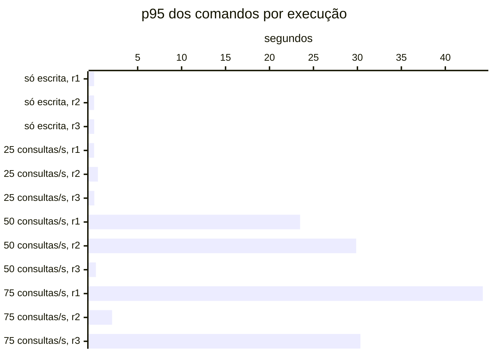
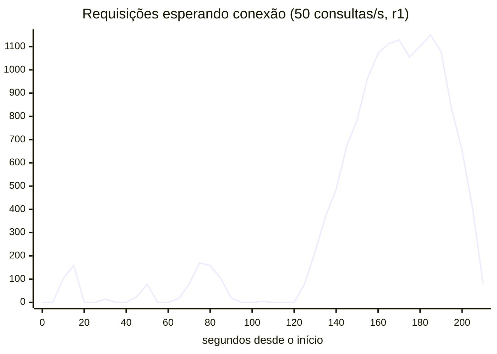
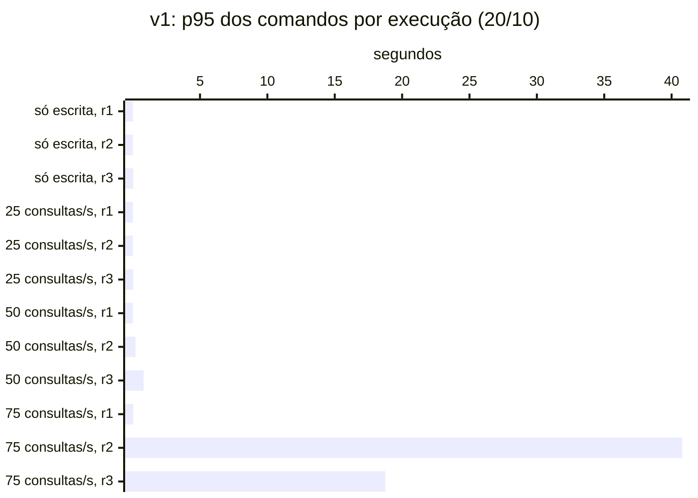
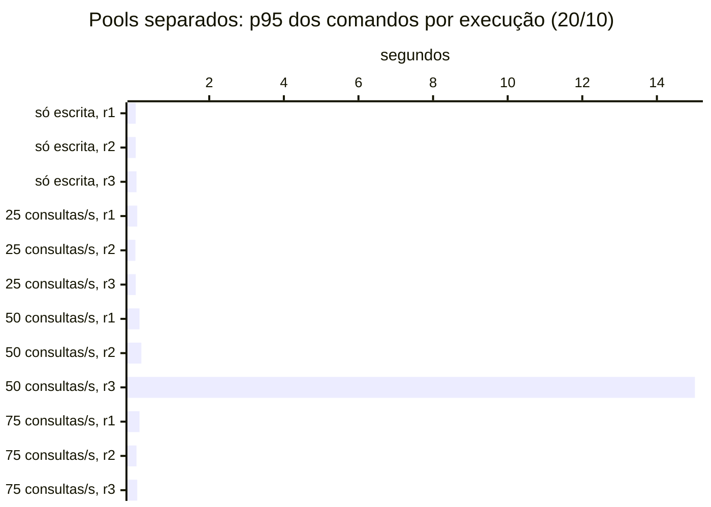
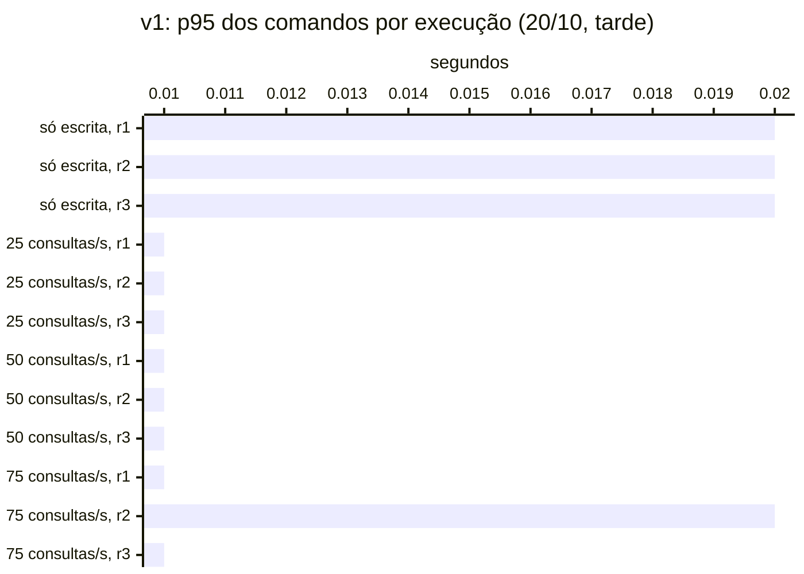
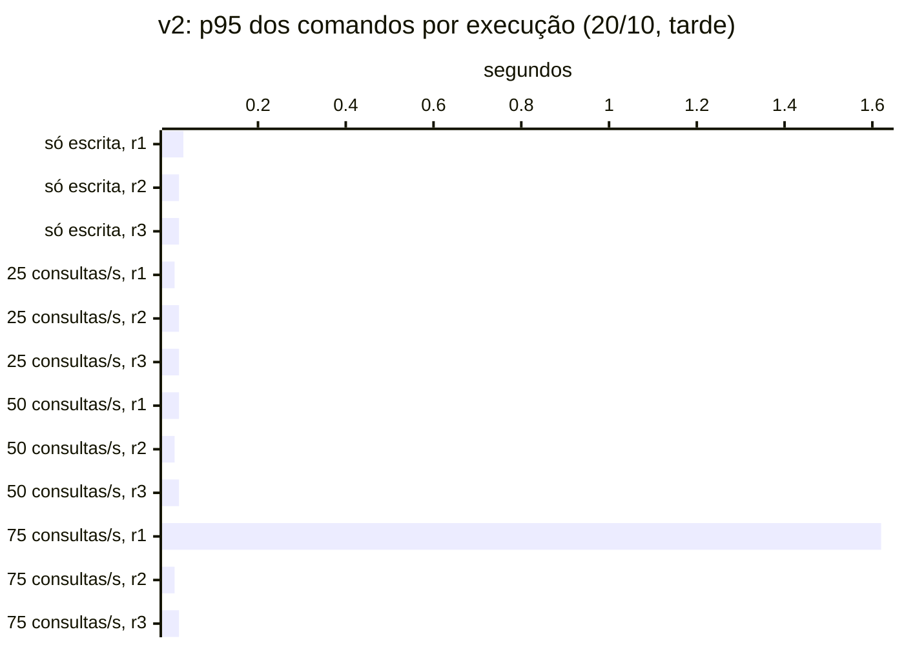

# spring-cqrs

Ledger financeiro que começa com um modelo único (leitura e escrita no mesmo Postgres) e evolui para
CQRS, medindo a cada fase o que melhora e o que custa.

> **Status:** M3 — a v2 (CQRS lógico) deixou as consultas de 3 a 8 vezes menos dependentes do disco, a +40% de custo
> por comando no banco; nesta rodada, nem a v1 colapsou ([resultados](docs/benchmarks/2026-10-20-v2/README.md)). Antes:
> no M2, a leitura derruba a escrita na v1 ([resultados](docs/benchmarks/2026-10-19-v1/README.md)); na #11, separar os
> pools não protege a escrita ([resultados](docs/benchmarks/2026-10-20-v1-split/README.md)).
> Escopo, hipóteses e marcos em [docs/SCOPE.md](docs/SCOPE.md); contrato e dataset no
> [ADR-0008](docs/adr/0008-contrato-v1-e-dataset.md).

## A história

Esta é a história de como um problema comum de um modelo único leva ao CQRS: uma aplicação tradicional, com
a baseline bem ajustada, que falha sob carga mista, e a evolução em fases até leitura e escrita com modelos
próprios. Cada passo é justificado por medição, e a alternativa mais barata é medida antes da mais cara, para
que o ganho do CQRS seja atribuível a ele.

Cada capítulo é um marco: a pergunta, a medição que a responde, a decisão que ela motivou e o que custou.
Os números vêm de `make bench`, os gráficos são gerados pelo `bench/Report.java` a partir dos dados
versionados, e cada capítulo aponta para os dados brutos. Resultados desfavoráveis ao CQRS entram também.

### 1. O problema: a leitura derruba a escrita (v1, M2)

**Pergunta.** Num ledger com modelo único (comandos e consultas na mesma aplicação, no mesmo Postgres,
dividindo um pool de 10 conexões), a carga de leitura degrada a escrita? (H1)

**Antes de medir, uma baseline justa.** Culpar a arquitetura por um índice ruim invalidaria a comparação. A
revisão da baseline ([ADR-0009](docs/adr/0009-revisao-da-baseline-e-parametros-do-benchmark.md)) corrigiu a
estatística de `account_id`, trocou os índices de busca por índices compostos com a conta e dimensionou o
Postgres para o container: a busca textual (Q4) numa conta empresarial caiu de 3,7 s para 0,2–0,5 s a frio. O
que sobrou é do modelo: 20 milhões de lançamentos (7,2 GB), os de cada conta espalhados pela tabela, para um
cache de até 2 GB.

**Evidência.** Escrita constante a 20 comandos/s; leitura a 0 (`s1`), 25, 50 e 75 consultas/s (`s3-rNNN`);
três repetições de 3 minutos cada.

<!-- java bench/Report.java summarize docs/benchmarks/2026-10-19-v1 -->


Sem leitura, o p95 dos comandos fica em 35–53 ms. Com 25 consultas/s, sobe até 483 ms, sem colapsar. Com 50
ou mais, o sistema colapsou em 6 de 9 execuções (contando as só de leitura): p95 de 21 a 44 s e até 23% de
requisições com falha.

**Mecanismo.** O comando não ficou mais lento dentro do banco; ele esperou na fila por uma conexão.

| Execução com 50 consultas/s (r1) | |
|---|---:|
| Comando dentro do Postgres | 8 ms |
| Espera média por uma conexão do pool | 6,4 s |
| p95 do comando no cliente | 23,5 s |

<!-- java bench/Report.java chart docs/benchmarks/2026-10-19-v1/runs/s3-r050/r1/timeseries.csv hikari_pending "..." -->


As consultas limitadas por I/O seguram as 10 conexões. Quando uma fila se forma, as dez passam a rodar
consultas ao mesmo tempo, cada uma fica mais lenta, e a fila se realimenta até a carga acabar: no gráfico, ela
oscila e se desfaz até ~125 s; dali em diante cresce sem parar, passa de mil requisições e só esvazia quando o
teste termina. A busca textual (Q4)
responde por 58–81% do tempo de leitura no banco.

**O que mudou no entendimento.** H1 se confirma, mas não como foi escrita: o canal é o pool de conexões, não
a disputa dentro do Postgres; a leitura que pesa é o Q4, não Q2/Q3; e a degradação não é gradual, é um colapso
tudo ou nada.

**Decisão.** Não ir direto para o CQRS. Se o problema é a fila num pool compartilhado, a correção mais barata
é separar os pools, e ela precisa ser medida antes: sem isso, o ganho da v2 e da v3 não é atribuível ao CQRS
(capítulo 2).

**Limites.** Dataset sintético e carga gerada; uma máquina (macOS com Docker Desktop); três repetições só
permitem dizer que o colapso é frequente a partir de 50 consultas/s e raro a 25/s.

Dados: [análise completa](docs/benchmarks/2026-10-19-v1/README.md) · [estado por execução](docs/benchmarks/2026-10-19-v1/summary.md) ·
[planos de execução](docs/benchmarks/2026-10-19-v1/explain.md) · tag [`m2`](https://github.com/guipalm4/spring-cqrs/tree/m2)

### 2. A correção barata: separar os pools (controle, [#11](https://github.com/guipalm4/spring-cqrs/issues/11))

**Pergunta.** Um pool só para comandos, com o mesmo total de conexões, elimina a degradação da escrita sem
mudar a arquitetura? Se sim, o argumento do CQRS para a escrita (H3) enfraquece, e o que sobra para ele é a
leitura.

**Antes de medir, a regra.** A variante liga por profile, sem mudar a v1: 2 conexões para comandos e 8 para
consultas, divisão fixada a partir do uso de conexão dos comandos no M2, e o que contaria como "basta" e "não basta"
escrito antes da medição ([ADR-0010](docs/adr/0010-controle-pools-separados.md)).

**Um tropeço no caminho.** Comparada à v1 do capítulo 1, a variante parecia resolver: 2 colapsos em 9 contra 6.
Mas o S1, que só tem escrita e não depende dos pools, também ficou ~40% mais rápido, com o mesmo ambiente declarado.
A v1 foi medida de novo no mesmo dia e colapsou em 3 de 9. A diferença era do dia, não dos pools. Desde então,
fases só se comparam com a v1 medida no mesmo dia.

**Evidência.** Mesmo protocolo do capítulo 1, as duas no mesmo dia, cada uma com o dataset recarregado.

<!-- java bench/Report.java summarize docs/benchmarks/2026-10-20-v1 -->


<!-- java bench/Report.java summarize docs/benchmarks/2026-10-20-v1-split -->


Com leitura a 50/s ou mais, a v1 colapsou em 3 de 9 execuções e a variante em 2 de 9, o que não é diferença com três
repetições. No colapso, os comandos caem junto mesmo com pool próprio: p95 de 15 s e 23% de falhas. Fora dele, as
faixas de p95 se sobrepõem.

**Mecanismo.** O pool de comandos fica livre até a JVM parar. No colapso, milhares de consultas esperando enchem o
heap, e o GC passa a pausar a aplicação inteira:

| Execução | Comando no banco | Comando segurando a conexão | JVM parada em GC (de 180 s) |
|---|---:|---:|---:|
| Pools separados, colapso (50 consultas/s, r3) | 13 ms | 110 ms | 64 s |
| Pools separados, 13 execuções estáveis | 2–5 ms | 5–16 ms | ≤ 2,4 s |

A pausa para também os comandos que já têm conexão. Com 110 ms por comando, 20 comandos/s ocupam 2,2 conexões, mais
que as 2 do pool, e o pool de comandos faz fila também. Separar as conexões não separa o heap.

**O que mudou no entendimento.** O capítulo 1 disse que o canal era o pool. É onde as requisições esperam, mas o
colapso se sustenta pela JVM compartilhada: a fila enche o heap, e o GC atrasa todo mundo.

**Decisão.** A v1 continua com o pool compartilhado (o controle não mudou o resultado), e H3 segue em aberto com um
alvo mais preciso: o que a v3 tem e esta variante não tem é um processo próprio para a escrita. Falta uma correção
barata que ataca o heap: contrapressão (recusar consultas em excesso em vez de enfileirá-las). Sem medi-la, parte do
ganho da v3 pode não ser do CQRS.

**Limites.** Três repetições só mostram diferenças grandes na frequência de colapso; a variação entre dias é do
tamanho do efeito procurado; a divisão 2 + 8 foi dimensionada para o uso normal da conexão, e com o GC o pool de
comandos saturou (uma terceira conexão não evitaria 64 s de pausa). As séries do controle foram exportadas de novo
depois do resultado para incluir o GC.

Dados: [análise completa](docs/benchmarks/2026-10-20-v1-split/README.md) ·
[estado por execução, pools separados](docs/benchmarks/2026-10-20-v1-split/summary.md) ·
[v1 no mesmo dia](docs/benchmarks/2026-10-20-v1/README.md)

### 3. Separar o modelo: CQRS lógico (v2, M3)

**Pergunta.** Projeções no mesmo Postgres, atualizadas na transação do comando, dão às consultas de uma conta a
localidade que o ledger não tem? Quanto isso custa na escrita? (H2, H4)

**Antes de medir, a forma e a regra.** Uma projeção com uma linha por lançamento teria a mesma dispersão da
`ledger_entry`. A v2 guarda um bloco por conta e mês, com os lançamentos já no formato do extrato num `jsonb`, as
palavras do bloco num `tsvector` e os totais mensais numa tabela à parte. É o documento que o MongoDB vai guardar na
v3. A `ledger_entry` perdeu os índices que só serviam à leitura, e um teste confere que a v2 responde exatamente
como o SQL da v1 sobre o mesmo ledger. A forma e o que contaria como confirmação foram escritos antes da medição
([ADR-0011](docs/adr/0011-v2-projecoes-e-escopo-congelado.md)).

**Evidência.** Mesmo protocolo dos capítulos anteriores, v1 e v2 no mesmo dia, cada uma com o dataset recarregado.

<!-- java bench/Report.java summarize docs/benchmarks/2026-10-20-v1-m3 -->


<!-- java bench/Report.java summarize docs/benchmarks/2026-10-20-v2 -->


Nenhuma das duas colapsou. A v1 desta tarde é a mesma que colapsou em 6 de 9 no dia 19 e em 3 de 9 hoje de manhã.
O que mudou entre as três foi o tempo para ler uma página fora do cache do Postgres:

| v1 | Colapsos com leitura ≥ 50/s | Tempo por página lida fora do cache |
|---|---:|---:|
| 19/10 | 6 de 9 | 1,8–4,1 ms |
| 20/10, manhã | 3 de 9 | 0,31–2,2 ms |
| 20/10, tarde | 0 de 9 | 0,17–0,21 ms |

Sem uma v1 que colapse para comparar, o que dá para afirmar está no custo de cada consulta:

| No banco, por chamada, 25 consultas/s | v1 | v2 |
|---|---:|---:|
| Q3: tempo / páginas tocadas | 6,0 ms / 4.558 | 1,6 ms / 199 |
| Q2 + Q4: tempo / páginas tocadas | 14,5 ms / 369 | 11,2 ms / 104 |
| Q2 + Q4: páginas lidas fora do cache | 58,7 | 16,9 |

| p95 no cliente | v1 | v2 |
|---|---:|---:|
| Q3 empresa, 25 consultas/s | 25 ms | 11 ms |
| Q2 empresa, 25 consultas/s | 25 ms | 23 ms |
| Q4 empresa, 25 consultas/s | 85 ms | 68 ms |
| Q4 empresa, 75 consultas/s | 134 ms | 60 ms |
| Q1 (as duas contas), 25 consultas/s | 6 ms | 7–8 ms |
| Comandos, só escrita | 22 ms | 23 ms |

**H2 confirmada:** o Q3 empresarial caiu mais da metade (−56%) e o Q2 bem menos (−8%). O maior ganho em tempo, porém,
ficou fora do H2, no Q4. **H4 confirmada no que afirma:** o Q1 não melhorou. Ele ficou 1–2 ms acima da faixa da v1, o
que o critério combinado não previa, com o mesmo custo no banco.

**O custo.** No benchmark, cada comando gasta ~0,7 ms a mais no Postgres (+40%): o lançamento ficou mais barato sem os
índices de leitura, mas as duas projeções somam 1,5 ms. No cliente, a diferença some no ruído. Esse número é otimista:
os comandos do benchmark caem num mês cujos blocos começam vazios. Num bloco cheio, um lançamento custa 2,9 ms e
grava 104 KB no WAL, porque o mês é reescrito inteiro. A v2 também ocupa 8,9 GB contra 7,2 GB e leva o dobro do tempo
no seed.

**O que mudou no entendimento.** O colapso do M2 é real, mas depende de leituras lentas: com o disco rápido, nem a v1
cai. A v2 ataca exatamente esse ponto, porque cada consulta precisa de 3 a 8 vezes menos páginas fora do cache. Que
isso a proteja quando o disco fica lento é inferência: hoje não houve disco lento para testar.

**Decisão.** A v2 fica como está e vira a segunda referência do M4. Não entra nenhum controle novo
(ADR-0011): a latência do disco passa a acompanhar cada comparação, ao lado da contagem de colapsos. O argumento da v3
fica mais estreito. Ela precisa mostrar o que um processo próprio para a escrita dá além de leituras mais baratas,
e a comparação com a v2 do mesmo dia é que vai dizer isso.

**Limites.** A v1 de referência não colapsou, então "separar o modelo evita o colapso" ficou sem resposta. A latência do
disco, que decide o colapso, não é controlada pelo benchmark. Os blocos vazios subestimam a escrita, e a sonda a mede à
parte. Na v2, uma execução teve 15 s de lentidão no banco, que se resolveu sozinha e cuja causa não foi identificada.
No `pg_stat_statements`, Q2 e Q4 da v2 aparecem somados. São três repetições por cenário.

Dados: [análise completa](docs/benchmarks/2026-10-20-v2/README.md) ·
[estado por execução, v2](docs/benchmarks/2026-10-20-v2/summary.md) ·
[v1 no mesmo dia](docs/benchmarks/2026-10-20-v1-m3/README.md) · [planos e sonda de escrita](docs/benchmarks/2026-10-20-v2/explain.md)

### 4. Separar o armazenamento: CQRS físico (v3, M4)

**Pergunta.** Com escrita e leitura em stores e processos separados, sincronizados por outbox e Kafka, a
interferência desaparece? Qual o preço em atraso de projeção, recursos e operação? Escalar só a leitura
funciona? (H3, H5, H7) *A medir.*

### 5. Um modelo de escrita, vários de leitura: OpenSearch (M5)

**Pergunta.** Uma projeção dedicada à busca supera Postgres e Mongo no Q4, a consulta que dominou o
problema da v1? (H6) *A medir.*

### 6. Balanço: quando não usar CQRS (M6)

**Pergunta.** Somando ganhos e custos medidos, em que condições cada fase compensa, e em quais a v1 com
ajustes bastava? *A escrever.*

## Fases

| Fase | O que muda | Módulo |
|---|---|---|
| v1 — Baseline | — | `app-baseline` |
| v2 — CQRS lógico | Modelos separados, mesmo Postgres | `app-cqrs` |
| v3 — CQRS físico | Stores de leitura separados, sincronização assíncrona | `app-cqrs` + projetores |

## Stack

Java 25 · Spring Boot 4.1 · PostgreSQL 18 · MongoDB · OpenSearch · Kafka · Spring Modulith ·
Testcontainers · Gatling · Prometheus · Grafana. Decisões em [docs/adr](docs/adr).

## Rodando

Pré-requisitos: JDK 25 e um runtime Docker com Compose v2.

```bash
make verify          # build + testes (sobe Postgres via Testcontainers)
make up PHASE=v1     # Postgres, app-baseline, Prometheus, Grafana
make smoke           # confere a saúde da aplicação
make seed SCALE=0.01 # APAGA e carrega um dataset (1 = referência: 100 mil contas, ~20 mi lançamentos)
make bench PHASE=v1  # benchmark da fase no ar (~1 h com SCALE=1); resultados em docs/benchmarks/
make down
```

| Serviço | Endereço |
|---|---|
| Aplicação | http://localhost:8080/actuator/health |
| Swagger UI | http://localhost:8080/swagger-ui.html |
| Contrato OpenAPI | http://localhost:8080/v3/api-docs ([versionado](docs/api/openapi.json)) |
| Collection Postman | [docs/api/ledger.postman_collection.json](docs/api/ledger.postman_collection.json) |
| Prometheus | http://localhost:9090 |
| Grafana | http://localhost:3000/d/ledger (aplicação e Postgres) |

## Benchmark

`make bench` roda a mesma simulação Gatling contra a fase no ar: só escrita (S1), escrita constante com
leitura crescente (S3) e só leitura (S2), com aquecimento descartado e três repetições intercaladas.
Metodologia no [ADR-0005](docs/adr/0005-metodologia-de-benchmark.md), parâmetros e revisão da baseline no
[ADR-0009](docs/adr/0009-revisao-da-baseline-e-parametros-do-benchmark.md), resultados em
[docs/benchmarks](docs/benchmarks).
