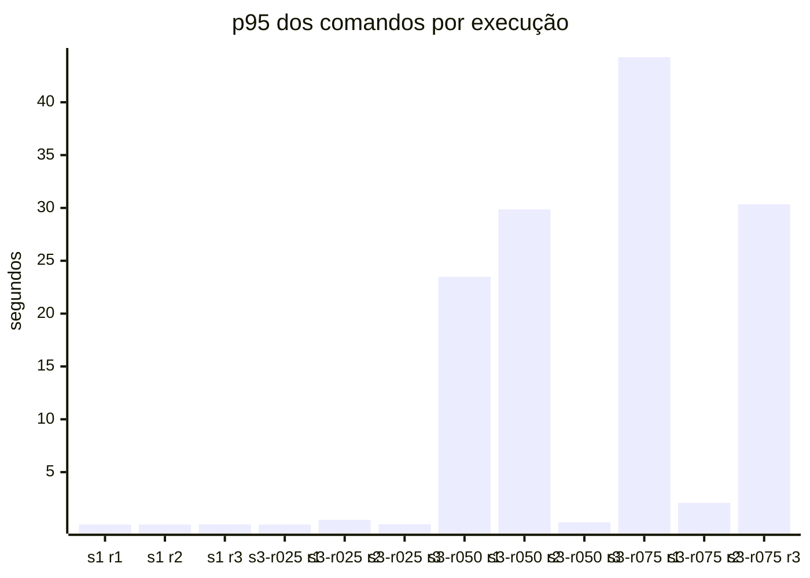
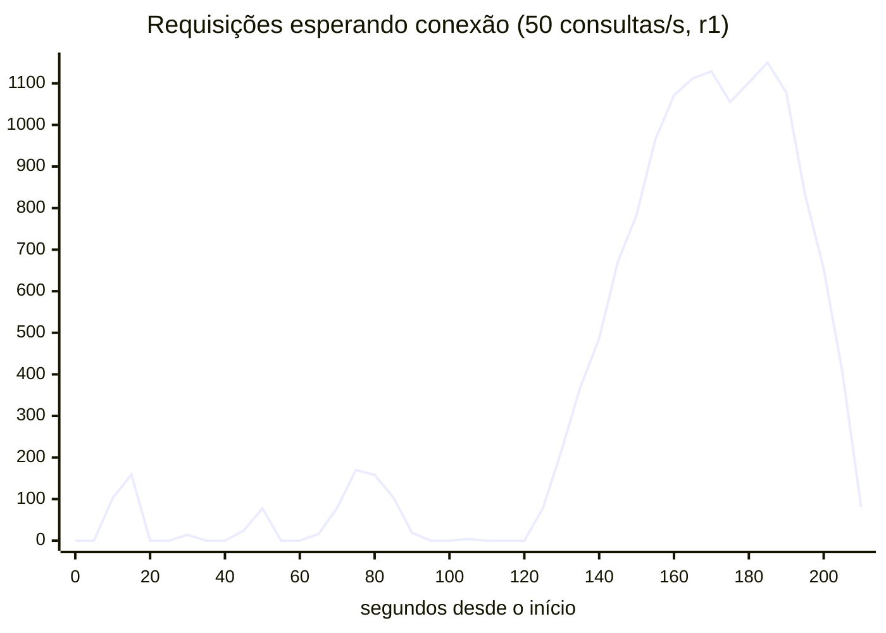

# spring-cqrs

Ledger financeiro que começa com um modelo único (leitura e escrita no mesmo Postgres) e evolui para
CQRS, medindo a cada fase o que melhora e o que custa.

> **Status:** M2 — evidência do problema: benchmark reproduzível (`make bench`) e H1 confirmada na v1 — a
> leitura degrada a escrita pela fila no pool compartilhado; com 50 consultas/s ou mais, o sistema
> colapsou em 6 de 9 execuções ([resultados](docs/benchmarks/2026-10-19-v1/README.md)).
> Escopo, hipóteses e marcos em [docs/SCOPE.md](docs/SCOPE.md); contrato e dataset no
> [ADR-0008](docs/adr/0008-contrato-v1-e-dataset.md).

## A história

Esta é a história de como um problema comum de um modelo único leva ao CQRS: uma aplicação tradicional, com
a baseline bem ajustada, que falha sob carga mista, e a evolução em fases até leitura e escrita com modelos
próprios. Cada passo é justificado por medição, e a alternativa mais barata é medida antes da mais cara, para
que o ganho do CQRS seja atribuível a ele.

Cada capítulo é um marco: a pergunta, a medição que a responde, a decisão que ela motivou e o que custou.
Os números vêm de `make bench`, os gráficos são gerados pelo `bench/Report.java` a partir dos dados
versionados, e cada capítulo aponta para os dados brutos. Resultados desfavoráveis ao CQRS entram também.

### 1. O problema: a leitura derruba a escrita (v1, M2)

**Pergunta.** Num ledger com modelo único (comandos e consultas na mesma aplicação, no mesmo Postgres,
dividindo um pool de 10 conexões), a carga de leitura degrada a escrita? (H1)

**Antes de medir, uma baseline justa.** Culpar a arquitetura por um índice ruim invalidaria a comparação. A
revisão da baseline ([ADR-0009](docs/adr/0009-revisao-da-baseline-e-parametros-do-benchmark.md)) corrigiu a
estatística de `account_id`, trocou os índices de busca por índices compostos com a conta e dimensionou o
Postgres para o container: a busca textual (Q4) numa conta empresarial caiu de 3,7 s para 0,2–0,5 s a frio. O
que sobrou é do modelo: 20 milhões de lançamentos (7,2 GB), os de cada conta espalhados pela tabela, para um
cache de até 2 GB.

**Evidência.** Escrita constante a 20 comandos/s; leitura a 0 (`s1`), 25, 50 e 75 consultas/s (`s3-rNNN`);
três repetições de 3 minutos cada.

<!-- java bench/Report.java summarize docs/benchmarks/2026-10-19-v1 -->


Sem leitura, o p95 dos comandos fica em 35–53 ms. Com 25 consultas/s, sobe até 483 ms, sem colapsar. Com 50
ou mais, o sistema colapsou em 6 de 9 execuções (contando as só de leitura): p95 de 21 a 44 s e até 23% de
requisições com falha.

**Mecanismo.** O comando não ficou mais lento dentro do banco; ele esperou na fila por uma conexão.

| Execução com 50 consultas/s (r1) | |
|---|---:|
| Comando dentro do Postgres | 8 ms |
| Espera média por uma conexão do pool | 6,4 s |
| p95 do comando no cliente | 23,5 s |

<!-- java bench/Report.java chart docs/benchmarks/2026-10-19-v1/runs/s3-r050/r1/timeseries.csv hikari_pending "..." -->


As consultas limitadas por I/O seguram as 10 conexões. Quando uma fila se forma, as dez passam a rodar
consultas ao mesmo tempo, cada uma fica mais lenta, e a fila se realimenta até a carga acabar: no gráfico, ela
oscila e se desfaz até ~125 s; dali em diante cresce sem parar, passa de mil requisições e só esvazia quando o
teste termina. A busca textual (Q4)
responde por 58–81% do tempo de leitura no banco.

**O que mudou no entendimento.** H1 se confirma, mas não como foi escrita: o canal é o pool de conexões, não
a disputa dentro do Postgres; a leitura que pesa é o Q4, não Q2/Q3; e a degradação não é gradual, é um colapso
tudo ou nada.

**Decisão.** Não ir direto para o CQRS. Se o problema é a fila num pool compartilhado, a correção mais barata
é separar os pools, e ela precisa ser medida antes: sem isso, o ganho da v2 e da v3 não é atribuível ao CQRS
(capítulo 2).

**Limites.** Dataset sintético e carga gerada; uma máquina (macOS com Docker Desktop); três repetições só
permitem dizer que o colapso é frequente a partir de 50 consultas/s e raro a 25/s.

Dados: [análise completa](docs/benchmarks/2026-10-19-v1/README.md) · [estado por execução](docs/benchmarks/2026-10-19-v1/summary.md) ·
[planos de execução](docs/benchmarks/2026-10-19-v1/explain.md) · tag [`m2`](https://github.com/guipalm4/spring-cqrs/tree/m2)

### 2. A correção barata: separar os pools (controle, [#11](https://github.com/guipalm4/spring-cqrs/issues/11))

**Pergunta.** Um pool só para comandos, com o mesmo total de conexões, elimina a degradação da escrita sem
mudar a arquitetura? Se sim, o argumento do CQRS para a escrita (H3) enfraquece, e o que sobra para ele é a
leitura. *A medir.*

### 3. Separar o modelo: CQRS lógico (v2, M3)

**Pergunta.** Projeções no mesmo Postgres, atualizadas na transação do comando, dão às consultas de uma
conta a localidade que o ledger não tem? Quanto isso custa na escrita? (H2, H4) *A medir.*

### 4. Separar o armazenamento: CQRS físico (v3, M4)

**Pergunta.** Com escrita e leitura em stores e processos separados, sincronizados por outbox e Kafka, a
interferência desaparece? Qual o preço em atraso de projeção, recursos e operação? Escalar só a leitura
funciona? (H3, H5, H7) *A medir.*

### 5. Um modelo de escrita, vários de leitura: OpenSearch (M5)

**Pergunta.** Uma projeção dedicada à busca supera Postgres e Mongo no Q4, a consulta que dominou o
problema da v1? (H6) *A medir.*

### 6. Balanço: quando não usar CQRS (M6)

**Pergunta.** Somando ganhos e custos medidos, em que condições cada fase compensa, e em quais a v1 com
ajustes bastava? *A escrever.*

## Fases

| Fase | O que muda | Módulo |
|---|---|---|
| v1 — Baseline | — | `app-baseline` |
| v2 — CQRS lógico | Modelos separados, mesmo Postgres | `app-cqrs` |
| v3 — CQRS físico | Stores de leitura separados, sincronização assíncrona | `app-cqrs` + projetores |

## Stack

Java 25 · Spring Boot 4.1 · PostgreSQL 18 · MongoDB · OpenSearch · Kafka · Spring Modulith ·
Testcontainers · Gatling · Prometheus · Grafana. Decisões em [docs/adr](docs/adr).

## Rodando

Pré-requisitos: JDK 25 e um runtime Docker com Compose v2.

```bash
make verify          # build + testes (sobe Postgres via Testcontainers)
make up PHASE=v1     # Postgres, app-baseline, Prometheus, Grafana
make smoke           # confere a saúde da aplicação
make seed SCALE=0.01 # APAGA e carrega um dataset (1 = referência: 100 mil contas, ~20 mi lançamentos)
make bench PHASE=v1  # benchmark da fase no ar (~1 h com SCALE=1); resultados em docs/benchmarks/
make down
```

| Serviço | Endereço |
|---|---|
| Aplicação | http://localhost:8080/actuator/health |
| Swagger UI | http://localhost:8080/swagger-ui.html |
| Contrato OpenAPI | http://localhost:8080/v3/api-docs ([versionado](docs/api/openapi.json)) |
| Collection Postman | [docs/api/ledger.postman_collection.json](docs/api/ledger.postman_collection.json) |
| Prometheus | http://localhost:9090 |
| Grafana | http://localhost:3000/d/ledger (aplicação e Postgres) |

## Benchmark

`make bench` roda a mesma simulação Gatling contra a fase no ar: só escrita (S1), escrita constante com
leitura crescente (S3) e só leitura (S2), com aquecimento descartado e três repetições intercaladas.
Metodologia no [ADR-0005](docs/adr/0005-metodologia-de-benchmark.md), parâmetros e revisão da baseline no
[ADR-0009](docs/adr/0009-revisao-da-baseline-e-parametros-do-benchmark.md), resultados em
[docs/benchmarks](docs/benchmarks).
