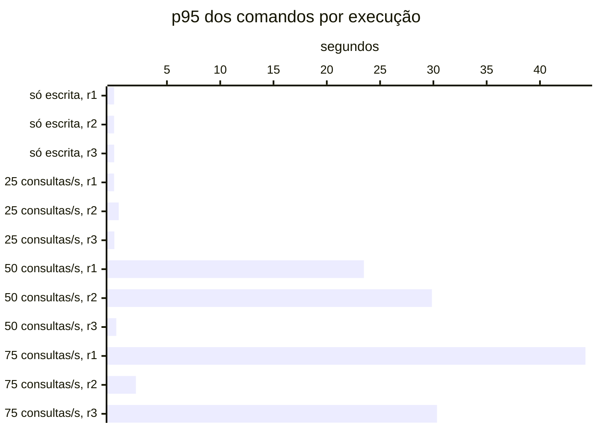

# Resumo

Gerado por `java bench/Report.java summarize`. Mediana das repetições; entre colchetes, a faixa do p95
(mín–máx). Latências em ms, vazão em requisições/s. Parâmetros de cada cenário em
`runs/<cenário>/scenario.properties`; série temporal de cada execução (5 s) em
`runs/<cenário>/r<n>/timeseries.csv`.

## s1 (3 execuções)

`writeRate=20` · `readRate=0` · `duration=180`

| Requisição | Vazão | % KO | p50 | p95 | p99 |
|---|---:|---:|---:|---:|---:|
| Global | 20.0 | 0.0 | 10 | 44 [35–53] | 288 |
| comandos | 20.0 | 0.0 | 10 | 44 [35–53] | 288 |
| comandos / deposit empresa | 3.0 | 0.0 | 9 | 51 [31–56] | 344 |
| comandos / deposit pessoa | 3.1 | 0.0 | 9 | 36 [35–60] | 210 |
| comandos / transfer empresa | 1.5 | 0.0 | 13 | 53 [36–85] | 495 |
| comandos / transfer pessoa | 1.5 | 0.0 | 14 | 56 [53–74] | 272 |
| comandos / withdraw empresa | 5.6 | 0.0 | 8 | 39 [32–41] | 149 |
| comandos / withdraw pessoa | 5.2 | 0.0 | 9 | 34 [34–54] | 325 |

## s2 (3 execuções)

`writeRate=0` · `readRate=75` · `duration=180`

| Requisição | Vazão | % KO | p50 | p95 | p99 |
|---|---:|---:|---:|---:|---:|
| Global | 70.7 | 0.5 | 1,348 | 21,749 [2,688–33,115] | 26,160 |
| consultas | 70.7 | 0.5 | 1,348 | 21,749 [2,688–33,115] | 26,160 |
| consultas / Q1 empresa | 8.6 | 0.6 | 1,365 | 21,648 [2,578–32,172] | 22,507 |
| consultas / Q1 pessoa | 9.1 | 0.7 | 1,231 | 21,703 [2,548–32,298] | 24,915 |
| consultas / Q2 empresa | 8.9 | 0.5 | 1,296 | 21,778 [2,687–32,679] | 25,229 |
| consultas / Q2 pessoa | 8.9 | 0.3 | 1,029 | 21,582 [2,578–32,481] | 22,085 |
| consultas / Q3 empresa | 8.9 | 0.6 | 1,155 | 21,687 [2,628–32,984] | 27,203 |
| consultas / Q3 pessoa | 8.8 | 0.6 | 1,197 | 21,671 [2,524–32,265] | 24,302 |
| consultas / Q4 empresa | 8.8 | 0.3 | 2,156 | 22,486 [3,468–35,963] | 26,393 |
| consultas / Q4 pessoa | 8.7 | 0.4 | 1,229 | 21,844 [2,599–35,603] | 30,312 |

## s3-r025 (3 execuções)

`writeRate=20` · `readRate=25` · `duration=180`

| Requisição | Vazão | % KO | p50 | p95 | p99 |
|---|---:|---:|---:|---:|---:|
| Global | 44.8 | 0.0 | 8 | 164 [116–615] | 897 |
| comandos | 19.9 | 0.0 | 7 | 66 [42–483] | 700 |
| consultas | 24.9 | 0.0 | 13 | 215 [158–718] | 1,025 |
| comandos / deposit empresa | 3.0 | 0.0 | 6 | 54 [31–491] | 442 |
| comandos / deposit pessoa | 3.1 | 0.0 | 7 | 52 [42–604] | 264 |
| comandos / transfer empresa | 1.5 | 0.0 | 9 | 106 [40–658] | 876 |
| comandos / transfer pessoa | 1.5 | 0.0 | 8 | 67 [58–280] | 828 |
| comandos / withdraw empresa | 5.4 | 0.0 | 6 | 58 [35–457] | 747 |
| comandos / withdraw pessoa | 5.4 | 0.0 | 7 | 93 [54–284] | 878 |
| consultas / Q1 empresa | 3.2 | 0.0 | 2 | 50 [8–427] | 901 |
| consultas / Q1 pessoa | 3.2 | 0.0 | 2 | 19 [9–524] | 433 |
| consultas / Q2 empresa | 3.1 | 0.0 | 32 | 428 [211–680] | 1,185 |
| consultas / Q2 pessoa | 3.0 | 0.0 | 12 | 209 [73–632] | 990 |
| consultas / Q3 empresa | 3.1 | 0.0 | 21 | 145 [74–406] | 584 |
| consultas / Q3 pessoa | 3.3 | 0.0 | 4 | 27 [26–432] | 338 |
| consultas / Q4 empresa | 3.1 | 0.0 | 79 | 561 [517–2,550] | 1,748 |
| consultas / Q4 pessoa | 2.9 | 0.0 | 10 | 131 [128–578] | 1,032 |

## s3-r050 (3 execuções)

`writeRate=20` · `readRate=50` · `duration=180`

| Requisição | Vazão | % KO | p50 | p95 | p99 |
|---|---:|---:|---:|---:|---:|
| Global | 67.7 | 1.2 | 968 | 23,607 [417–29,963] | 30,014 |
| comandos | 19.4 | 1.2 | 821 | 23,476 [254–29,859] | 30,010 |
| consultas | 48.4 | 1.2 | 1,035 | 23,652 [461–29,980] | 30,018 |
| comandos / deposit empresa | 2.9 | 0.9 | 785 | 21,483 [182–29,817] | 30,010 |
| comandos / deposit pessoa | 2.8 | 0.9 | 987 | 23,699 [425–29,924] | 29,107 |
| comandos / transfer empresa | 1.5 | 1.1 | 1,633 | 23,636 [530–30,009] | 29,712 |
| comandos / transfer pessoa | 1.4 | 2.0 | 1,177 | 22,178 [134–30,004] | 30,013 |
| comandos / withdraw empresa | 5.4 | 1.7 | 550 | 23,438 [262–29,963] | 30,013 |
| comandos / withdraw pessoa | 5.3 | 0.7 | 665 | 23,490 [211–29,328] | 27,037 |
| consultas / Q1 empresa | 6.2 | 1.2 | 847 | 23,552 [209–29,836] | 30,005 |
| consultas / Q1 pessoa | 5.9 | 1.5 | 576 | 23,517 [239–29,754] | 30,011 |
| consultas / Q2 empresa | 6.0 | 0.9 | 983 | 23,443 [409–30,009] | 29,668 |
| consultas / Q2 pessoa | 5.8 | 0.5 | 784 | 23,538 [406–29,629] | 28,131 |
| consultas / Q3 empresa | 6.2 | 1.6 | 861 | 23,558 [248–29,916] | 30,011 |
| consultas / Q3 pessoa | 6.2 | 1.1 | 652 | 23,494 [183–29,949] | 30,010 |
| consultas / Q4 empresa | 6.1 | 1.4 | 2,165 | 25,262 [1,206–30,397] | 32,645 |
| consultas / Q4 pessoa | 5.9 | 1.1 | 915 | 23,752 [463–29,997] | 32,544 |

## s3-r075 (3 execuções)

`writeRate=20` · `readRate=75` · `duration=180`

| Requisição | Vazão | % KO | p50 | p95 | p99 |
|---|---:|---:|---:|---:|---:|
| Global | 79.2 | 11.9 | 64 | 30,335 [2,155–44,481] | 35,053 |
| comandos | 16.7 | 12.0 | 26 | 30,335 [2,090–44,268] | 34,766 |
| consultas | 62.5 | 11.9 | 76 | 30,377 [2,177–44,467] | 35,047 |
| comandos / deposit empresa | 2.4 | 8.7 | 28 | 30,091 [2,068–44,874] | 35,143 |
| comandos / deposit pessoa | 2.5 | 13.2 | 21 | 30,652 [2,157–45,167] | 34,447 |
| comandos / transfer empresa | 1.3 | 15.6 | 35 | 30,343 [2,111–45,063] | 38,950 |
| comandos / transfer pessoa | 1.3 | 13.2 | 30 | 30,280 [2,118–46,102] | 35,554 |
| comandos / withdraw empresa | 4.9 | 10.8 | 28 | 30,189 [2,062–43,825] | 33,519 |
| comandos / withdraw pessoa | 4.7 | 13.0 | 23 | 30,362 [2,104–43,395] | 35,121 |
| consultas / Q1 empresa | 7.7 | 13.3 | 8 | 30,817 [2,048–45,225] | 35,975 |
| consultas / Q1 pessoa | 7.8 | 11.2 | 10 | 30,187 [2,092–42,735] | 34,459 |
| consultas / Q2 empresa | 7.7 | 12.5 | 105 | 30,570 [2,146–44,138] | 34,557 |
| consultas / Q2 pessoa | 8.1 | 11.9 | 60 | 30,261 [2,093–44,619] | 34,313 |
| consultas / Q3 empresa | 7.7 | 11.0 | 42 | 30,268 [2,094–45,173] | 34,256 |
| consultas / Q3 pessoa | 7.9 | 11.3 | 15 | 30,101 [2,062–44,526] | 34,312 |
| consultas / Q4 empresa | 8.1 | 12.1 | 426 | 32,113 [2,772–44,878] | 36,971 |
| consultas / Q4 pessoa | 7.6 | 11.7 | 54 | 30,274 [2,187–45,809] | 35,485 |

## Estado por execução

Colapso: p95 global acima de 5,000 ms (ADR-0009). Leia a contagem, não a mediana: perto da saturação as
repetições caem em estados diferentes.

| Cenário | Colapsou |
|---|---|
| s1 | 0 de 3 |
| s2 | 2 de 3 (r1, r2) |
| s3-r025 | 0 de 3 |
| s3-r050 | 2 de 3 (r1, r2) |
| s3-r075 | 2 de 3 (r1, r3) |

p95 global e comandos em ms, no cliente (Gatling). Espera e uso da conexão do Hikari em ms, média da
execução. Comando no banco: soma do tempo médio das instruções de escrita e do `SELECT … FOR UPDATE` no
`pg_stat_statements`, em ms (o custo de um comando dentro do Postgres, sem a fila).

| Cenário | Rep. | Estado | p95 global | % KO | Comandos p50 | p95 | p99 | Espera no pool | Uso da conexão | Comando no banco |
|---|---|---|---:|---:|---:|---:|---:|---:|---:|---:|
| s1 | r1 | estável | 35 | 0.0 | 10 | 35 | 123 | 0.4 | 10.4 | 3.5 |
| s1 | r2 | estável | 44 | 0.0 | 9 | 44 | 297 | 1.7 | 13.4 | 5.9 |
| s1 | r3 | estável | 53 | 0.0 | 11 | 53 | 288 | 0.6 | 14.9 | 6.7 |
| s2 | r1 | **colapso** | 33,115 | 23.4 | — | — | — | 23,146.6 | 162.2 | — |
| s2 | r2 | **colapso** | 21,749 | 0.5 | — | — | — | 3,776.4 | 119.6 | — |
| s2 | r3 | estável | 2,688 | 0.0 | — | — | — | 525.6 | 62.8 | — |
| s3-r025 | r1 | estável | 116 | 0.0 | 7 | 42 | 240 | 1.8 | 21.8 | 2.9 |
| s3-r025 | r2 | estável | 615 | 0.0 | 8 | 483 | 1,259 | 51.6 | 40.2 | 4.2 |
| s3-r025 | r3 | estável | 164 | 0.0 | 7 | 66 | 700 | 12.4 | 24.8 | 3.4 |
| s3-r050 | r1 | **colapso** | 23,607 | 1.2 | 821 | 23,476 | 30,010 | 6,352.3 | 134.8 | 8.1 |
| s3-r050 | r2 | **colapso** | 29,963 | 6.8 | 5,223 | 29,859 | 30,494 | 9,432.1 | 147.3 | 7.8 |
| s3-r050 | r3 | estável | 417 | 0.0 | 8 | 254 | 819 | 33.2 | 37.1 | 4.3 |
| s3-r075 | r1 | **colapso** | 44,481 | 20.7 | 935 | 44,268 | 48,547 | 12,126.1 | 136.8 | 7.0 |
| s3-r075 | r2 | estável | 2,155 | 0.0 | 26 | 2,090 | 2,958 | 394.0 | 59.4 | 4.6 |
| s3-r075 | r3 | **colapso** | 30,335 | 11.9 | 9 | 30,335 | 34,766 | 6,903.1 | 83.9 | 5.1 |

## Pool e banco por cenário

Mediana das repetições. Espera = tempo médio para obter conexão do Hikari; uso = tempo médio com a
conexão (o trabalho no banco); hit ratio = blocos achados no shared_buffers.

| Cenário | Espera no pool (ms) | Uso da conexão (ms) | Fila máx. no pool | Hit ratio | CPU da app |
|---|---:|---:|---:|---:|---:|
| s1 | 0.6 | 13.4 | 0 | 70.6% | 5% |
| s2 | 3,776.4 | 119.6 | 1,379 | 97.2% | 16% |
| s3-r025 | 12.4 | 24.8 | 21 | 95.6% | 6% |
| s3-r050 | 6,352.3 | 134.8 | 1,150 | 96.2% | 16% |
| s3-r075 | 6,903.1 | 83.9 | 1,966 | 97.2% | 18% |
