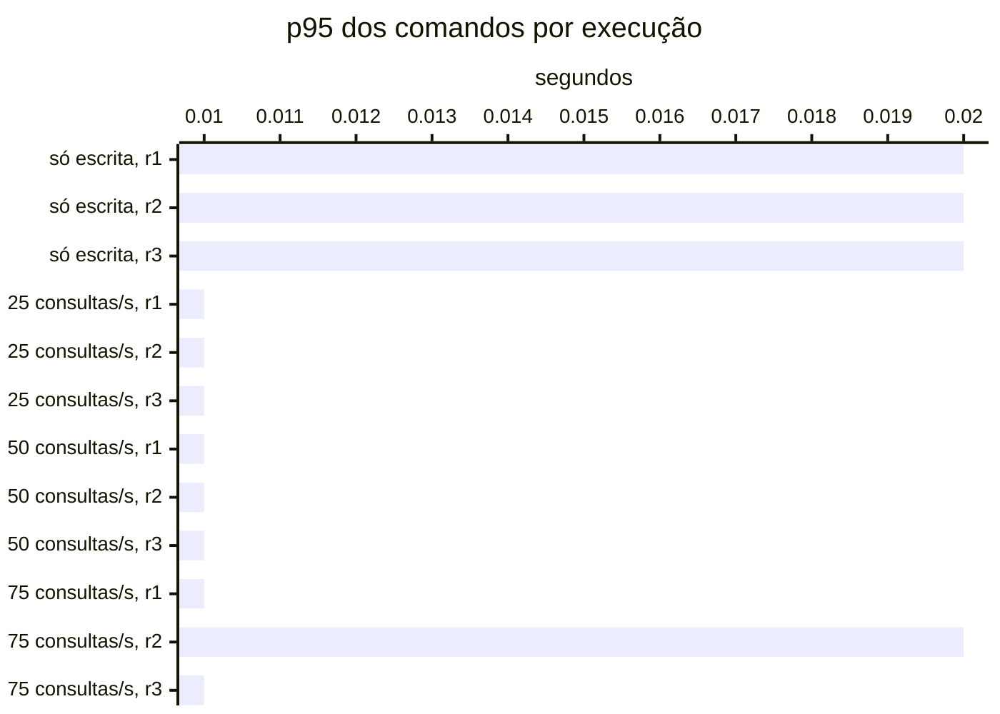

# Resumo

Gerado por `java bench/Report.java summarize`. Mediana das repetições; entre colchetes, a faixa do p95
(mín–máx). Latências em ms, vazão em requisições/s. Parâmetros de cada cenário em
`runs/<cenário>/scenario.properties`; série temporal de cada execução (5 s) em
`runs/<cenário>/r<n>/timeseries.csv`.

## s1 (3 execuções)

`writeRate=20` · `readRate=0` · `duration=180`

| Requisição | Vazão | % KO | p50 | p95 | p99 |
|---|---:|---:|---:|---:|---:|
| Global | 20.0 | 0.0 | 9 | 22 [20–23] | 46 |
| comandos | 20.0 | 0.0 | 9 | 22 [20–23] | 46 |
| comandos / deposit empresa | 3.0 | 0.0 | 8 | 22 [20–24] | 42 |
| comandos / deposit pessoa | 3.1 | 0.0 | 9 | 22 [19–25] | 63 |
| comandos / transfer empresa | 1.5 | 0.0 | 10 | 25 [23–25] | 53 |
| comandos / transfer pessoa | 1.5 | 0.0 | 10 | 25 [24–27] | 33 |
| comandos / withdraw empresa | 5.6 | 0.0 | 8 | 21 [18–22] | 48 |
| comandos / withdraw pessoa | 5.2 | 0.0 | 9 | 22 [20–22] | 33 |

## s2 (3 execuções)

`writeRate=0` · `readRate=75` · `duration=180`

| Requisição | Vazão | % KO | p50 | p95 | p99 |
|---|---:|---:|---:|---:|---:|
| Global | 75.0 | 0.0 | 6 | 40 [36–43] | 83 |
| consultas | 75.0 | 0.0 | 6 | 40 [36–43] | 83 |
| consultas / Q1 empresa | 9.4 | 0.0 | 1 | 5 [4–5] | 11 |
| consultas / Q1 pessoa | 9.3 | 0.0 | 1 | 5 [5–6] | 11 |
| consultas / Q2 empresa | 9.5 | 0.0 | 9 | 27 [23–32] | 53 |
| consultas / Q2 pessoa | 9.2 | 0.0 | 5 | 17 [16–18] | 35 |
| consultas / Q3 empresa | 9.6 | 0.0 | 11 | 22 [20–22] | 37 |
| consultas / Q3 pessoa | 9.3 | 0.0 | 2 | 7 [6–7] | 13 |
| consultas / Q4 empresa | 9.1 | 0.0 | 30 | 95 [86–107] | 143 |
| consultas / Q4 pessoa | 9.3 | 0.0 | 5 | 17 [17–18] | 36 |

## s3-r025 (3 execuções)

`writeRate=20` · `readRate=25` · `duration=180`

| Requisição | Vazão | % KO | p50 | p95 | p99 |
|---|---:|---:|---:|---:|---:|
| Global | 45.0 | 0.0 | 5 | 29 [29–36] | 68 |
| comandos | 20.0 | 0.0 | 5 | 14 [13–14] | 23 |
| consultas | 25.0 | 0.0 | 7 | 40 [40–51] | 78 |
| comandos / deposit empresa | 3.1 | 0.0 | 4 | 13 [11–14] | 21 |
| comandos / deposit pessoa | 3.1 | 0.0 | 5 | 12 [12–16] | 23 |
| comandos / transfer empresa | 1.5 | 0.0 | 6 | 15 [14–16] | 24 |
| comandos / transfer pessoa | 1.6 | 0.0 | 6 | 15 [14–17] | 24 |
| comandos / withdraw empresa | 5.4 | 0.0 | 4 | 14 [12–14] | 22 |
| comandos / withdraw pessoa | 5.5 | 0.0 | 5 | 13 [13–14] | 25 |
| consultas / Q1 empresa | 3.0 | 0.0 | 2 | 6 [5–6] | 14 |
| consultas / Q1 pessoa | 3.1 | 0.0 | 2 | 6 [5–7] | 15 |
| consultas / Q2 empresa | 3.2 | 0.0 | 12 | 25 [25–35] | 41 |
| consultas / Q2 pessoa | 3.1 | 0.0 | 6 | 17 [16–22] | 26 |
| consultas / Q3 empresa | 3.2 | 0.0 | 13 | 25 [24–27] | 34 |
| consultas / Q3 pessoa | 3.2 | 0.0 | 3 | 8 [8–9] | 15 |
| consultas / Q4 empresa | 3.1 | 0.0 | 34 | 85 [82–106] | 116 |
| consultas / Q4 pessoa | 3.0 | 0.0 | 7 | 21 [19–24] | 35 |

## s3-r050 (3 execuções)

`writeRate=20` · `readRate=50` · `duration=180`

| Requisição | Vazão | % KO | p50 | p95 | p99 |
|---|---:|---:|---:|---:|---:|
| Global | 70.0 | 0.0 | 5 | 34 [30–36] | 77 |
| comandos | 20.0 | 0.0 | 4 | 12 [12–12] | 24 |
| consultas | 50.0 | 0.0 | 6 | 41 [36–45] | 84 |
| comandos / deposit empresa | 2.9 | 0.0 | 4 | 12 [10–12] | 23 |
| comandos / deposit pessoa | 3.0 | 0.0 | 4 | 12 [10–12] | 26 |
| comandos / transfer empresa | 1.5 | 0.0 | 5 | 14 [13–16] | 37 |
| comandos / transfer pessoa | 1.6 | 0.0 | 5 | 13 [12–14] | 28 |
| comandos / withdraw empresa | 5.4 | 0.0 | 4 | 10 [10–11] | 23 |
| comandos / withdraw pessoa | 5.6 | 0.0 | 4 | 12 [11–12] | 21 |
| consultas / Q1 empresa | 6.4 | 0.0 | 1 | 5 [5–5] | 13 |
| consultas / Q1 pessoa | 6.4 | 0.0 | 1 | 4 [4–5] | 9 |
| consultas / Q2 empresa | 6.4 | 0.0 | 11 | 28 [24–32] | 53 |
| consultas / Q2 pessoa | 6.3 | 0.0 | 6 | 16 [14–16] | 29 |
| consultas / Q3 empresa | 6.3 | 0.0 | 11 | 22 [21–23] | 34 |
| consultas / Q3 pessoa | 6.1 | 0.0 | 2 | 7 [7–7] | 17 |
| consultas / Q4 empresa | 6.2 | 0.0 | 32 | 91 [87–100] | 225 |
| consultas / Q4 pessoa | 6.1 | 0.0 | 6 | 19 [16–19] | 52 |

## s3-r075 (3 execuções)

`writeRate=20` · `readRate=75` · `duration=180`

| Requisição | Vazão | % KO | p50 | p95 | p99 |
|---|---:|---:|---:|---:|---:|
| Global | 95.0 | 0.0 | 5 | 48 [37–48] | 133 |
| comandos | 20.0 | 0.0 | 4 | 14 [13–16] | 59 |
| consultas | 75.0 | 0.0 | 6 | 55 [43–56] | 147 |
| comandos / deposit empresa | 2.8 | 0.0 | 4 | 14 [11–15] | 27 |
| comandos / deposit pessoa | 3.0 | 0.0 | 4 | 13 [13–17] | 71 |
| comandos / transfer empresa | 1.5 | 0.0 | 5 | 14 [14–19] | 39 |
| comandos / transfer pessoa | 1.4 | 0.0 | 5 | 16 [14–20] | 72 |
| comandos / withdraw empresa | 5.5 | 0.0 | 4 | 13 [10–14] | 49 |
| comandos / withdraw pessoa | 5.6 | 0.0 | 4 | 15 [15–16] | 48 |
| consultas / Q1 empresa | 9.4 | 0.0 | 1 | 5 [5–6] | 16 |
| consultas / Q1 pessoa | 9.4 | 0.0 | 1 | 5 [5–7] | 21 |
| consultas / Q2 empresa | 9.4 | 0.0 | 10 | 37 [28–48] | 132 |
| consultas / Q2 pessoa | 9.2 | 0.0 | 5 | 19 [18–22] | 62 |
| consultas / Q3 empresa | 9.5 | 0.0 | 11 | 24 [23–29] | 88 |
| consultas / Q3 pessoa | 9.4 | 0.0 | 2 | 9 [6–9] | 22 |
| consultas / Q4 empresa | 9.6 | 0.0 | 33 | 134 [109–140] | 322 |
| consultas / Q4 pessoa | 9.2 | 0.0 | 6 | 23 [21–25] | 88 |

## Estado por execução

Colapso: p95 global acima de 5,000 ms (ADR-0009). Leia a contagem, não a mediana: perto da saturação as
repetições caem em estados diferentes.

| Cenário | Colapsou |
|---|---|
| s1 | 0 de 3 |
| s2 | 0 de 3 |
| s3-r025 | 0 de 3 |
| s3-r050 | 0 de 3 |
| s3-r075 | 0 de 3 |

p95 global e comandos em ms, no cliente (Gatling). Espera e uso da conexão do Hikari em ms, média da
execução. Comando no banco: soma do tempo médio das instruções de escrita e do `SELECT … FOR UPDATE` no
`pg_stat_statements`, em ms (o custo de um comando dentro do Postgres, sem a fila). GC: segundos com a JVM
parada em GC na execução (medido a partir da #11).

| Cenário | Rep. | Estado | p95 global | % KO | Comandos p50 | p95 | p99 | Espera no pool | Uso da conexão | Comando no banco | GC |
|---|---|---|---:|---:|---:|---:|---:|---:|---:|---:|---:|
| s1 | r1 | estável | 22 | 0.0 | 9 | 22 | 87 | 0.1 | 5.4 | 1.6 | 0.4 |
| s1 | r2 | estável | 23 | 0.0 | 9 | 23 | 46 | 0.1 | 5.7 | 2.1 | 0.2 |
| s1 | r3 | estável | 20 | 0.0 | 9 | 20 | 31 | 0.0 | 4.6 | 1.6 | 0.2 |
| s2 | r1 | estável | 40 | 0.0 | — | — | — | 0.0 | 7.5 | — | 0.3 |
| s2 | r2 | estável | 36 | 0.0 | — | — | — | 0.0 | 7.2 | — | 0.3 |
| s2 | r3 | estável | 43 | 0.0 | — | — | — | 0.0 | 8.9 | — | 0.3 |
| s3-r025 | r1 | estável | 36 | 0.0 | 5 | 14 | 29 | 0.3 | 7.6 | 1.1 | 0.3 |
| s3-r025 | r2 | estável | 29 | 0.0 | 5 | 13 | 21 | 0.0 | 5.8 | 0.9 | 0.2 |
| s3-r025 | r3 | estável | 29 | 0.0 | 5 | 14 | 23 | 0.0 | 5.8 | 0.9 | 0.2 |
| s3-r050 | r1 | estável | 36 | 0.0 | 4 | 12 | 31 | 0.6 | 7.3 | 1.1 | 0.4 |
| s3-r050 | r2 | estável | 30 | 0.0 | 4 | 12 | 22 | 0.0 | 6.1 | 0.9 | 0.3 |
| s3-r050 | r3 | estável | 34 | 0.0 | 4 | 12 | 24 | 0.1 | 7.5 | 1.0 | 0.4 |
| s3-r075 | r1 | estável | 48 | 0.0 | 4 | 14 | 659 | 11.1 | 8.8 | 1.1 | 0.5 |
| s3-r075 | r2 | estável | 48 | 0.0 | 4 | 16 | 59 | 0.9 | 9.4 | 1.4 | 0.5 |
| s3-r075 | r3 | estável | 37 | 0.0 | 4 | 13 | 29 | 0.1 | 8.0 | 1.1 | 0.5 |

## Pool e banco por cenário

Mediana das repetições. Espera = tempo médio para obter conexão do Hikari; uso = tempo médio com a
conexão (o trabalho no banco); hit ratio = blocos achados no shared_buffers.

| Cenário | Espera no pool (ms) | Uso da conexão (ms) | Fila máx. no pool | Hit ratio | CPU da app |
|---|---:|---:|---:|---:|---:|
| s1 | 0.1 | 5.4 | 0 | 70.8% | 4% |
| s2 | 0.0 | 7.5 | 0 | 96.9% | 3% |
| s3-r025 | 0.0 | 5.8 | 0 | 97.6% | 3% |
| s3-r050 | 0.1 | 7.3 | 0 | 96.5% | 4% |
| s3-r075 | 0.9 | 8.8 | 0 | 96.9% | 5% |
