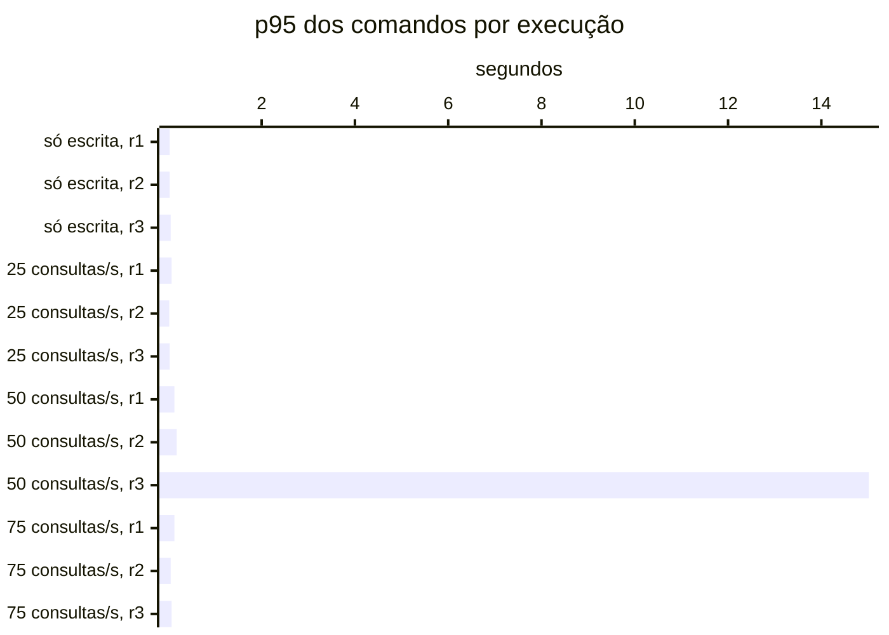

# Resumo

Gerado por `java bench/Report.java summarize`. Mediana das repetições; entre colchetes, a faixa do p95
(mín–máx). Latências em ms, vazão em requisições/s. Parâmetros de cada cenário em
`runs/<cenário>/scenario.properties`; série temporal de cada execução (5 s) em
`runs/<cenário>/r<n>/timeseries.csv`.

## s1 (3 execuções)

`writeRate=20` · `readRate=0` · `duration=180`

| Requisição | Vazão | % KO | p50 | p95 | p99 |
|---|---:|---:|---:|---:|---:|
| Global | 20.0 | 0.0 | 9 | 32 [25–49] | 86 |
| comandos | 20.0 | 0.0 | 9 | 32 [25–49] | 86 |
| comandos / deposit empresa | 3.0 | 0.0 | 8 | 24 [23–39] | 54 |
| comandos / deposit pessoa | 3.1 | 0.0 | 9 | 33 [25–52] | 68 |
| comandos / transfer empresa | 1.5 | 0.0 | 12 | 43 [35–55] | 92 |
| comandos / transfer pessoa | 1.5 | 0.0 | 13 | 38 [31–87] | 117 |
| comandos / withdraw empresa | 5.6 | 0.0 | 8 | 27 [22–48] | 83 |
| comandos / withdraw pessoa | 5.2 | 0.0 | 9 | 32 [23–45] | 84 |

## s2 (3 execuções)

`writeRate=0` · `readRate=75` · `duration=180`

| Requisição | Vazão | % KO | p50 | p95 | p99 |
|---|---:|---:|---:|---:|---:|
| Global | 74.6 | 0.0 | 14 | 1,376 [284–36,087] | 2,128 |
| consultas | 74.6 | 0.0 | 14 | 1,376 [284–36,087] | 2,128 |
| consultas / Q1 empresa | 9.1 | 0.0 | 2 | 1,101 [203–35,798] | 1,873 |
| consultas / Q1 pessoa | 9.1 | 0.0 | 2 | 1,424 [165–33,636] | 2,073 |
| consultas / Q2 empresa | 9.4 | 0.0 | 31 | 1,420 [303–34,936] | 1,973 |
| consultas / Q2 pessoa | 9.1 | 0.0 | 13 | 1,269 [195–33,261] | 2,064 |
| consultas / Q3 empresa | 9.4 | 0.0 | 18 | 1,149 [202–34,647] | 1,885 |
| consultas / Q3 pessoa | 9.3 | 0.0 | 4 | 1,326 [161–34,148] | 1,852 |
| consultas / Q4 empresa | 9.0 | 0.0 | 92 | 1,762 [772–39,111] | 2,883 |
| consultas / Q4 pessoa | 9.2 | 0.0 | 11 | 1,372 [276–40,168] | 2,230 |

## s3-r025 (3 execuções)

`writeRate=20` · `readRate=25` · `duration=180`

| Requisição | Vazão | % KO | p50 | p95 | p99 |
|---|---:|---:|---:|---:|---:|
| Global | 45.0 | 0.0 | 7 | 84 [57–129] | 423 |
| comandos | 20.0 | 0.0 | 6 | 25 [20–66] | 126 |
| consultas | 25.0 | 0.0 | 11 | 132 [79–169] | 511 |
| comandos / deposit empresa | 3.0 | 0.0 | 6 | 21 [16–86] | 145 |
| comandos / deposit pessoa | 3.0 | 0.0 | 7 | 23 [21–73] | 229 |
| comandos / transfer empresa | 1.4 | 0.0 | 8 | 42 [36–66] | 414 |
| comandos / transfer pessoa | 1.6 | 0.0 | 9 | 31 [22–46] | 80 |
| comandos / withdraw empresa | 5.4 | 0.0 | 5 | 27 [19–77] | 159 |
| comandos / withdraw pessoa | 5.6 | 0.0 | 6 | 23 [18–51] | 104 |
| consultas / Q1 empresa | 3.1 | 0.0 | 2 | 11 [8–45] | 397 |
| consultas / Q1 pessoa | 3.2 | 0.0 | 2 | 12 [9–16] | 236 |
| consultas / Q2 empresa | 3.1 | 0.0 | 28 | 125 [63–227] | 674 |
| consultas / Q2 pessoa | 3.1 | 0.0 | 11 | 41 [33–103] | 312 |
| consultas / Q3 empresa | 3.1 | 0.0 | 21 | 61 [51–191] | 360 |
| consultas / Q3 pessoa | 3.3 | 0.0 | 4 | 18 [13–34] | 348 |
| consultas / Q4 empresa | 3.1 | 0.0 | 67 | 386 [198–398] | 1,073 |
| consultas / Q4 pessoa | 3.0 | 0.0 | 10 | 78 [30–92] | 469 |

## s3-r050 (3 execuções)

`writeRate=20` · `readRate=50` · `duration=180`

| Requisição | Vazão | % KO | p50 | p95 | p99 |
|---|---:|---:|---:|---:|---:|
| Global | 69.6 | 0.0 | 13 | 644 [588–60,001] | 1,290 |
| comandos | 19.9 | 0.0 | 8 | 178 [128–15,022] | 466 |
| consultas | 49.7 | 0.0 | 17 | 787 [719–60,001] | 1,392 |
| comandos / deposit empresa | 2.9 | 0.0 | 7 | 150 [83–15,014] | 421 |
| comandos / deposit pessoa | 2.9 | 0.0 | 9 | 193 [77–15,090] | 463 |
| comandos / transfer empresa | 1.5 | 0.0 | 11 | 163 [161–15,080] | 567 |
| comandos / transfer pessoa | 1.4 | 0.0 | 11 | 223 [155–15,023] | 469 |
| comandos / withdraw empresa | 5.2 | 0.0 | 7 | 157 [121–15,016] | 532 |
| comandos / withdraw pessoa | 5.4 | 0.0 | 8 | 185 [156–15,083] | 453 |
| consultas / Q1 empresa | 6.2 | 0.0 | 2 | 602 [509–60,001] | 1,042 |
| consultas / Q1 pessoa | 6.3 | 0.0 | 3 | 553 [552–60,001] | 1,077 |
| consultas / Q2 empresa | 6.2 | 0.0 | 33 | 783 [691–60,001] | 1,181 |
| consultas / Q2 pessoa | 6.1 | 0.0 | 14 | 653 [615–60,001] | 1,205 |
| consultas / Q3 empresa | 6.2 | 0.0 | 22 | 682 [575–60,001] | 1,262 |
| consultas / Q3 pessoa | 6.1 | 0.0 | 5 | 646 [554–60,001] | 1,087 |
| consultas / Q4 empresa | 6.0 | 0.0 | 87 | 1,456 [1,433–60,001] | 2,206 |
| consultas / Q4 pessoa | 6.0 | 0.0 | 13 | 764 [673–60,001] | 1,271 |

## s3-r075 (3 execuções)

`writeRate=20` · `readRate=75` · `duration=180`

| Requisição | Vazão | % KO | p50 | p95 | p99 |
|---|---:|---:|---:|---:|---:|
| Global | 94.5 | 0.0 | 12 | 872 [284–2,473] | 1,451 |
| comandos | 19.9 | 0.0 | 8 | 66 [54–132] | 221 |
| consultas | 74.6 | 0.0 | 14 | 947 [332–2,685] | 1,588 |
| comandos / deposit empresa | 3.0 | 0.0 | 7 | 62 [40–206] | 311 |
| comandos / deposit pessoa | 3.0 | 0.0 | 8 | 72 [60–190] | 244 |
| comandos / transfer empresa | 1.5 | 0.0 | 10 | 68 [63–145] | 210 |
| comandos / transfer pessoa | 1.3 | 0.0 | 11 | 110 [62–205] | 329 |
| comandos / withdraw empresa | 5.6 | 0.0 | 7 | 55 [52–76] | 187 |
| comandos / withdraw pessoa | 5.5 | 0.0 | 8 | 68 [53–116] | 195 |
| consultas / Q1 empresa | 9.2 | 0.0 | 2 | 819 [192–2,681] | 1,220 |
| consultas / Q1 pessoa | 9.2 | 0.0 | 2 | 865 [183–2,556] | 1,193 |
| consultas / Q2 empresa | 9.2 | 0.0 | 29 | 932 [353–2,523] | 1,180 |
| consultas / Q2 pessoa | 9.2 | 0.0 | 12 | 880 [261–2,642] | 1,237 |
| consultas / Q3 empresa | 9.5 | 0.0 | 19 | 850 [243–2,518] | 1,324 |
| consultas / Q3 pessoa | 9.3 | 0.0 | 4 | 786 [219–2,560] | 1,145 |
| consultas / Q4 empresa | 9.3 | 0.0 | 89 | 1,479 [763–3,389] | 2,116 |
| consultas / Q4 pessoa | 9.0 | 0.0 | 12 | 951 [292–2,908] | 1,476 |

## Estado por execução

Colapso: p95 global acima de 5,000 ms (ADR-0009). Leia a contagem, não a mediana: perto da saturação as
repetições caem em estados diferentes.

| Cenário | Colapsou |
|---|---|
| s1 | 0 de 3 |
| s2 | 1 de 3 (r3) |
| s3-r025 | 0 de 3 |
| s3-r050 | 1 de 3 (r3) |
| s3-r075 | 0 de 3 |

p95 global e comandos em ms, no cliente (Gatling). Espera e uso da conexão do Hikari em ms, média da
execução. Comando no banco: soma do tempo médio das instruções de escrita e do `SELECT … FOR UPDATE` no
`pg_stat_statements`, em ms (o custo de um comando dentro do Postgres, sem a fila). GC: segundos com a JVM
parada em GC na execução (medido a partir da #11).

| Cenário | Rep. | Estado | p95 global | % KO | Comandos p50 | p95 | p99 | Espera no pool | Uso da conexão | Comando no banco | GC |
|---|---|---|---:|---:|---:|---:|---:|---:|---:|---:|---:|
| s1 | r1 | estável | 32 | 0.0 | 9 | 32 | 86 | 0.2 | 7.7 | 2.9 | 0.9 |
| s1 | r2 | estável | 25 | 0.0 | 9 | 25 | 53 | 0.3 | 6.3 | 2.4 | 0.2 |
| s1 | r3 | estável | 49 | 0.0 | 10 | 49 | 287 | 4.8 | 11.0 | 3.9 | 0.1 |
| s2 | r1 | estável | 1,376 | 0.0 | — | — | — | 126.1 | 32.2 | — | 0.9 |
| s2 | r2 | estável | 284 | 0.0 | — | — | — | 29.0 | 24.2 | — | 0.3 |
| s2 | r3 | **colapso** | 36,087 | 18.0 | — | — | — | 21,199.5 | 137.9 | — | 31.8 |
| s3-r025 | r1 | estável | 129 | 0.0 | 8 | 66 | 335 | 1.6 | 17.7 | 2.9 | 2.4 |
| s3-r025 | r2 | estável | 57 | 0.0 | 6 | 20 | 126 | 1.1 | 11.3 | 1.8 | 0.1 |
| s3-r025 | r3 | estável | 84 | 0.0 | 6 | 25 | 117 | 6.1 | 17.6 | 2.1 | 0.2 |
| s3-r050 | r1 | estável | 644 | 0.0 | 8 | 128 | 458 | 55.6 | 37.9 | 3.9 | 1.3 |
| s3-r050 | r2 | estável | 588 | 0.0 | 8 | 178 | 466 | 52.0 | 37.7 | 4.8 | 0.6 |
| s3-r050 | r3 | **colapso** | 60,001 | 47.2 | 496 | 15,022 | 54,156 | 25,605.2 | 356.8 | 13.1 | 64.3 |
| s3-r075 | r1 | estável | 2,473 | 0.0 | 7 | 132 | 617 | 276.0 | 34.8 | 4.1 | 1.9 |
| s3-r075 | r2 | estável | 284 | 0.0 | 8 | 54 | 171 | 18.8 | 27.4 | 3.6 | 0.3 |
| s3-r075 | r3 | estável | 872 | 0.0 | 10 | 66 | 221 | 94.2 | 40.8 | 5.0 | 1.9 |

## Pools por execução

Espera e uso da conexão do Hikari em ms, média da execução; fila máxima de requisições esperando conexão.
Pool sem requisições na execução aparece com —.

| Cenário | Rep. | Pool | Espera | Uso da conexão | Fila máx. |
|---|---|---|---:|---:|---:|
| s1 | r1 | commands | 0.2 | 7.7 | 0 |
| s1 | r1 | queries | — | — | 0 |
| s1 | r2 | commands | 0.3 | 6.3 | 0 |
| s1 | r2 | queries | — | — | 0 |
| s1 | r3 | commands | 4.8 | 11.0 | 16 |
| s1 | r3 | queries | — | — | 0 |
| s2 | r1 | commands | — | — | 0 |
| s2 | r1 | queries | 126.1 | 32.2 | 150 |
| s2 | r2 | commands | — | — | 0 |
| s2 | r2 | queries | 29.0 | 24.2 | 30 |
| s2 | r3 | commands | — | — | 0 |
| s2 | r3 | queries | 21,199.5 | 137.9 | 1,928 |
| s3-r025 | r1 | commands | 2.2 | 8.6 | 7 |
| s3-r025 | r1 | queries | 1.2 | 24.4 | 3 |
| s3-r025 | r2 | commands | 1.7 | 5.3 | 0 |
| s3-r025 | r2 | queries | 0.6 | 15.8 | 0 |
| s3-r025 | r3 | commands | 1.7 | 6.7 | 0 |
| s3-r025 | r3 | queries | 9.4 | 25.7 | 9 |
| s3-r050 | r1 | commands | 9.9 | 13.7 | 4 |
| s3-r050 | r1 | queries | 72.5 | 46.8 | 50 |
| s3-r050 | r2 | commands | 11.6 | 16.4 | 3 |
| s3-r050 | r2 | queries | 67.0 | 45.6 | 51 |
| s3-r050 | r3 | commands | 2,489.0 | 109.7 | 285 |
| s3-r050 | r3 | queries | 34,390.2 | 564.3 | 1,504 |
| s3-r075 | r1 | commands | 11.3 | 14.4 | 7 |
| s3-r075 | r1 | queries | 341.1 | 39.9 | 247 |
| s3-r075 | r2 | commands | 1.8 | 10.8 | 2 |
| s3-r075 | r2 | queries | 23.0 | 31.5 | 28 |
| s3-r075 | r3 | commands | 2.8 | 13.8 | 9 |
| s3-r075 | r3 | queries | 116.7 | 47.4 | 73 |

## Pool e banco por cenário

Mediana das repetições. Espera = tempo médio para obter conexão do Hikari; uso = tempo médio com a
conexão (o trabalho no banco); hit ratio = blocos achados no shared_buffers.

| Cenário | Espera no pool (ms) | Uso da conexão (ms) | Fila máx. no pool | Hit ratio | CPU da app |
|---|---:|---:|---:|---:|---:|
| s1 | 0.3 | 7.7 | 0 | 70.9% | 5% |
| s2 | 126.1 | 32.2 | 150 | 97.6% | 7% |
| s3-r025 | 1.6 | 17.6 | 7 | 97.5% | 6% |
| s3-r050 | 55.6 | 37.9 | 51 | 97.2% | 11% |
| s3-r075 | 94.2 | 34.8 | 73 | 97.5% | 10% |
