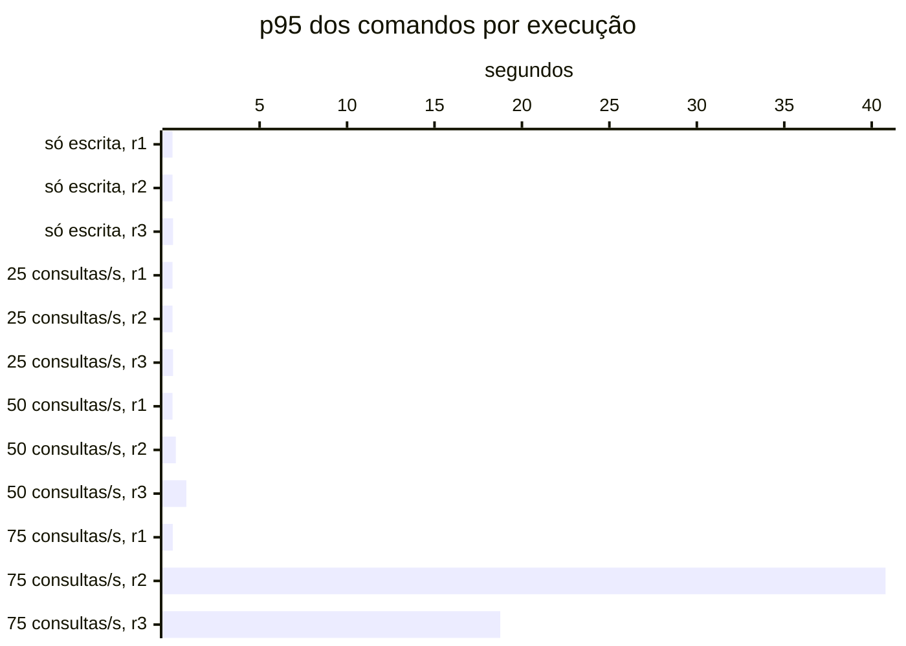

# Resumo

Gerado por `java bench/Report.java summarize`. Mediana das repetições; entre colchetes, a faixa do p95
(mín–máx). Latências em ms, vazão em requisições/s. Parâmetros de cada cenário em
`runs/<cenário>/scenario.properties`; série temporal de cada execução (5 s) em
`runs/<cenário>/r<n>/timeseries.csv`.

## s1 (3 execuções)

`writeRate=20` · `readRate=0` · `duration=180`

| Requisição | Vazão | % KO | p50 | p95 | p99 |
|---|---:|---:|---:|---:|---:|
| Global | 20.0 | 0.0 | 9 | 23 [22–48] | 47 |
| comandos | 20.0 | 0.0 | 9 | 23 [22–48] | 47 |
| comandos / deposit empresa | 3.0 | 0.0 | 9 | 22 [21–43] | 38 |
| comandos / deposit pessoa | 3.1 | 0.0 | 9 | 23 [19–45] | 33 |
| comandos / transfer empresa | 1.5 | 0.0 | 12 | 29 [27–54] | 70 |
| comandos / transfer pessoa | 1.5 | 0.0 | 12 | 28 [27–59] | 54 |
| comandos / withdraw empresa | 5.6 | 0.0 | 9 | 22 [21–44] | 52 |
| comandos / withdraw pessoa | 5.2 | 0.0 | 9 | 24 [22–49] | 48 |

## s2 (3 execuções)

`writeRate=0` · `readRate=75` · `duration=180`

| Requisição | Vazão | % KO | p50 | p95 | p99 |
|---|---:|---:|---:|---:|---:|
| Global | 74.6 | 0.0 | 10 | 148 [72–30,368] | 604 |
| consultas | 74.6 | 0.0 | 10 | 148 [72–30,368] | 604 |
| consultas / Q1 empresa | 9.1 | 0.0 | 2 | 12 [7–30,161] | 492 |
| consultas / Q1 pessoa | 9.3 | 0.0 | 2 | 15 [7–30,082] | 600 |
| consultas / Q2 empresa | 9.2 | 0.0 | 23 | 122 [54–30,183] | 713 |
| consultas / Q2 pessoa | 9.2 | 0.0 | 10 | 69 [26–30,115] | 412 |
| consultas / Q3 empresa | 9.4 | 0.0 | 17 | 65 [33–30,083] | 445 |
| consultas / Q3 pessoa | 9.3 | 0.0 | 3 | 29 [10–30,069] | 411 |
| consultas / Q4 empresa | 9.1 | 0.0 | 68 | 471 [156–37,746] | 1,217 |
| consultas / Q4 pessoa | 9.2 | 0.0 | 9 | 101 [31–41,174] | 899 |

## s3-r025 (3 execuções)

`writeRate=20` · `readRate=25` · `duration=180`

| Requisição | Vazão | % KO | p50 | p95 | p99 |
|---|---:|---:|---:|---:|---:|
| Global | 45.0 | 0.0 | 6 | 50 [42–125] | 227 |
| comandos | 20.0 | 0.0 | 5 | 20 [16–50] | 195 |
| consultas | 25.0 | 0.0 | 8 | 71 [63–162] | 245 |
| comandos / deposit empresa | 3.0 | 0.0 | 5 | 22 [17–55] | 293 |
| comandos / deposit pessoa | 3.1 | 0.0 | 5 | 21 [17–40] | 212 |
| comandos / transfer empresa | 1.6 | 0.0 | 7 | 22 [17–152] | 149 |
| comandos / transfer pessoa | 1.4 | 0.0 | 7 | 20 [18–54] | 59 |
| comandos / withdraw empresa | 5.4 | 0.0 | 5 | 18 [14–38] | 193 |
| comandos / withdraw pessoa | 5.5 | 0.0 | 5 | 21 [16–51] | 176 |
| consultas / Q1 empresa | 3.1 | 0.0 | 2 | 9 [7–13] | 109 |
| consultas / Q1 pessoa | 3.3 | 0.0 | 2 | 11 [7–27] | 82 |
| consultas / Q2 empresa | 3.3 | 0.0 | 18 | 54 [53–186] | 534 |
| consultas / Q2 pessoa | 3.1 | 0.0 | 8 | 25 [24–83] | 223 |
| consultas / Q3 empresa | 3.1 | 0.0 | 15 | 37 [30–135] | 222 |
| consultas / Q3 pessoa | 3.1 | 0.0 | 3 | 13 [10–34] | 53 |
| consultas / Q4 empresa | 3.2 | 0.0 | 44 | 173 [132–432] | 651 |
| consultas / Q4 pessoa | 3.0 | 0.0 | 7 | 33 [24–94] | 187 |

## s3-r050 (3 execuções)

`writeRate=20` · `readRate=50` · `duration=180`

| Requisição | Vazão | % KO | p50 | p95 | p99 |
|---|---:|---:|---:|---:|---:|
| Global | 70.0 | 0.0 | 7 | 255 [57–899] | 770 |
| comandos | 20.0 | 0.0 | 6 | 207 [19–808] | 673 |
| consultas | 50.0 | 0.0 | 9 | 278 [71–951] | 812 |
| comandos / deposit empresa | 3.0 | 0.0 | 5 | 268 [17–568] | 771 |
| comandos / deposit pessoa | 2.9 | 0.0 | 6 | 110 [17–648] | 454 |
| comandos / transfer empresa | 1.5 | 0.0 | 6 | 232 [23–1,144] | 627 |
| comandos / transfer pessoa | 1.5 | 0.0 | 8 | 208 [19–918] | 508 |
| comandos / withdraw empresa | 5.7 | 0.0 | 5 | 233 [18–785] | 688 |
| comandos / withdraw pessoa | 5.5 | 0.0 | 5 | 208 [19–851] | 727 |
| consultas / Q1 empresa | 6.1 | 0.0 | 2 | 173 [8–345] | 658 |
| consultas / Q1 pessoa | 6.3 | 0.0 | 2 | 229 [8–600] | 700 |
| consultas / Q2 empresa | 6.3 | 0.0 | 17 | 325 [52–816] | 766 |
| consultas / Q2 pessoa | 6.1 | 0.0 | 8 | 240 [29–926] | 746 |
| consultas / Q3 empresa | 6.1 | 0.0 | 14 | 207 [33–898] | 618 |
| consultas / Q3 pessoa | 6.1 | 0.0 | 3 | 177 [11–765] | 654 |
| consultas / Q4 empresa | 6.2 | 0.0 | 48 | 797 [153–2,289] | 4,571 |
| consultas / Q4 pessoa | 6.0 | 0.0 | 8 | 247 [31–795] | 683 |

## s3-r075 (3 execuções)

`writeRate=20` · `readRate=75` · `duration=180`

| Requisição | Vazão | % KO | p50 | p95 | p99 |
|---|---:|---:|---:|---:|---:|
| Global | 92.9 | 3.1 | 1,214 | 18,799 [107–41,090] | 22,660 |
| comandos | 19.6 | 3.1 | 1,153 | 18,763 [38–40,794] | 23,199 |
| consultas | 73.4 | 3.1 | 1,230 | 18,613 [120–41,117] | 22,431 |
| comandos / deposit empresa | 2.8 | 2.9 | 1,365 | 19,602 [52–41,386] | 25,979 |
| comandos / deposit pessoa | 3.0 | 2.8 | 1,113 | 18,348 [42–40,597] | 20,347 |
| comandos / transfer empresa | 1.5 | 1.7 | 1,229 | 15,012 [51–39,579] | 19,827 |
| comandos / transfer pessoa | 1.4 | 2.5 | 1,024 | 19,635 [36–40,196] | 20,249 |
| comandos / withdraw empresa | 5.0 | 3.7 | 1,079 | 19,531 [30–41,480] | 26,198 |
| comandos / withdraw pessoa | 5.5 | 3.4 | 1,142 | 19,378 [36–40,786] | 23,308 |
| consultas / Q1 empresa | 9.4 | 2.3 | 1,207 | 18,888 [14–40,149] | 20,393 |
| consultas / Q1 pessoa | 9.0 | 3.3 | 1,093 | 19,520 [14–40,247] | 21,392 |
| consultas / Q2 empresa | 9.2 | 3.8 | 1,322 | 19,323 [128–40,834] | 20,698 |
| consultas / Q2 pessoa | 9.3 | 3.8 | 1,071 | 18,807 [50–41,578] | 20,236 |
| consultas / Q3 empresa | 8.8 | 3.0 | 1,104 | 19,364 [54–40,495] | 20,562 |
| consultas / Q3 pessoa | 9.1 | 2.4 | 1,104 | 19,075 [25–40,333] | 22,014 |
| consultas / Q4 empresa | 9.3 | 3.4 | 1,751 | 19,445 [439–42,085] | 25,653 |
| consultas / Q4 pessoa | 8.9 | 2.9 | 1,128 | 19,353 [68–41,811] | 26,337 |

## Estado por execução

Colapso: p95 global acima de 5,000 ms (ADR-0009). Leia a contagem, não a mediana: perto da saturação as
repetições caem em estados diferentes.

| Cenário | Colapsou |
|---|---|
| s1 | 0 de 3 |
| s2 | 1 de 3 (r2) |
| s3-r025 | 0 de 3 |
| s3-r050 | 0 de 3 |
| s3-r075 | 2 de 3 (r2, r3) |

p95 global e comandos em ms, no cliente (Gatling). Espera e uso da conexão do Hikari em ms, média da
execução. Comando no banco: soma do tempo médio das instruções de escrita e do `SELECT … FOR UPDATE` no
`pg_stat_statements`, em ms (o custo de um comando dentro do Postgres, sem a fila). GC: segundos com a JVM
parada em GC na execução (medido a partir da #11).

| Cenário | Rep. | Estado | p95 global | % KO | Comandos p50 | p95 | p99 | Espera no pool | Uso da conexão | Comando no banco | GC |
|---|---|---|---:|---:|---:|---:|---:|---:|---:|---:|---:|
| s1 | r1 | estável | 23 | 0.0 | 9 | 23 | 47 | 0.1 | 6.0 | 2.0 | 0.6 |
| s1 | r2 | estável | 22 | 0.0 | 9 | 22 | 34 | 0.0 | 4.9 | 1.7 | 0.5 |
| s1 | r3 | estável | 48 | 0.0 | 10 | 48 | 260 | 1.2 | 11.9 | 4.3 | 1.5 |
| s2 | r1 | estável | 72 | 0.0 | — | — | — | 10.1 | 12.5 | — | 1.2 |
| s2 | r2 | **colapso** | 30,368 | 22.7 | — | — | — | 26,784.7 | 175.1 | — | 8.6 |
| s2 | r3 | estável | 148 | 0.0 | — | — | — | 9.5 | 22.9 | — | 0.8 |
| s3-r025 | r1 | estável | 50 | 0.0 | 5 | 20 | 195 | 1.8 | 11.8 | 1.7 | 0.7 |
| s3-r025 | r2 | estável | 42 | 0.0 | 5 | 16 | 32 | 0.1 | 8.6 | 1.2 | 0.7 |
| s3-r025 | r3 | estável | 125 | 0.0 | 6 | 50 | 284 | 1.7 | 22.1 | 2.6 | 1.7 |
| s3-r050 | r1 | estável | 57 | 0.0 | 5 | 19 | 89 | 1.0 | 10.9 | 1.6 | 1.0 |
| s3-r050 | r2 | estável | 255 | 0.0 | 6 | 207 | 673 | 24.1 | 28.4 | 2.2 | 1.0 |
| s3-r050 | r3 | estável | 899 | 0.0 | 6 | 808 | 3,599 | 110.8 | 27.6 | 2.9 | 0.4 |
| s3-r075 | r1 | estável | 107 | 0.0 | 5 | 38 | 301 | 6.1 | 16.2 | 2.0 | 1.3 |
| s3-r075 | r2 | **colapso** | 41,090 | 57.7 | 30,265 | 40,794 | 46,744 | 29,182.6 | 348.3 | 12.7 | 35.3 |
| s3-r075 | r3 | **colapso** | 18,799 | 3.1 | 1,153 | 18,763 | 23,199 | 3,343.8 | 84.2 | 5.3 | 16.7 |

## Pool e banco por cenário

Mediana das repetições. Espera = tempo médio para obter conexão do Hikari; uso = tempo médio com a
conexão (o trabalho no banco); hit ratio = blocos achados no shared_buffers.

| Cenário | Espera no pool (ms) | Uso da conexão (ms) | Fila máx. no pool | Hit ratio | CPU da app |
|---|---:|---:|---:|---:|---:|
| s1 | 0.1 | 6.0 | 0 | 70.6% | 4% |
| s2 | 10.1 | 22.9 | 8 | 97.5% | 6% |
| s3-r025 | 1.7 | 11.8 | 0 | 95.5% | 5% |
| s3-r050 | 24.1 | 27.6 | 22 | 96.2% | 6% |
| s3-r075 | 3,343.8 | 84.2 | 1,408 | 96.6% | 14% |
