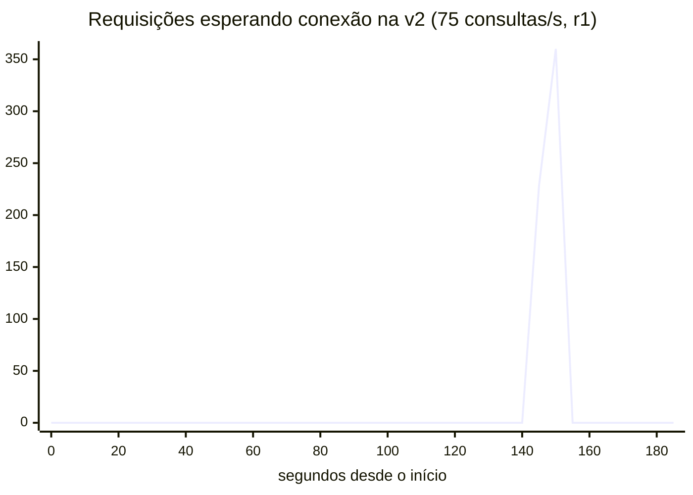

# v2 — 2026-10-20: CQRS lógico contra a v1 do mesmo dia

A v2 ([ADR-0011](../../adr/0011-v2-projecoes-e-escopo-congelado.md)) lê Q2–Q4 de projeções no mesmo Postgres:
blocos conta/mês em `statement_view` e totais em `monthly_summary`, atualizados na transação do comando. A referência
é a [v1 medida logo depois](../2026-10-20-v1-m3/README.md), com o dataset recarregado e o volume do Postgres recriado
antes de cada uma. Ambiente em [env.md](env.md), números em [summary.md](summary.md), planos e a sonda de escrita em
[explain.md](explain.md).

## Resultado em uma frase

A leitura ficou mais barata e passou a depender menos do disco, e a escrita pagou por isso. A pergunta do colapso
ficou sem resposta: nesta rodada, a v1 também não colapsou.

## Colapso: 0 de 9 nas duas

| Execução | Colapsos com leitura ≥ 50/s | Tempo por bloco lido fora do cache (s2, por repetição) |
|---|---:|---|
| v1, 19/10 | 6 de 9 | 4,1 · 3,1 · 1,8 ms |
| v1, 20/10 de manhã | 3 de 9 | 0,31 · 2,2 · 0,62 ms |
| v1, 20/10 à tarde (referência desta) | 0 de 9 | 0,18 · 0,17 · 0,21 ms |
| **v2, 20/10 à tarde** | **0 de 9** | 0,26 · 0,26 · 0,20 ms |

O tempo por bloco é `read_ms / shared_blks_read` do `pg_stat_statements`, o custo de ir além do `shared_buffers`. Entre
execuções da mesma v1, com o mesmo código, dataset e ambiente declarado, ele variou mais de 20 vezes, e a contagem de
colapsos acompanhou. O benchmark não controla essa latência, que vem do disco da VM do Docker e do cache do macOS.
A v2 rodou com o disco um pouco mais lento que o da v1, então a comparação não a favorece.

Com o disco rápido, a v1 não colapsou, e a comparação combinada antes de medir (k de 9) não separa as fases. A
diferença que dá para afirmar está no custo das leituras, abaixo.

**A única instabilidade da v2** (75 consultas/s, r1): por 10–15 s o banco ficou lento para todos (tempo médio com
a conexão de ~4 ms para 131 ms), a fila chegou a 360 requisições e esvaziou sozinha em ~10 s. O heap ficou abaixo de
100 MiB e a JVM parou 1,7 s em GC na execução inteira, contra 8–64 s nos colapsos da #11. Não foi possível achar a
causa: os logs do Postgres sumiram com o `make clean` da troca de fase.

<!-- java bench/Report.java chart docs/benchmarks/2026-10-20-v2/runs/s3-r075/r1/timeseries.csv hikari_pending "..." -->

## Leitura: menos páginas por consulta

Custo no Postgres por chamada, mediana das três repetições (`pg_stat_statements`). "Páginas" soma as do cache e as
lidas fora dele.

| 25 consultas/s (`s3-r025`) | v1 | v2 |
|---|---:|---:|
| Q3: tempo / páginas / lidas fora do cache | 6,0 ms / 4.558 / 17,2 | 1,6 ms / 199 / 2,2 |
| Q2 + Q4: tempo / páginas / lidas fora do cache | 14,5 ms / 369 / 58,7 | 11,2 ms / 104 / 16,9 |

| 75 consultas/s (`s3-r075`) | v1 | v2 |
|---|---:|---:|
| Q2 + Q4 por chamada | 18,7 ms | 10,2 ms |
| Tempo de leitura no banco (Q2–Q4, por execução de 180 s) | 145 s | 72 s |

Q2 e Q4 aparecem somados porque o `run.sh` guarda só os primeiros 400 caracteres de cada instrução, e na v2 os dois
começam pelo mesmo trecho. Na v1, o Q4 sozinho lia 85–89 páginas fora do cache por chamada.

No cliente, p95 em ms, mediana [faixa das repetições]:

| | 25 consultas/s, v1 | 25 consultas/s, v2 | 75 só leitura (`s2`), v1 | 75 só leitura, v2 |
|---|---:|---:|---:|---:|
| Q1 empresa | 6 [5–6] | 7 [6–8] | 5 [4–5] | 5 [5–6] |
| Q1 pessoa | 6 [5–7] | 8 [5–10] | 5 [5–6] | 7 [6–7] |
| Q2 empresa | 25 [25–35] | 23 [23–25] | 27 [23–32] | 19 [19–21] |
| Q2 pessoa | 17 [16–22] | 12 [9–12] | 17 [16–18] | 10 [8–10] |
| Q3 empresa | 25 [24–27] | 11 [9–14] | 22 [20–22] | 9 [9–10] |
| Q3 pessoa | 8 [8–9] | 11 [8–15] | 7 [6–7] | 9 [8–10] |
| Q4 empresa | 85 [82–106] | 68 [66–83] | 95 [86–107] | 60 [57–63] |
| Q4 pessoa | 21 [19–24] | 14 [12–16] | 17 [17–18] | 12 [12–13] |
| Comandos | 14 [13–14] | 16 [13–19] | — | — |

## Hipóteses (leitura combinada no ADR-0011)

**H2, confirmada.** No `s3-r025`, o p95 do Q3 empresarial caiu de 25 para 11 ms (−56%, a regra pedia pelo menos metade),
e o do Q2 empresarial de 25 para 23 ms (−8%), ganho menor que o do Q3. No banco, o Q3 lê 23 vezes menos páginas. Duas
ressalvas: o Q3 de pessoa física não melhorou no cliente (8 → 11 ms, faixas sobrepostas), embora no banco também tenha
ficado mais barato; e o maior ganho em tempo absoluto está fora do H2, no Q4 empresarial (85 → 68 ms com 25 consultas/s,
134 → 60 ms com 75).

**H4, confirmada no que afirma, mas o critério que escrevemos falhou por 1–2 ms.** A hipótese é que o Q1 não melhora, e
ele não melhorou. O critério do ADR-0011 era mais estrito (ficar dentro da faixa da v1), e a v2 ficou 1–2 ms acima em
parte das células, sobretudo em pessoa física. A consulta é a mesma nas duas fases e custa o mesmo no banco
(0,12–0,28 ms por chamada), então a diferença está fora do Postgres. Ela não muda a conclusão: o Q1 não ganha nada com
as projeções.

## Escrita: o custo da v2

| Só escrita (`s1`), mediana | v1 | v2 |
|---|---:|---:|
| p95 dos comandos no cliente | 22 ms [20–23] | 23 ms [22–26] |
| Comando dentro do Postgres | 1,6 ms | 2,3 ms |
| Comando segurando a conexão | 5,4 ms | 7,7 ms |

Por instrução, na v2: o `INSERT` na `ledger_entry` caiu de 1,00 ms para 0,20 ms, sem os índices de leitura. As duas
projeções custam 0,85 ms (`statement_view`) e 0,65 ms (`monthly_summary`). No saldo, cada comando gasta ~0,7 ms a mais
no banco (+40%), e no cliente a diferença fica dentro do ruído.

**Isso subestima o custo.** Os comandos do benchmark caem no mês corrente, cujos blocos começam vazios. Num bloco já
cheio (293 lançamentos, 33 kB comprimidos), o mesmo `upsert` custou **2,9 ms e 104 KB de WAL** (a sonda do
[explain.md](explain.md)), porque o `jsonb` do mês é reescrito inteiro a cada lançamento.

Outros custos:

| | v1 | v2 |
|---|---|---|
| Espaço | 7,2 GB (`ledger_entry` com índices) | 8,9 GB (3,5 GB do ledger + 4,5 GB de `statement_view` + 0,9 GB de `monthly_summary`) |
| Seed | ~15 min | ~28 min, com o rebuild das projeções |
| Código | um modelo | `Projections.apply` no comando, `rebuild_projections()` e um teste de equivalência com o SQL da v1 |

## Limites

- **A v1 de referência não colapsou**, então a pergunta "separar o modelo evita o colapso?" fica sem resposta. O que se
  mediu é que a v2 precisa de 3–8 vezes menos páginas fora do cache por consulta. Que isso a torne menos sensível a um
  disco lento é inferência, não medição.
- **A latência do disco não é controlada** e variou mais de 20 vezes entre execuções da mesma v1. Comparações entre
  fases precisam vir acompanhadas do tempo por bloco lido.
- Blocos vazios no benchmark, como descrito acima. O mesmo vale para o documento do MongoDB na v3.
- Q2 e Q4 da v2 estão somados no `pg_stat_statements` (corte de 400 caracteres).
- A causa da instabilidade de 15 s da v2 não foi identificada.
- Três repetições por cenário.
