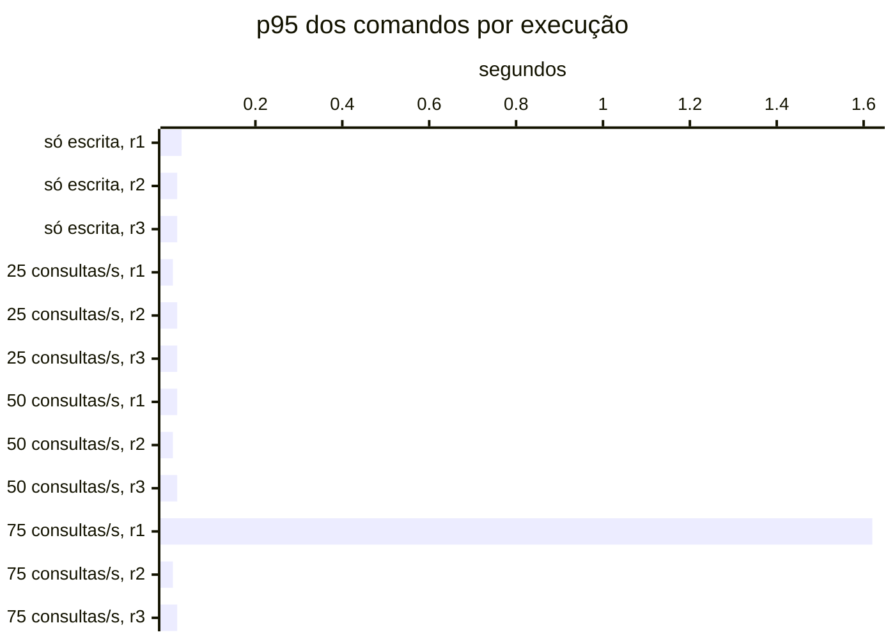

# Resumo

Gerado por `java bench/Report.java summarize`. Mediana das repetições; entre colchetes, a faixa do p95
(mín–máx). Latências em ms, vazão em requisições/s. Parâmetros de cada cenário em
`runs/<cenário>/scenario.properties`; série temporal de cada execução (5 s) em
`runs/<cenário>/r<n>/timeseries.csv`.

## s1 (3 execuções)

`writeRate=20` · `readRate=0` · `duration=180`

| Requisição | Vazão | % KO | p50 | p95 | p99 |
|---|---:|---:|---:|---:|---:|
| Global | 20.0 | 0.0 | 9 | 23 [22–26] | 60 |
| comandos | 20.0 | 0.0 | 9 | 23 [22–26] | 60 |
| comandos / deposit empresa | 3.0 | 0.0 | 9 | 22 [22–28] | 57 |
| comandos / deposit pessoa | 3.1 | 0.0 | 10 | 21 [21–22] | 82 |
| comandos / transfer empresa | 1.5 | 0.0 | 12 | 25 [23–27] | 41 |
| comandos / transfer pessoa | 1.5 | 0.0 | 13 | 26 [24–34] | 72 |
| comandos / withdraw empresa | 5.6 | 0.0 | 8 | 22 [22–27] | 70 |
| comandos / withdraw pessoa | 5.2 | 0.0 | 9 | 22 [21–24] | 87 |

## s2 (3 execuções)

`writeRate=0` · `readRate=75` · `duration=180`

| Requisição | Vazão | % KO | p50 | p95 | p99 |
|---|---:|---:|---:|---:|---:|
| Global | 74.6 | 0.0 | 3 | 31 [31–34] | 61 |
| consultas | 74.6 | 0.0 | 3 | 31 [31–34] | 61 |
| consultas / Q1 empresa | 9.4 | 0.0 | 1 | 5 [5–6] | 21 |
| consultas / Q1 pessoa | 9.3 | 0.0 | 1 | 7 [6–7] | 25 |
| consultas / Q2 empresa | 9.4 | 0.0 | 8 | 19 [19–21] | 70 |
| consultas / Q2 pessoa | 9.2 | 0.0 | 3 | 10 [8–10] | 24 |
| consultas / Q3 empresa | 9.5 | 0.0 | 3 | 9 [9–10] | 21 |
| consultas / Q3 pessoa | 9.3 | 0.0 | 2 | 9 [8–10] | 35 |
| consultas / Q4 empresa | 9.1 | 0.0 | 25 | 60 [57–63] | 156 |
| consultas / Q4 pessoa | 9.3 | 0.0 | 4 | 12 [12–13] | 39 |

## s3-r025 (3 execuções)

`writeRate=20` · `readRate=25` · `duration=180`

| Requisição | Vazão | % KO | p50 | p95 | p99 |
|---|---:|---:|---:|---:|---:|
| Global | 45.0 | 0.0 | 5 | 28 [25–32] | 61 |
| comandos | 20.0 | 0.0 | 6 | 16 [13–19] | 26 |
| consultas | 25.0 | 0.0 | 4 | 41 [34–42] | 73 |
| comandos / deposit empresa | 3.0 | 0.0 | 5 | 15 [12–16] | 28 |
| comandos / deposit pessoa | 2.9 | 0.0 | 6 | 15 [12–20] | 26 |
| comandos / transfer empresa | 1.6 | 0.0 | 7 | 21 [13–23] | 29 |
| comandos / transfer pessoa | 1.6 | 0.0 | 8 | 21 [17–21] | 26 |
| comandos / withdraw empresa | 5.4 | 0.0 | 5 | 13 [12–15] | 23 |
| comandos / withdraw pessoa | 5.5 | 0.0 | 6 | 15 [12–19] | 22 |
| consultas / Q1 empresa | 3.1 | 0.0 | 2 | 7 [6–8] | 14 |
| consultas / Q1 pessoa | 3.2 | 0.0 | 2 | 8 [5–10] | 17 |
| consultas / Q2 empresa | 3.2 | 0.0 | 10 | 23 [23–25] | 36 |
| consultas / Q2 pessoa | 3.0 | 0.0 | 4 | 12 [9–12] | 19 |
| consultas / Q3 empresa | 3.1 | 0.0 | 4 | 11 [9–14] | 18 |
| consultas / Q3 pessoa | 3.2 | 0.0 | 3 | 11 [8–15] | 17 |
| consultas / Q4 empresa | 3.1 | 0.0 | 31 | 68 [66–83] | 112 |
| consultas / Q4 pessoa | 3.1 | 0.0 | 6 | 14 [12–16] | 22 |

## s3-r050 (3 execuções)

`writeRate=20` · `readRate=50` · `duration=180`

| Requisição | Vazão | % KO | p50 | p95 | p99 |
|---|---:|---:|---:|---:|---:|
| Global | 70.0 | 0.0 | 4 | 29 [26–34] | 66 |
| comandos | 20.0 | 0.0 | 5 | 15 [14–15] | 54 |
| consultas | 50.0 | 0.0 | 3 | 34 [31–39] | 67 |
| comandos / deposit empresa | 2.9 | 0.0 | 4 | 13 [11–14] | 88 |
| comandos / deposit pessoa | 3.0 | 0.0 | 5 | 14 [13–16] | 102 |
| comandos / transfer empresa | 1.5 | 0.0 | 6 | 18 [17–21] | 60 |
| comandos / transfer pessoa | 1.5 | 0.0 | 7 | 23 [17–23] | 204 |
| comandos / withdraw empresa | 5.5 | 0.0 | 4 | 13 [13–14] | 34 |
| comandos / withdraw pessoa | 5.7 | 0.0 | 5 | 14 [13–16] | 33 |
| consultas / Q1 empresa | 6.3 | 0.0 | 1 | 5 [4–5] | 18 |
| consultas / Q1 pessoa | 6.2 | 0.0 | 1 | 6 [6–6] | 24 |
| consultas / Q2 empresa | 6.5 | 0.0 | 8 | 22 [18–25] | 45 |
| consultas / Q2 pessoa | 6.2 | 0.0 | 3 | 10 [9–10] | 32 |
| consultas / Q3 empresa | 6.5 | 0.0 | 3 | 10 [8–11] | 39 |
| consultas / Q3 pessoa | 6.2 | 0.0 | 3 | 9 [8–9] | 25 |
| consultas / Q4 empresa | 6.1 | 0.0 | 27 | 64 [59–75] | 131 |
| consultas / Q4 pessoa | 6.1 | 0.0 | 4 | 13 [12–14] | 24 |

## s3-r075 (3 execuções)

`writeRate=20` · `readRate=75` · `duration=180`

| Requisição | Vazão | % KO | p50 | p95 | p99 |
|---|---:|---:|---:|---:|---:|
| Global | 95.0 | 0.0 | 4 | 31 [28–1,137] | 661 |
| comandos | 20.0 | 0.0 | 5 | 16 [13–1,616] | 694 |
| consultas | 75.0 | 0.0 | 3 | 34 [30–1,397] | 654 |
| comandos / deposit empresa | 2.9 | 0.0 | 4 | 12 [11–1,112] | 54 |
| comandos / deposit pessoa | 3.0 | 0.0 | 5 | 19 [12–1,508] | 286 |
| comandos / transfer empresa | 1.6 | 0.0 | 6 | 23 [15–2,353] | 1,097 |
| comandos / transfer pessoa | 1.5 | 0.0 | 7 | 25 [19–2,101] | 1,558 |
| comandos / withdraw empresa | 5.6 | 0.0 | 4 | 13 [11–1,708] | 295 |
| comandos / withdraw pessoa | 5.4 | 0.0 | 5 | 18 [14–1,133] | 981 |
| consultas / Q1 empresa | 9.2 | 0.0 | 1 | 6 [5–2,089] | 732 |
| consultas / Q1 pessoa | 9.2 | 0.0 | 1 | 5 [4–1,001] | 786 |
| consultas / Q2 empresa | 9.4 | 0.0 | 8 | 23 [17–714] | 881 |
| consultas / Q2 pessoa | 9.5 | 0.0 | 3 | 10 [8–1,714] | 267 |
| consultas / Q3 empresa | 9.6 | 0.0 | 2 | 11 [9–1,347] | 252 |
| consultas / Q3 pessoa | 9.3 | 0.0 | 2 | 8 [7–1,245] | 544 |
| consultas / Q4 empresa | 9.6 | 0.0 | 25 | 60 [53–1,770] | 1,069 |
| consultas / Q4 pessoa | 9.0 | 0.0 | 4 | 14 [12–1,349] | 653 |

## Estado por execução

Colapso: p95 global acima de 5,000 ms (ADR-0009). Leia a contagem, não a mediana: perto da saturação as
repetições caem em estados diferentes.

| Cenário | Colapsou |
|---|---|
| s1 | 0 de 3 |
| s2 | 0 de 3 |
| s3-r025 | 0 de 3 |
| s3-r050 | 0 de 3 |
| s3-r075 | 0 de 3 |

p95 global e comandos em ms, no cliente (Gatling). Espera e uso da conexão do Hikari em ms, média da
execução. Comando no banco: soma do tempo médio das instruções de escrita e do `SELECT … FOR UPDATE` no
`pg_stat_statements`, em ms (o custo de um comando dentro do Postgres, sem a fila). GC: segundos com a JVM
parada em GC na execução (medido a partir da #11).

| Cenário | Rep. | Estado | p95 global | % KO | Comandos p50 | p95 | p99 | Espera no pool | Uso da conexão | Comando no banco | GC |
|---|---|---|---:|---:|---:|---:|---:|---:|---:|---:|---:|
| s1 | r1 | estável | 26 | 0.0 | 9 | 26 | 130 | 0.4 | 8.5 | 2.8 | 0.2 |
| s1 | r2 | estável | 22 | 0.0 | 9 | 22 | 60 | 0.1 | 7.7 | 2.3 | 0.2 |
| s1 | r3 | estável | 23 | 0.0 | 9 | 23 | 40 | 0.2 | 6.4 | 2.3 | 0.2 |
| s2 | r1 | estável | 31 | 0.0 | — | — | — | 0.1 | 4.7 | — | 0.3 |
| s2 | r2 | estável | 34 | 0.0 | — | — | — | 2.5 | 5.7 | — | 0.3 |
| s2 | r3 | estável | 31 | 0.0 | — | — | — | 0.2 | 4.5 | — | 0.3 |
| s3-r025 | r1 | estável | 28 | 0.0 | 5 | 13 | 19 | 0.0 | 5.2 | 1.2 | 0.2 |
| s3-r025 | r2 | estável | 25 | 0.0 | 6 | 16 | 26 | 0.0 | 4.7 | 1.4 | 0.2 |
| s3-r025 | r3 | estável | 32 | 0.0 | 6 | 19 | 138 | 1.5 | 6.2 | 2.1 | 0.3 |
| s3-r050 | r1 | estável | 34 | 0.0 | 5 | 15 | 60 | 1.4 | 5.8 | 1.6 | 0.3 |
| s3-r050 | r2 | estável | 26 | 0.0 | 5 | 14 | 24 | 0.0 | 4.1 | 1.1 | 0.3 |
| s3-r050 | r3 | estável | 29 | 0.0 | 5 | 15 | 54 | 0.4 | 4.9 | 1.6 | 0.3 |
| s3-r075 | r1 | estável | 1,137 | 0.0 | 5 | 1,616 | 3,596 | 143.5 | 11.4 | 3.4 | 1.7 |
| s3-r075 | r2 | estável | 28 | 0.0 | 4 | 13 | 694 | 11.2 | 5.0 | 1.6 | 0.3 |
| s3-r075 | r3 | estável | 31 | 0.0 | 5 | 16 | 158 | 1.4 | 5.3 | 1.8 | 0.4 |

## Pool e banco por cenário

Mediana das repetições. Espera = tempo médio para obter conexão do Hikari; uso = tempo médio com a
conexão (o trabalho no banco); hit ratio = blocos achados no shared_buffers.

| Cenário | Espera no pool (ms) | Uso da conexão (ms) | Fila máx. no pool | Hit ratio | CPU da app |
|---|---:|---:|---:|---:|---:|
| s1 | 0.2 | 7.7 | 0 | 98.0% | 4% |
| s2 | 0.2 | 4.7 | 0 | 92.4% | 4% |
| s3-r025 | 0.0 | 5.2 | 0 | 94.8% | 4% |
| s3-r050 | 0.4 | 4.9 | 0 | 93.8% | 5% |
| s3-r075 | 11.2 | 5.3 | 19 | 93.0% | 6% |
