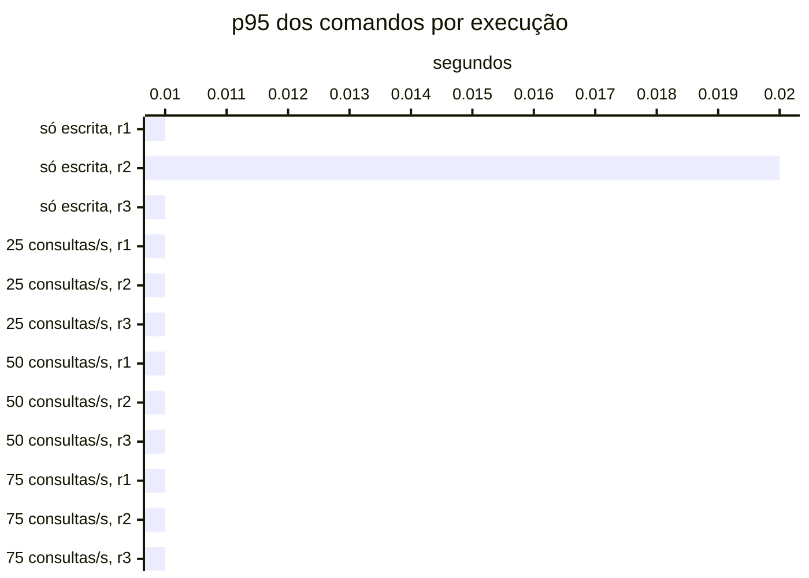

# Resumo

Gerado por `java bench/Report.java summarize`. Mediana das repetições; entre colchetes, a faixa do p95
(mín–máx). Latências em ms, vazão em requisições/s. Parâmetros de cada cenário em
`runs/<cenário>/scenario.properties`; série temporal de cada execução (5 s) em
`runs/<cenário>/r<n>/timeseries.csv`.

## s1 (3 execuções)

`writeRate=20` · `readRate=0` · `duration=180`

| Requisição | Vazão | % KO | p50 | p95 | p99 |
|---|---:|---:|---:|---:|---:|
| Global | 20.0 | 0.0 | 8 | 14 [14–15] | 21 |
| comandos | 20.0 | 0.0 | 8 | 14 [14–15] | 21 |
| comandos / deposit empresa | 3.0 | 0.0 | 7 | 14 [13–14] | 19 |
| comandos / deposit pessoa | 3.1 | 0.0 | 8 | 14 [13–14] | 23 |
| comandos / transfer empresa | 1.5 | 0.0 | 10 | 16 [15–16] | 24 |
| comandos / transfer pessoa | 1.5 | 0.0 | 10 | 17 [16–17] | 23 |
| comandos / withdraw empresa | 5.6 | 0.0 | 8 | 14 [13–14] | 21 |
| comandos / withdraw pessoa | 5.2 | 0.0 | 8 | 14 [13–14] | 20 |

## s2 (3 execuções)

`writeRate=0` · `readRate=75` · `duration=180`

| Requisição | Vazão | % KO | p50 | p95 | p99 |
|---|---:|---:|---:|---:|---:|
| Global | 75.0 | 0.0 | 4 | 30 [26–34] | 63 |
| consultas | 75.0 | 0.0 | 4 | 30 [26–34] | 63 |
| consultas / Q1 empresa | 9.5 | 0.0 | 1 | 3 [3–3] | 9 |
| consultas / Q1 pessoa | 9.4 | 0.0 | 1 | 3 [3–3] | 9 |
| consultas / Q2 empresa | 9.5 | 0.0 | 7 | 18 [14–21] | 34 |
| consultas / Q2 pessoa | 9.3 | 0.0 | 4 | 12 [9–13] | 22 |
| consultas / Q3 empresa | 9.6 | 0.0 | 10 | 19 [19–19] | 39 |
| consultas / Q3 pessoa | 9.3 | 0.0 | 2 | 5 [4–5] | 10 |
| consultas / Q4 empresa | 9.2 | 0.0 | 25 | 70 [58–77] | 104 |
| consultas / Q4 pessoa | 9.4 | 0.0 | 5 | 15 [15–16] | 28 |

## s3-r025 (3 execuções)

`writeRate=20` · `readRate=25` · `duration=180`

| Requisição | Vazão | % KO | p50 | p95 | p99 |
|---|---:|---:|---:|---:|---:|
| Global | 45.0 | 0.0 | 5 | 26 [23–27] | 60 |
| comandos | 20.0 | 0.0 | 4 | 10 [9–10] | 18 |
| consultas | 25.0 | 0.0 | 6 | 38 [32–39] | 71 |
| comandos / deposit empresa | 3.0 | 0.0 | 4 | 8 [8–10] | 19 |
| comandos / deposit pessoa | 2.9 | 0.0 | 4 | 9 [9–10] | 14 |
| comandos / transfer empresa | 1.5 | 0.0 | 5 | 13 [11–14] | 24 |
| comandos / transfer pessoa | 1.5 | 0.0 | 6 | 13 [11–13] | 17 |
| comandos / withdraw empresa | 5.5 | 0.0 | 4 | 9 [8–10] | 17 |
| comandos / withdraw pessoa | 5.5 | 0.0 | 4 | 9 [9–9] | 18 |
| consultas / Q1 empresa | 3.1 | 0.0 | 1 | 4 [3–4] | 8 |
| consultas / Q1 pessoa | 3.1 | 0.0 | 1 | 4 [3–4] | 7 |
| consultas / Q2 empresa | 3.2 | 0.0 | 10 | 22 [19–24] | 34 |
| consultas / Q2 pessoa | 3.1 | 0.0 | 5 | 13 [11–13] | 23 |
| consultas / Q3 empresa | 3.2 | 0.0 | 12 | 23 [21–24] | 34 |
| consultas / Q3 pessoa | 3.2 | 0.0 | 2 | 5 [5–5] | 10 |
| consultas / Q4 empresa | 3.0 | 0.0 | 30 | 76 [70–771] | 100 |
| consultas / Q4 pessoa | 3.0 | 0.0 | 6 | 20 [18–23] | 35 |

## s3-r050 (3 execuções)

`writeRate=20` · `readRate=50` · `duration=180`

| Requisição | Vazão | % KO | p50 | p95 | p99 |
|---|---:|---:|---:|---:|---:|
| Global | 69.6 | 0.0 | 4 | 25 [24–27] | 59 |
| comandos | 19.9 | 0.0 | 4 | 9 [8–10] | 22 |
| consultas | 49.7 | 0.0 | 5 | 30 [29–32] | 63 |
| comandos / deposit empresa | 3.0 | 0.0 | 3 | 8 [8–9] | 19 |
| comandos / deposit pessoa | 2.9 | 0.0 | 4 | 10 [9–12] | 30 |
| comandos / transfer empresa | 1.5 | 0.0 | 4 | 11 [9–12] | 38 |
| comandos / transfer pessoa | 1.4 | 0.0 | 5 | 12 [11–13] | 19 |
| comandos / withdraw empresa | 5.3 | 0.0 | 3 | 8 [7–9] | 19 |
| comandos / withdraw pessoa | 5.8 | 0.0 | 4 | 9 [8–10] | 19 |
| consultas / Q1 empresa | 6.2 | 0.0 | 1 | 3 [3–3] | 8 |
| consultas / Q1 pessoa | 6.5 | 0.0 | 1 | 3 [3–3] | 8 |
| consultas / Q2 empresa | 6.4 | 0.0 | 7 | 18 [18–18] | 34 |
| consultas / Q2 pessoa | 6.3 | 0.0 | 4 | 11 [11–11] | 25 |
| consultas / Q3 empresa | 6.2 | 0.0 | 10 | 20 [19–21] | 36 |
| consultas / Q3 pessoa | 6.1 | 0.0 | 2 | 5 [5–6] | 14 |
| consultas / Q4 empresa | 6.3 | 0.0 | 23 | 69 [65–74] | 113 |
| consultas / Q4 pessoa | 5.9 | 0.0 | 5 | 16 [15–20] | 28 |

## s3-r075 (3 execuções)

`writeRate=20` · `readRate=75` · `duration=180`

| Requisição | Vazão | % KO | p50 | p95 | p99 |
|---|---:|---:|---:|---:|---:|
| Global | 95.0 | 0.0 | 4 | 27 [23–38] | 60 |
| comandos | 20.0 | 0.0 | 3 | 9 [8–12] | 22 |
| consultas | 75.0 | 0.0 | 4 | 30 [26–46] | 64 |
| comandos / deposit empresa | 3.0 | 0.0 | 3 | 8 [8–11] | 24 |
| comandos / deposit pessoa | 3.1 | 0.0 | 3 | 9 [7–12] | 16 |
| comandos / transfer empresa | 1.5 | 0.0 | 4 | 11 [8–14] | 21 |
| comandos / transfer pessoa | 1.4 | 0.0 | 4 | 15 [12–17] | 29 |
| comandos / withdraw empresa | 5.5 | 0.0 | 3 | 8 [7–11] | 19 |
| comandos / withdraw pessoa | 5.4 | 0.0 | 3 | 9 [8–12] | 22 |
| consultas / Q1 empresa | 9.2 | 0.0 | 1 | 3 [2–4] | 10 |
| consultas / Q1 pessoa | 9.4 | 0.0 | 1 | 3 [2–5] | 8 |
| consultas / Q2 empresa | 9.3 | 0.0 | 7 | 18 [15–29] | 31 |
| consultas / Q2 pessoa | 9.4 | 0.0 | 4 | 11 [10–16] | 24 |
| consultas / Q3 empresa | 9.5 | 0.0 | 10 | 19 [18–29] | 35 |
| consultas / Q3 pessoa | 9.3 | 0.0 | 2 | 5 [4–7] | 11 |
| consultas / Q4 empresa | 9.3 | 0.0 | 24 | 71 [60–95] | 105 |
| consultas / Q4 pessoa | 9.3 | 0.0 | 5 | 14 [14–22] | 27 |

## Estado por execução

Colapso: p95 global acima de 5,000 ms (ADR-0009). Leia a contagem, não a mediana: perto da saturação as
repetições caem em estados diferentes.

| Cenário | Colapsou |
|---|---|
| s1 | 0 de 3 |
| s2 | 0 de 3 |
| s3-r025 | 0 de 3 |
| s3-r050 | 0 de 3 |
| s3-r075 | 0 de 3 |

p95 global e comandos em ms, no cliente (Gatling). Espera e uso da conexão do Hikari em ms, média da
execução. Comando no banco: soma do tempo médio das instruções de escrita e do `SELECT … FOR UPDATE` no
`pg_stat_statements`, em ms (o custo de um comando dentro do Postgres, sem a fila). GC: segundos com a JVM
parada em GC na execução (medido a partir da #11).

| Cenário | Rep. | Estado | p95 global | % KO | Comandos p50 | p95 | p99 | Espera no pool | Uso da conexão | Comando no banco | GC |
|---|---|---|---:|---:|---:|---:|---:|---:|---:|---:|---:|
| s1 | r1 | estável | 14 | 0.0 | 8 | 14 | 20 | 0.0 | 4.4 | 1.3 | 0.1 |
| s1 | r2 | estável | 15 | 0.0 | 8 | 15 | 23 | 0.0 | 4.5 | 1.5 | 0.2 |
| s1 | r3 | estável | 14 | 0.0 | 8 | 14 | 21 | 0.0 | 4.4 | 1.4 | 0.1 |
| s2 | r1 | estável | 34 | 0.0 | — | — | — | 0.0 | 6.1 | — | 0.2 |
| s2 | r2 | estável | 26 | 0.0 | — | — | — | 0.1 | 5.4 | — | 0.2 |
| s2 | r3 | estável | 30 | 0.0 | — | — | — | 0.0 | 5.8 | — | 0.2 |
| s3-r025 | r1 | estável | 27 | 0.0 | 4 | 10 | 18 | 0.0 | 5.6 | 0.8 | 0.2 |
| s3-r025 | r2 | estável | 26 | 0.0 | 4 | 10 | 22 | 0.0 | 11.1 | 0.9 | 0.2 |
| s3-r025 | r3 | estável | 23 | 0.0 | 4 | 9 | 16 | 0.0 | 5.0 | 0.8 | 0.1 |
| s3-r050 | r1 | estável | 27 | 0.0 | 4 | 9 | 22 | 0.0 | 5.7 | 0.7 | 0.3 |
| s3-r050 | r2 | estável | 25 | 0.0 | 4 | 10 | 25 | 0.0 | 4.9 | 0.7 | 0.3 |
| s3-r050 | r3 | estável | 24 | 0.0 | 4 | 8 | 19 | 0.0 | 4.8 | 0.7 | 0.2 |
| s3-r075 | r1 | estável | 38 | 0.0 | 4 | 12 | 34 | 0.1 | 6.2 | 0.8 | 0.3 |
| s3-r075 | r2 | estável | 27 | 0.0 | 3 | 9 | 22 | 0.0 | 5.2 | 0.7 | 0.2 |
| s3-r075 | r3 | estável | 23 | 0.0 | 3 | 8 | 17 | 0.0 | 4.5 | 0.6 | 0.2 |

## Leitura de disco por execução

Páginas lidas fora do cache e tempo médio por página, em ms. Postgres: soma das instruções do
pg_stat_statements (as 50 mais caras). Mongo: leituras das threads da aplicação para o cache do WiredTiger.
— quando o store não existe na fase.

| Cenário | Rep. | Postgres: páginas | ms/página | Mongo: páginas | ms/página |
|---|---|---:|---:|---:|---:|
| s1 | r1 | 2,916 | 0.75 | — | — |
| s1 | r2 | 4,310 | 0.66 | — | — |
| s1 | r3 | 4,391 | 0.61 | — | — |
| s2 | r1 | 383,966 | 0.16 | — | — |
| s2 | r2 | 385,992 | 0.11 | — | — |
| s2 | r3 | 365,485 | 0.15 | — | — |
| s3-r025 | r1 | 134,069 | 0.18 | — | — |
| s3-r025 | r2 | 335,943 | 0.21 | — | — |
| s3-r025 | r3 | 126,662 | 0.15 | — | — |
| s3-r050 | r1 | 293,483 | 0.15 | — | — |
| s3-r050 | r2 | 252,535 | 0.13 | — | — |
| s3-r050 | r3 | 250,418 | 0.13 | — | — |
| s3-r075 | r1 | 381,224 | 0.19 | — | — |
| s3-r075 | r2 | 379,633 | 0.15 | — | — |
| s3-r075 | r3 | 382,490 | 0.11 | — | — |

## Pool e banco por cenário

Mediana das repetições. Espera = tempo médio para obter conexão do Hikari; uso = tempo médio com a
conexão (o trabalho no banco); hit ratio = blocos achados no shared_buffers.

| Cenário | Espera no pool (ms) | Uso da conexão (ms) | Fila máx. no pool | Hit ratio | CPU da app |
|---|---:|---:|---:|---:|---:|
| s1 | 0.0 | 4.4 | 0 | 71.8% | 2% |
| s2 | 0.0 | 5.8 | 0 | 97.9% | 2% |
| s3-r025 | 0.0 | 5.6 | 0 | 96.0% | 2% |
| s3-r050 | 0.0 | 4.9 | 0 | 97.6% | 2% |
| s3-r075 | 0.0 | 5.2 | 0 | 97.9% | 3% |
