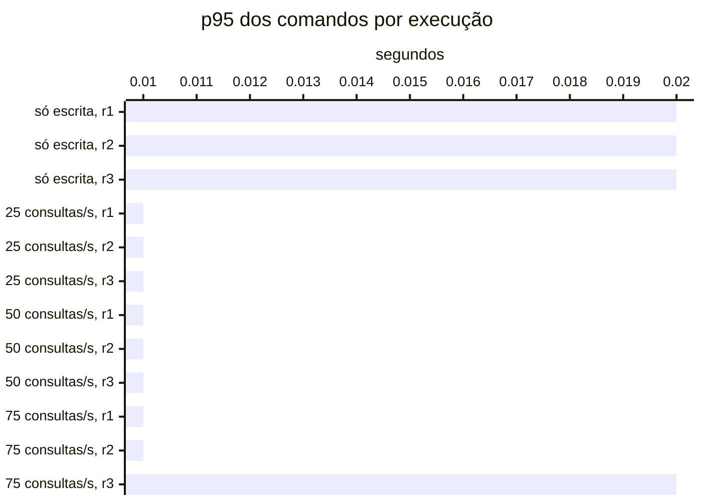

# Resumo

Gerado por `java bench/Report.java summarize`. Mediana das repetições; entre colchetes, a faixa do p95
(mín–máx). Latências em ms, vazão em requisições/s. Parâmetros de cada cenário em
`runs/<cenário>/scenario.properties`; série temporal de cada execução (5 s) em
`runs/<cenário>/r<n>/timeseries.csv`.

## s1 (3 execuções)

`writeRate=20` · `readRate=0` · `duration=180`

| Requisição | Vazão | % KO | p50 | p95 | p99 |
|---|---:|---:|---:|---:|---:|
| Global | 20.0 | 0.0 | 8 | 15 [15–17] | 22 |
| comandos | 20.0 | 0.0 | 8 | 15 [15–17] | 22 |
| comandos / deposit empresa | 3.0 | 0.0 | 7 | 14 [14–15] | 23 |
| comandos / deposit pessoa | 3.1 | 0.0 | 8 | 16 [14–16] | 23 |
| comandos / transfer empresa | 1.5 | 0.0 | 10 | 17 [16–18] | 26 |
| comandos / transfer pessoa | 1.5 | 0.0 | 10 | 19 [17–19] | 24 |
| comandos / withdraw empresa | 5.6 | 0.0 | 8 | 15 [14–16] | 22 |
| comandos / withdraw pessoa | 5.2 | 0.0 | 8 | 15 [15–17] | 22 |

## s2 (3 execuções)

`writeRate=0` · `readRate=75` · `duration=180`

| Requisição | Vazão | % KO | p50 | p95 | p99 |
|---|---:|---:|---:|---:|---:|
| Global | 74.6 | 0.0 | 6 | 40 [33–162] | 88 |
| consultas | 74.6 | 0.0 | 6 | 40 [33–162] | 87 |
| consultas / Q1 empresa | 9.4 | 0.0 | 1 | 3 [3–94] | 8 |
| consultas / Q1 pessoa | 9.3 | 0.0 | 1 | 4 [3–58] | 12 |
| consultas / Q2 empresa | 9.4 | 0.0 | 10 | 29 [20–242] | 49 |
| consultas / Q2 pessoa | 9.2 | 0.0 | 5 | 17 [11–123] | 30 |
| consultas / Q3 empresa | 9.4 | 0.0 | 10 | 23 [18–123] | 36 |
| consultas / Q3 pessoa | 9.3 | 0.0 | 2 | 7 [4–75] | 17 |
| consultas / Q4 empresa | 9.1 | 0.0 | 31 | 104 [70–577] | 171 |
| consultas / Q4 pessoa | 9.2 | 0.0 | 5 | 19 [14–101] | 33 |

## s3-r025 (3 execuções)

`writeRate=20` · `readRate=25` · `duration=180`

| Requisição | Vazão | % KO | p50 | p95 | p99 |
|---|---:|---:|---:|---:|---:|
| Global | 45.0 | 0.0 | 4 | 26 [24–36] | 58 |
| comandos | 20.0 | 0.0 | 4 | 9 [9–13] | 17 |
| consultas | 25.0 | 0.0 | 6 | 37 [34–50] | 67 |
| comandos / deposit empresa | 3.0 | 0.0 | 4 | 9 [9–12] | 18 |
| comandos / deposit pessoa | 2.9 | 0.0 | 4 | 10 [9–15] | 19 |
| comandos / transfer empresa | 1.4 | 0.0 | 5 | 12 [10–16] | 20 |
| comandos / transfer pessoa | 1.5 | 0.0 | 5 | 12 [12–14] | 25 |
| comandos / withdraw empresa | 5.7 | 0.0 | 4 | 9 [9–12] | 17 |
| comandos / withdraw pessoa | 5.5 | 0.0 | 4 | 9 [9–13] | 14 |
| consultas / Q1 empresa | 3.1 | 0.0 | 1 | 4 [4–5] | 10 |
| consultas / Q1 pessoa | 3.1 | 0.0 | 1 | 4 [4–7] | 9 |
| consultas / Q2 empresa | 3.2 | 0.0 | 12 | 24 [24–41] | 37 |
| consultas / Q2 pessoa | 3.1 | 0.0 | 5 | 12 [11–21] | 19 |
| consultas / Q3 empresa | 3.1 | 0.0 | 12 | 23 [23–28] | 36 |
| consultas / Q3 pessoa | 3.2 | 0.0 | 2 | 7 [6–7] | 13 |
| consultas / Q4 empresa | 3.1 | 0.0 | 29 | 73 [71–104] | 90 |
| consultas / Q4 pessoa | 3.1 | 0.0 | 6 | 16 [15–18] | 25 |

## s3-r050 (3 execuções)

`writeRate=20` · `readRate=50` · `duration=180`

| Requisição | Vazão | % KO | p50 | p95 | p99 |
|---|---:|---:|---:|---:|---:|
| Global | 70.0 | 0.0 | 4 | 30 [24–32] | 72 |
| comandos | 20.0 | 0.0 | 4 | 10 [8–11] | 24 |
| consultas | 50.0 | 0.0 | 5 | 36 [29–37] | 78 |
| comandos / deposit empresa | 2.9 | 0.0 | 3 | 11 [7–12] | 27 |
| comandos / deposit pessoa | 3.1 | 0.0 | 4 | 9 [8–12] | 20 |
| comandos / transfer empresa | 1.4 | 0.0 | 4 | 11 [10–11] | 30 |
| comandos / transfer pessoa | 1.5 | 0.0 | 5 | 12 [10–12] | 27 |
| comandos / withdraw empresa | 5.6 | 0.0 | 3 | 9 [7–10] | 22 |
| comandos / withdraw pessoa | 5.6 | 0.0 | 4 | 10 [8–11] | 20 |
| consultas / Q1 empresa | 6.3 | 0.0 | 1 | 3 [3–3] | 12 |
| consultas / Q1 pessoa | 6.3 | 0.0 | 1 | 3 [3–3] | 8 |
| consultas / Q2 empresa | 6.3 | 0.0 | 10 | 25 [21–26] | 39 |
| consultas / Q2 pessoa | 6.3 | 0.0 | 5 | 14 [11–16] | 30 |
| consultas / Q3 empresa | 6.4 | 0.0 | 11 | 21 [18–21] | 38 |
| consultas / Q3 pessoa | 6.1 | 0.0 | 2 | 5 [5–6] | 13 |
| consultas / Q4 empresa | 6.1 | 0.0 | 27 | 87 [71–93] | 123 |
| consultas / Q4 pessoa | 6.0 | 0.0 | 5 | 16 [13–18] | 36 |

## s3-r075 (3 execuções)

`writeRate=20` · `readRate=75` · `duration=180`

| Requisição | Vazão | % KO | p50 | p95 | p99 |
|---|---:|---:|---:|---:|---:|
| Global | 95.0 | 0.0 | 4 | 30 [27–58] | 66 |
| comandos | 20.0 | 0.0 | 3 | 9 [9–18] | 25 |
| consultas | 75.0 | 0.0 | 5 | 34 [31–65] | 69 |
| comandos / deposit empresa | 2.9 | 0.0 | 3 | 8 [6–13] | 22 |
| comandos / deposit pessoa | 3.0 | 0.0 | 3 | 9 [9–17] | 31 |
| comandos / transfer empresa | 1.6 | 0.0 | 4 | 11 [9–19] | 22 |
| comandos / transfer pessoa | 1.5 | 0.0 | 5 | 12 [11–28] | 41 |
| comandos / withdraw empresa | 5.5 | 0.0 | 3 | 8 [8–14] | 17 |
| comandos / withdraw pessoa | 5.5 | 0.0 | 3 | 10 [8–18] | 23 |
| consultas / Q1 empresa | 9.4 | 0.0 | 1 | 2 [2–4] | 10 |
| consultas / Q1 pessoa | 9.5 | 0.0 | 1 | 3 [3–6] | 11 |
| consultas / Q2 empresa | 9.4 | 0.0 | 9 | 23 [20–62] | 39 |
| consultas / Q2 pessoa | 9.4 | 0.0 | 4 | 12 [12–29] | 31 |
| consultas / Q3 empresa | 9.3 | 0.0 | 9 | 18 [17–28] | 40 |
| consultas / Q3 pessoa | 9.5 | 0.0 | 2 | 5 [4–11] | 15 |
| consultas / Q4 empresa | 9.4 | 0.0 | 25 | 74 [73–229] | 134 |
| consultas / Q4 pessoa | 9.3 | 0.0 | 5 | 14 [13–34] | 25 |

## Estado por execução

Colapso: p95 global acima de 5,000 ms (ADR-0009). Leia a contagem, não a mediana: perto da saturação as
repetições caem em estados diferentes.

| Cenário | Colapsou |
|---|---|
| s1 | 0 de 3 |
| s2 | 0 de 3 |
| s3-r025 | 0 de 3 |
| s3-r050 | 0 de 3 |
| s3-r075 | 0 de 3 |

p95 global e comandos em ms, no cliente (Gatling). Espera e uso da conexão do Hikari em ms, média da
execução. Comando no banco: soma do tempo médio das instruções de escrita e do `SELECT … FOR UPDATE` no
`pg_stat_statements`, em ms (o custo de um comando dentro do Postgres, sem a fila). GC: segundos com a JVM
parada em GC na execução (medido a partir da #11).

| Cenário | Rep. | Estado | p95 global | % KO | Comandos p50 | p95 | p99 | Espera no pool | Uso da conexão | Comando no banco | GC |
|---|---|---|---:|---:|---:|---:|---:|---:|---:|---:|---:|
| s1 | r1 | estável | 15 | 0.0 | 8 | 15 | 22 | 0.0 | 4.3 | 1.3 | 0.4 |
| s1 | r2 | estável | 15 | 0.0 | 8 | 15 | 22 | 0.0 | 4.6 | 1.5 | 0.4 |
| s1 | r3 | estável | 17 | 0.0 | 8 | 17 | 26 | 0.0 | 4.6 | 1.7 | 0.1 |
| s2 | r1 | estável | 33 | 0.0 | — | — | — | 0.0 | 6.2 | — | 0.7 |
| s2 | r2 | estável | 162 | 0.0 | — | — | — | 13.6 | 16.7 | — | 0.4 |
| s2 | r3 | estável | 40 | 0.0 | — | — | — | 0.0 | 8.1 | — | 0.2 |
| s3-r025 | r1 | estável | 26 | 0.0 | 4 | 9 | 17 | 0.0 | 5.3 | 0.8 | 0.5 |
| s3-r025 | r2 | estável | 24 | 0.0 | 4 | 9 | 17 | 0.0 | 5.4 | 0.8 | 0.5 |
| s3-r025 | r3 | estável | 36 | 0.0 | 4 | 13 | 46 | 0.1 | 6.7 | 0.9 | 0.2 |
| s3-r050 | r1 | estável | 30 | 0.0 | 4 | 10 | 28 | 0.0 | 5.8 | 0.8 | 0.6 |
| s3-r050 | r2 | estável | 24 | 0.0 | 3 | 8 | 18 | 0.1 | 5.2 | 0.7 | 0.5 |
| s3-r050 | r3 | estável | 32 | 0.0 | 4 | 11 | 24 | 0.0 | 6.4 | 0.9 | 0.2 |
| s3-r075 | r1 | estável | 30 | 0.0 | 3 | 9 | 25 | 0.1 | 5.8 | 0.8 | 0.8 |
| s3-r075 | r2 | estável | 27 | 0.0 | 3 | 9 | 17 | 0.0 | 5.6 | 0.8 | 0.2 |
| s3-r075 | r3 | estável | 58 | 0.0 | 4 | 18 | 81 | 1.0 | 12.1 | 1.5 | 0.3 |

## Leitura de disco por execução

Páginas lidas fora do cache e tempo médio por página, em ms. Postgres: soma das instruções do
pg_stat_statements (as 50 mais caras). Mongo: leituras das threads da aplicação para o cache do WiredTiger.
— quando o store não existe na fase.

| Cenário | Rep. | Postgres: páginas | ms/página | Mongo: páginas | ms/página |
|---|---|---:|---:|---:|---:|
| s1 | r1 | 3,956 | 0.60 | — | — |
| s1 | r2 | 5,491 | 0.54 | — | — |
| s1 | r3 | 5,509 | 0.69 | — | — |
| s2 | r1 | 441,989 | 0.14 | — | — |
| s2 | r2 | 438,171 | 0.40 | — | — |
| s2 | r3 | 434,664 | 0.20 | — | — |
| s3-r025 | r1 | 152,769 | 0.16 | — | — |
| s3-r025 | r2 | 155,301 | 0.16 | — | — |
| s3-r025 | r3 | 151,554 | 0.22 | — | — |
| s3-r050 | r1 | 302,109 | 0.16 | — | — |
| s3-r050 | r2 | 290,783 | 0.14 | — | — |
| s3-r050 | r3 | 292,070 | 0.19 | — | — |
| s3-r075 | r1 | 453,404 | 0.15 | — | — |
| s3-r075 | r2 | 448,036 | 0.15 | — | — |
| s3-r075 | r3 | 467,529 | 0.37 | — | — |

## Pool e banco por cenário

Mediana das repetições. Espera = tempo médio para obter conexão do Hikari; uso = tempo médio com a
conexão (o trabalho no banco); hit ratio = blocos achados no shared_buffers.

| Cenário | Espera no pool (ms) | Uso da conexão (ms) | Fila máx. no pool | Hit ratio | CPU da app |
|---|---:|---:|---:|---:|---:|
| s1 | 0.0 | 4.6 | 0 | 97.1% | 3% |
| s2 | 0.0 | 8.1 | 0 | 97.6% | 3% |
| s3-r025 | 0.0 | 5.4 | 0 | 95.6% | 3% |
| s3-r050 | 0.0 | 5.8 | 0 | 96.6% | 4% |
| s3-r075 | 0.1 | 5.8 | 0 | 96.8% | 4% |
