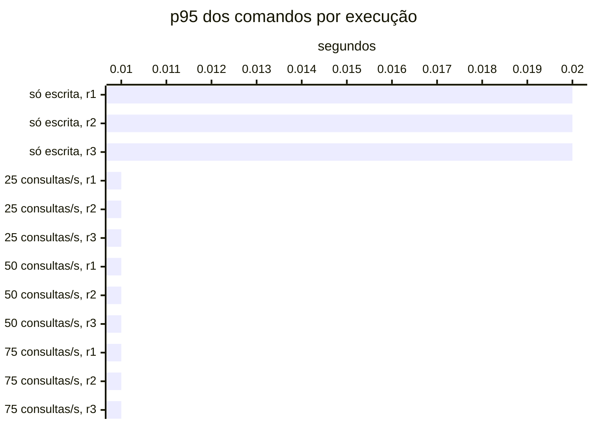

# Resumo

Gerado por `java bench/Report.java summarize`. Mediana das repetições; entre colchetes, a faixa do p95
(mín–máx). Latências em ms, vazão em requisições/s. Parâmetros de cada cenário em
`runs/<cenário>/scenario.properties`; série temporal de cada execução (5 s) em
`runs/<cenário>/r<n>/timeseries.csv`.

## s1 (3 execuções)

`writeRate=20` · `readRate=0` · `duration=180`

| Requisição | Vazão | % KO | p50 | p95 | p99 |
|---|---:|---:|---:|---:|---:|
| Global | 20.0 | 0.0 | 9 | 15 [15–16] | 21 |
| comandos | 20.0 | 0.0 | 9 | 15 [15–16] | 21 |
| comandos / deposit empresa | 3.0 | 0.0 | 8 | 14 [13–14] | 19 |
| comandos / deposit pessoa | 3.1 | 0.0 | 9 | 15 [15–16] | 24 |
| comandos / transfer empresa | 1.5 | 0.0 | 11 | 18 [17–19] | 23 |
| comandos / transfer pessoa | 1.5 | 0.0 | 11 | 18 [17–18] | 25 |
| comandos / withdraw empresa | 5.6 | 0.0 | 8 | 14 [13–14] | 21 |
| comandos / withdraw pessoa | 5.2 | 0.0 | 9 | 15 [14–15] | 21 |

## s2 (3 execuções)

`writeRate=0` · `readRate=75` · `duration=180`

| Requisição | Vazão | % KO | p50 | p95 | p99 |
|---|---:|---:|---:|---:|---:|
| Global | 75.0 | 0.0 | 2 | 24 [22–26] | 44 |
| consultas | 75.0 | 0.0 | 2 | 24 [22–26] | 44 |
| consultas / Q1 empresa | 9.4 | 0.0 | 1 | 3 [2–4] | 8 |
| consultas / Q1 pessoa | 9.3 | 0.0 | 1 | 3 [3–4] | 10 |
| consultas / Q2 empresa | 9.5 | 0.0 | 5 | 12 [11–14] | 26 |
| consultas / Q2 pessoa | 9.2 | 0.0 | 2 | 5 [5–7] | 13 |
| consultas / Q3 empresa | 9.6 | 0.0 | 2 | 6 [5–7] | 12 |
| consultas / Q3 pessoa | 9.3 | 0.0 | 2 | 5 [4–6] | 11 |
| consultas / Q4 empresa | 9.1 | 0.0 | 20 | 44 [44–63] | 66 |
| consultas / Q4 pessoa | 9.3 | 0.0 | 3 | 7 [7–9] | 15 |

## s3-r025 (3 execuções)

`writeRate=20` · `readRate=25` · `duration=180`

| Requisição | Vazão | % KO | p50 | p95 | p99 |
|---|---:|---:|---:|---:|---:|
| Global | 45.0 | 0.0 | 5 | 19 [18–19] | 39 |
| comandos | 20.0 | 0.0 | 6 | 11 [11–12] | 17 |
| consultas | 25.0 | 0.0 | 4 | 26 [26–28] | 45 |
| comandos / deposit empresa | 3.1 | 0.0 | 5 | 11 [10–11] | 16 |
| comandos / deposit pessoa | 2.9 | 0.0 | 5 | 11 [11–12] | 16 |
| comandos / transfer empresa | 1.5 | 0.0 | 7 | 14 [13–14] | 17 |
| comandos / transfer pessoa | 1.5 | 0.0 | 7 | 13 [12–14] | 19 |
| comandos / withdraw empresa | 5.5 | 0.0 | 5 | 10 [10–10] | 15 |
| comandos / withdraw pessoa | 5.5 | 0.0 | 5 | 11 [11–11] | 18 |
| consultas / Q1 empresa | 3.2 | 0.0 | 2 | 5 [5–5] | 8 |
| consultas / Q1 pessoa | 3.1 | 0.0 | 2 | 5 [4–5] | 9 |
| consultas / Q2 empresa | 3.2 | 0.0 | 7 | 14 [14–15] | 20 |
| consultas / Q2 pessoa | 3.1 | 0.0 | 3 | 8 [8–8] | 12 |
| consultas / Q3 empresa | 3.2 | 0.0 | 3 | 7 [7–8] | 10 |
| consultas / Q3 pessoa | 3.3 | 0.0 | 3 | 7 [6–7] | 12 |
| consultas / Q4 empresa | 3.0 | 0.0 | 23 | 48 [47–50] | 60 |
| consultas / Q4 pessoa | 3.0 | 0.0 | 5 | 9 [9–11] | 16 |

## s3-r050 (3 execuções)

`writeRate=20` · `readRate=50` · `duration=180`

| Requisição | Vazão | % KO | p50 | p95 | p99 |
|---|---:|---:|---:|---:|---:|
| Global | 70.0 | 0.0 | 3 | 21 [20–21] | 38 |
| comandos | 20.0 | 0.0 | 4 | 10 [9–10] | 17 |
| consultas | 50.0 | 0.0 | 3 | 25 [24–25] | 41 |
| comandos / deposit empresa | 3.0 | 0.0 | 4 | 9 [8–9] | 17 |
| comandos / deposit pessoa | 3.0 | 0.0 | 4 | 9 [8–10] | 16 |
| comandos / transfer empresa | 1.5 | 0.0 | 6 | 11 [10–12] | 16 |
| comandos / transfer pessoa | 1.5 | 0.0 | 6 | 12 [11–14] | 21 |
| comandos / withdraw empresa | 5.6 | 0.0 | 4 | 8 [8–8] | 16 |
| comandos / withdraw pessoa | 5.7 | 0.0 | 4 | 9 [8–9] | 21 |
| consultas / Q1 empresa | 6.3 | 0.0 | 1 | 3 [3–3] | 9 |
| consultas / Q1 pessoa | 6.5 | 0.0 | 1 | 3 [3–3] | 8 |
| consultas / Q2 empresa | 6.2 | 0.0 | 6 | 12 [11–14] | 18 |
| consultas / Q2 pessoa | 6.2 | 0.0 | 2 | 5 [5–7] | 11 |
| consultas / Q3 empresa | 6.3 | 0.0 | 2 | 5 [5–5] | 11 |
| consultas / Q3 pessoa | 6.2 | 0.0 | 2 | 5 [5–5] | 8 |
| consultas / Q4 empresa | 6.2 | 0.0 | 21 | 44 [44–45] | 54 |
| consultas / Q4 pessoa | 6.1 | 0.0 | 3 | 7 [7–8] | 14 |

## s3-r075 (3 execuções)

`writeRate=20` · `readRate=75` · `duration=180`

| Requisição | Vazão | % KO | p50 | p95 | p99 |
|---|---:|---:|---:|---:|---:|
| Global | 95.0 | 0.0 | 3 | 20 [19–20] | 36 |
| comandos | 20.0 | 0.0 | 4 | 8 [8–8] | 15 |
| consultas | 75.0 | 0.0 | 2 | 22 [22–23] | 38 |
| comandos / deposit empresa | 2.9 | 0.0 | 3 | 7 [6–8] | 14 |
| comandos / deposit pessoa | 2.9 | 0.0 | 4 | 8 [7–9] | 16 |
| comandos / transfer empresa | 1.6 | 0.0 | 5 | 11 [9–11] | 18 |
| comandos / transfer pessoa | 1.5 | 0.0 | 5 | 10 [8–10] | 20 |
| comandos / withdraw empresa | 5.7 | 0.0 | 3 | 7 [7–8] | 15 |
| comandos / withdraw pessoa | 5.5 | 0.0 | 4 | 8 [7–8] | 15 |
| consultas / Q1 empresa | 9.5 | 0.0 | 1 | 3 [2–3] | 6 |
| consultas / Q1 pessoa | 9.4 | 0.0 | 1 | 2 [2–3] | 6 |
| consultas / Q2 empresa | 9.3 | 0.0 | 5 | 10 [10–11] | 18 |
| consultas / Q2 pessoa | 9.4 | 0.0 | 2 | 5 [4–5] | 10 |
| consultas / Q3 empresa | 9.4 | 0.0 | 2 | 4 [4–5] | 10 |
| consultas / Q3 pessoa | 9.5 | 0.0 | 2 | 4 [4–4] | 8 |
| consultas / Q4 empresa | 9.4 | 0.0 | 19 | 40 [40–41] | 53 |
| consultas / Q4 pessoa | 9.1 | 0.0 | 3 | 6 [6–8] | 12 |

## Estado por execução

Colapso: p95 global acima de 5,000 ms (ADR-0009). Leia a contagem, não a mediana: perto da saturação as
repetições caem em estados diferentes.

| Cenário | Colapsou |
|---|---|
| s1 | 0 de 3 |
| s2 | 0 de 3 |
| s3-r025 | 0 de 3 |
| s3-r050 | 0 de 3 |
| s3-r075 | 0 de 3 |

p95 global e comandos em ms, no cliente (Gatling). Espera e uso da conexão do Hikari em ms, média da
execução. Comando no banco: soma do tempo médio das instruções de escrita e do `SELECT … FOR UPDATE` no
`pg_stat_statements`, em ms (o custo de um comando dentro do Postgres, sem a fila). GC: segundos com a JVM
parada em GC na execução (medido a partir da #11).

| Cenário | Rep. | Estado | p95 global | % KO | Comandos p50 | p95 | p99 | Espera no pool | Uso da conexão | Comando no banco | GC |
|---|---|---|---:|---:|---:|---:|---:|---:|---:|---:|---:|
| s1 | r1 | estável | 16 | 0.0 | 9 | 16 | 22 | 0.0 | 5.1 | 1.4 | 0.2 |
| s1 | r2 | estável | 15 | 0.0 | 9 | 15 | 21 | 0.0 | 5.2 | 1.6 | 0.1 |
| s1 | r3 | estável | 15 | 0.0 | 9 | 15 | 19 | 0.0 | 5.3 | 1.7 | 0.2 |
| s2 | r1 | estável | 24 | 0.0 | — | — | — | 0.0 | 3.1 | — | 0.2 |
| s2 | r2 | estável | 22 | 0.0 | — | — | — | 0.0 | 2.9 | — | 0.2 |
| s2 | r3 | estável | 26 | 0.0 | — | — | — | 0.0 | 3.2 | — | 0.2 |
| s3-r025 | r1 | estável | 19 | 0.0 | 5 | 11 | 15 | 0.0 | 3.8 | 0.9 | 0.2 |
| s3-r025 | r2 | estável | 18 | 0.0 | 6 | 11 | 17 | 0.0 | 3.8 | 1.0 | 0.2 |
| s3-r025 | r3 | estável | 19 | 0.0 | 6 | 12 | 18 | 0.0 | 3.8 | 1.1 | 0.2 |
| s3-r050 | r1 | estável | 21 | 0.0 | 4 | 10 | 17 | 0.0 | 3.3 | 0.8 | 0.2 |
| s3-r050 | r2 | estável | 20 | 0.0 | 4 | 9 | 15 | 0.0 | 3.2 | 0.8 | 0.2 |
| s3-r050 | r3 | estável | 21 | 0.0 | 4 | 10 | 20 | 0.0 | 3.3 | 0.9 | 0.2 |
| s3-r075 | r1 | estável | 20 | 0.0 | 4 | 8 | 17 | 0.0 | 2.9 | 0.7 | 0.3 |
| s3-r075 | r2 | estável | 19 | 0.0 | 4 | 8 | 15 | 0.0 | 2.9 | 0.8 | 0.3 |
| s3-r075 | r3 | estável | 20 | 0.0 | 4 | 8 | 15 | 0.0 | 2.9 | 0.8 | 0.3 |

## Leitura de disco por execução

Páginas lidas fora do cache e tempo médio por página, em ms. Postgres: soma das instruções do
pg_stat_statements (as 50 mais caras). Mongo: leituras das threads da aplicação para o cache do WiredTiger.
— quando o store não existe na fase.

| Cenário | Rep. | Postgres: páginas | ms/página | Mongo: páginas | ms/página |
|---|---|---:|---:|---:|---:|
| s1 | r1 | 4,510 | 0.53 | — | — |
| s1 | r2 | 5,785 | 0.52 | — | — |
| s1 | r3 | 6,664 | 0.50 | — | — |
| s2 | r1 | 111,469 | 0.09 | — | — |
| s2 | r2 | 111,368 | 0.09 | — | — |
| s2 | r3 | 113,375 | 0.10 | — | — |
| s3-r025 | r1 | 43,706 | 0.15 | — | — |
| s3-r025 | r2 | 41,574 | 0.16 | — | — |
| s3-r025 | r3 | 43,840 | 0.15 | — | — |
| s3-r050 | r1 | 80,783 | 0.11 | — | — |
| s3-r050 | r2 | 80,817 | 0.11 | — | — |
| s3-r050 | r3 | 84,402 | 0.11 | — | — |
| s3-r075 | r1 | 117,144 | 0.10 | — | — |
| s3-r075 | r2 | 120,848 | 0.10 | — | — |
| s3-r075 | r3 | 121,248 | 0.10 | — | — |

## Pool e banco por cenário

Mediana das repetições. Espera = tempo médio para obter conexão do Hikari; uso = tempo médio com a
conexão (o trabalho no banco); hit ratio = blocos achados no shared_buffers.

| Cenário | Espera no pool (ms) | Uso da conexão (ms) | Fila máx. no pool | Hit ratio | CPU da app |
|---|---:|---:|---:|---:|---:|
| s1 | 0.0 | 5.2 | 0 | 97.9% | 4% |
| s2 | 0.0 | 3.1 | 0 | 92.5% | 3% |
| s3-r025 | 0.0 | 3.8 | 0 | 94.9% | 4% |
| s3-r050 | 0.0 | 3.3 | 0 | 93.7% | 4% |
| s3-r075 | 0.0 | 2.9 | 0 | 93.0% | 4% |
