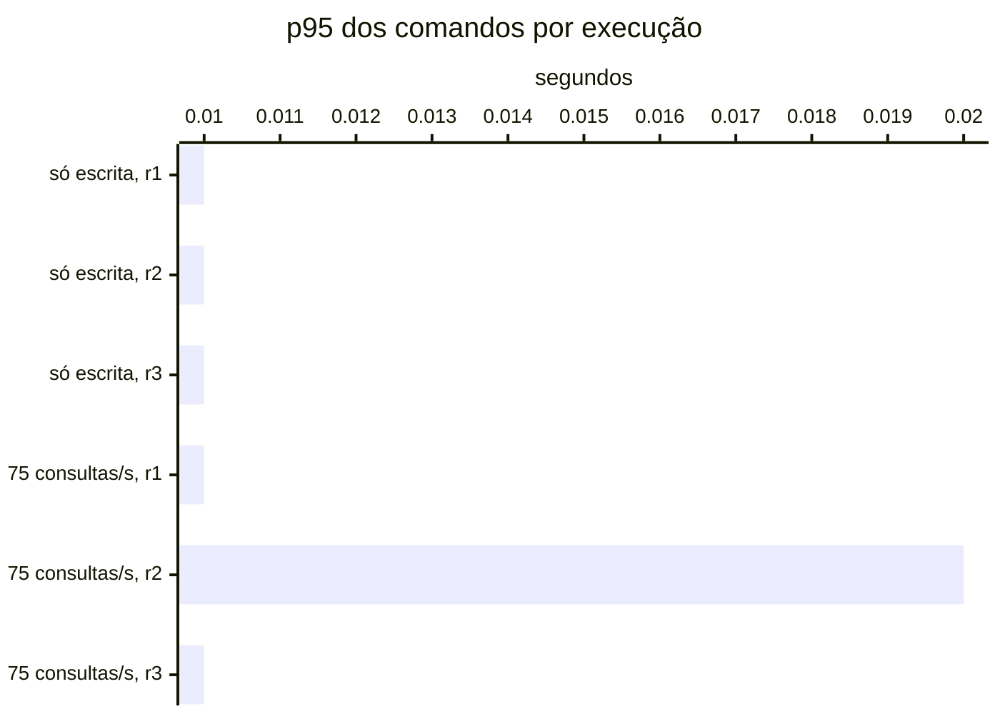

# Resumo

Gerado por `java bench/Report.java summarize`. Mediana das repetições; entre colchetes, a faixa do p95
(mín–máx). Latências em ms, vazão em requisições/s. Parâmetros de cada cenário em
`runs/<cenário>/scenario.properties`; série temporal de cada execução (5 s) em
`runs/<cenário>/r<n>/timeseries.csv`.

## s1 (3 execuções)

`writeRate=20` · `readRate=0` · `duration=180`

| Requisição | Vazão | % KO | p50 | p95 | p99 |
|---|---:|---:|---:|---:|---:|
| Global | 20.0 | 0.0 | 5 | 12 [12–12] | 73 |
| comandos | 20.0 | 0.0 | 5 | 12 [12–12] | 73 |
| comandos / deposit empresa | 3.0 | 0.0 | 5 | 13 [11–13] | 132 |
| comandos / deposit pessoa | 3.1 | 0.0 | 5 | 12 [10–12] | 61 |
| comandos / transfer empresa | 1.5 | 0.0 | 6 | 13 [12–22] | 62 |
| comandos / transfer pessoa | 1.5 | 0.0 | 6 | 16 [14–17] | 112 |
| comandos / withdraw empresa | 5.6 | 0.0 | 5 | 11 [11–12] | 62 |
| comandos / withdraw pessoa | 5.2 | 0.0 | 5 | 12 [12–12] | 110 |

## s2 (3 execuções)

`writeRate=0` · `readRate=75` · `duration=180`

| Requisição | Vazão | % KO | p50 | p95 | p99 |
|---|---:|---:|---:|---:|---:|
| Global | 75.0 | 0.0 | 3 | 20 [20–20] | 35 |
| consultas | 75.0 | 0.0 | 3 | 20 [20–20] | 35 |
| consultas / Q1 empresa | 9.4 | 0.0 | 1 | 4 [4–4] | 11 |
| consultas / Q1 pessoa | 9.3 | 0.0 | 1 | 4 [4–4] | 11 |
| consultas / Q2 empresa | 9.5 | 0.0 | 4 | 10 [9–10] | 18 |
| consultas / Q2 pessoa | 9.2 | 0.0 | 3 | 8 [7–8] | 16 |
| consultas / Q3 empresa | 9.6 | 0.0 | 4 | 9 [8–9] | 18 |
| consultas / Q3 pessoa | 9.3 | 0.0 | 3 | 7 [7–7] | 15 |
| consultas / Q4 empresa | 9.1 | 0.0 | 17 | 37 [36–37] | 55 |
| consultas / Q4 pessoa | 9.3 | 0.0 | 4 | 9 [8–9] | 19 |

## s3-r075 (3 execuções)

`writeRate=20` · `readRate=75` · `duration=180`

| Requisição | Vazão | % KO | p50 | p95 | p99 |
|---|---:|---:|---:|---:|---:|
| Global | 95.0 | 0.0 | 4 | 21 [20–28] | 42 |
| comandos | 20.0 | 0.0 | 4 | 13 [11–21] | 128 |
| consultas | 75.0 | 0.0 | 3 | 22 [21–29] | 40 |
| comandos / deposit empresa | 3.0 | 0.0 | 4 | 12 [10–21] | 172 |
| comandos / deposit pessoa | 3.2 | 0.0 | 4 | 13 [9–22] | 62 |
| comandos / transfer empresa | 1.4 | 0.0 | 5 | 20 [12–22] | 109 |
| comandos / transfer pessoa | 1.5 | 0.0 | 5 | 14 [13–57] | 126 |
| comandos / withdraw empresa | 5.6 | 0.0 | 4 | 13 [13–22] | 148 |
| comandos / withdraw pessoa | 5.4 | 0.0 | 4 | 12 [11–19] | 116 |
| consultas / Q1 empresa | 9.3 | 0.0 | 1 | 5 [4–7] | 13 |
| consultas / Q1 pessoa | 9.4 | 0.0 | 1 | 5 [4–8] | 10 |
| consultas / Q2 empresa | 9.5 | 0.0 | 4 | 13 [10–17] | 28 |
| consultas / Q2 pessoa | 9.3 | 0.0 | 3 | 11 [10–16] | 28 |
| consultas / Q3 empresa | 9.3 | 0.0 | 4 | 11 [9–15] | 31 |
| consultas / Q3 pessoa | 9.5 | 0.0 | 3 | 10 [9–14] | 34 |
| consultas / Q4 empresa | 9.4 | 0.0 | 17 | 43 [41–80] | 104 |
| consultas / Q4 pessoa | 9.1 | 0.0 | 4 | 12 [10–15] | 38 |

## Estado por execução

Colapso: p95 global acima de 5,000 ms (ADR-0009). Leia a contagem, não a mediana: perto da saturação as
repetições caem em estados diferentes.

| Cenário | Colapsou |
|---|---|
| s1 | 0 de 3 |
| s2 | 0 de 3 |
| s3-r075 | 0 de 3 |

p95 global e comandos em ms, no cliente (Gatling). Espera e uso da conexão do Hikari em ms, média da
execução. Comando no banco: soma do tempo médio das instruções de escrita e do `SELECT … FOR UPDATE` no
`pg_stat_statements`, em ms (o custo de um comando dentro do Postgres, sem a fila). GC: segundos com a JVM
parada em GC na execução (medido a partir da #11).

| Cenário | Rep. | Estado | p95 global | % KO | Comandos p50 | p95 | p99 | Espera no pool | Uso da conexão | Comando no banco | GC |
|---|---|---|---:|---:|---:|---:|---:|---:|---:|---:|---:|
| s1 | r1 | estável | 12 | 0.0 | 5 | 12 | 62 | 0.0 | 1.6 | 0.5 | 0.8 |
| s1 | r2 | estável | 12 | 0.0 | 5 | 12 | 73 | 0.0 | 1.8 | 0.6 | 0.8 |
| s1 | r3 | estável | 12 | 0.0 | 5 | 12 | 117 | 0.1 | 2.2 | 0.5 | 0.8 |
| s2 | r1 | estável | 20 | 0.0 | — | — | — | 0.0 | 0.1 | — | 2.4 |
| s2 | r2 | estável | 20 | 0.0 | — | — | — | 0.0 | 0.1 | — | 2.4 |
| s2 | r3 | estável | 20 | 0.0 | — | — | — | 0.0 | 0.1 | — | 2.4 |
| s3-r075 | r1 | estável | 21 | 0.0 | 4 | 13 | 63 | 0.0 | 1.3 | 0.6 | 2.8 |
| s3-r075 | r2 | estável | 28 | 0.0 | 4 | 21 | 128 | 0.0 | 1.6 | 0.6 | 2.8 |
| s3-r075 | r3 | estável | 20 | 0.0 | 4 | 11 | 130 | 0.0 | 1.5 | 0.7 | 2.6 |

## Pools por execução

Espera e uso da conexão do Hikari em ms, média da execução; fila máxima de requisições esperando conexão.
Pool sem requisições na execução aparece com —.

| Cenário | Rep. | Pool | Espera | Uso da conexão | Fila máx. |
|---|---|---|---:|---:|---:|
| s1 | r1 | HikariPool-1@command-api | 0.0 | 1.6 | 0 |
| s1 | r1 | HikariPool-1@query-api | — | — | 0 |
| s1 | r1 | HikariPool-1@query-api-2 | — | — | 0 |
| s1 | r2 | HikariPool-1@command-api | 0.0 | 1.8 | 0 |
| s1 | r2 | HikariPool-1@query-api | — | — | 0 |
| s1 | r2 | HikariPool-1@query-api-2 | — | — | 0 |
| s1 | r3 | HikariPool-1@command-api | 0.1 | 2.2 | 0 |
| s1 | r3 | HikariPool-1@query-api | — | — | 0 |
| s1 | r3 | HikariPool-1@query-api-2 | — | — | 0 |
| s2 | r1 | HikariPool-1@command-api | 1.6 | 0.6 | 0 |
| s2 | r1 | HikariPool-1@query-api | 0.0 | 0.1 | 0 |
| s2 | r1 | HikariPool-1@query-api-2 | 0.0 | 0.1 | 0 |
| s2 | r2 | HikariPool-1@command-api | 1.3 | 0.4 | 0 |
| s2 | r2 | HikariPool-1@query-api | 0.0 | 0.1 | 0 |
| s2 | r2 | HikariPool-1@query-api-2 | 0.0 | 0.1 | 0 |
| s2 | r3 | HikariPool-1@command-api | 1.2 | 0.4 | 0 |
| s2 | r3 | HikariPool-1@query-api | 0.0 | 0.1 | 0 |
| s2 | r3 | HikariPool-1@query-api-2 | 0.0 | 0.1 | 0 |
| s3-r075 | r1 | HikariPool-1@command-api | 0.0 | 1.7 | 0 |
| s3-r075 | r1 | HikariPool-1@query-api | 0.0 | 0.1 | 0 |
| s3-r075 | r1 | HikariPool-1@query-api-2 | 0.0 | 0.1 | 0 |
| s3-r075 | r2 | HikariPool-1@command-api | 0.0 | 2.2 | 0 |
| s3-r075 | r2 | HikariPool-1@query-api | 0.0 | 0.2 | 0 |
| s3-r075 | r2 | HikariPool-1@query-api-2 | 0.0 | 0.1 | 0 |
| s3-r075 | r3 | HikariPool-1@command-api | 0.1 | 2.1 | 0 |
| s3-r075 | r3 | HikariPool-1@query-api | 0.0 | 0.1 | 0 |
| s3-r075 | r3 | HikariPool-1@query-api-2 | 0.0 | 0.1 | 0 |

## JVMs por execução

GC: segundos com a JVM parada em GC na execução. CPU: média do processo. Heap: maior uso na execução, em MiB.

| Cenário | Rep. | JVM | GC (s) | CPU | Heap máx. |
|---|---|---|---:|---:|---:|
| s1 | r1 | command-api | 0.3 | 5% | 57 |
| s1 | r1 | projector | 0.2 | 6% | 59 |
| s1 | r1 | query-api | 0.2 | 3% | 54 |
| s1 | r1 | query-api-2 | 0.2 | 3% | 53 |
| s1 | r2 | command-api | 0.3 | 4% | 59 |
| s1 | r2 | projector | 0.2 | 5% | 60 |
| s1 | r2 | query-api | 0.2 | 3% | 59 |
| s1 | r2 | query-api-2 | 0.1 | 3% | 59 |
| s1 | r3 | command-api | 0.2 | 4% | 63 |
| s1 | r3 | projector | 0.2 | 4% | 61 |
| s1 | r3 | query-api | 0.2 | 3% | 65 |
| s1 | r3 | query-api-2 | 0.2 | 3% | 65 |
| s2 | r1 | command-api | 0.2 | 3% | 60 |
| s2 | r1 | projector | 0.2 | 3% | 60 |
| s2 | r1 | query-api | 1.0 | 5% | 58 |
| s2 | r1 | query-api-2 | 1.0 | 5% | 59 |
| s2 | r2 | command-api | 0.2 | 3% | 62 |
| s2 | r2 | projector | 0.2 | 3% | 59 |
| s2 | r2 | query-api | 1.0 | 5% | 64 |
| s2 | r2 | query-api-2 | 1.1 | 5% | 64 |
| s2 | r3 | command-api | 0.2 | 3% | 64 |
| s2 | r3 | projector | 0.1 | 2% | 59 |
| s2 | r3 | query-api | 1.0 | 5% | 70 |
| s2 | r3 | query-api-2 | 1.1 | 5% | 71 |
| s3-r075 | r1 | command-api | 0.4 | 5% | 57 |
| s3-r075 | r1 | projector | 0.2 | 5% | 61 |
| s3-r075 | r1 | query-api | 1.1 | 6% | 56 |
| s3-r075 | r1 | query-api-2 | 1.1 | 6% | 57 |
| s3-r075 | r2 | command-api | 0.3 | 4% | 62 |
| s3-r075 | r2 | projector | 0.2 | 4% | 60 |
| s3-r075 | r2 | query-api | 1.1 | 6% | 61 |
| s3-r075 | r2 | query-api-2 | 1.1 | 6% | 61 |
| s3-r075 | r3 | command-api | 0.3 | 4% | 60 |
| s3-r075 | r3 | projector | 0.2 | 4% | 61 |
| s3-r075 | r3 | query-api | 1.0 | 5% | 67 |
| s3-r075 | r3 | query-api-2 | 1.1 | 5% | 68 |

## Atraso da projeção por execução

Do `occurred_at` do lançamento (início da transação do comando) até ele estar nas duas projeções do Mongo,
em ms; superestima o atraso em até a duração do comando. p50 e p99 vêm do histograma (precisão dos
buckets); o máximo pode vir de uma janela anterior à execução. Reentregas: lançamentos que o projetor
recebeu de novo e descartou. Fila do outbox: publicações ainda não enviadas ao Kafka, no maior instante.

| Cenário | Rep. | Lançamentos | p50 | p99 | Máx. | Reentregas | Fila do outbox |
|---|---|---:|---:|---:|---:|---:|---:|
| s1 | r1 | 4,119 | 15 | 88 | 470 | 0 | 2 |
| s1 | r2 | 4,103 | 14 | 106 | 593 | 0 | 0 |
| s1 | r3 | 4,145 | 14 | 177 | 606 | 0 | 0 |
| s3-r075 | r1 | 4,118 | 13 | 110 | 544 | 0 | 0 |
| s3-r075 | r2 | 4,052 | 13 | 149 | 606 | 0 | 1 |
| s3-r075 | r3 | 4,155 | 13 | 149 | 640 | 0 | 1 |

## Leitura de disco por execução

Páginas lidas fora do cache e tempo médio por página, em ms. Postgres: soma das instruções do
pg_stat_statements (as 50 mais caras). Mongo: leituras das threads da aplicação para o cache do WiredTiger.
— quando o store não existe na fase.

| Cenário | Rep. | Postgres: páginas | ms/página | Mongo: páginas | ms/página |
|---|---|---:|---:|---:|---:|
| s1 | r1 | 0 | — | 9,426 | 0.34 |
| s1 | r2 | 0 | — | 10,611 | 0.37 |
| s1 | r3 | 0 | — | 10,840 | 0.37 |
| s2 | r1 | 0 | — | 47,419 | 0.25 |
| s2 | r2 | 0 | — | 47,466 | 0.25 |
| s2 | r3 | 0 | — | 46,586 | 0.25 |
| s3-r075 | r1 | 0 | — | 59,686 | 0.31 |
| s3-r075 | r2 | 0 | — | 61,130 | 0.33 |
| s3-r075 | r3 | 0 | — | 59,650 | 0.33 |

## Pool e banco por cenário

Mediana das repetições. Espera = tempo médio para obter conexão do Hikari; uso = tempo médio com a
conexão (o trabalho no banco); hit ratio = blocos achados no shared_buffers.

| Cenário | Espera no pool (ms) | Uso da conexão (ms) | Fila máx. no pool | Hit ratio | CPU da app |
|---|---:|---:|---:|---:|---:|
| s1 | 0.0 | 1.8 | 0 | 100.0% | 4% |
| s2 | 0.0 | 0.1 | 0 | 100.0% | 4% |
| s3-r075 | 0.0 | 1.5 | 0 | 100.0% | 5% |
