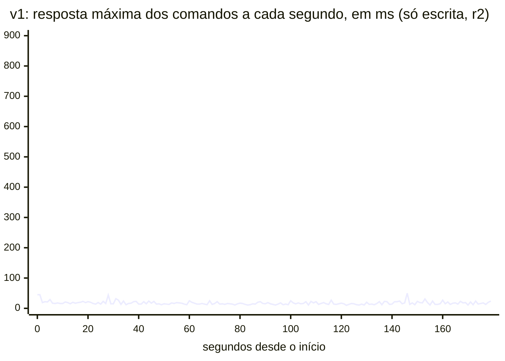
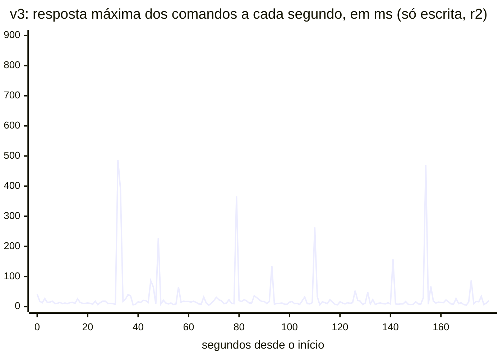

# v3 — 2026-10-21: CQRS físico contra v1, v1-big e v2 do mesmo dia

A v3 ([ADR-0012](../../adr/0012-v3-projecao-mongo-e-controle-de-hardware.md)) separa os processos e os stores:
`command-api` no Postgres, outbox do Modulith, Kafka, projetor e `query-api` com Q2–Q4 no Mongo (Q1 continua no
Postgres). As cinco fases rodaram no mesmo dia, nesta ordem, cada uma com `make clean` + `make up` +
`make seed SCALE=1` antes: [v1](../2026-10-21-v1/summary.md), [v1-big](../2026-10-21-v1-big/summary.md) (a v1 com o
hardware da v3, controle do ADR-0012), [v2](../2026-10-21-v2/summary.md), [v3](summary.md) e
[v3-s5](../2026-10-21-v3-s5/summary.md) (duas `query-api`, só `s3-r075` e S2). Mesmo protocolo e mesmas taxas do
[ADR-0009](../../adr/0009-revisao-da-baseline-e-parametros-do-benchmark.md). Ambiente no `env.md` de cada pasta.

## Resultado em uma frase

Nenhuma fase colapsou, então não houve interferência para a v3 eliminar: **H3 e H7 inconclusivas** a estas taxas.
**H5 confirmada:** a v3 custa 3 vezes a memória e de 2 a 5 vezes a CPU da v1, com atraso de projeção p50 de ~15 ms, e
os comandos têm uma cauda que as outras fases não têm (p99 de ~110 ms contra ~22 ms).

## Colapso: 0 de 9 em todas

| Fase | Colapsos com leitura ≥ 50/s | Tempo por página lida fora do cache (S2, por repetição) | CPU do Postgres, `s3-r075` |
|---|---:|---|---:|
| v1 | 0 de 9 | 0,14 · 0,40 · 0,20 ms | 36% |
| v1-big | 0 de 9 | 0,16 · 0,11 · 0,15 ms | 35% |
| v2 | 0 de 9 | 0,09 · 0,09 · 0,10 ms | 26% |
| v3 | 0 de 9 | Postgres: nenhuma página lida; Mongo: 0,29 · 0,28 · 0,27 ms | 6% |
| v3-s5 | 0 de 6 | Mongo: 0,25 · 0,25 · 0,25 ms | 6% |

CPU em % de um núcleo, média do `docker stats`; o teto do Postgres é 200%. O disco estava rápido o dia todo, como na
tarde de 20/10, e a v1 usou uma fração pequena da capacidade: pela lei de Little, ~0,55 das 10 conexões em média
([ADR-0013](../../adr/0013-estudo-de-capacidade.md#contexto)). No dia 19, a mesma taxa derrubou a v1 em 6 de 9.

## H3: inconclusiva

p95 dos comandos em ms, mediana das 3 repetições e faixa:

| Fase | Só escrita (S1) | 25 consultas/s | 50 consultas/s | 75 consultas/s |
|---|---:|---:|---:|---:|
| v1 | 15 [15–17] | 9 [9–13] | 10 [8–11] | 9 [9–18] |
| v1-big | 14 [14–15] | 10 [9–10] | 9 [8–10] | 9 [8–12] |
| v2 | 15 [15–16] | 11 [11–12] | 10 [9–10] | 8 [8–8] |
| v3 | 14 [14–20] | 16 [13–22] | 18 [13–24] | 17 [15–19] |
| v3-s5 | 12 [12–12] | — | — | 13 [11–21] |

Pelos critérios do ADR-0012, a H3 só se decide com a v1 degradando, o que não aconteceu. Ao contrário: nas fases de
modelo único, os comandos ficaram **mais rápidos** com leitura do que sem ela (p50 de 8 para 4 ms na v1). A causa não
foi investigada; uma hipótese é a CPU da VM em estado de economia com carga baixa. A única fase em que os comandos
pioram com a leitura é a v3 (14 → 17–18 ms), e pouco.

## H5: confirmada

**Atraso da projeção** (do `occurred_at` até as duas escritas no Mongo; superestima em até a duração do comando):

| | S1 | `s3-r075` |
|---|---:|---:|
| p50 | 15–16 ms | 13–14 ms |
| p99 | 113–166 ms | 186–210 ms |
| máximo | 624–855 ms | 683–953 ms |

Nenhuma reentrega, e a fila do outbox nunca passou de 13 publicações. A previsão do ADR-0012 era p50 de dezenas de ms
(ficou abaixo) e p99 em `s3-r075` uma ordem de grandeza acima do S1 (ficou 1,4 vez): **a parte do p99 foi refutada**.
O projetor não disputou o Mongo com as consultas a ponto de atrasar, nesta carga.

**Recursos**, somados de `docker stats` (média da execução; sem Prometheus, Grafana e exporter):

| Fase | Containers | CPU, S1 | CPU, `s3-r075` | Memória |
|---|---:|---:|---:|---:|
| v1 | 2 | 14% | 44% | 0,9 GiB |
| v1-big | 2 | 16% | 46% | 1,3 GiB |
| v2 | 2 | 14% | 35% | 1,0–1,1 GiB |
| v3 | 6 | 74% | 99% | 3,1–3,2 GiB |
| v3-s5 | 7 | 68% | 97% | 3,5 GiB |

Na v3, o Kafka sozinho usa ~30% de um núcleo e ~560 MiB, com 20 escritas/s: mais que o Postgres inteiro da v1 no S1.
O Mongo usa 20–31% e ~900 MiB. É custo fixo: quase não muda entre o S1 e o `s3-r075`.

**Custo de escrita.** No Postgres, o comando da v3 é o mais barato: 0,6–0,8 ms por comando no S1, contra 1,3–1,7 ms na v1
e 1,4–1,7 ms na v2 (soma das instruções de escrita no `pg_stat_statements`). A previsão "p95 dos comandos abaixo da v2" se
confirma por pouco no S1 (14 contra 15 ms, com faixas sobrepostas). O p99 conta outra história.

## A cauda dos comandos da v3

Segundos em que a resposta máxima dos comandos passou de 60 ms, por repetição do S1 (só escrita, então só comandos):

| v1 | v1-big | v2 | v3 | v3-s5 |
|---|---|---|---|---|
| 0 · 0 · 4 | 2 · 2 · 2 | 2 · 0 · 0 | 15 · 13 · 9 | 13 · 9 · 11 |

<!-- java bench/Report.java chart docs/benchmarks/2026-10-21-v1/runs/s1/r2/seconds.csv max "..." 1 900 -->

<!-- java bench/Report.java chart docs/benchmarks/2026-10-21-v3/runs/s1/r2/seconds.csv max "..." 1 900 -->

São picos isolados de até 822 ms, sem período fixo. Não é GC (a JVM da `command-api` não para nesses segundos) nem
uma instrução lenta (o desvio-padrão das instruções não comporta picos desse tamanho nas repetições r2 e r3). No S1,
84% dos picos da v3 caem a até 3 s de uma rajada de escrita do Mongo, contra 43% ao acaso. O Mongo grava ~57 KB por
comando no disco virtual que o Postgres compartilha. Hipótese de trabalho: a rajada atrasa o fsync do WAL no commit.
**É correlação, não está medido.** Diagnóstico completo no
[ADR-0013](../../adr/0013-estudo-de-capacidade.md#a-cauda-dos-comandos-da-v3), reproduzível com
`java bench/analysis/CommandTail.java docs/benchmarks/2026-10-21-v3`.

## H7: inconclusiva

Com uma `query-api`, a v3 já sustentou 75 consultas/s sem colapso, com a JVM das consultas a 9–11% de CPU. Nada para
escalar. Com duas (v3-s5), cada réplica ficou em 5–6%, o p95 das consultas foi de 26 para 22 ms e o do Q4 empresarial,
de 54 para 43 ms; os comandos ficaram dentro da faixa da v3 (13 [11–21] ms). O Mongo ficou em 29–31% nas duas. É o
caso previsto no ADR-0012: **inconclusiva nestas taxas**.

## Consultas (sem hipótese)

p95 das consultas empresariais em ms, mediana das repetições, a 75 consultas/s com escrita (`s3-r075`):

| | v1 | v1-big | v2 | v3 | v3-s5 |
|---|---:|---:|---:|---:|---:|
| Q1 | 2 | 3 | 3 | 6 | 5 |
| Q2 | 23 | 18 | 10 | 13 | 13 |
| Q3 | 18 | 19 | 4 | 12 | 11 |
| Q4 | 74 | 71 | 40 | 54 | 43 |
| Q4, só leitura (S2) | 104 | 70 | 44 | 43 | 37 |

- A v3 lê mais barato que a v1, mas **mais caro que a v2** em Q2 e Q3, com o mesmo documento (ADR-0011). No
  `s3-r075`, o Mongo leu ~61 mil páginas para o cache a ~0,4 ms cada; o Postgres da v2, ~120 mil a ~0,1 ms. Que a
  diferença venha do cache do WiredTiger, e não do salto a mais de rede ou da conversão do BSON, é inferência.
- O Q1 piorou 3–4 ms na v3. A H4 (Q1 não melhora) segue confirmada.
- O Q4 no Mongo empata com a v2 só leitura e perde para ela com escrita. É o ponto de partida do M5 (H6).

## Ruído do dia

O Grafana bateu no limite de 512 MB e fez I/O descontrolado no disco compartilhado: 8 GB na última repetição da v1 e
23 GB na primeira da v3. A pior execução de comandos da v1 (`s3-r075` r3: p95 18 ms, p99 81 ms) coincide com ele. Não
explica a cauda da v3, que continua nas repetições sem o Grafana. A partir do ADR-0013, ele fica desligado durante a
medição.

## O que muda

A taxa fixa calibrada em 19/10 ficou a ~5% da capacidade da v1 em 21/10: o ponto de carga muda de lugar com o estado
do host. O [ADR-0013](../../adr/0013-estudo-de-capacidade.md) troca a pergunta "o CQRS ganha neste ponto de carga?"
por "em que regime ele se paga, e contra qual alternativa?": escadas de carga até a saturação, dois cenários (pico de
leitura e escrita intensa com busca), uma réplica de leitura da v1 como rival e as previsões escritas antes de medir.

## Limites

- Taxas fixas longe da saturação: nenhuma das três hipóteses da v3 foi testada no regime em que importa.
- Mesmo host para o gerador e as fases, um único disco virtual para todos os stores, e a soma dos limites de CPU da v3
  passa da VM (ADR-0012).
- A causa da cauda da v3 é inferida por correlação, com um contador de 10 MB de resolução.
- O atraso da projeção é medido no projetor, não por um cliente que escreve e lê (o S4 do ADR-0005 não foi
  implementado).
- Os blocos do mês corrente começam vazios no benchmark, o que favorece a escrita da v2.
- Três repetições por cenário.
