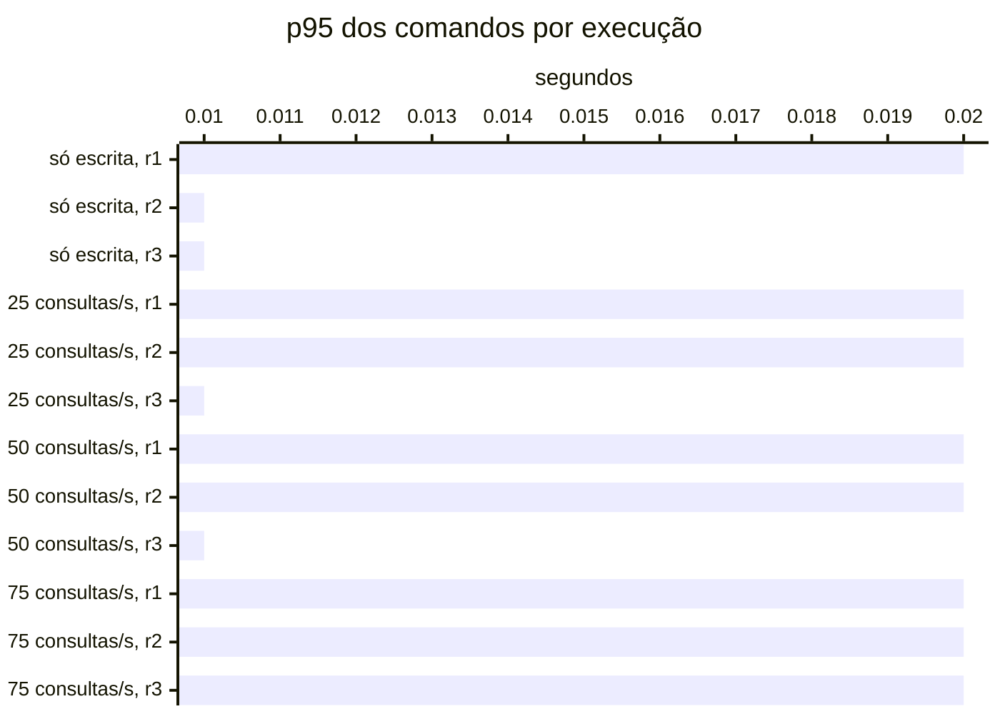

# Resumo

Gerado por `java bench/Report.java summarize`. Mediana das repetições; entre colchetes, a faixa do p95
(mín–máx). Latências em ms, vazão em requisições/s. Parâmetros de cada cenário em
`runs/<cenário>/scenario.properties`; série temporal de cada execução (5 s) em
`runs/<cenário>/r<n>/timeseries.csv`.

## s1 (3 execuções)

`writeRate=20` · `readRate=0` · `duration=180`

| Requisição | Vazão | % KO | p50 | p95 | p99 |
|---|---:|---:|---:|---:|---:|
| Global | 20.0 | 0.0 | 5 | 14 [14–20] | 107 |
| comandos | 20.0 | 0.0 | 5 | 14 [14–20] | 107 |
| comandos / deposit empresa | 3.0 | 0.0 | 5 | 13 [13–27] | 151 |
| comandos / deposit pessoa | 3.1 | 0.0 | 5 | 15 [14–16] | 81 |
| comandos / transfer empresa | 1.5 | 0.0 | 6 | 16 [14–18] | 51 |
| comandos / transfer pessoa | 1.5 | 0.0 | 6 | 16 [15–18] | 46 |
| comandos / withdraw empresa | 5.6 | 0.0 | 5 | 13 [13–21] | 151 |
| comandos / withdraw pessoa | 5.2 | 0.0 | 5 | 14 [14–19] | 72 |

## s2 (3 execuções)

`writeRate=0` · `readRate=75` · `duration=180`

| Requisição | Vazão | % KO | p50 | p95 | p99 |
|---|---:|---:|---:|---:|---:|
| Global | 75.0 | 0.0 | 3 | 22 [20–22] | 40 |
| consultas | 75.0 | 0.0 | 3 | 22 [20–22] | 40 |
| consultas / Q1 empresa | 9.5 | 0.0 | 1 | 5 [4–5] | 12 |
| consultas / Q1 pessoa | 9.4 | 0.0 | 1 | 5 [4–5] | 14 |
| consultas / Q2 empresa | 9.5 | 0.0 | 4 | 11 [9–12] | 22 |
| consultas / Q2 pessoa | 9.3 | 0.0 | 3 | 9 [8–9] | 24 |
| consultas / Q3 empresa | 9.6 | 0.0 | 4 | 10 [9–11] | 22 |
| consultas / Q3 pessoa | 9.3 | 0.0 | 3 | 8 [7–8] | 19 |
| consultas / Q4 empresa | 9.2 | 0.0 | 18 | 43 [38–43] | 79 |
| consultas / Q4 pessoa | 9.4 | 0.0 | 4 | 9 [8–10] | 20 |

## s3-r025 (3 execuções)

`writeRate=20` · `readRate=25` · `duration=180`

| Requisição | Vazão | % KO | p50 | p95 | p99 |
|---|---:|---:|---:|---:|---:|
| Global | 45.0 | 0.0 | 4 | 25 [21–30] | 96 |
| comandos | 20.0 | 0.0 | 4 | 16 [13–22] | 176 |
| consultas | 25.0 | 0.0 | 4 | 28 [24–33] | 64 |
| comandos / deposit empresa | 2.9 | 0.0 | 4 | 21 [15–23] | 120 |
| comandos / deposit pessoa | 3.1 | 0.0 | 4 | 13 [11–20] | 95 |
| comandos / transfer empresa | 1.6 | 0.0 | 6 | 18 [16–20] | 164 |
| comandos / transfer pessoa | 1.4 | 0.0 | 6 | 23 [14–29] | 136 |
| comandos / withdraw empresa | 5.6 | 0.0 | 4 | 16 [11–20] | 189 |
| comandos / withdraw pessoa | 5.5 | 0.0 | 4 | 13 [12–21] | 131 |
| consultas / Q1 empresa | 3.0 | 0.0 | 2 | 6 [5–7] | 14 |
| consultas / Q1 pessoa | 3.0 | 0.0 | 2 | 6 [6–6] | 14 |
| consultas / Q2 empresa | 3.2 | 0.0 | 5 | 17 [13–21] | 44 |
| consultas / Q2 pessoa | 3.1 | 0.0 | 4 | 14 [11–18] | 50 |
| consultas / Q3 empresa | 3.3 | 0.0 | 4 | 14 [12–15] | 35 |
| consultas / Q3 pessoa | 3.3 | 0.0 | 3 | 12 [9–12] | 35 |
| consultas / Q4 empresa | 3.1 | 0.0 | 21 | 65 [46–65] | 199 |
| consultas / Q4 pessoa | 2.8 | 0.0 | 5 | 15 [10–18] | 34 |

## s3-r050 (3 execuções)

`writeRate=20` · `readRate=50` · `duration=180`

| Requisição | Vazão | % KO | p50 | p95 | p99 |
|---|---:|---:|---:|---:|---:|
| Global | 70.0 | 0.0 | 4 | 24 [21–29] | 62 |
| comandos | 20.0 | 0.0 | 4 | 18 [13–24] | 128 |
| consultas | 50.0 | 0.0 | 4 | 25 [23–31] | 54 |
| comandos / deposit empresa | 3.0 | 0.0 | 4 | 17 [12–22] | 133 |
| comandos / deposit pessoa | 2.9 | 0.0 | 4 | 21 [14–23] | 94 |
| comandos / transfer empresa | 1.6 | 0.0 | 5 | 26 [14–29] | 214 |
| comandos / transfer pessoa | 1.5 | 0.0 | 5 | 20 [18–28] | 174 |
| comandos / withdraw empresa | 5.5 | 0.0 | 4 | 15 [11–25] | 96 |
| comandos / withdraw pessoa | 5.5 | 0.0 | 4 | 15 [13–21] | 143 |
| consultas / Q1 empresa | 6.3 | 0.0 | 2 | 6 [5–8] | 17 |
| consultas / Q1 pessoa | 6.2 | 0.0 | 2 | 6 [5–8] | 16 |
| consultas / Q2 empresa | 6.3 | 0.0 | 5 | 15 [11–22] | 46 |
| consultas / Q2 pessoa | 6.2 | 0.0 | 4 | 12 [12–19] | 29 |
| consultas / Q3 empresa | 6.4 | 0.0 | 4 | 14 [11–16] | 37 |
| consultas / Q3 pessoa | 6.3 | 0.0 | 3 | 10 [9–15] | 25 |
| consultas / Q4 empresa | 6.1 | 0.0 | 19 | 56 [48–63] | 121 |
| consultas / Q4 pessoa | 6.1 | 0.0 | 4 | 15 [10–19] | 41 |

## s3-r075 (3 execuções)

`writeRate=20` · `readRate=75` · `duration=180`

| Requisição | Vazão | % KO | p50 | p95 | p99 |
|---|---:|---:|---:|---:|---:|
| Global | 95.0 | 0.0 | 4 | 25 [22–25] | 59 |
| comandos | 20.0 | 0.0 | 4 | 17 [15–19] | 125 |
| consultas | 75.0 | 0.0 | 3 | 26 [23–26] | 55 |
| comandos / deposit empresa | 3.0 | 0.0 | 4 | 18 [17–23] | 251 |
| comandos / deposit pessoa | 3.1 | 0.0 | 4 | 15 [14–17] | 81 |
| comandos / transfer empresa | 1.5 | 0.0 | 5 | 18 [16–23] | 118 |
| comandos / transfer pessoa | 1.4 | 0.0 | 5 | 18 [17–25] | 248 |
| comandos / withdraw empresa | 5.7 | 0.0 | 4 | 15 [12–19] | 99 |
| comandos / withdraw pessoa | 5.4 | 0.0 | 4 | 18 [14–21] | 251 |
| consultas / Q1 empresa | 9.0 | 0.0 | 1 | 6 [4–6] | 19 |
| consultas / Q1 pessoa | 9.2 | 0.0 | 1 | 5 [5–6] | 16 |
| consultas / Q2 empresa | 9.3 | 0.0 | 4 | 13 [12–15] | 41 |
| consultas / Q2 pessoa | 9.0 | 0.0 | 3 | 15 [10–15] | 52 |
| consultas / Q3 empresa | 9.4 | 0.0 | 4 | 12 [12–15] | 52 |
| consultas / Q3 pessoa | 9.3 | 0.0 | 3 | 12 [10–12] | 38 |
| consultas / Q4 empresa | 9.4 | 0.0 | 18 | 54 [49–78] | 124 |
| consultas / Q4 pessoa | 9.3 | 0.0 | 4 | 14 [12–17] | 44 |

## Estado por execução

Colapso: p95 global acima de 5,000 ms (ADR-0009). Leia a contagem, não a mediana: perto da saturação as
repetições caem em estados diferentes.

| Cenário | Colapsou |
|---|---|
| s1 | 0 de 3 |
| s2 | 0 de 3 |
| s3-r025 | 0 de 3 |
| s3-r050 | 0 de 3 |
| s3-r075 | 0 de 3 |

p95 global e comandos em ms, no cliente (Gatling). Espera e uso da conexão do Hikari em ms, média da
execução. Comando no banco: soma do tempo médio das instruções de escrita e do `SELECT … FOR UPDATE` no
`pg_stat_statements`, em ms (o custo de um comando dentro do Postgres, sem a fila). GC: segundos com a JVM
parada em GC na execução (medido a partir da #11).

| Cenário | Rep. | Estado | p95 global | % KO | Comandos p50 | p95 | p99 | Espera no pool | Uso da conexão | Comando no banco | GC |
|---|---|---|---:|---:|---:|---:|---:|---:|---:|---:|---:|
| s1 | r1 | estável | 20 | 0.0 | 5 | 20 | 82 | 0.0 | 2.3 | 0.8 | 1.1 |
| s1 | r2 | estável | 14 | 0.0 | 5 | 14 | 107 | 0.1 | 2.2 | 0.6 | 0.8 |
| s1 | r3 | estável | 14 | 0.0 | 5 | 14 | 146 | 0.1 | 2.2 | 0.6 | 0.8 |
| s2 | r1 | estável | 22 | 0.0 | — | — | — | 0.1 | 0.1 | — | 2.6 |
| s2 | r2 | estável | 22 | 0.0 | — | — | — | 0.0 | 0.1 | — | 2.6 |
| s2 | r3 | estável | 20 | 0.0 | — | — | — | 0.0 | 0.1 | — | 2.4 |
| s3-r025 | r1 | estável | 30 | 0.0 | 5 | 22 | 183 | 0.0 | 2.6 | 0.6 | 1.9 |
| s3-r025 | r2 | estável | 25 | 0.0 | 4 | 16 | 176 | 0.0 | 1.9 | 0.6 | 1.7 |
| s3-r025 | r3 | estável | 21 | 0.0 | 4 | 13 | 119 | 0.1 | 1.8 | 0.5 | 1.5 |
| s3-r050 | r1 | estável | 29 | 0.0 | 5 | 24 | 143 | 0.1 | 2.5 | 0.6 | 2.8 |
| s3-r050 | r2 | estável | 24 | 0.0 | 4 | 18 | 128 | 0.1 | 1.9 | 0.6 | 2.4 |
| s3-r050 | r3 | estável | 21 | 0.0 | 4 | 13 | 115 | 0.0 | 1.6 | 0.5 | 2.1 |
| s3-r075 | r1 | estável | 25 | 0.0 | 4 | 19 | 122 | 0.0 | 1.8 | 0.6 | 3.0 |
| s3-r075 | r2 | estável | 25 | 0.0 | 4 | 17 | 125 | 0.1 | 1.7 | 0.5 | 2.8 |
| s3-r075 | r3 | estável | 22 | 0.0 | 4 | 15 | 158 | 0.1 | 1.8 | 0.6 | 2.7 |

## Pools por execução

Espera e uso da conexão do Hikari em ms, média da execução; fila máxima de requisições esperando conexão.
Pool sem requisições na execução aparece com —.

| Cenário | Rep. | Pool | Espera | Uso da conexão | Fila máx. |
|---|---|---|---:|---:|---:|
| s1 | r1 | HikariPool-1@command-api | 0.0 | 2.3 | 0 |
| s1 | r1 | HikariPool-1@query-api | — | — | 0 |
| s1 | r2 | HikariPool-1@command-api | 0.1 | 2.2 | 0 |
| s1 | r2 | HikariPool-1@query-api | — | — | 0 |
| s1 | r3 | HikariPool-1@command-api | 0.1 | 2.2 | 0 |
| s1 | r3 | HikariPool-1@query-api | — | — | 0 |
| s2 | r1 | HikariPool-1@command-api | 1.4 | 0.3 | 0 |
| s2 | r1 | HikariPool-1@query-api | 0.0 | 0.1 | 0 |
| s2 | r2 | HikariPool-1@command-api | 1.7 | 0.8 | 0 |
| s2 | r2 | HikariPool-1@query-api | 0.0 | 0.1 | 0 |
| s2 | r3 | HikariPool-1@command-api | 1.5 | 0.5 | 0 |
| s2 | r3 | HikariPool-1@query-api | 0.0 | 0.1 | 0 |
| s3-r025 | r1 | HikariPool-1@command-api | 0.0 | 2.9 | 0 |
| s3-r025 | r1 | HikariPool-1@query-api | 0.0 | 0.1 | 0 |
| s3-r025 | r2 | HikariPool-1@command-api | 0.0 | 2.1 | 0 |
| s3-r025 | r2 | HikariPool-1@query-api | 0.1 | 0.3 | 0 |
| s3-r025 | r3 | HikariPool-1@command-api | 0.1 | 2.0 | 0 |
| s3-r025 | r3 | HikariPool-1@query-api | 0.0 | 0.1 | 0 |
| s3-r050 | r1 | HikariPool-1@command-api | 0.1 | 3.1 | 0 |
| s3-r050 | r1 | HikariPool-1@query-api | 0.1 | 0.2 | 0 |
| s3-r050 | r2 | HikariPool-1@command-api | 0.0 | 2.3 | 0 |
| s3-r050 | r2 | HikariPool-1@query-api | 0.1 | 0.2 | 0 |
| s3-r050 | r3 | HikariPool-1@command-api | 0.0 | 1.9 | 0 |
| s3-r050 | r3 | HikariPool-1@query-api | 0.0 | 0.1 | 0 |
| s3-r075 | r1 | HikariPool-1@command-api | 0.0 | 2.4 | 0 |
| s3-r075 | r1 | HikariPool-1@query-api | 0.0 | 0.1 | 0 |
| s3-r075 | r2 | HikariPool-1@command-api | 0.1 | 2.2 | 0 |
| s3-r075 | r2 | HikariPool-1@query-api | 0.1 | 0.2 | 0 |
| s3-r075 | r3 | HikariPool-1@command-api | 0.2 | 2.5 | 0 |
| s3-r075 | r3 | HikariPool-1@query-api | 0.0 | 0.1 | 0 |

## JVMs por execução

GC: segundos com a JVM parada em GC na execução. CPU: média do processo. Heap: maior uso na execução, em MiB.

| Cenário | Rep. | JVM | GC (s) | CPU | Heap máx. |
|---|---|---|---:|---:|---:|
| s1 | r1 | command-api | 0.5 | 6% | 57 |
| s1 | r1 | projector | 0.3 | 7% | 61 |
| s1 | r1 | query-api | 0.3 | 4% | 77 |
| s1 | r2 | command-api | 0.3 | 5% | 63 |
| s1 | r2 | projector | 0.3 | 5% | 60 |
| s1 | r2 | query-api | 0.2 | 3% | 98 |
| s1 | r3 | command-api | 0.3 | 5% | 68 |
| s1 | r3 | projector | 0.3 | 5% | 61 |
| s1 | r3 | query-api | 0.2 | 3% | 120 |
| s2 | r1 | command-api | 0.2 | 3% | 62 |
| s2 | r1 | projector | 0.3 | 4% | 60 |
| s2 | r1 | query-api | 2.1 | 10% | 98 |
| s2 | r2 | command-api | 0.2 | 3% | 68 |
| s2 | r2 | projector | 0.3 | 3% | 60 |
| s2 | r2 | query-api | 2.1 | 10% | 118 |
| s2 | r3 | command-api | 0.2 | 3% | 72 |
| s2 | r3 | projector | 0.2 | 3% | 61 |
| s2 | r3 | query-api | 1.9 | 9% | 137 |
| s3-r025 | r1 | command-api | 0.5 | 6% | 58 |
| s3-r025 | r1 | projector | 0.4 | 7% | 61 |
| s3-r025 | r1 | query-api | 1.1 | 5% | 79 |
| s3-r025 | r2 | command-api | 0.4 | 5% | 64 |
| s3-r025 | r2 | projector | 0.3 | 5% | 60 |
| s3-r025 | r2 | query-api | 1.0 | 5% | 100 |
| s3-r025 | r3 | command-api | 0.3 | 4% | 69 |
| s3-r025 | r3 | projector | 0.3 | 5% | 61 |
| s3-r025 | r3 | query-api | 1.0 | 4% | 121 |
| s3-r050 | r1 | command-api | 0.5 | 6% | 60 |
| s3-r050 | r1 | projector | 0.4 | 6% | 61 |
| s3-r050 | r1 | query-api | 1.9 | 9% | 82 |
| s3-r050 | r2 | command-api | 0.5 | 5% | 65 |
| s3-r050 | r2 | projector | 0.4 | 6% | 60 |
| s3-r050 | r2 | query-api | 1.6 | 7% | 102 |
| s3-r050 | r3 | command-api | 0.4 | 4% | 70 |
| s3-r050 | r3 | projector | 0.2 | 4% | 60 |
| s3-r050 | r3 | query-api | 1.5 | 7% | 126 |
| s3-r075 | r1 | command-api | 0.4 | 5% | 62 |
| s3-r075 | r1 | projector | 0.4 | 6% | 61 |
| s3-r075 | r1 | query-api | 2.3 | 11% | 92 |
| s3-r075 | r2 | command-api | 0.3 | 5% | 67 |
| s3-r075 | r2 | projector | 0.3 | 5% | 61 |
| s3-r075 | r2 | query-api | 2.2 | 10% | 111 |
| s3-r075 | r3 | command-api | 0.4 | 4% | 71 |
| s3-r075 | r3 | projector | 0.3 | 4% | 61 |
| s3-r075 | r3 | query-api | 2.1 | 9% | 131 |

## Atraso da projeção por execução

Do `occurred_at` do lançamento (início da transação do comando) até ele estar nas duas projeções do Mongo,
em ms; superestima o atraso em até a duração do comando. p50 e p99 vêm do histograma (precisão dos
buckets); o máximo pode vir de uma janela anterior à execução. Reentregas: lançamentos que o projetor
recebeu de novo e descartou. Fila do outbox: publicações ainda não enviadas ao Kafka, no maior instante.

| Cenário | Rep. | Lançamentos | p50 | p99 | Máx. | Reentregas | Fila do outbox |
|---|---|---:|---:|---:|---:|---:|---:|
| s1 | r1 | 4,096 | 16 | 113 | 624 | 0 | 1 |
| s1 | r2 | 4,150 | 15 | 166 | 648 | 0 | 0 |
| s1 | r3 | 4,145 | 15 | 132 | 855 | 0 | 0 |
| s3-r025 | r1 | 4,134 | 15 | 223 | 627 | 0 | 2 |
| s3-r025 | r2 | 4,141 | 14 | 222 | 813 | 0 | 2 |
| s3-r025 | r3 | 4,121 | 14 | 134 | 855 | 0 | 2 |
| s3-r050 | r1 | 4,091 | 15 | 166 | 653 | 0 | 2 |
| s3-r050 | r2 | 4,073 | 14 | 219 | 813 | 0 | 13 |
| s3-r050 | r3 | 4,160 | 14 | 168 | 710 | 0 | 2 |
| s3-r075 | r1 | 4,123 | 14 | 186 | 683 | 0 | 3 |
| s3-r075 | r2 | 4,047 | 14 | 203 | 721 | 0 | 1 |
| s3-r075 | r3 | 4,151 | 13 | 210 | 953 | 0 | 1 |

## Leitura de disco por execução

Páginas lidas fora do cache e tempo médio por página, em ms. Postgres: soma das instruções do
pg_stat_statements (as 50 mais caras). Mongo: leituras das threads da aplicação para o cache do WiredTiger.
— quando o store não existe na fase.

| Cenário | Rep. | Postgres: páginas | ms/página | Mongo: páginas | ms/página |
|---|---|---:|---:|---:|---:|
| s1 | r1 | 0 | — | 9,567 | 0.52 |
| s1 | r2 | 0 | — | 10,125 | 0.47 |
| s1 | r3 | 0 | — | 10,593 | 0.42 |
| s2 | r1 | 0 | — | 47,798 | 0.29 |
| s2 | r2 | 0 | — | 47,562 | 0.28 |
| s2 | r3 | 0 | — | 46,927 | 0.27 |
| s3-r025 | r1 | 0 | — | 26,688 | 0.56 |
| s3-r025 | r2 | 0 | — | 27,337 | 0.40 |
| s3-r025 | r3 | 0 | — | 26,914 | 0.33 |
| s3-r050 | r1 | 0 | — | 44,768 | 0.51 |
| s3-r050 | r2 | 0 | — | 44,287 | 0.39 |
| s3-r050 | r3 | 0 | — | 44,185 | 0.38 |
| s3-r075 | r1 | 0 | — | 61,321 | 0.42 |
| s3-r075 | r2 | 0 | — | 61,254 | 0.39 |
| s3-r075 | r3 | 0 | — | 61,913 | 0.42 |

## Pool e banco por cenário

Mediana das repetições. Espera = tempo médio para obter conexão do Hikari; uso = tempo médio com a
conexão (o trabalho no banco); hit ratio = blocos achados no shared_buffers.

| Cenário | Espera no pool (ms) | Uso da conexão (ms) | Fila máx. no pool | Hit ratio | CPU da app |
|---|---:|---:|---:|---:|---:|
| s1 | 0.1 | 2.2 | 0 | 100.0% | 4% |
| s2 | 0.0 | 0.1 | 0 | 100.0% | 5% |
| s3-r025 | 0.0 | 1.9 | 0 | 100.0% | 5% |
| s3-r050 | 0.1 | 1.9 | 0 | 100.0% | 6% |
| s3-r075 | 0.1 | 1.8 | 0 | 100.0% | 7% |
