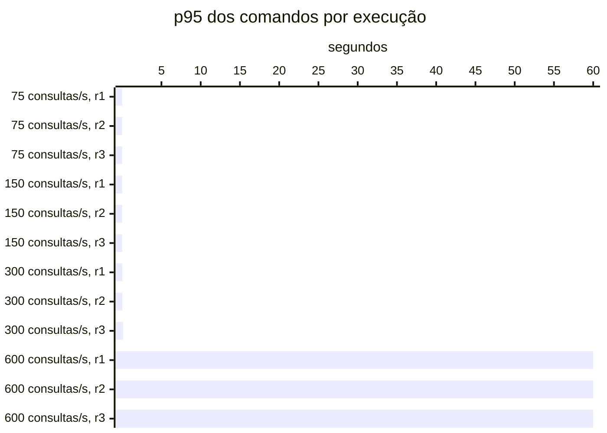

# Resumo

Gerado por `java bench/Report.java summarize`. Mediana das repetições; entre colchetes, a faixa do p95
(mín–máx). Latências em ms, vazão em requisições/s. Parâmetros de cada cenário em
`runs/<cenário>/scenario.properties`; série temporal de cada execução (5 s) em
`runs/<cenário>/r<n>/timeseries.csv`.

## c1-r0075 (3 execuções)

`writeRate=20` · `readRate=75` · `duration=180`

| Requisição | Vazão | % KO | p50 | p95 | p99 |
|---|---:|---:|---:|---:|---:|
| Global | 95.0 | 0.0 | 3 | 21 [21–22] | 50 |
| comandos | 20.0 | 0.0 | 3 | 6 [6–6] | 11 |
| consultas | 75.0 | 0.0 | 4 | 24 [24–26] | 53 |
| comandos / deposit empresa | 2.9 | 0.0 | 3 | 5 [5–6] | 11 |
| comandos / deposit pessoa | 2.9 | 0.0 | 3 | 6 [6–6] | 11 |
| comandos / transfer empresa | 1.5 | 0.0 | 4 | 7 [6–7] | 16 |
| comandos / transfer pessoa | 1.5 | 0.0 | 4 | 8 [8–9] | 17 |
| comandos / withdraw empresa | 5.7 | 0.0 | 3 | 5 [5–6] | 13 |
| comandos / withdraw pessoa | 5.4 | 0.0 | 3 | 6 [5–6] | 11 |
| consultas / Q1 empresa | 9.3 | 0.0 | 1 | 2 [2–2] | 4 |
| consultas / Q1 pessoa | 9.3 | 0.0 | 1 | 2 [2–2] | 4 |
| consultas / Q2 empresa | 9.4 | 0.0 | 6 | 13 [13–14] | 21 |
| consultas / Q2 pessoa | 9.3 | 0.0 | 4 | 8 [8–9] | 16 |
| consultas / Q3 empresa | 9.4 | 0.0 | 9 | 14 [14–14] | 21 |
| consultas / Q3 pessoa | 9.3 | 0.0 | 2 | 3 [3–3] | 6 |
| consultas / Q4 empresa | 9.4 | 0.0 | 20 | 58 [57–58] | 82 |
| consultas / Q4 pessoa | 9.3 | 0.0 | 4 | 11 [11–12] | 17 |

## c1-r0150 (3 execuções)

`writeRate=20` · `readRate=150` · `duration=180`

| Requisição | Vazão | % KO | p50 | p95 | p99 |
|---|---:|---:|---:|---:|---:|
| Global | 170.0 | 0.0 | 3 | 25 [23–28] | 57 |
| comandos | 20.0 | 0.0 | 3 | 8 [7–9] | 16 |
| consultas | 150.0 | 0.0 | 4 | 27 [25–30] | 59 |
| comandos / deposit empresa | 3.1 | 0.0 | 3 | 7 [6–8] | 22 |
| comandos / deposit pessoa | 3.0 | 0.0 | 3 | 8 [6–8] | 15 |
| comandos / transfer empresa | 1.4 | 0.0 | 4 | 8 [8–11] | 24 |
| comandos / transfer pessoa | 1.5 | 0.0 | 4 | 11 [11–12] | 23 |
| comandos / withdraw empresa | 5.5 | 0.0 | 3 | 7 [6–8] | 13 |
| comandos / withdraw pessoa | 5.7 | 0.0 | 3 | 8 [7–8] | 17 |
| consultas / Q1 empresa | 18.6 | 0.0 | 1 | 2 [2–2] | 4 |
| consultas / Q1 pessoa | 18.9 | 0.0 | 1 | 2 [2–2] | 6 |
| consultas / Q2 empresa | 19.0 | 0.0 | 6 | 15 [13–18] | 26 |
| consultas / Q2 pessoa | 18.7 | 0.0 | 3 | 10 [9–11] | 19 |
| consultas / Q3 empresa | 19.0 | 0.0 | 9 | 15 [14–16] | 27 |
| consultas / Q3 pessoa | 19.0 | 0.0 | 2 | 4 [3–4] | 9 |
| consultas / Q4 empresa | 18.5 | 0.0 | 22 | 66 [61–74] | 102 |
| consultas / Q4 pessoa | 18.7 | 0.0 | 4 | 13 [11–14] | 25 |

## c1-r0300 (3 execuções)

`writeRate=20` · `readRate=300` · `duration=180`

| Requisição | Vazão | % KO | p50 | p95 | p99 |
|---|---:|---:|---:|---:|---:|
| Global | 318.2 | 0.0 | 4 | 58 [54–167] | 184 |
| comandos | 19.9 | 0.0 | 4 | 21 [18–123] | 135 |
| consultas | 298.3 | 0.0 | 4 | 59 [56–175] | 187 |
| comandos / deposit empresa | 3.0 | 0.0 | 4 | 22 [14–122] | 139 |
| comandos / deposit pessoa | 3.0 | 0.0 | 4 | 20 [17–177] | 184 |
| comandos / transfer empresa | 1.5 | 0.0 | 5 | 38 [37–62] | 225 |
| comandos / transfer pessoa | 1.5 | 0.0 | 5 | 20 [16–140] | 103 |
| comandos / withdraw empresa | 5.5 | 0.0 | 3 | 21 [19–67] | 144 |
| comandos / withdraw pessoa | 5.6 | 0.0 | 4 | 17 [17–134] | 113 |
| consultas / Q1 empresa | 37.1 | 0.0 | 1 | 8 [7–112] | 123 |
| consultas / Q1 pessoa | 37.7 | 0.0 | 1 | 10 [8–121] | 119 |
| consultas / Q2 empresa | 37.3 | 0.0 | 7 | 33 [32–145] | 140 |
| consultas / Q2 pessoa | 37.2 | 0.0 | 4 | 23 [23–137] | 154 |
| consultas / Q3 empresa | 37.1 | 0.0 | 9 | 31 [28–146] | 122 |
| consultas / Q3 pessoa | 37.6 | 0.0 | 2 | 13 [10–99] | 116 |
| consultas / Q4 empresa | 37.7 | 0.0 | 31 | 165 [152–321] | 337 |
| consultas / Q4 pessoa | 37.3 | 0.0 | 5 | 32 [32–113] | 156 |

## c1-r0600 (3 execuções)

`writeRate=20` · `readRate=600` · `duration=180`

| Requisição | Vazão | % KO | p50 | p95 | p99 |
|---|---:|---:|---:|---:|---:|
| Global | 465.0 | 89.9 | 29,926 | 60,010 [60,009–60,010] | 60,194 |
| comandos | 15.0 | 89.4 | 30,075 | 60,009 [60,008–60,009] | 60,182 |
| consultas | 450.0 | 89.9 | 30,333 | 60,009 [60,009–60,010] | 60,195 |
| comandos / deposit empresa | 2.2 | 89.5 | 30,055 | 60,007 [60,007–60,012] | 60,198 |
| comandos / deposit pessoa | 2.3 | 90.0 | 29,401 | 60,011 [60,007–60,018] | 60,148 |
| comandos / transfer empresa | 1.1 | 87.2 | 27,373 | 60,006 [60,004–60,023] | 60,155 |
| comandos / transfer pessoa | 1.1 | 91.3 | 25,733 | 60,013 [60,011–60,013] | 60,116 |
| comandos / withdraw empresa | 4.1 | 89.6 | 27,057 | 60,010 [60,005–60,013] | 60,112 |
| comandos / withdraw pessoa | 4.2 | 89.0 | 30,119 | 60,007 [60,006–60,010] | 60,179 |
| consultas / Q1 empresa | 56.3 | 89.9 | 30,414 | 60,009 [60,009–60,010] | 60,181 |
| consultas / Q1 pessoa | 56.5 | 90.0 | 30,336 | 60,009 [60,008–60,010] | 60,164 |
| consultas / Q2 empresa | 56.1 | 89.7 | 30,194 | 60,009 [60,008–60,011] | 60,190 |
| consultas / Q2 pessoa | 56.2 | 89.5 | 29,999 | 60,010 [60,009–60,012] | 60,185 |
| consultas / Q3 empresa | 56.2 | 89.9 | 30,100 | 60,009 [60,009–60,011] | 60,215 |
| consultas / Q3 pessoa | 56.5 | 89.9 | 30,065 | 60,012 [60,009–60,012] | 60,206 |
| consultas / Q4 empresa | 56.0 | 90.1 | 30,562 | 60,009 [60,009–60,010] | 60,215 |
| consultas / Q4 pessoa | 56.4 | 90.2 | 30,421 | 60,009 [60,009–60,012] | 60,199 |

## Capacidade

Critério do ADR-0013 por repetição: p95 dos comandos ≤ 50 ms, p95 das consultas ≤ 250 ms, KO ≤ 1%,
vazão ≥ 98% da oferecida e, com consistência eventual, atraso p99 ≤ 2 s e fila no fim ≤ 1 s de escrita.
Vazão baixa com nenhum container da fase acima de 50% do seu limite de CPU (p90 das amostras) é limite do
gerador. Degrau
sustentado: em pelo menos 2 de 3 repetições. **Maior degrau sustentado: 300 consultas/s.**

- c1-r0075: sustentado (3 de 3)
- c1-r0150: sustentado (3 de 3)
- c1-r0300: sustentado (2 de 3); r3: comandos p95 123 ms
- c1-r0600: não sustentado (0 de 3); r1: comandos p95 60,009 ms, consultas p95 60,009 ms, KO 81.8%, vazão 75% da oferecida (CPU da fase no p90 até 110% do limite); r2: comandos p95 60,008 ms, consultas p95 60,009 ms, KO 89.9%, vazão 75% da oferecida (CPU da fase no p90 até 110% do limite); r3: comandos p95 60,009 ms, consultas p95 60,010 ms, KO 94.5%, vazão 75% da oferecida (CPU da fase no p90 até 121% do limite)

Vazão em % da oferecida; p95 em ms, no cliente; KO em %; atraso p99 em s; fila no fim em segundos de
escrita (— sem consistência eventual).

| Degrau | Rep. | Estado | Vazão | p95 comandos | p95 consultas | % KO | Atraso p99 | Fila no fim |
|---|---|---|---:|---:|---:|---:|---:|---:|
| c1-r0075 | r1 | sustentado | 100.0% | 6 | 26 | 0.0 | — | — |
| c1-r0075 | r2 | sustentado | 100.0% | 6 | 24 | 0.0 | — | — |
| c1-r0075 | r3 | sustentado | 100.0% | 6 | 24 | 0.0 | — | — |
| c1-r0150 | r1 | sustentado | 100.0% | 9 | 30 | 0.0 | — | — |
| c1-r0150 | r2 | sustentado | 100.0% | 8 | 27 | 0.0 | — | — |
| c1-r0150 | r3 | sustentado | 100.0% | 7 | 25 | 0.0 | — | — |
| c1-r0300 | r1 | sustentado | 99.4% | 18 | 56 | 0.0 | — | — |
| c1-r0300 | r2 | sustentado | 99.4% | 21 | 59 | 0.0 | — | — |
| c1-r0300 | r3 | **não sustentado** | 100.0% | 123 | 175 | 0.0 | — | — |
| c1-r0600 | r1 | **não sustentado** | 75.0% | 60,009 | 60,009 | 81.8 | — | — |
| c1-r0600 | r2 | **não sustentado** | 75.0% | 60,008 | 60,009 | 89.9 | — | — |
| c1-r0600 | r3 | **não sustentado** | 75.0% | 60,009 | 60,010 | 94.5 | — | — |

## Estado por execução

Colapso: p95 global acima de 5,000 ms (ADR-0009). Leia a contagem, não a mediana: perto da saturação as
repetições caem em estados diferentes.

| Cenário | Colapsou |
|---|---|
| c1-r0075 | 0 de 3 |
| c1-r0150 | 0 de 3 |
| c1-r0300 | 0 de 3 |
| c1-r0600 | 3 de 3 (r1, r2, r3) |

p95 global e comandos em ms, no cliente (Gatling). Espera e uso da conexão do Hikari em ms, média da
execução. Comando no banco: soma do tempo médio das instruções de escrita e do `SELECT … FOR UPDATE` no
`pg_stat_statements`, em ms (o custo de um comando dentro do Postgres, sem a fila). GC: segundos com a JVM
parada em GC na execução (medido a partir da #11).

| Cenário | Rep. | Estado | p95 global | % KO | Comandos p50 | p95 | p99 | Espera no pool | Uso da conexão | Comando no banco | GC |
|---|---|---|---:|---:|---:|---:|---:|---:|---:|---:|---:|
| c1-r0075 | r1 | estável | 22 | 0.0 | 3 | 6 | 13 | 0.0 | 4.6 | 0.6 | 0.2 |
| c1-r0075 | r2 | estável | 21 | 0.0 | 3 | 6 | 11 | 0.0 | 4.4 | 0.6 | 0.2 |
| c1-r0075 | r3 | estável | 21 | 0.0 | 3 | 6 | 11 | 0.0 | 4.3 | 0.6 | 0.2 |
| c1-r0150 | r1 | estável | 28 | 0.0 | 3 | 9 | 25 | 0.1 | 5.5 | 0.7 | 0.3 |
| c1-r0150 | r2 | estável | 25 | 0.0 | 3 | 8 | 16 | 0.0 | 5.0 | 0.7 | 0.3 |
| c1-r0150 | r3 | estável | 23 | 0.0 | 3 | 7 | 14 | 0.0 | 4.6 | 0.6 | 0.3 |
| c1-r0300 | r1 | estável | 54 | 0.0 | 4 | 18 | 135 | 3.0 | 7.8 | 0.9 | 0.5 |
| c1-r0300 | r2 | estável | 58 | 0.0 | 4 | 21 | 112 | 2.9 | 8.1 | 0.9 | 0.4 |
| c1-r0300 | r3 | estável | 167 | 0.0 | 4 | 123 | 848 | 27.1 | 9.1 | 1.0 | 0.5 |
| c1-r0600 | r1 | **colapso** | 60,010 | 81.8 | 24,894 | 60,009 | 60,231 | 29,343.3 | 199.4 | 10.0 | 31.7 |
| c1-r0600 | r2 | **colapso** | 60,009 | 89.9 | 30,075 | 60,008 | 60,182 | 29,819.5 | 245.0 | 20.5 | 27.4 |
| c1-r0600 | r3 | **colapso** | 60,010 | 94.5 | 31,420 | 60,009 | 60,127 | 30,551.9 | 371.9 | 35.5 | 36.7 |

## Leitura de disco por execução

Páginas lidas fora do cache e tempo médio por página, em ms. Postgres: soma das instruções do
pg_stat_statements (as 50 mais caras; na v1-replica, do primário e da réplica somados). Mongo: leituras das
threads da aplicação para o cache do WiredTiger. — quando o store não existe na fase.

| Cenário | Rep. | Postgres: páginas | ms/página | Mongo: páginas | ms/página |
|---|---|---:|---:|---:|---:|
| c1-r0075 | r1 | 385,220 | 0.13 | — | — |
| c1-r0075 | r2 | 380,229 | 0.12 | — | — |
| c1-r0075 | r3 | 379,335 | 0.12 | — | — |
| c1-r0150 | r1 | 752,900 | 0.15 | — | — |
| c1-r0150 | r2 | 746,279 | 0.14 | — | — |
| c1-r0150 | r3 | 740,317 | 0.12 | — | — |
| c1-r0300 | r1 | 1,486,240 | 0.24 | — | — |
| c1-r0300 | r2 | 1,490,608 | 0.24 | — | — |
| c1-r0300 | r3 | 1,487,590 | 0.27 | — | — |
| c1-r0600 | r1 | 631,007 | 2.30 | — | — |
| c1-r0600 | r2 | 365,900 | 3.77 | — | — |
| c1-r0600 | r3 | 226,267 | 5.71 | — | — |

## Escrita em disco por execução

WAL gerado no Postgres primário (MB e KB por comando), fsyncs do WAL e o tempo médio de cada um, em ms
(pg_stat_io com track_wal_io_timing), e bytes gravados em disco pelo WiredTiger por comando, em KB (block
manager; — sem Mongo). Os contadores do pg_stat_io chegam com até ~1 s de atraso; a série por segundo está
no `pg-seconds.csv` de cada execução.

| Cenário | Rep. | WAL (MB) | WAL por comando | fsyncs | ms por fsync | Mongo por comando |
|---|---|---:|---:|---:|---:|---:|
| c1-r0075 | r1 | 55 | 15.6 | 3,869 | 0.44 | — |
| c1-r0075 | r2 | 60 | 17.1 | 3,864 | 0.39 | — |
| c1-r0075 | r3 | 68 | 19.5 | 3,863 | 0.38 | — |
| c1-r0150 | r1 | 75 | 21.3 | 3,909 | 0.61 | — |
| c1-r0150 | r2 | 76 | 21.6 | 3,900 | 0.57 | — |
| c1-r0150 | r3 | 78 | 22.1 | 3,886 | 0.48 | — |
| c1-r0300 | r1 | 44 | 12.5 | 3,937 | 0.91 | — |
| c1-r0300 | r2 | 79 | 22.5 | 3,936 | 0.95 | — |
| c1-r0300 | r3 | 78 | 22.2 | 3,940 | 1.02 | — |
| c1-r0600 | r1 | 13 | 3.7 | 977 | 9.64 | — |
| c1-r0600 | r2 | 13 | 3.8 | 699 | 13.26 | — |
| c1-r0600 | r3 | 6 | 1.6 | 462 | 30.98 | — |

## Pool e banco por cenário

Mediana das repetições. Espera = tempo médio para obter conexão do Hikari; uso = tempo médio com a
conexão (o trabalho no banco); hit ratio = blocos achados no shared_buffers.

| Cenário | Espera no pool (ms) | Uso da conexão (ms) | Fila máx. no pool | Hit ratio | CPU da app |
|---|---:|---:|---:|---:|---:|
| c1-r0075 | 0.0 | 4.4 | 0 | 97.2% | 3% |
| c1-r0150 | 0.0 | 5.0 | 0 | 97.6% | 4% |
| c1-r0300 | 3.0 | 8.1 | 53 | 97.8% | 7% |
| c1-r0600 | 29,819.5 | 245.0 | 8,178 | 97.9% | 47% |
