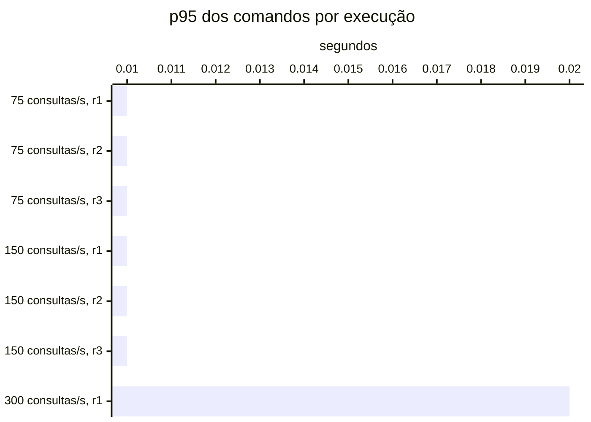

# Resumo

Gerado por `java bench/Report.java summarize`. Mediana das repetições; entre colchetes, a faixa do p95
(mín–máx). Latências em ms, vazão em requisições/s. Parâmetros de cada cenário em
`runs/<cenário>/scenario.properties`; série temporal de cada execução (5 s) em
`runs/<cenário>/r<n>/timeseries.csv`.

## c1-r0075 (3 execuções)

`writeRate=20` · `readRate=75` · `duration=180`

| Requisição | Vazão | % KO | p50 | p95 | p99 |
|---|---:|---:|---:|---:|---:|
| Global | 95.0 | 0.0 | 4 | 28 [27–29] | 66 |
| comandos | 20.0 | 0.0 | 3 | 8 [7–8] | 18 |
| consultas | 75.0 | 0.0 | 4 | 32 [31–34] | 68 |
| comandos / deposit empresa | 2.9 | 0.0 | 3 | 7 [6–8] | 16 |
| comandos / deposit pessoa | 3.0 | 0.0 | 3 | 8 [8–9] | 29 |
| comandos / transfer empresa | 1.5 | 0.0 | 4 | 9 [7–10] | 18 |
| comandos / transfer pessoa | 1.4 | 0.0 | 4 | 9 [8–12] | 17 |
| comandos / withdraw empresa | 5.6 | 0.0 | 3 | 7 [6–7] | 15 |
| comandos / withdraw pessoa | 5.5 | 0.0 | 3 | 7 [7–8] | 20 |
| consultas / Q1 empresa | 9.2 | 0.0 | 1 | 2 [2–3] | 5 |
| consultas / Q1 pessoa | 9.4 | 0.0 | 1 | 2 [2–3] | 6 |
| consultas / Q2 empresa | 9.6 | 0.0 | 8 | 20 [20–21] | 50 |
| consultas / Q2 pessoa | 9.4 | 0.0 | 4 | 11 [11–12] | 21 |
| consultas / Q3 empresa | 9.4 | 0.0 | 10 | 16 [16–16] | 31 |
| consultas / Q3 pessoa | 9.5 | 0.0 | 2 | 4 [4–5] | 8 |
| consultas / Q4 empresa | 9.4 | 0.0 | 25 | 72 [72–76] | 122 |
| consultas / Q4 pessoa | 9.2 | 0.0 | 4 | 14 [12–14] | 21 |

## c1-r0150 (3 execuções)

`writeRate=20` · `readRate=150` · `duration=180`

| Requisição | Vazão | % KO | p50 | p95 | p99 |
|---|---:|---:|---:|---:|---:|
| Global | 169.1 | 0.0 | 4 | 49 [44–71] | 137 |
| comandos | 19.9 | 0.0 | 4 | 10 [10–12] | 32 |
| consultas | 149.2 | 0.0 | 5 | 54 [49–79] | 148 |
| comandos / deposit empresa | 2.9 | 0.0 | 3 | 9 [9–10] | 25 |
| comandos / deposit pessoa | 2.9 | 0.0 | 4 | 11 [10–12] | 25 |
| comandos / transfer empresa | 1.6 | 0.0 | 4 | 11 [10–13] | 36 |
| comandos / transfer pessoa | 1.5 | 0.0 | 5 | 13 [13–18] | 43 |
| comandos / withdraw empresa | 5.3 | 0.0 | 3 | 9 [8–12] | 33 |
| comandos / withdraw pessoa | 5.5 | 0.0 | 4 | 10 [10–11] | 31 |
| consultas / Q1 empresa | 18.8 | 0.0 | 1 | 3 [3–9] | 37 |
| consultas / Q1 pessoa | 18.6 | 0.0 | 1 | 4 [3–5] | 63 |
| consultas / Q2 empresa | 18.8 | 0.0 | 10 | 34 [29–39] | 134 |
| consultas / Q2 pessoa | 18.5 | 0.0 | 5 | 18 [15–25] | 92 |
| consultas / Q3 empresa | 18.8 | 0.0 | 10 | 22 [20–31] | 70 |
| consultas / Q3 pessoa | 18.6 | 0.0 | 2 | 6 [5–9] | 50 |
| consultas / Q4 empresa | 18.3 | 0.0 | 34 | 150 [126–232] | 387 |
| consultas / Q4 pessoa | 18.8 | 0.0 | 5 | 20 [20–38] | 107 |

## c1-r0300 (1 execuções)

`writeRate=20` · `readRate=300` · `duration=180`

| Requisição | Vazão | % KO | p50 | p95 | p99 |
|---|---:|---:|---:|---:|---:|
| Global | 295.4 | 75.9 | 15,001 | 60,001 [60,001–60,001] | 60,002 |
| comandos | 18.5 | 0.0 | 5 | 20 [20–20] | 106 |
| consultas | 276.9 | 81.0 | 15,001 | 60,001 [60,001–60,001] | 60,002 |
| comandos / deposit empresa | 2.7 | 0.0 | 5 | 18 [18–18] | 113 |
| comandos / deposit pessoa | 2.7 | 0.0 | 5 | 25 [25–25] | 630 |
| comandos / transfer empresa | 1.4 | 0.0 | 6 | 19 [19–19] | 98 |
| comandos / transfer pessoa | 1.4 | 0.0 | 6 | 27 [27–27] | 152 |
| comandos / withdraw empresa | 5.0 | 0.0 | 4 | 18 [18–18] | 79 |
| comandos / withdraw pessoa | 5.3 | 0.0 | 5 | 18 [18–18] | 76 |
| consultas / Q1 empresa | 34.2 | 81.8 | 15,001 | 60,001 [60,001–60,001] | 60,002 |
| consultas / Q1 pessoa | 34.9 | 80.7 | 15,001 | 60,001 [60,001–60,001] | 60,002 |
| consultas / Q2 empresa | 34.8 | 81.4 | 15,001 | 60,001 [60,001–60,001] | 60,002 |
| consultas / Q2 pessoa | 34.8 | 81.1 | 15,001 | 60,001 [60,001–60,001] | 60,002 |
| consultas / Q3 empresa | 34.3 | 81.0 | 15,001 | 60,001 [60,001–60,001] | 60,002 |
| consultas / Q3 pessoa | 35.1 | 81.1 | 15,001 | 60,001 [60,001–60,001] | 60,002 |
| consultas / Q4 empresa | 34.7 | 80.3 | 15,001 | 60,001 [60,001–60,001] | 60,002 |
| consultas / Q4 pessoa | 34.0 | 80.3 | 15,001 | 60,001 [60,001–60,001] | 60,002 |

## Capacidade

Critério do ADR-0013 por repetição: p95 dos comandos ≤ 50 ms, p95 das consultas ≤ 250 ms, KO ≤ 1%,
vazão ≥ 98% da oferecida e, com consistência eventual, atraso p99 ≤ 2 s e fila no fim ≤ 1 s de escrita.
Vazão baixa com nenhum container da fase acima de 50% do seu limite de CPU (p90 das amostras) é limite do
gerador. Degrau
sustentado: em pelo menos 2 de 3 repetições. **Maior degrau sustentado: 150 consultas/s.**

- c1-r0075: sustentado (3 de 3)
- c1-r0150: sustentado (3 de 3)
- c1-r0300: não sustentado (0 de 1); r1: fase fora do ar no fim (http://localhost:8081), consultas p95 60,001 ms, KO 75.9%, vazão 92% da oferecida (CPU da fase no p90 até 55% do limite)

Vazão em % da oferecida; p95 em ms, no cliente; KO em %; atraso p99 em s; fila no fim em segundos de
escrita (— sem consistência eventual).

| Degrau | Rep. | Estado | Vazão | p95 comandos | p95 consultas | % KO | Atraso p99 | Fila no fim |
|---|---|---|---:|---:|---:|---:|---:|---:|
| c1-r0075 | r1 | sustentado | 100.0% | 8 | 32 | 0.0 | 0.01 | 0.00 |
| c1-r0075 | r2 | sustentado | 100.0% | 8 | 34 | 0.0 | 0.01 | 0.00 |
| c1-r0075 | r3 | sustentado | 100.0% | 7 | 31 | 0.0 | 0.00 | 0.00 |
| c1-r0150 | r1 | sustentado | 100.0% | 10 | 49 | 0.0 | 0.01 | 0.00 |
| c1-r0150 | r2 | sustentado | 99.4% | 10 | 54 | 0.0 | 0.23 | 0.00 |
| c1-r0150 | r3 | sustentado | 99.4% | 12 | 79 | 0.0 | 0.01 | 0.00 |
| c1-r0300 | r1 | **não sustentado** | 92.3% | 20 | 60,001 | 75.9 | 0.22 | 0.00 |

## Estado por execução

Colapso: p95 global acima de 5,000 ms (ADR-0009). Leia a contagem, não a mediana: perto da saturação as
repetições caem em estados diferentes.

| Cenário | Colapsou |
|---|---|
| c1-r0075 | 0 de 3 |
| c1-r0150 | 0 de 3 |
| c1-r0300 | 1 de 1 (r1) |

p95 global e comandos em ms, no cliente (Gatling). Espera e uso da conexão do Hikari em ms, média da
execução. Comando no banco: soma do tempo médio das instruções de escrita e do `SELECT … FOR UPDATE` no
`pg_stat_statements`, em ms (o custo de um comando dentro do Postgres, sem a fila). GC: segundos com a JVM
parada em GC na execução (medido a partir da #11).

| Cenário | Rep. | Estado | p95 global | % KO | Comandos p50 | p95 | p99 | Espera no pool | Uso da conexão | Comando no banco | GC |
|---|---|---|---:|---:|---:|---:|---:|---:|---:|---:|---:|
| c1-r0075 | r1 | estável | 28 | 0.0 | 3 | 8 | 18 | 0.0 | 5.7 | 0.6 | 0.8 |
| c1-r0075 | r2 | estável | 29 | 0.0 | 3 | 8 | 22 | 0.0 | 5.9 | 0.7 | 0.8 |
| c1-r0075 | r3 | estável | 27 | 0.0 | 3 | 7 | 16 | 0.0 | 5.5 | 0.6 | 0.8 |
| c1-r0150 | r1 | estável | 44 | 0.0 | 4 | 10 | 25 | 0.6 | 8.5 | 0.7 | 1.4 |
| c1-r0150 | r2 | estável | 49 | 0.0 | 4 | 10 | 32 | 1.0 | 8.5 | 0.7 | 1.4 |
| c1-r0150 | r3 | estável | 71 | 0.0 | 4 | 12 | 43 | 9.0 | 11.2 | 0.9 | 2.3 |
| c1-r0300 | r1 | **colapso** | 60,001 | 75.9 | 5 | 20 | 106 | 5.0 | 12.6 | 1.5 | 0.2 |

## Pools por execução

Espera e uso da conexão do Hikari em ms, média da execução; fila máxima de requisições esperando conexão.
Pool sem requisições na execução aparece com —.

| Cenário | Rep. | Pool | Espera | Uso da conexão | Fila máx. |
|---|---|---|---:|---:|---:|
| c1-r0075 | r1 | HikariPool-1@app-baseline | 0.0 | 2.5 | 0 |
| c1-r0075 | r1 | HikariPool-1@app-baseline-query | 0.0 | 6.5 | 0 |
| c1-r0075 | r2 | HikariPool-1@app-baseline | 0.0 | 2.5 | 0 |
| c1-r0075 | r2 | HikariPool-1@app-baseline-query | 0.0 | 6.7 | 0 |
| c1-r0075 | r3 | HikariPool-1@app-baseline | 0.0 | 2.2 | 0 |
| c1-r0075 | r3 | HikariPool-1@app-baseline-query | 0.0 | 6.3 | 0 |
| c1-r0150 | r1 | HikariPool-1@app-baseline | 0.0 | 3.1 | 0 |
| c1-r0150 | r1 | HikariPool-1@app-baseline-query | 0.6 | 9.1 | 0 |
| c1-r0150 | r2 | HikariPool-1@app-baseline | 0.0 | 3.2 | 0 |
| c1-r0150 | r2 | HikariPool-1@app-baseline-query | 1.2 | 9.2 | 0 |
| c1-r0150 | r3 | HikariPool-1@app-baseline | 0.0 | 3.6 | 0 |
| c1-r0150 | r3 | HikariPool-1@app-baseline-query | 10.1 | 12.2 | 123 |
| c1-r0300 | r1 | HikariPool-1@app-baseline | 5.0 | 12.6 | 0 |

## JVMs por execução

GC: segundos com a JVM parada em GC na execução. CPU: média do processo. Heap: maior uso na execução, em MiB.

| Cenário | Rep. | JVM | GC (s) | CPU | Heap máx. |
|---|---|---|---:|---:|---:|
| c1-r0075 | r1 | app-baseline | 0.2 | 2% | 38 |
| c1-r0075 | r1 | app-baseline-query | 0.6 | 3% | 41 |
| c1-r0075 | r2 | app-baseline | 0.2 | 3% | 40 |
| c1-r0075 | r2 | app-baseline-query | 0.6 | 3% | 44 |
| c1-r0075 | r3 | app-baseline | 0.2 | 2% | 41 |
| c1-r0075 | r3 | app-baseline-query | 0.6 | 3% | 46 |
| c1-r0150 | r1 | app-baseline | 0.3 | 2% | 42 |
| c1-r0150 | r1 | app-baseline-query | 1.2 | 6% | 54 |
| c1-r0150 | r2 | app-baseline | 0.3 | 2% | 44 |
| c1-r0150 | r2 | app-baseline-query | 1.1 | 6% | 60 |
| c1-r0150 | r3 | app-baseline | 0.3 | 2% | 46 |
| c1-r0150 | r3 | app-baseline-query | 2.0 | 7% | 84 |
| c1-r0300 | r1 | app-baseline | 0.2 | 2% | 48 |

## Leitura de disco por execução

Páginas lidas fora do cache e tempo médio por página, em ms. Postgres: soma das instruções do
pg_stat_statements (as 50 mais caras; na v1-replica, do primário e da réplica somados). Mongo: leituras das
threads da aplicação para o cache do WiredTiger. — quando o store não existe na fase.

| Cenário | Rep. | Postgres: páginas | ms/página | Mongo: páginas | ms/página |
|---|---|---:|---:|---:|---:|
| c1-r0075 | r1 | 450,926 | 0.15 | — | — |
| c1-r0075 | r2 | 448,735 | 0.15 | — | — |
| c1-r0075 | r3 | 445,413 | 0.14 | — | — |
| c1-r0150 | r1 | 914,346 | 0.23 | — | — |
| c1-r0150 | r2 | 889,347 | 0.24 | — | — |
| c1-r0150 | r3 | 922,613 | 0.31 | — | — |
| c1-r0300 | r1 | 350,106 | 1.07 | — | — |

## Escrita em disco por execução

WAL gerado no Postgres primário (MB e KB por comando), fsyncs do WAL e o tempo médio de cada um, em ms
(pg_stat_io com track_wal_io_timing), e bytes gravados em disco pelo WiredTiger por comando, em KB (block
manager; — sem Mongo). Os contadores do pg_stat_io chegam com até ~1 s de atraso; a série por segundo está
no `pg-seconds.csv` de cada execução.

| Cenário | Rep. | WAL (MB) | WAL por comando | fsyncs | ms por fsync | Mongo por comando |
|---|---|---:|---:|---:|---:|---:|
| c1-r0075 | r1 | 54 | 15.5 | 3,621 | 0.59 | — |
| c1-r0075 | r2 | 67 | 19.1 | 3,641 | 0.55 | — |
| c1-r0075 | r3 | 68 | 19.4 | 3,624 | 0.48 | — |
| c1-r0150 | r1 | 72 | 20.6 | 3,630 | 0.79 | — |
| c1-r0150 | r2 | 90 | 25.5 | 3,613 | 0.86 | — |
| c1-r0150 | r3 | 47 | 13.4 | 3,621 | 0.94 | — |
| c1-r0300 | r1 | 79 | 22.6 | 3,624 | 1.28 | — |

## Pool e banco por cenário

Mediana das repetições. Espera = tempo médio para obter conexão do Hikari; uso = tempo médio com a
conexão (o trabalho no banco); hit ratio = blocos achados no shared_buffers.

| Cenário | Espera no pool (ms) | Uso da conexão (ms) | Fila máx. no pool | Hit ratio | CPU da app |
|---|---:|---:|---:|---:|---:|
| c1-r0075 | 0.0 | 5.7 | 0 | 78.2% | 3% |
| c1-r0150 | 1.0 | 8.5 | 0 | 79.9% | 4% |
| c1-r0300 | 5.0 | 12.6 | 0 | 66.2% | 2% |
