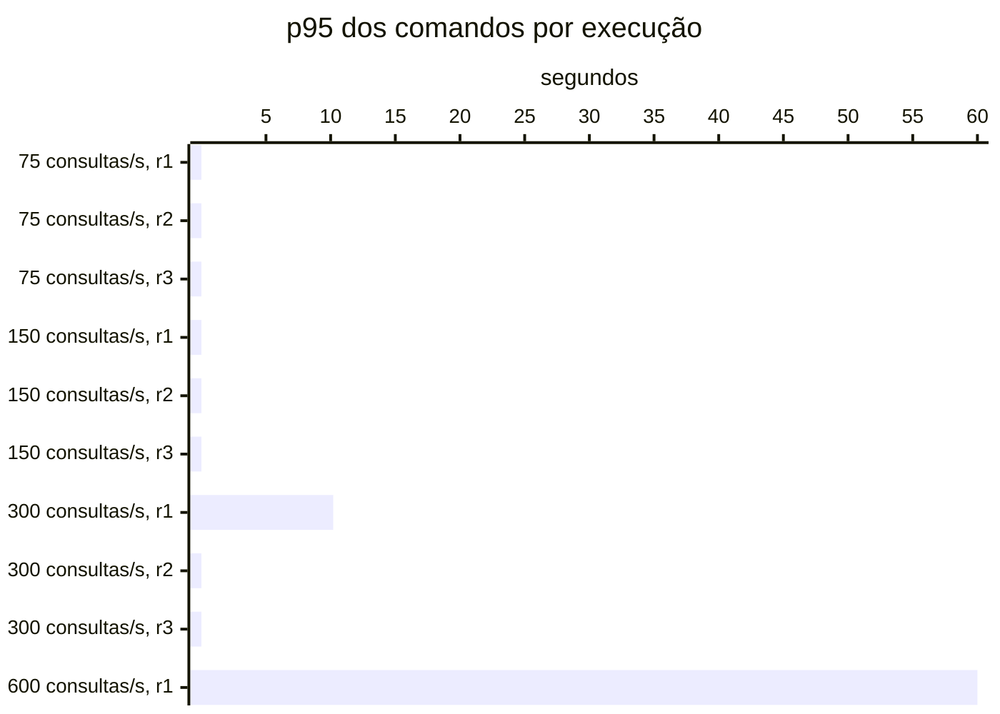

# Resumo

Gerado por `java bench/Report.java summarize`. Mediana das repetições; entre colchetes, a faixa do p95
(mín–máx). Latências em ms, vazão em requisições/s. Parâmetros de cada cenário em
`runs/<cenário>/scenario.properties`; série temporal de cada execução (5 s) em
`runs/<cenário>/r<n>/timeseries.csv`.

## c1-r0075 (3 execuções)

`writeRate=20` · `readRate=75` · `duration=180`

| Requisição | Vazão | % KO | p50 | p95 | p99 |
|---|---:|---:|---:|---:|---:|
| Global | 95.0 | 0.0 | 3 | 20 [19–20] | 46 |
| comandos | 20.0 | 0.0 | 3 | 5 [5–5] | 7 |
| consultas | 75.0 | 0.0 | 4 | 23 [22–23] | 49 |
| comandos / deposit empresa | 3.0 | 0.0 | 3 | 4 [4–4] | 8 |
| comandos / deposit pessoa | 3.1 | 0.0 | 3 | 5 [4–5] | 7 |
| comandos / transfer empresa | 1.5 | 0.0 | 4 | 5 [5–6] | 7 |
| comandos / transfer pessoa | 1.4 | 0.0 | 4 | 6 [6–6] | 11 |
| comandos / withdraw empresa | 5.5 | 0.0 | 3 | 4 [4–4] | 6 |
| comandos / withdraw pessoa | 5.5 | 0.0 | 3 | 5 [4–5] | 6 |
| consultas / Q1 empresa | 9.4 | 0.0 | 1 | 2 [2–2] | 3 |
| consultas / Q1 pessoa | 9.3 | 0.0 | 1 | 2 [2–2] | 3 |
| consultas / Q2 empresa | 9.5 | 0.0 | 7 | 13 [13–13] | 19 |
| consultas / Q2 pessoa | 9.6 | 0.0 | 3 | 7 [7–7] | 10 |
| consultas / Q3 empresa | 9.5 | 0.0 | 8 | 12 [12–12] | 15 |
| consultas / Q3 pessoa | 9.1 | 0.0 | 2 | 3 [3–3] | 4 |
| consultas / Q4 empresa | 9.6 | 0.0 | 19 | 53 [53–53] | 69 |
| consultas / Q4 pessoa | 9.1 | 0.0 | 4 | 10 [10–11] | 16 |

## c1-r0150 (3 execuções)

`writeRate=20` · `readRate=150` · `duration=180`

| Requisição | Vazão | % KO | p50 | p95 | p99 |
|---|---:|---:|---:|---:|---:|
| Global | 170.0 | 0.0 | 3 | 21 [21–22] | 48 |
| comandos | 20.0 | 0.0 | 3 | 5 [5–5] | 8 |
| consultas | 150.0 | 0.0 | 3 | 22 [22–24] | 49 |
| comandos / deposit empresa | 2.9 | 0.0 | 2 | 5 [4–5] | 8 |
| comandos / deposit pessoa | 3.0 | 0.0 | 3 | 5 [5–5] | 9 |
| comandos / transfer empresa | 1.5 | 0.0 | 3 | 5 [5–6] | 10 |
| comandos / transfer pessoa | 1.5 | 0.0 | 3 | 6 [6–6] | 9 |
| comandos / withdraw empresa | 5.5 | 0.0 | 2 | 4 [4–4] | 7 |
| comandos / withdraw pessoa | 5.6 | 0.0 | 3 | 5 [5–5] | 7 |
| consultas / Q1 empresa | 18.8 | 0.0 | 1 | 1 [1–1] | 2 |
| consultas / Q1 pessoa | 18.7 | 0.0 | 1 | 2 [1–2] | 3 |
| consultas / Q2 empresa | 18.8 | 0.0 | 5 | 12 [12–14] | 18 |
| consultas / Q2 pessoa | 18.7 | 0.0 | 3 | 7 [7–8] | 11 |
| consultas / Q3 empresa | 18.7 | 0.0 | 8 | 11 [11–11] | 13 |
| consultas / Q3 pessoa | 18.7 | 0.0 | 1 | 2 [2–2] | 4 |
| consultas / Q4 empresa | 18.6 | 0.0 | 19 | 56 [54–56] | 79 |
| consultas / Q4 pessoa | 18.9 | 0.0 | 4 | 10 [10–11] | 17 |

## c1-r0300 (3 execuções)

`writeRate=20` · `readRate=300` · `duration=180`

| Requisição | Vazão | % KO | p50 | p95 | p99 |
|---|---:|---:|---:|---:|---:|
| Global | 318.2 | 0.0 | 3 | 34 [32–10,350] | 83 |
| comandos | 19.9 | 0.0 | 3 | 6 [6–10,197] | 31 |
| consultas | 298.3 | 0.0 | 4 | 35 [33–10,351] | 85 |
| comandos / deposit empresa | 2.9 | 0.0 | 3 | 6 [5–9,187] | 40 |
| comandos / deposit pessoa | 3.0 | 0.0 | 3 | 7 [6–9,954] | 19 |
| comandos / transfer empresa | 1.5 | 0.0 | 4 | 7 [6–10,286] | 34 |
| comandos / transfer pessoa | 1.6 | 0.0 | 4 | 7 [6–8,933] | 11 |
| comandos / withdraw empresa | 5.5 | 0.0 | 3 | 6 [5–10,636] | 37 |
| comandos / withdraw pessoa | 5.5 | 0.0 | 3 | 6 [5–10,464] | 37 |
| consultas / Q1 empresa | 37.2 | 0.0 | 1 | 2 [1–10,454] | 20 |
| consultas / Q1 pessoa | 38.0 | 0.0 | 1 | 2 [2–10,301] | 23 |
| consultas / Q2 empresa | 37.4 | 0.0 | 6 | 17 [15–10,317] | 53 |
| consultas / Q2 pessoa | 37.1 | 0.0 | 3 | 9 [9–10,470] | 34 |
| consultas / Q3 empresa | 37.5 | 0.0 | 8 | 13 [12–10,342] | 36 |
| consultas / Q3 pessoa | 37.6 | 0.0 | 1 | 3 [2–10,329] | 20 |
| consultas / Q4 empresa | 37.3 | 0.0 | 25 | 92 [86–10,553] | 191 |
| consultas / Q4 pessoa | 37.5 | 0.0 | 4 | 15 [14–10,371] | 38 |

## c1-r0600 (1 execuções)

`writeRate=20` · `readRate=600` · `duration=180`

| Requisição | Vazão | % KO | p50 | p95 | p99 |
|---|---:|---:|---:|---:|---:|
| Global | 572.3 | 94.3 | 15,001 | 58,755 [58,755–58,755] | 60,002 |
| comandos | 18.5 | 94.3 | 15,001 | 60,000 [60,000–60,000] | 60,002 |
| consultas | 553.9 | 94.4 | 15,001 | 58,382 [58,382–58,382] | 60,002 |
| comandos / deposit empresa | 2.7 | 93.3 | 15,001 | 60,000 [60,000–60,000] | 60,002 |
| comandos / deposit pessoa | 2.7 | 94.1 | 15,001 | 60,001 [60,001–60,001] | 60,002 |
| comandos / transfer empresa | 1.3 | 95.7 | 15,001 | 60,000 [60,000–60,000] | 60,001 |
| comandos / transfer pessoa | 1.5 | 92.7 | 15,001 | 60,000 [60,000–60,000] | 60,003 |
| comandos / withdraw empresa | 5.1 | 94.6 | 15,001 | 60,000 [60,000–60,000] | 60,002 |
| comandos / withdraw pessoa | 5.2 | 94.7 | 15,001 | 44,471 [44,471–44,471] | 60,002 |
| consultas / Q1 empresa | 68.8 | 94.7 | 15,001 | 59,780 [59,780–59,780] | 60,002 |
| consultas / Q1 pessoa | 70.0 | 94.3 | 15,001 | 60,000 [60,000–60,000] | 60,002 |
| consultas / Q2 empresa | 69.5 | 94.1 | 15,001 | 60,000 [60,000–60,000] | 60,002 |
| consultas / Q2 pessoa | 68.4 | 94.4 | 15,001 | 60,000 [60,000–60,000] | 60,002 |
| consultas / Q3 empresa | 69.4 | 94.6 | 15,001 | 60,000 [60,000–60,000] | 60,002 |
| consultas / Q3 pessoa | 69.1 | 94.4 | 15,001 | 60,000 [60,000–60,000] | 60,002 |
| consultas / Q4 empresa | 69.4 | 94.0 | 15,001 | 60,000 [60,000–60,000] | 60,002 |
| consultas / Q4 pessoa | 69.3 | 94.4 | 15,001 | 60,000 [60,000–60,000] | 60,002 |

## Capacidade

Critério do ADR-0013 por repetição: p95 dos comandos ≤ 50 ms, p95 das consultas ≤ 250 ms, KO ≤ 1%,
vazão ≥ 98% da oferecida e, com consistência eventual, atraso p99 ≤ 2 s e fila no fim ≤ 1 s de escrita.
Vazão baixa com nenhum container da fase acima de 50% do seu limite de CPU (p90 das amostras) é limite do
gerador. Degrau
sustentado: em pelo menos 2 de 3 repetições. **Maior degrau sustentado: 300 consultas/s.**

- c1-r0075: sustentado (3 de 3)
- c1-r0150: sustentado (3 de 3)
- c1-r0300: sustentado (2 de 3); r1: comandos p95 10,197 ms, consultas p95 10,351 ms
- c1-r0600: não sustentado (0 de 1); r1: fase fora do ar no fim (http://localhost:8080, http://localhost:8080), comandos p95 60,000 ms, consultas p95 58,382 ms, KO 94.3%, vazão 92% da oferecida (CPU da fase no p90 até 51% do limite)

Vazão em % da oferecida; p95 em ms, no cliente; KO em %; atraso p99 em s; fila no fim em segundos de
escrita (— sem consistência eventual).

| Degrau | Rep. | Estado | Vazão | p95 comandos | p95 consultas | % KO | Atraso p99 | Fila no fim |
|---|---|---|---:|---:|---:|---:|---:|---:|
| c1-r0075 | r1 | sustentado | 100.0% | 5 | 23 | 0.0 | — | — |
| c1-r0075 | r2 | sustentado | 100.0% | 5 | 22 | 0.0 | — | — |
| c1-r0075 | r3 | sustentado | 100.0% | 5 | 23 | 0.0 | — | — |
| c1-r0150 | r1 | sustentado | 100.0% | 5 | 24 | 0.0 | — | — |
| c1-r0150 | r2 | sustentado | 100.0% | 5 | 22 | 0.0 | — | — |
| c1-r0150 | r3 | sustentado | 100.0% | 5 | 22 | 0.0 | — | — |
| c1-r0300 | r1 | **não sustentado** | 99.4% | 10,197 | 10,351 | 0.0 | — | — |
| c1-r0300 | r2 | sustentado | 99.4% | 6 | 35 | 0.0 | — | — |
| c1-r0300 | r3 | sustentado | 100.0% | 6 | 33 | 0.0 | — | — |
| c1-r0600 | r1 | **não sustentado** | 92.3% | 60,000 | 58,382 | 94.3 | — | — |

## Estado por execução

Colapso: p95 global acima de 5,000 ms (ADR-0009). Leia a contagem, não a mediana: perto da saturação as
repetições caem em estados diferentes.

| Cenário | Colapsou |
|---|---|
| c1-r0075 | 0 de 3 |
| c1-r0150 | 0 de 3 |
| c1-r0300 | 1 de 3 (r1) |
| c1-r0600 | 1 de 1 (r1) |

p95 global e comandos em ms, no cliente (Gatling). Espera e uso da conexão do Hikari em ms, média da
execução. Comando no banco: soma do tempo médio das instruções de escrita e do `SELECT … FOR UPDATE` no
`pg_stat_statements`, em ms (o custo de um comando dentro do Postgres, sem a fila). GC: segundos com a JVM
parada em GC na execução (medido a partir da #11).

| Cenário | Rep. | Estado | p95 global | % KO | Comandos p50 | p95 | p99 | Espera no pool | Uso da conexão | Comando no banco | GC |
|---|---|---|---:|---:|---:|---:|---:|---:|---:|---:|---:|
| c1-r0075 | r1 | estável | 20 | 0.0 | 3 | 5 | 7 | 0.0 | 4.1 | 0.6 | 0.6 |
| c1-r0075 | r2 | estável | 19 | 0.0 | 3 | 5 | 7 | 0.0 | 4.0 | 0.5 | 0.6 |
| c1-r0075 | r3 | estável | 20 | 0.0 | 3 | 5 | 7 | 0.0 | 4.1 | 0.5 | 0.6 |
| c1-r0150 | r1 | estável | 22 | 0.0 | 3 | 5 | 8 | 0.0 | 4.4 | 0.6 | 1.1 |
| c1-r0150 | r2 | estável | 21 | 0.0 | 3 | 5 | 7 | 0.0 | 4.2 | 0.6 | 1.0 |
| c1-r0150 | r3 | estável | 21 | 0.0 | 3 | 5 | 9 | 0.0 | 4.1 | 0.6 | 1.0 |
| c1-r0300 | r1 | **colapso** | 10,350 | 0.0 | 5 | 10,197 | 15,663 | 2,011.9 | 15.4 | 1.2 | 1.9 |
| c1-r0300 | r2 | estável | 34 | 0.0 | 3 | 6 | 31 | 0.6 | 5.9 | 0.8 | 0.1 |
| c1-r0300 | r3 | estável | 32 | 0.0 | 3 | 6 | 15 | 0.2 | 5.7 | 0.8 | 0.1 |
| c1-r0600 | r1 | **colapso** | 58,755 | 94.3 | 15,001 | 60,000 | 60,002 | — | — | 1.9 | — |

## Leitura de disco por execução

Páginas lidas fora do cache e tempo médio por página, em ms. Postgres: soma das instruções do
pg_stat_statements (as 50 mais caras; na v1-replica, do primário e da réplica somados). Mongo: leituras das
threads da aplicação para o cache do WiredTiger. — quando o store não existe na fase.

| Cenário | Rep. | Postgres: páginas | ms/página | Mongo: páginas | ms/página |
|---|---|---:|---:|---:|---:|
| c1-r0075 | r1 | 455,753 | 0.10 | — | — |
| c1-r0075 | r2 | 440,347 | 0.10 | — | — |
| c1-r0075 | r3 | 457,252 | 0.10 | — | — |
| c1-r0150 | r1 | 896,292 | 0.10 | — | — |
| c1-r0150 | r2 | 881,257 | 0.10 | — | — |
| c1-r0150 | r3 | 872,564 | 0.10 | — | — |
| c1-r0300 | r1 | 2,168,301 | 0.37 | — | — |
| c1-r0300 | r2 | 1,772,094 | 0.15 | — | — |
| c1-r0300 | r3 | 1,761,640 | 0.15 | — | — |
| c1-r0600 | r1 | 252,117 | 0.53 | — | — |

## Escrita em disco por execução

WAL gerado no Postgres primário (MB e KB por comando), fsyncs do WAL e o tempo médio de cada um, em ms
(pg_stat_io com track_wal_io_timing), e bytes gravados em disco pelo WiredTiger por comando, em KB (block
manager; — sem Mongo). Os contadores do pg_stat_io chegam com até ~1 s de atraso; a série por segundo está
no `pg-seconds.csv` de cada execução.

| Cenário | Rep. | WAL (MB) | WAL por comando | fsyncs | ms por fsync | Mongo por comando |
|---|---|---:|---:|---:|---:|---:|
| c1-r0075 | r1 | 64 | 18.3 | 3,848 | 0.30 | — |
| c1-r0075 | r2 | 66 | 18.7 | 3,820 | 0.29 | — |
| c1-r0075 | r3 | 68 | 19.5 | 3,832 | 0.30 | — |
| c1-r0150 | r1 | 76 | 21.6 | 3,922 | 0.35 | — |
| c1-r0150 | r2 | 77 | 21.9 | 3,902 | 0.34 | — |
| c1-r0150 | r3 | 46 | 13.0 | 3,908 | 0.32 | — |
| c1-r0300 | r1 | 75 | 21.3 | 3,964 | 0.87 | — |
| c1-r0300 | r2 | 83 | 23.6 | 3,938 | 0.51 | — |
| c1-r0300 | r3 | 42 | 12.0 | 3,912 | 0.48 | — |
| c1-r0600 | r1 | 6 | 1.6 | 255 | 1.50 | — |

## Pool e banco por cenário

Mediana das repetições. Espera = tempo médio para obter conexão do Hikari; uso = tempo médio com a
conexão (o trabalho no banco); hit ratio = blocos achados no shared_buffers.

| Cenário | Espera no pool (ms) | Uso da conexão (ms) | Fila máx. no pool | Hit ratio | CPU da app |
|---|---:|---:|---:|---:|---:|
| c1-r0075 | 0.0 | 4.1 | 0 | 96.8% | 4% |
| c1-r0150 | 0.0 | 4.2 | 0 | 97.2% | 5% |
| c1-r0300 | 0.6 | 5.9 | 28 | 97.3% | 8% |
| c1-r0600 | — | — | — | 100.0% | — |
