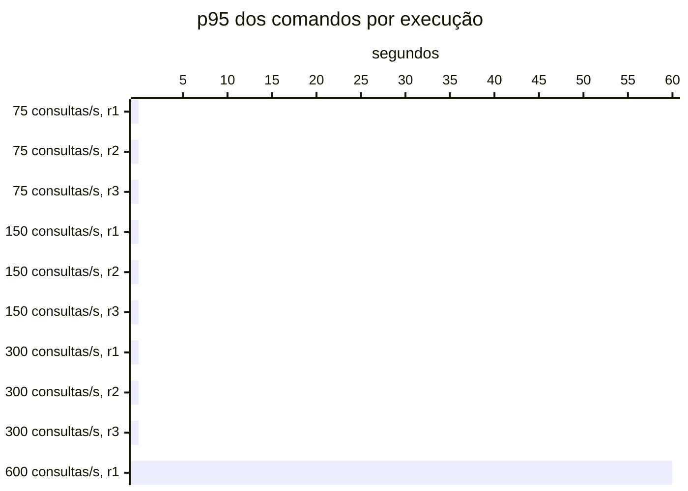

# Resumo

Gerado por `java bench/Report.java summarize`. Mediana das repetições; entre colchetes, a faixa do p95
(mín–máx). Latências em ms, vazão em requisições/s. Parâmetros de cada cenário em
`runs/<cenário>/scenario.properties`; série temporal de cada execução (5 s) em
`runs/<cenário>/r<n>/timeseries.csv`.

## c1-r0075 (3 execuções)

`writeRate=20` · `readRate=75` · `duration=180`

| Requisição | Vazão | % KO | p50 | p95 | p99 |
|---|---:|---:|---:|---:|---:|
| Global | 95.0 | 0.0 | 3 | 19 [18–20] | 37 |
| comandos | 20.0 | 0.0 | 4 | 7 [7–7] | 15 |
| consultas | 75.0 | 0.0 | 2 | 21 [21–22] | 38 |
| comandos / deposit empresa | 3.0 | 0.0 | 3 | 6 [6–6] | 13 |
| comandos / deposit pessoa | 3.1 | 0.0 | 4 | 6 [6–6] | 23 |
| comandos / transfer empresa | 1.5 | 0.0 | 5 | 9 [8–10] | 26 |
| comandos / transfer pessoa | 1.5 | 0.0 | 5 | 8 [8–9] | 16 |
| comandos / withdraw empresa | 5.6 | 0.0 | 3 | 6 [6–6] | 9 |
| comandos / withdraw pessoa | 5.5 | 0.0 | 4 | 6 [6–7] | 14 |
| consultas / Q1 empresa | 9.3 | 0.0 | 1 | 2 [2–2] | 6 |
| consultas / Q1 pessoa | 9.3 | 0.0 | 1 | 2 [2–2] | 4 |
| consultas / Q2 empresa | 9.5 | 0.0 | 5 | 8 [8–9] | 13 |
| consultas / Q2 pessoa | 9.5 | 0.0 | 2 | 4 [4–4] | 9 |
| consultas / Q3 empresa | 9.4 | 0.0 | 2 | 4 [3–4] | 8 |
| consultas / Q3 pessoa | 9.5 | 0.0 | 2 | 3 [3–4] | 8 |
| consultas / Q4 empresa | 9.4 | 0.0 | 18 | 38 [38–39] | 49 |
| consultas / Q4 pessoa | 9.1 | 0.0 | 3 | 5 [5–6] | 15 |

## c1-r0150 (3 execuções)

`writeRate=20` · `readRate=150` · `duration=180`

| Requisição | Vazão | % KO | p50 | p95 | p99 |
|---|---:|---:|---:|---:|---:|
| Global | 170.0 | 0.0 | 2 | 17 [17–18] | 31 |
| comandos | 20.0 | 0.0 | 3 | 6 [5–6] | 10 |
| consultas | 150.0 | 0.0 | 2 | 18 [18–19] | 32 |
| comandos / deposit empresa | 2.9 | 0.0 | 3 | 5 [4–6] | 12 |
| comandos / deposit pessoa | 3.0 | 0.0 | 3 | 5 [5–5] | 12 |
| comandos / transfer empresa | 1.5 | 0.0 | 4 | 6 [6–7] | 11 |
| comandos / transfer pessoa | 1.5 | 0.0 | 4 | 7 [7–9] | 20 |
| comandos / withdraw empresa | 5.5 | 0.0 | 3 | 5 [4–5] | 10 |
| comandos / withdraw pessoa | 5.6 | 0.0 | 3 | 5 [5–5] | 9 |
| consultas / Q1 empresa | 18.7 | 0.0 | 1 | 1 [1–2] | 3 |
| consultas / Q1 pessoa | 18.7 | 0.0 | 1 | 2 [2–2] | 4 |
| consultas / Q2 empresa | 18.8 | 0.0 | 4 | 7 [6–7] | 10 |
| consultas / Q2 pessoa | 18.6 | 0.0 | 2 | 3 [3–3] | 6 |
| consultas / Q3 empresa | 18.8 | 0.0 | 1 | 3 [3–3] | 5 |
| consultas / Q3 pessoa | 18.7 | 0.0 | 1 | 3 [2–3] | 6 |
| consultas / Q4 empresa | 18.7 | 0.0 | 16 | 35 [35–36] | 44 |
| consultas / Q4 pessoa | 18.8 | 0.0 | 2 | 4 [4–4] | 8 |

## c1-r0300 (3 execuções)

`writeRate=20` · `readRate=300` · `duration=180`

| Requisição | Vazão | % KO | p50 | p95 | p99 |
|---|---:|---:|---:|---:|---:|
| Global | 320.0 | 0.0 | 2 | 19 [17–19] | 37 |
| comandos | 20.0 | 0.0 | 3 | 6 [5–7] | 22 |
| consultas | 300.0 | 0.0 | 1 | 19 [18–19] | 36 |
| comandos / deposit empresa | 2.9 | 0.0 | 3 | 5 [5–6] | 41 |
| comandos / deposit pessoa | 3.0 | 0.0 | 3 | 6 [5–7] | 16 |
| comandos / transfer empresa | 1.5 | 0.0 | 4 | 7 [6–8] | 12 |
| comandos / transfer pessoa | 1.6 | 0.0 | 4 | 9 [8–11] | 31 |
| comandos / withdraw empresa | 5.5 | 0.0 | 3 | 6 [4–6] | 32 |
| comandos / withdraw pessoa | 5.4 | 0.0 | 3 | 6 [5–7] | 19 |
| consultas / Q1 empresa | 37.4 | 0.0 | 1 | 1 [1–2] | 9 |
| consultas / Q1 pessoa | 37.7 | 0.0 | 1 | 2 [1–2] | 8 |
| consultas / Q2 empresa | 37.4 | 0.0 | 4 | 7 [6–7] | 15 |
| consultas / Q2 pessoa | 37.3 | 0.0 | 1 | 3 [2–3] | 14 |
| consultas / Q3 empresa | 37.3 | 0.0 | 1 | 3 [2–3] | 10 |
| consultas / Q3 pessoa | 37.8 | 0.0 | 1 | 3 [2–3] | 18 |
| consultas / Q4 empresa | 37.3 | 0.0 | 15 | 36 [34–36] | 52 |
| consultas / Q4 pessoa | 37.3 | 0.0 | 2 | 5 [4–5] | 23 |

## c1-r0600 (1 execuções)

`writeRate=20` · `readRate=600` · `duration=180`

| Requisição | Vazão | % KO | p50 | p95 | p99 |
|---|---:|---:|---:|---:|---:|
| Global | 572.3 | 46.9 | 5,591 | 59,540 [59,540–59,540] | 60,002 |
| comandos | 18.5 | 46.9 | 5,470 | 60,000 [60,000–60,000] | 60,002 |
| consultas | 553.9 | 46.9 | 5,826 | 59,802 [59,802–59,802] | 60,002 |
| comandos / deposit empresa | 2.9 | 45.6 | 4,610 | 60,000 [60,000–60,000] | 60,002 |
| comandos / deposit pessoa | 2.8 | 47.3 | 5,778 | 60,000 [60,000–60,000] | 60,003 |
| comandos / transfer empresa | 1.4 | 45.7 | 4,653 | 60,000 [60,000–60,000] | 60,001 |
| comandos / transfer pessoa | 1.4 | 47.9 | 8,601 | 60,001 [60,001–60,001] | 60,003 |
| comandos / withdraw empresa | 4.9 | 47.9 | 5,643 | 60,000 [60,000–60,000] | 60,001 |
| comandos / withdraw pessoa | 5.1 | 46.7 | 5,195 | 60,000 [60,000–60,000] | 60,002 |
| consultas / Q1 empresa | 68.9 | 47.6 | 6,410 | 60,000 [60,000–60,000] | 60,002 |
| consultas / Q1 pessoa | 69.8 | 46.3 | 5,236 | 59,401 [59,401–59,401] | 60,002 |
| consultas / Q2 empresa | 69.0 | 46.4 | 5,246 | 56,685 [56,685–56,685] | 60,002 |
| consultas / Q2 pessoa | 68.7 | 46.5 | 5,365 | 60,000 [60,000–60,000] | 60,002 |
| consultas / Q3 empresa | 69.4 | 47.4 | 6,079 | 60,000 [60,000–60,000] | 60,002 |
| consultas / Q3 pessoa | 69.3 | 46.7 | 5,624 | 60,000 [60,000–60,000] | 60,002 |
| consultas / Q4 empresa | 69.6 | 47.0 | 5,578 | 57,220 [57,220–57,220] | 60,002 |
| consultas / Q4 pessoa | 69.2 | 46.9 | 5,440 | 54,589 [54,589–54,589] | 60,002 |

## Capacidade

Critério do ADR-0013 por repetição: p95 dos comandos ≤ 50 ms, p95 das consultas ≤ 250 ms, KO ≤ 1%,
vazão ≥ 98% da oferecida e, com consistência eventual, atraso p99 ≤ 2 s e fila no fim ≤ 1 s de escrita.
Vazão baixa com nenhum container da fase acima de 50% do seu limite de CPU (p90 das amostras) é limite do
gerador. Degrau
sustentado: em pelo menos 2 de 3 repetições. **Maior degrau sustentado: 300 consultas/s.**

- c1-r0075: sustentado (3 de 3)
- c1-r0150: sustentado (3 de 3)
- c1-r0300: sustentado (3 de 3)
- c1-r0600: não sustentado (0 de 1); r1: fase fora do ar no fim (http://localhost:8080, http://localhost:8080), comandos p95 60,000 ms, consultas p95 59,802 ms, KO 46.9%, vazão 92% da oferecida (CPU da fase no p90 até 101% do limite)

Vazão em % da oferecida; p95 em ms, no cliente; KO em %; atraso p99 em s; fila no fim em segundos de
escrita (— sem consistência eventual).

| Degrau | Rep. | Estado | Vazão | p95 comandos | p95 consultas | % KO | Atraso p99 | Fila no fim |
|---|---|---|---:|---:|---:|---:|---:|---:|
| c1-r0075 | r1 | sustentado | 100.0% | 7 | 21 | 0.0 | — | — |
| c1-r0075 | r2 | sustentado | 100.0% | 7 | 21 | 0.0 | — | — |
| c1-r0075 | r3 | sustentado | 100.0% | 7 | 22 | 0.0 | — | — |
| c1-r0150 | r1 | sustentado | 100.0% | 6 | 19 | 0.0 | — | — |
| c1-r0150 | r2 | sustentado | 100.0% | 5 | 18 | 0.0 | — | — |
| c1-r0150 | r3 | sustentado | 100.0% | 6 | 18 | 0.0 | — | — |
| c1-r0300 | r1 | sustentado | 99.4% | 6 | 19 | 0.0 | — | — |
| c1-r0300 | r2 | sustentado | 100.0% | 5 | 18 | 0.0 | — | — |
| c1-r0300 | r3 | sustentado | 100.0% | 7 | 19 | 0.0 | — | — |
| c1-r0600 | r1 | **não sustentado** | 92.3% | 60,000 | 59,802 | 46.9 | — | — |

## Estado por execução

Colapso: p95 global acima de 5,000 ms (ADR-0009). Leia a contagem, não a mediana: perto da saturação as
repetições caem em estados diferentes.

| Cenário | Colapsou |
|---|---|
| c1-r0075 | 0 de 3 |
| c1-r0150 | 0 de 3 |
| c1-r0300 | 0 de 3 |
| c1-r0600 | 1 de 1 (r1) |

p95 global e comandos em ms, no cliente (Gatling). Espera e uso da conexão do Hikari em ms, média da
execução. Comando no banco: soma do tempo médio das instruções de escrita e do `SELECT … FOR UPDATE` no
`pg_stat_statements`, em ms (o custo de um comando dentro do Postgres, sem a fila). GC: segundos com a JVM
parada em GC na execução (medido a partir da #11).

| Cenário | Rep. | Estado | p95 global | % KO | Comandos p50 | p95 | p99 | Espera no pool | Uso da conexão | Comando no banco | GC |
|---|---|---|---:|---:|---:|---:|---:|---:|---:|---:|---:|
| c1-r0075 | r1 | estável | 18 | 0.0 | 4 | 7 | 11 | 0.0 | 2.7 | 0.7 | 0.2 |
| c1-r0075 | r2 | estável | 19 | 0.0 | 4 | 7 | 15 | 0.0 | 2.9 | 0.7 | 0.2 |
| c1-r0075 | r3 | estável | 20 | 0.0 | 4 | 7 | 27 | 0.8 | 3.3 | 0.9 | 0.2 |
| c1-r0150 | r1 | estável | 18 | 0.0 | 3 | 6 | 13 | 0.0 | 2.5 | 0.6 | 0.3 |
| c1-r0150 | r2 | estável | 17 | 0.0 | 3 | 5 | 9 | 0.0 | 2.3 | 0.6 | 0.3 |
| c1-r0150 | r3 | estável | 17 | 0.0 | 3 | 6 | 10 | 0.0 | 2.3 | 0.6 | 0.3 |
| c1-r0300 | r1 | estável | 19 | 0.0 | 3 | 6 | 22 | 0.3 | 2.4 | 0.7 | 0.5 |
| c1-r0300 | r2 | estável | 17 | 0.0 | 3 | 5 | 12 | 0.1 | 2.2 | 0.6 | 0.5 |
| c1-r0300 | r3 | estável | 19 | 0.0 | 3 | 7 | 52 | 0.1 | 2.5 | 0.8 | 0.5 |
| c1-r0600 | r1 | **colapso** | 59,540 | 46.9 | 5,470 | 60,000 | 60,002 | — | — | 3.6 | — |

## Leitura de disco por execução

Páginas lidas fora do cache e tempo médio por página, em ms. Postgres: soma das instruções do
pg_stat_statements (as 50 mais caras; na v1-replica, do primário e da réplica somados). Mongo: leituras das
threads da aplicação para o cache do WiredTiger. — quando o store não existe na fase.

| Cenário | Rep. | Postgres: páginas | ms/página | Mongo: páginas | ms/página |
|---|---|---:|---:|---:|---:|
| c1-r0075 | r1 | 121,515 | 0.09 | — | — |
| c1-r0075 | r2 | 119,960 | 0.10 | — | — |
| c1-r0075 | r3 | 119,057 | 0.11 | — | — |
| c1-r0150 | r1 | 236,559 | 0.08 | — | — |
| c1-r0150 | r2 | 235,364 | 0.07 | — | — |
| c1-r0150 | r3 | 232,292 | 0.08 | — | — |
| c1-r0300 | r1 | 460,991 | 0.08 | — | — |
| c1-r0300 | r2 | 465,505 | 0.07 | — | — |
| c1-r0300 | r3 | 469,881 | 0.09 | — | — |
| c1-r0600 | r1 | 492,169 | 0.52 | — | — |

## Escrita em disco por execução

WAL gerado no Postgres primário (MB e KB por comando), fsyncs do WAL e o tempo médio de cada um, em ms
(pg_stat_io com track_wal_io_timing), e bytes gravados em disco pelo WiredTiger por comando, em KB (block
manager; — sem Mongo). Os contadores do pg_stat_io chegam com até ~1 s de atraso; a série por segundo está
no `pg-seconds.csv` de cada execução.

| Cenário | Rep. | WAL (MB) | WAL por comando | fsyncs | ms por fsync | Mongo por comando |
|---|---|---:|---:|---:|---:|---:|
| c1-r0075 | r1 | 67 | 18.9 | 3,892 | 0.30 | — |
| c1-r0075 | r2 | 68 | 19.3 | 3,870 | 0.32 | — |
| c1-r0075 | r3 | 69 | 19.8 | 3,875 | 0.40 | — |
| c1-r0150 | r1 | 67 | 19.0 | 3,926 | 0.30 | — |
| c1-r0150 | r2 | 69 | 19.7 | 3,926 | 0.26 | — |
| c1-r0150 | r3 | 68 | 19.3 | 3,915 | 0.27 | — |
| c1-r0300 | r1 | 68 | 19.5 | 4,000 | 0.34 | — |
| c1-r0300 | r2 | 68 | 19.4 | 3,954 | 0.29 | — |
| c1-r0300 | r3 | 72 | 20.5 | 3,947 | 0.38 | — |
| c1-r0600 | r1 | 48 | 13.8 | 2,198 | 3.04 | — |

## Pool e banco por cenário

Mediana das repetições. Espera = tempo médio para obter conexão do Hikari; uso = tempo médio com a
conexão (o trabalho no banco); hit ratio = blocos achados no shared_buffers.

| Cenário | Espera no pool (ms) | Uso da conexão (ms) | Fila máx. no pool | Hit ratio | CPU da app |
|---|---:|---:|---:|---:|---:|
| c1-r0075 | 0.0 | 2.9 | 0 | 93.5% | 4% |
| c1-r0150 | 0.0 | 2.3 | 0 | 92.7% | 5% |
| c1-r0300 | 0.1 | 2.4 | 0 | 92.3% | 8% |
| c1-r0600 | — | — | — | 99.9% | — |
