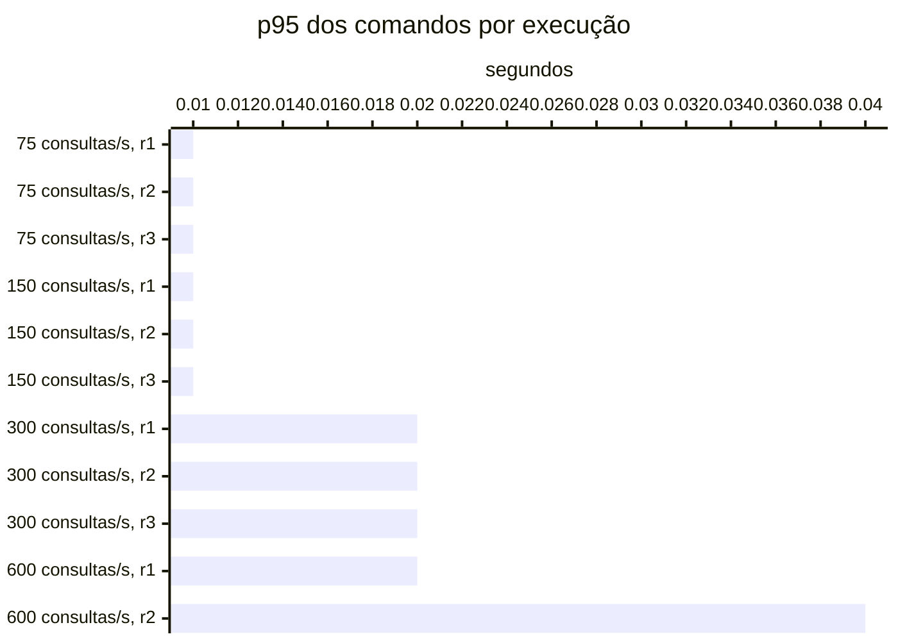

# Resumo

Gerado por `java bench/Report.java summarize`. Mediana das repetições; entre colchetes, a faixa do p95
(mín–máx). Latências em ms, vazão em requisições/s. Parâmetros de cada cenário em
`runs/<cenário>/scenario.properties`; série temporal de cada execução (5 s) em
`runs/<cenário>/r<n>/timeseries.csv`.

## c1-r0075 (3 execuções)

`writeRate=20` · `readRate=75` · `duration=180`

| Requisição | Vazão | % KO | p50 | p95 | p99 |
|---|---:|---:|---:|---:|---:|
| Global | 95.0 | 0.0 | 3 | 18 [17–20] | 37 |
| comandos | 20.0 | 0.0 | 4 | 9 [9–11] | 68 |
| consultas | 75.0 | 0.0 | 3 | 19 [19–21] | 36 |
| comandos / deposit empresa | 3.0 | 0.0 | 3 | 8 [8–13] | 63 |
| comandos / deposit pessoa | 3.1 | 0.0 | 4 | 10 [9–15] | 92 |
| comandos / transfer empresa | 1.5 | 0.0 | 4 | 11 [9–16] | 40 |
| comandos / transfer pessoa | 1.4 | 0.0 | 4 | 11 [10–11] | 52 |
| comandos / withdraw empresa | 5.3 | 0.0 | 3 | 10 [9–11] | 93 |
| comandos / withdraw pessoa | 5.6 | 0.0 | 4 | 9 [9–10] | 93 |
| consultas / Q1 empresa | 9.6 | 0.0 | 1 | 3 [3–3] | 7 |
| consultas / Q1 pessoa | 9.4 | 0.0 | 1 | 3 [3–3] | 7 |
| consultas / Q2 empresa | 9.5 | 0.0 | 4 | 8 [8–10] | 20 |
| consultas / Q2 pessoa | 9.5 | 0.0 | 3 | 8 [7–10] | 25 |
| consultas / Q3 empresa | 9.3 | 0.0 | 3 | 7 [7–11] | 27 |
| consultas / Q3 pessoa | 9.4 | 0.0 | 2 | 6 [6–7] | 24 |
| consultas / Q4 empresa | 9.4 | 0.0 | 16 | 38 [35–40] | 77 |
| consultas / Q4 pessoa | 9.2 | 0.0 | 3 | 8 [7–8] | 26 |

## c1-r0150 (3 execuções)

`writeRate=20` · `readRate=150` · `duration=180`

| Requisição | Vazão | % KO | p50 | p95 | p99 |
|---|---:|---:|---:|---:|---:|
| Global | 170.0 | 0.0 | 3 | 19 [18–19] | 41 |
| comandos | 20.0 | 0.0 | 3 | 11 [10–11] | 81 |
| consultas | 150.0 | 0.0 | 2 | 19 [19–20] | 39 |
| comandos / deposit empresa | 3.0 | 0.0 | 3 | 15 [11–21] | 90 |
| comandos / deposit pessoa | 3.1 | 0.0 | 3 | 9 [8–9] | 83 |
| comandos / transfer empresa | 1.4 | 0.0 | 4 | 14 [11–14] | 176 |
| comandos / transfer pessoa | 1.5 | 0.0 | 4 | 12 [11–20] | 72 |
| comandos / withdraw empresa | 5.5 | 0.0 | 3 | 9 [9–10] | 83 |
| comandos / withdraw pessoa | 5.5 | 0.0 | 3 | 10 [10–10] | 97 |
| consultas / Q1 empresa | 18.8 | 0.0 | 1 | 3 [3–3] | 11 |
| consultas / Q1 pessoa | 18.8 | 0.0 | 1 | 3 [3–3] | 9 |
| consultas / Q2 empresa | 18.8 | 0.0 | 3 | 8 [8–8] | 27 |
| consultas / Q2 pessoa | 18.4 | 0.0 | 2 | 8 [8–8] | 31 |
| consultas / Q3 empresa | 19.0 | 0.0 | 3 | 7 [7–8] | 31 |
| consultas / Q3 pessoa | 18.8 | 0.0 | 2 | 7 [6–7] | 32 |
| consultas / Q4 empresa | 18.6 | 0.0 | 15 | 37 [36–38] | 111 |
| consultas / Q4 pessoa | 18.8 | 0.0 | 3 | 9 [7–9] | 35 |

## c1-r0300 (3 execuções)

`writeRate=20` · `readRate=300` · `duration=180`

| Requisição | Vazão | % KO | p50 | p95 | p99 |
|---|---:|---:|---:|---:|---:|
| Global | 320.0 | 0.0 | 2 | 30 [23–48] | 223 |
| comandos | 20.0 | 0.0 | 3 | 19 [15–19] | 155 |
| consultas | 300.0 | 0.0 | 2 | 31 [24–50] | 227 |
| comandos / deposit empresa | 2.9 | 0.0 | 3 | 17 [16–25] | 143 |
| comandos / deposit pessoa | 3.1 | 0.0 | 3 | 13 [13–25] | 166 |
| comandos / transfer empresa | 1.4 | 0.0 | 4 | 21 [19–27] | 205 |
| comandos / transfer pessoa | 1.5 | 0.0 | 4 | 17 [16–40] | 207 |
| comandos / withdraw empresa | 5.5 | 0.0 | 3 | 17 [13–19] | 259 |
| comandos / withdraw pessoa | 5.5 | 0.0 | 3 | 17 [13–19] | 173 |
| consultas / Q1 empresa | 37.2 | 0.0 | 1 | 6 [5–15] | 56 |
| consultas / Q1 pessoa | 37.6 | 0.0 | 1 | 7 [5–14] | 51 |
| consultas / Q2 empresa | 37.9 | 0.0 | 3 | 24 [14–52] | 294 |
| consultas / Q2 pessoa | 37.3 | 0.0 | 2 | 29 [15–57] | 250 |
| consultas / Q3 empresa | 37.3 | 0.0 | 2 | 22 [14–50] | 285 |
| consultas / Q3 pessoa | 37.7 | 0.0 | 2 | 22 [12–39] | 215 |
| consultas / Q4 empresa | 37.2 | 0.0 | 15 | 75 [50–131] | 462 |
| consultas / Q4 pessoa | 37.6 | 0.0 | 3 | 21 [14–54] | 216 |

## c1-r0600 (2 execuções)

`writeRate=20` · `readRate=600` · `duration=180`

| Requisição | Vazão | % KO | p50 | p95 | p99 |
|---|---:|---:|---:|---:|---:|
| Global | 596.2 | 35.6 | 7,502 | 30,019 [143–59,895] | 30,351 |
| comandos | 19.2 | 0.0 | 5 | 28 [20–36] | 210 |
| consultas | 576.9 | 36.8 | 7,502 | 30,056 [151–59,961] | 30,356 |
| comandos / deposit empresa | 3.0 | 0.0 | 5 | 30 [21–38] | 224 |
| comandos / deposit pessoa | 3.0 | 0.0 | 5 | 25 [18–31] | 165 |
| comandos / transfer empresa | 1.5 | 0.0 | 7 | 38 [26–49] | 138 |
| comandos / transfer pessoa | 1.4 | 0.0 | 6 | 43 [40–45] | 336 |
| comandos / withdraw empresa | 5.2 | 0.0 | 5 | 25 [17–32] | 139 |
| comandos / withdraw pessoa | 5.2 | 0.0 | 5 | 29 [20–38] | 269 |
| consultas / Q1 empresa | 72.0 | 34.4 | 7,501 | 7,517 [27–15,007] | 23,599 |
| consultas / Q1 pessoa | 72.2 | 34.4 | 7,501 | 7,517 [26–15,007] | 27,860 |
| consultas / Q2 empresa | 72.3 | 37.8 | 7,503 | 30,115 [230–60,000] | 30,421 |
| consultas / Q2 pessoa | 72.0 | 37.5 | 7,502 | 30,108 [216–60,000] | 30,370 |
| consultas / Q3 empresa | 72.3 | 37.2 | 7,502 | 30,106 [212–60,000] | 30,375 |
| consultas / Q3 pessoa | 72.0 | 37.2 | 7,502 | 30,095 [190–60,000] | 30,369 |
| consultas / Q4 empresa | 72.0 | 38.7 | 7,510 | 30,177 [353–60,001] | 30,556 |
| consultas / Q4 pessoa | 72.1 | 37.3 | 7,502 | 30,089 [178–60,000] | 30,364 |

## Capacidade

Critério do ADR-0013 por repetição: p95 dos comandos ≤ 50 ms, p95 das consultas ≤ 250 ms, KO ≤ 1%,
vazão ≥ 98% da oferecida e, com consistência eventual, atraso p99 ≤ 2 s e fila no fim ≤ 1 s de escrita.
Vazão baixa com nenhum container da fase acima de 50% do seu limite de CPU (p90 das amostras) é limite do
gerador. Degrau
sustentado: em pelo menos 2 de 3 repetições. **Maior degrau sustentado: 300 consultas/s.**

- c1-r0075: sustentado (3 de 3)
- c1-r0150: sustentado (3 de 3)
- c1-r0300: sustentado (3 de 3)
- c1-r0600: não sustentado (1 de 2); r2: fase fora do ar no fim (http://localhost:8081), consultas p95 59,961 ms, KO 71.2%, vazão 92% da oferecida (CPU da fase no p90 até 101% do limite)

Vazão em % da oferecida; p95 em ms, no cliente; KO em %; atraso p99 em s; fila no fim em segundos de
escrita (— sem consistência eventual).

| Degrau | Rep. | Estado | Vazão | p95 comandos | p95 consultas | % KO | Atraso p99 | Fila no fim |
|---|---|---|---:|---:|---:|---:|---:|---:|
| c1-r0075 | r1 | sustentado | 100.0% | 9 | 19 | 0.0 | 0.10 | 0.00 |
| c1-r0075 | r2 | sustentado | 100.0% | 11 | 21 | 0.0 | 0.25 | 0.00 |
| c1-r0075 | r3 | sustentado | 100.0% | 9 | 19 | 0.0 | 0.15 | 0.00 |
| c1-r0150 | r1 | sustentado | 100.0% | 11 | 19 | 0.0 | 0.14 | 0.00 |
| c1-r0150 | r2 | sustentado | 99.4% | 10 | 19 | 0.0 | 0.13 | 0.00 |
| c1-r0150 | r3 | sustentado | 100.0% | 11 | 20 | 0.0 | 0.22 | 0.00 |
| c1-r0300 | r1 | sustentado | 100.0% | 19 | 50 | 0.0 | 0.30 | 0.00 |
| c1-r0300 | r2 | sustentado | 100.0% | 15 | 24 | 0.0 | 0.24 | 0.00 |
| c1-r0300 | r3 | sustentado | 100.0% | 19 | 31 | 0.0 | 0.20 | 0.00 |
| c1-r0600 | r1 | sustentado | 100.0% | 20 | 151 | 0.0 | 0.22 | 0.00 |
| c1-r0600 | r2 | **não sustentado** | 92.3% | 36 | 59,961 | 71.2 | 0.29 | 0.00 |

## Estado por execução

Colapso: p95 global acima de 5,000 ms (ADR-0009). Leia a contagem, não a mediana: perto da saturação as
repetições caem em estados diferentes.

| Cenário | Colapsou |
|---|---|
| c1-r0075 | 0 de 3 |
| c1-r0150 | 0 de 3 |
| c1-r0300 | 0 de 3 |
| c1-r0600 | 1 de 2 (r2) |

p95 global e comandos em ms, no cliente (Gatling). Espera e uso da conexão do Hikari em ms, média da
execução. Comando no banco: soma do tempo médio das instruções de escrita e do `SELECT … FOR UPDATE` no
`pg_stat_statements`, em ms (o custo de um comando dentro do Postgres, sem a fila). GC: segundos com a JVM
parada em GC na execução (medido a partir da #11).

| Cenário | Rep. | Estado | p95 global | % KO | Comandos p50 | p95 | p99 | Espera no pool | Uso da conexão | Comando no banco | GC |
|---|---|---|---:|---:|---:|---:|---:|---:|---:|---:|---:|
| c1-r0075 | r1 | estável | 18 | 0.0 | 4 | 9 | 66 | 0.0 | 1.1 | 0.4 | 2.1 |
| c1-r0075 | r2 | estável | 20 | 0.0 | 4 | 11 | 135 | 0.1 | 1.7 | 0.5 | 2.3 |
| c1-r0075 | r3 | estável | 17 | 0.0 | 4 | 9 | 68 | 0.0 | 1.2 | 0.4 | 2.1 |
| c1-r0150 | r1 | estável | 19 | 0.0 | 3 | 11 | 81 | 0.0 | 0.9 | 0.4 | 3.6 |
| c1-r0150 | r2 | estável | 18 | 0.0 | 3 | 10 | 68 | 0.0 | 1.1 | 0.4 | 3.7 |
| c1-r0150 | r3 | estável | 19 | 0.0 | 3 | 11 | 197 | 0.4 | 1.6 | 0.7 | 3.6 |
| c1-r0300 | r1 | estável | 48 | 0.0 | 3 | 19 | 235 | 0.6 | 1.8 | 1.1 | 9.0 |
| c1-r0300 | r2 | estável | 23 | 0.0 | 3 | 15 | 155 | 0.0 | 1.1 | 0.5 | 1.4 |
| c1-r0300 | r3 | estável | 30 | 0.0 | 3 | 19 | 134 | 0.1 | 1.3 | 0.5 | 1.7 |
| c1-r0600 | r1 | estável | 143 | 0.0 | 4 | 20 | 123 | 0.1 | 1.4 | 0.6 | 3.8 |
| c1-r0600 | r2 | **colapso** | 59,895 | 71.2 | 6 | 36 | 297 | 0.1 | 3.4 | 1.3 | 0.4 |

## Pools por execução

Espera e uso da conexão do Hikari em ms, média da execução; fila máxima de requisições esperando conexão.
Pool sem requisições na execução aparece com —.

| Cenário | Rep. | Pool | Espera | Uso da conexão | Fila máx. |
|---|---|---|---:|---:|---:|
| c1-r0075 | r1 | HikariPool-1@command-api | 0.0 | 1.5 | 0 |
| c1-r0075 | r1 | HikariPool-1@query-api | 0.0 | 0.0 | 0 |
| c1-r0075 | r2 | HikariPool-1@command-api | 0.1 | 2.3 | 0 |
| c1-r0075 | r2 | HikariPool-1@query-api | 0.0 | 0.1 | 0 |
| c1-r0075 | r3 | HikariPool-1@command-api | 0.0 | 1.6 | 0 |
| c1-r0075 | r3 | HikariPool-1@query-api | 0.0 | 0.0 | 0 |
| c1-r0150 | r1 | HikariPool-1@command-api | 0.0 | 1.6 | 0 |
| c1-r0150 | r1 | HikariPool-1@query-api | 0.0 | 0.1 | 0 |
| c1-r0150 | r2 | HikariPool-1@command-api | 0.0 | 1.8 | 0 |
| c1-r0150 | r2 | HikariPool-1@query-api | 0.0 | 0.1 | 0 |
| c1-r0150 | r3 | HikariPool-1@command-api | 0.4 | 2.5 | 0 |
| c1-r0150 | r3 | HikariPool-1@query-api | 0.3 | 0.3 | 0 |
| c1-r0300 | r1 | HikariPool-1@command-api | 0.4 | 3.1 | 0 |
| c1-r0300 | r1 | HikariPool-1@query-api | 0.7 | 0.9 | 23 |
| c1-r0300 | r2 | HikariPool-1@command-api | 0.0 | 2.4 | 0 |
| c1-r0300 | r2 | HikariPool-1@query-api | 0.0 | 0.2 | 0 |
| c1-r0300 | r3 | HikariPool-1@command-api | 0.1 | 2.7 | 0 |
| c1-r0300 | r3 | HikariPool-1@query-api | 0.0 | 0.3 | 0 |
| c1-r0600 | r1 | HikariPool-1@command-api | 0.0 | 3.0 | 0 |
| c1-r0600 | r1 | HikariPool-1@query-api | 0.1 | 0.8 | 0 |
| c1-r0600 | r2 | HikariPool-1@command-api | 0.1 | 3.4 | 0 |

## JVMs por execução

GC: segundos com a JVM parada em GC na execução. CPU: média do processo. Heap: maior uso na execução, em MiB.

| Cenário | Rep. | JVM | GC (s) | CPU | Heap máx. |
|---|---|---|---:|---:|---:|
| c1-r0075 | r1 | command-api | 0.2 | 5% | 56 |
| c1-r0075 | r1 | projector | 0.2 | 6% | 60 |
| c1-r0075 | r1 | query-api | 1.7 | 9% | 70 |
| c1-r0075 | r2 | command-api | 0.2 | 5% | 58 |
| c1-r0075 | r2 | projector | 0.3 | 5% | 60 |
| c1-r0075 | r2 | query-api | 1.7 | 9% | 84 |
| c1-r0075 | r3 | command-api | 0.2 | 4% | 57 |
| c1-r0075 | r3 | projector | 0.2 | 4% | 61 |
| c1-r0075 | r3 | query-api | 1.6 | 8% | 88 |
| c1-r0150 | r1 | command-api | 0.2 | 4% | 60 |
| c1-r0150 | r1 | projector | 0.2 | 4% | 59 |
| c1-r0150 | r1 | query-api | 3.3 | 15% | 112 |
| c1-r0150 | r2 | command-api | 0.2 | 3% | 61 |
| c1-r0150 | r2 | projector | 0.2 | 4% | 59 |
| c1-r0150 | r2 | query-api | 3.3 | 15% | 132 |
| c1-r0150 | r3 | command-api | 0.2 | 4% | 64 |
| c1-r0150 | r3 | projector | 0.2 | 5% | 60 |
| c1-r0150 | r3 | query-api | 3.3 | 15% | 179 |
| c1-r0300 | r1 | command-api | 0.6 | 4% | 63 |
| c1-r0300 | r1 | projector | 0.3 | 5% | 61 |
| c1-r0300 | r1 | query-api | 8.1 | 31% | 508 |
| c1-r0300 | r2 | command-api | 0.3 | 4% | 65 |
| c1-r0300 | r2 | projector | 0.2 | 5% | 60 |
| c1-r0300 | r2 | query-api | 0.9 | 28% | 294 |
| c1-r0300 | r3 | command-api | 0.4 | 4% | 67 |
| c1-r0300 | r3 | projector | 0.2 | 5% | 61 |
| c1-r0300 | r3 | query-api | 1.0 | 29% | 302 |
| c1-r0600 | r1 | command-api | 0.5 | 5% | 69 |
| c1-r0600 | r1 | projector | 0.4 | 6% | 60 |
| c1-r0600 | r1 | query-api | 3.0 | 58% | 497 |
| c1-r0600 | r2 | command-api | 0.2 | 3% | 70 |
| c1-r0600 | r2 | projector | 0.2 | 3% | 61 |

## Atraso da projeção por execução

Do `occurred_at` do lançamento (início da transação do comando) até ele estar nas duas projeções do Mongo,
em ms; superestima o atraso em até a duração do comando. p50 e p99 vêm do histograma (precisão dos
buckets); o máximo pode vir de uma janela anterior à execução. Reentregas: lançamentos que o projetor
recebeu de novo e descartou. Fila do outbox: publicações ainda não enviadas ao Kafka, no maior instante.

| Cenário | Rep. | Lançamentos | p50 | p99 | Máx. | Reentregas | Fila do outbox |
|---|---|---:|---:|---:|---:|---:|---:|
| c1-r0075 | r1 | 4,073 | 13 | 102 | 534 | 0 | 2 |
| c1-r0075 | r2 | 4,036 | 13 | 255 | 769 | 0 | 2 |
| c1-r0075 | r3 | 4,035 | 13 | 148 | 507 | 0 | 2 |
| c1-r0150 | r1 | 4,048 | 12 | 138 | 507 | 0 | 2 |
| c1-r0150 | r2 | 4,056 | 12 | 133 | 527 | 0 | 2 |
| c1-r0150 | r3 | 4,022 | 12 | 223 | 1,223 | 0 | 3 |
| c1-r0300 | r1 | 4,046 | 13 | 303 | 1,596 | 0 | 6 |
| c1-r0300 | r2 | 4,086 | 13 | 240 | 1,596 | 0 | 2 |
| c1-r0300 | r3 | 4,043 | 13 | 204 | 629 | 0 | 1 |
| c1-r0600 | r1 | 4,014 | 14 | 224 | 622 | 0 | 1 |
| c1-r0600 | r2 | 834 | 16 | 295 | 1,079 | 0 | 1 |

## Leitura de disco por execução

Páginas lidas fora do cache e tempo médio por página, em ms. Postgres: soma das instruções do
pg_stat_statements (as 50 mais caras; na v1-replica, do primário e da réplica somados). Mongo: leituras das
threads da aplicação para o cache do WiredTiger. — quando o store não existe na fase.

| Cenário | Rep. | Postgres: páginas | ms/página | Mongo: páginas | ms/página |
|---|---|---:|---:|---:|---:|
| c1-r0075 | r1 | 0 | — | 60,538 | 0.28 |
| c1-r0075 | r2 | 0 | — | 59,770 | 0.35 |
| c1-r0075 | r3 | 0 | — | 60,677 | 0.30 |
| c1-r0150 | r1 | 0 | — | 107,904 | 0.32 |
| c1-r0150 | r2 | 0 | — | 108,734 | 0.31 |
| c1-r0150 | r3 | 0 | — | 107,398 | 0.31 |
| c1-r0300 | r1 | 0 | — | 205,807 | 0.35 |
| c1-r0300 | r2 | 0 | — | 205,947 | 0.34 |
| c1-r0300 | r3 | 0 | — | 205,622 | 0.37 |
| c1-r0600 | r1 | 0 | — | 418,100 | 0.33 |
| c1-r0600 | r2 | 0 | — | 117,536 | 0.45 |

## Escrita em disco por execução

WAL gerado no Postgres primário (MB e KB por comando), fsyncs do WAL e o tempo médio de cada um, em ms
(pg_stat_io com track_wal_io_timing), e bytes gravados em disco pelo WiredTiger por comando, em KB (block
manager; — sem Mongo). Os contadores do pg_stat_io chegam com até ~1 s de atraso; a série por segundo está
no `pg-seconds.csv` de cada execução.

| Cenário | Rep. | WAL (MB) | WAL por comando | fsyncs | ms por fsync | Mongo por comando |
|---|---|---:|---:|---:|---:|---:|
| c1-r0075 | r1 | 20 | 5.8 | 11,987 | 0.46 | 73.0 |
| c1-r0075 | r2 | 21 | 6.0 | 11,836 | 0.54 | 65.9 |
| c1-r0075 | r3 | 22 | 6.4 | 12,025 | 0.46 | 69.7 |
| c1-r0150 | r1 | 22 | 6.2 | 11,970 | 0.51 | 69.6 |
| c1-r0150 | r2 | 23 | 6.6 | 11,977 | 0.52 | 66.7 |
| c1-r0150 | r3 | 24 | 6.8 | 11,920 | 0.54 | 69.6 |
| c1-r0300 | r1 | 23 | 6.7 | 11,950 | 0.74 | 66.9 |
| c1-r0300 | r2 | 21 | 6.1 | 11,965 | 0.65 | 72.3 |
| c1-r0300 | r3 | 25 | 7.0 | 11,934 | 0.69 | 67.4 |
| c1-r0600 | r1 | 23 | 6.6 | 11,947 | 0.89 | 65.9 |
| c1-r0600 | r2 | 25 | 7.2 | 11,852 | 1.03 | 72.4 |

## Pool e banco por cenário

Mediana das repetições. Espera = tempo médio para obter conexão do Hikari; uso = tempo médio com a
conexão (o trabalho no banco); hit ratio = blocos achados no shared_buffers.

| Cenário | Espera no pool (ms) | Uso da conexão (ms) | Fila máx. no pool | Hit ratio | CPU da app |
|---|---:|---:|---:|---:|---:|
| c1-r0075 | 0.0 | 1.2 | 0 | 100.0% | 6% |
| c1-r0150 | 0.0 | 1.1 | 0 | 100.0% | 8% |
| c1-r0300 | 0.1 | 1.3 | 0 | 100.0% | 13% |
| c1-r0600 | 0.1 | 2.4 | 0 | 100.0% | 13% |
