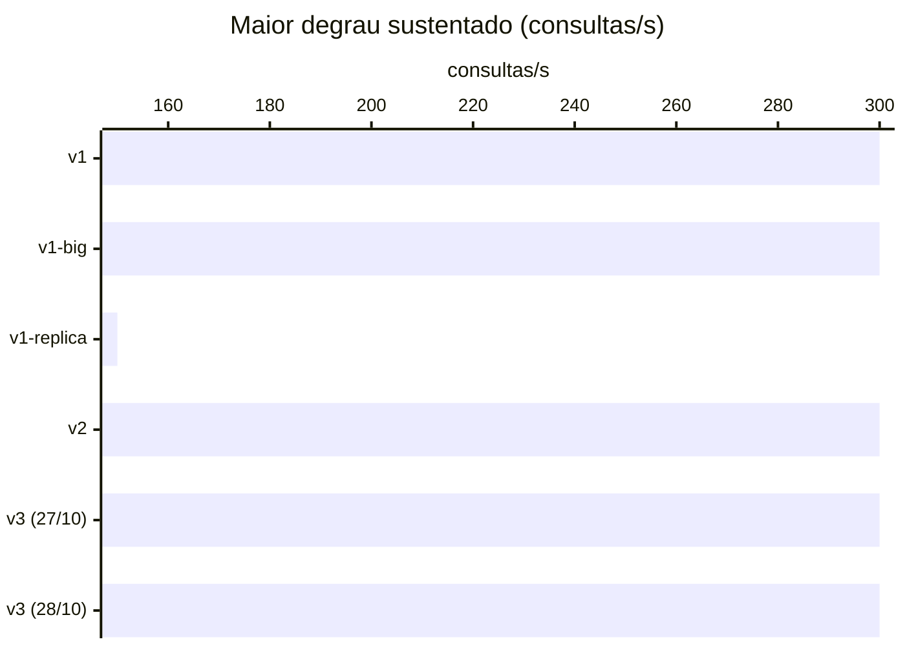

Maior degrau sustentado em pelo menos 2 de 3 repetições (ADR-0013), em consultas/s. Gerado por
`java bench/Report.java capacity`.

| Fase | Maior degrau sustentado | Parou em | Por quê |
|---|---:|---:|---|
| v1 | 300 | 600 | fase fora do ar no fim (http://localhost:8080, http://localhost:8080) (1 de 1), comandos p95 (1 de 1), consultas p95 (1 de 1), KO (1 de 1), vazão (1 de 1) |
| v1-big | 300 | 600 | comandos p95 (3 de 3), consultas p95 (3 de 3), KO (3 de 3), vazão (3 de 3) |
| v1-replica | 150 | 300 | fase fora do ar no fim (http://localhost:8081) (1 de 1), consultas p95 (1 de 1), KO (1 de 1), vazão (1 de 1) |
| v2 | 300 | 600 | fase fora do ar no fim (http://localhost:8080, http://localhost:8080) (1 de 1), comandos p95 (1 de 1), consultas p95 (1 de 1), KO (1 de 1), vazão (1 de 1) |
| v3 (27/10) | 300 | 600 | fase fora do ar no fim (http://localhost:8081) (1 de 2), consultas p95 (1 de 2), KO (1 de 2), vazão (1 de 2) |
| v3 (28/10) | 300 | 600 | fase fora do ar no fim (http://localhost:8081) (1 de 1), consultas p95 (1 de 1), KO (1 de 1), vazão (1 de 1) |
| v3-s5 | nenhum a partir de 600 | 600 | fase fora do ar no fim (http://localhost:8081, http://localhost:8082) (1 de 1), comandos p95 (1 de 1), consultas p95 (1 de 1), KO (1 de 1), vazão (1 de 1) |

