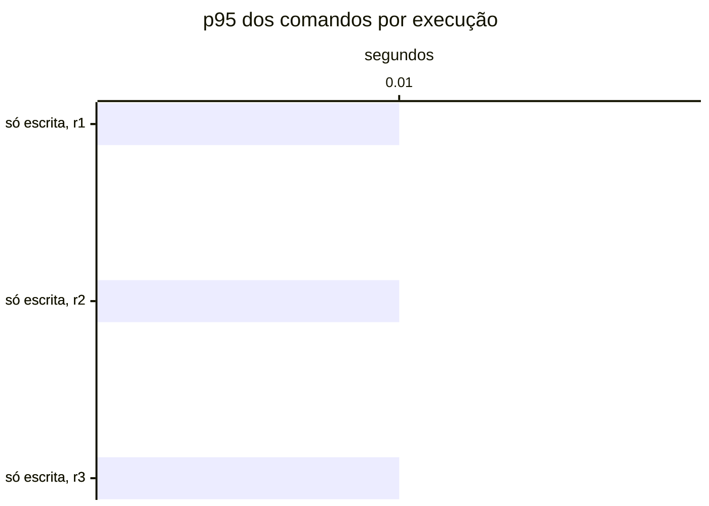

# Resumo

Gerado por `java bench/Report.java summarize`. Mediana das repetições; entre colchetes, a faixa do p95
(mín–máx). Latências em ms, vazão em requisições/s. Parâmetros de cada cenário em
`runs/<cenário>/scenario.properties`; série temporal de cada execução (5 s) em
`runs/<cenário>/r<n>/timeseries.csv`.

## s1 (3 execuções)

`writeRate=20` · `readRate=0` · `duration=180`

| Requisição | Vazão | % KO | p50 | p95 | p99 |
|---|---:|---:|---:|---:|---:|
| Global | 20.0 | 0.0 | 4 | 9 [9–13] | 53 |
| comandos | 20.0 | 0.0 | 4 | 9 [9–13] | 53 |
| comandos / deposit empresa | 3.0 | 0.0 | 4 | 9 [9–12] | 63 |
| comandos / deposit pessoa | 3.1 | 0.0 | 4 | 10 [9–16] | 88 |
| comandos / transfer empresa | 1.5 | 0.0 | 5 | 11 [10–13] | 45 |
| comandos / transfer pessoa | 1.5 | 0.0 | 5 | 10 [10–16] | 46 |
| comandos / withdraw empresa | 5.6 | 0.0 | 4 | 9 [8–11] | 128 |
| comandos / withdraw pessoa | 5.2 | 0.0 | 4 | 9 [8–11] | 43 |

## s1-sem-projetor (3 execuções)

`writeRate=20` · `readRate=0` · `duration=180`

| Requisição | Vazão | % KO | p50 | p95 | p99 |
|---|---:|---:|---:|---:|---:|
| Global | 20.0 | 0.0 | 5 | 11 [11–12] | 15 |
| comandos | 20.0 | 0.0 | 5 | 11 [11–12] | 15 |
| comandos / deposit empresa | 3.0 | 0.0 | 5 | 10 [10–11] | 15 |
| comandos / deposit pessoa | 3.1 | 0.0 | 5 | 11 [10–12] | 16 |
| comandos / transfer empresa | 1.5 | 0.0 | 6 | 13 [13–14] | 17 |
| comandos / transfer pessoa | 1.5 | 0.0 | 6 | 12 [12–14] | 17 |
| comandos / withdraw empresa | 5.6 | 0.0 | 5 | 11 [10–11] | 14 |
| comandos / withdraw pessoa | 5.2 | 0.0 | 5 | 11 [10–11] | 14 |

## Estado por execução

Colapso: p95 global acima de 5,000 ms (ADR-0009). Leia a contagem, não a mediana: perto da saturação as
repetições caem em estados diferentes.

| Cenário | Colapsou |
|---|---|
| s1 | 0 de 3 |
| s1-sem-projetor | 0 de 3 |

p95 global e comandos em ms, no cliente (Gatling). Espera e uso da conexão do Hikari em ms, média da
execução. Comando no banco: soma do tempo médio das instruções de escrita e do `SELECT … FOR UPDATE` no
`pg_stat_statements`, em ms (o custo de um comando dentro do Postgres, sem a fila). GC: segundos com a JVM
parada em GC na execução (medido a partir da #11).

| Cenário | Rep. | Estado | p95 global | % KO | Comandos p50 | p95 | p99 | Espera no pool | Uso da conexão | Comando no banco | GC |
|---|---|---|---:|---:|---:|---:|---:|---:|---:|---:|---:|
| s1 | r1 | estável | 9 | 0.0 | 4 | 9 | 41 | 0.0 | 1.5 | 0.4 | 0.4 |
| s1 | r2 | estável | 13 | 0.0 | 6 | 13 | 143 | 0.0 | 2.0 | 0.4 | 0.5 |
| s1 | r3 | estável | 9 | 0.0 | 4 | 9 | 53 | 0.0 | 1.5 | 0.5 | 0.3 |
| s1-sem-projetor | r1 | estável | 11 | 0.0 | 5 | 11 | 14 | 0.0 | 1.0 | 0.5 | 0.3 |
| s1-sem-projetor | r2 | estável | 11 | 0.0 | 5 | 11 | 15 | 0.0 | 1.0 | 0.4 | 0.3 |
| s1-sem-projetor | r3 | estável | 12 | 0.0 | 5 | 12 | 19 | 0.0 | 1.1 | 0.5 | 0.3 |

## Pools por execução

Espera e uso da conexão do Hikari em ms, média da execução; fila máxima de requisições esperando conexão.
Pool sem requisições na execução aparece com —.

| Cenário | Rep. | Pool | Espera | Uso da conexão | Fila máx. |
|---|---|---|---:|---:|---:|
| s1 | r1 | HikariPool-1@command-api | 0.0 | 1.5 | 0 |
| s1 | r1 | HikariPool-1@query-api | — | — | 0 |
| s1 | r2 | HikariPool-1@command-api | 0.0 | 2.0 | 0 |
| s1 | r2 | HikariPool-1@query-api | — | — | 0 |
| s1 | r3 | HikariPool-1@command-api | 0.0 | 1.5 | 0 |
| s1 | r3 | HikariPool-1@query-api | — | — | 0 |
| s1-sem-projetor | r1 | HikariPool-1@command-api | 0.0 | 1.0 | 0 |
| s1-sem-projetor | r1 | HikariPool-1@query-api | — | — | 0 |
| s1-sem-projetor | r2 | HikariPool-1@command-api | 0.0 | 1.0 | 0 |
| s1-sem-projetor | r2 | HikariPool-1@query-api | — | — | 0 |
| s1-sem-projetor | r3 | HikariPool-1@command-api | 0.0 | 1.1 | 0 |
| s1-sem-projetor | r3 | HikariPool-1@query-api | — | — | 0 |

## JVMs por execução

GC: segundos com a JVM parada em GC na execução. CPU: média do processo. Heap: maior uso na execução, em MiB.

| Cenário | Rep. | JVM | GC (s) | CPU | Heap máx. |
|---|---|---|---:|---:|---:|
| s1 | r1 | command-api | 0.2 | 5% | 55 |
| s1 | r1 | projector | 0.1 | 5% | 59 |
| s1 | r1 | query-api | 0.1 | 2% | 61 |
| s1 | r2 | command-api | 0.2 | 9% | 60 |
| s1 | r2 | projector | 0.2 | 10% | 63 |
| s1 | r2 | query-api | 0.1 | 2% | 62 |
| s1 | r3 | command-api | 0.1 | 4% | 64 |
| s1 | r3 | projector | 0.1 | 9% | 64 |
| s1 | r3 | query-api | 0.1 | 2% | 61 |
| s1-sem-projetor | r1 | command-api | 0.2 | 5% | 56 |
| s1-sem-projetor | r1 | query-api | 0.1 | 2% | 62 |
| s1-sem-projetor | r2 | command-api | 0.2 | 6% | 63 |
| s1-sem-projetor | r2 | query-api | 0.1 | 2% | 62 |
| s1-sem-projetor | r3 | command-api | 0.2 | 5% | 64 |
| s1-sem-projetor | r3 | query-api | 0.1 | 2% | 62 |

## Atraso da projeção por execução

Do `occurred_at` do lançamento (início da transação do comando) até ele estar nas duas projeções do Mongo,
em ms; superestima o atraso em até a duração do comando. p50 e p99 vêm do histograma (precisão dos
buckets); o máximo pode vir de uma janela anterior à execução. Reentregas: lançamentos que o projetor
recebeu de novo e descartou. Fila do outbox: publicações ainda não enviadas ao Kafka, no maior instante.

| Cenário | Rep. | Lançamentos | p50 | p99 | Máx. | Reentregas | Fila do outbox |
|---|---|---:|---:|---:|---:|---:|---:|
| s1 | r1 | 4,020 | 14 | 61 | 447 | 0 | 2 |
| s1 | r2 | 4,054 | 15 | 103 | 200,584 | 0 | 1 |
| s1 | r3 | 3,962 | 14 | 114 | 197,363 | 0 | 0 |

## Leitura de disco por execução

Páginas lidas fora do cache e tempo médio por página, em ms. Postgres: soma das instruções do
pg_stat_statements (as 50 mais caras; na v1-replica, do primário e da réplica somados). Mongo: leituras das
threads da aplicação para o cache do WiredTiger. — quando o store não existe na fase.

| Cenário | Rep. | Postgres: páginas | ms/página | Mongo: páginas | ms/página |
|---|---|---:|---:|---:|---:|
| s1 | r1 | 0 | — | 9,924 | 0.31 |
| s1 | r2 | 0 | — | 6,850 | 0.31 |
| s1 | r3 | 0 | — | 6,456 | 0.31 |
| s1-sem-projetor | r1 | 0 | — | 0 | — |
| s1-sem-projetor | r2 | 0 | — | 0 | — |
| s1-sem-projetor | r3 | 0 | — | 6 | 0.04 |

## Escrita em disco por execução

WAL gerado no Postgres primário (MB e KB por comando), fsyncs do WAL e o tempo médio de cada um, em ms
(pg_stat_io com track_wal_io_timing), e bytes gravados em disco pelo WiredTiger por comando, em KB (block
manager; — sem Mongo). Os contadores do pg_stat_io chegam com até ~1 s de atraso; a série por segundo está
no `pg-seconds.csv` de cada execução.

| Cenário | Rep. | WAL (MB) | WAL por comando | fsyncs | ms por fsync | Mongo por comando |
|---|---|---:|---:|---:|---:|---:|
| s1 | r1 | 21 | 5.9 | 11,766 | 0.45 | 66.7 |
| s1 | r2 | 21 | 6.1 | 11,824 | 0.49 | 68.2 |
| s1 | r3 | 22 | 6.2 | 11,845 | 0.44 | 67.6 |
| s1-sem-projetor | r1 | 12 | 3.3 | 11,828 | 0.28 | 3.3 |
| s1-sem-projetor | r2 | 23 | 6.5 | 11,901 | 0.28 | 0.0 |
| s1-sem-projetor | r3 | 22 | 6.3 | 11,845 | 0.32 | 3.2 |

## Pool e banco por cenário

Mediana das repetições. Espera = tempo médio para obter conexão do Hikari; uso = tempo médio com a
conexão (o trabalho no banco); hit ratio = blocos achados no shared_buffers.

| Cenário | Espera no pool (ms) | Uso da conexão (ms) | Fila máx. no pool | Hit ratio | CPU da app |
|---|---:|---:|---:|---:|---:|
| s1 | 0.0 | 1.5 | 0 | 100.0% | 5% |
| s1-sem-projetor | 0.0 | 1.0 | 0 | 100.0% | 3% |
