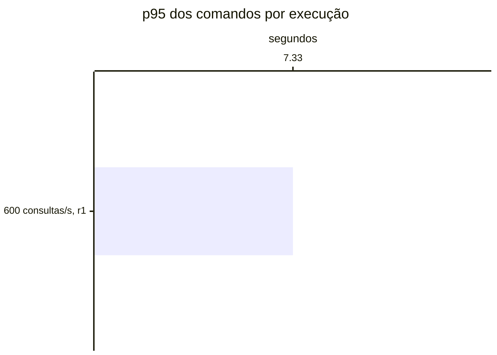

# Resumo

Gerado por `java bench/Report.java summarize`. Mediana das repetições; entre colchetes, a faixa do p95
(mín–máx). Latências em ms, vazão em requisições/s. Parâmetros de cada cenário em
`runs/<cenário>/scenario.properties`; série temporal de cada execução (5 s) em
`runs/<cenário>/r<n>/timeseries.csv`.

## c1-r0600 (1 execuções)

`writeRate=20` · `readRate=600` · `duration=180`

| Requisição | Vazão | % KO | p50 | p95 | p99 |
|---|---:|---:|---:|---:|---:|
| Global | 509.6 | 87.1 | 15,030 | 60,011 [60,011–60,011] | 60,060 |
| comandos | 16.4 | 0.1 | 44 | 7,326 [7,326–7,326] | 17,743 |
| consultas | 493.2 | 90.0 | 15,041 | 60,011 [60,011–60,011] | 60,061 |
| comandos / deposit empresa | 2.5 | 0.0 | 46 | 7,416 [7,416–7,416] | 17,805 |
| comandos / deposit pessoa | 2.4 | 0.0 | 49 | 5,623 [5,623–5,623] | 13,622 |
| comandos / transfer empresa | 1.2 | 0.4 | 49 | 6,734 [6,734–6,734] | 20,609 |
| comandos / transfer pessoa | 1.3 | 0.0 | 49 | 6,603 [6,603–6,603] | 19,185 |
| comandos / withdraw empresa | 4.6 | 0.1 | 42 | 7,832 [7,832–7,832] | 16,349 |
| comandos / withdraw pessoa | 4.5 | 0.0 | 41 | 8,104 [8,104–8,104] | 18,436 |
| consultas / Q1 empresa | 61.5 | 82.6 | 15,009 | 60,004 [60,004–60,004] | 60,036 |
| consultas / Q1 pessoa | 62.0 | 82.4 | 15,010 | 60,004 [60,004–60,004] | 60,034 |
| consultas / Q2 empresa | 61.1 | 92.5 | 15,082 | 60,014 [60,014–60,014] | 60,065 |
| consultas / Q2 pessoa | 61.4 | 92.4 | 15,073 | 60,013 [60,013–60,013] | 60,064 |
| consultas / Q3 empresa | 62.3 | 92.2 | 15,063 | 60,014 [60,014–60,014] | 60,067 |
| consultas / Q3 pessoa | 61.7 | 92.4 | 15,072 | 60,014 [60,014–60,014] | 60,070 |
| consultas / Q4 empresa | 62.0 | 94.2 | 15,102 | 60,014 [60,014–60,014] | 60,070 |
| consultas / Q4 pessoa | 61.3 | 91.7 | 15,054 | 60,013 [60,013–60,013] | 60,072 |

## Capacidade

Critério do ADR-0013 por repetição: p95 dos comandos ≤ 50 ms, p95 das consultas ≤ 250 ms, KO ≤ 1%,
vazão ≥ 98% da oferecida e, com consistência eventual, atraso p99 ≤ 2 s e fila no fim ≤ 1 s de escrita.
Vazão baixa com nenhum container da fase acima de 50% do seu limite de CPU (p90 das amostras) é limite do
gerador. Degrau
sustentado: em pelo menos 2 de 3 repetições. **Maior degrau sustentado: nenhum.**

- c1-r0600: não sustentado (0 de 1); r1: fase fora do ar no fim (http://localhost:8081, http://localhost:8082), comandos p95 7,326 ms, consultas p95 60,011 ms, KO 87.1%, vazão 82% da oferecida (CPU da fase no p90 até 109% do limite)

Vazão em % da oferecida; p95 em ms, no cliente; KO em %; atraso p99 em s; fila no fim em segundos de
escrita (— sem consistência eventual).

| Degrau | Rep. | Estado | Vazão | p95 comandos | p95 consultas | % KO | Atraso p99 | Fila no fim |
|---|---|---|---:|---:|---:|---:|---:|---:|
| c1-r0600 | r1 | **não sustentado** | 82.2% | 7,326 | 60,011 | 87.1 | — | 0.00 |

## Estado por execução

Colapso: p95 global acima de 5,000 ms (ADR-0009). Leia a contagem, não a mediana: perto da saturação as
repetições caem em estados diferentes.

| Cenário | Colapsou |
|---|---|
| c1-r0600 | 1 de 1 (r1) |

p95 global e comandos em ms, no cliente (Gatling). Espera e uso da conexão do Hikari em ms, média da
execução. Comando no banco: soma do tempo médio das instruções de escrita e do `SELECT … FOR UPDATE` no
`pg_stat_statements`, em ms (o custo de um comando dentro do Postgres, sem a fila). GC: segundos com a JVM
parada em GC na execução (medido a partir da #11).

| Cenário | Rep. | Estado | p95 global | % KO | Comandos p50 | p95 | p99 | Espera no pool | Uso da conexão | Comando no banco | GC |
|---|---|---|---:|---:|---:|---:|---:|---:|---:|---:|---:|
| c1-r0600 | r1 | **colapso** | 60,011 | 87.1 | 44 | 7,326 | 17,743 | 2.9 | 1.6 | 3.5 | 0.6 |

## JVMs por execução

GC: segundos com a JVM parada em GC na execução. CPU: média do processo. Heap: maior uso na execução, em MiB.

| Cenário | Rep. | JVM | GC (s) | CPU | Heap máx. |
|---|---|---|---:|---:|---:|
| c1-r0600 | r1 | command-api | 0.3 | 5% | 62 |
| c1-r0600 | r1 | projector | 0.3 | 5% | 60 |

## Leitura de disco por execução

Páginas lidas fora do cache e tempo médio por página, em ms. Postgres: soma das instruções do
pg_stat_statements (as 50 mais caras; na v1-replica, do primário e da réplica somados). Mongo: leituras das
threads da aplicação para o cache do WiredTiger. — quando o store não existe na fase.

| Cenário | Rep. | Postgres: páginas | ms/página | Mongo: páginas | ms/página |
|---|---|---:|---:|---:|---:|
| c1-r0600 | r1 | 0 | — | 43,574 | 1.90 |

## Escrita em disco por execução

WAL gerado no Postgres primário (MB e KB por comando), fsyncs do WAL e o tempo médio de cada um, em ms
(pg_stat_io com track_wal_io_timing), e bytes gravados em disco pelo WiredTiger por comando, em KB (block
manager; — sem Mongo). Os contadores do pg_stat_io chegam com até ~1 s de atraso; a série por segundo está
no `pg-seconds.csv` de cada execução.

| Cenário | Rep. | WAL (MB) | WAL por comando | fsyncs | ms por fsync | Mongo por comando |
|---|---|---:|---:|---:|---:|---:|
| c1-r0600 | r1 | 22 | 6.3 | 11,192 | 3.51 | 69.9 |

## Pool e banco por cenário

Mediana das repetições. Espera = tempo médio para obter conexão do Hikari; uso = tempo médio com a
conexão (o trabalho no banco); hit ratio = blocos achados no shared_buffers.

| Cenário | Espera no pool (ms) | Uso da conexão (ms) | Fila máx. no pool | Hit ratio | CPU da app |
|---|---:|---:|---:|---:|---:|
| c1-r0600 | 2.9 | 1.6 | 0 | 100.0% | 5% |
