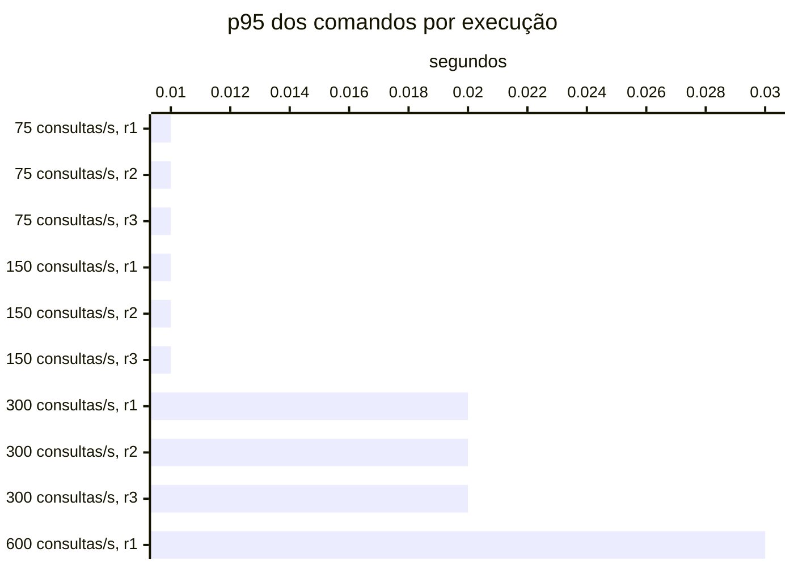

# Resumo

Gerado por `java bench/Report.java summarize`. Mediana das repetições; entre colchetes, a faixa do p95
(mín–máx). Latências em ms, vazão em requisições/s. Parâmetros de cada cenário em
`runs/<cenário>/scenario.properties`; série temporal de cada execução (5 s) em
`runs/<cenário>/r<n>/timeseries.csv`.

## c1-r0075 (3 execuções)

`writeRate=20` · `readRate=75` · `duration=180`

| Requisição | Vazão | % KO | p50 | p95 | p99 |
|---|---:|---:|---:|---:|---:|
| Global | 95.0 | 0.0 | 3 | 20 [18–22] | 58 |
| comandos | 20.0 | 0.0 | 4 | 12 [9–14] | 111 |
| consultas | 75.0 | 0.0 | 3 | 21 [19–23] | 51 |
| comandos / deposit empresa | 2.9 | 0.0 | 4 | 13 [9–19] | 196 |
| comandos / deposit pessoa | 3.1 | 0.0 | 3 | 11 [10–17] | 78 |
| comandos / transfer empresa | 1.6 | 0.0 | 5 | 13 [9–16] | 95 |
| comandos / transfer pessoa | 1.4 | 0.0 | 4 | 13 [11–13] | 53 |
| comandos / withdraw empresa | 5.7 | 0.0 | 3 | 10 [10–12] | 130 |
| comandos / withdraw pessoa | 5.4 | 0.0 | 3 | 14 [9–15] | 174 |
| consultas / Q1 empresa | 9.4 | 0.0 | 1 | 3 [3–4] | 15 |
| consultas / Q1 pessoa | 9.3 | 0.0 | 1 | 3 [3–5] | 16 |
| consultas / Q2 empresa | 9.3 | 0.0 | 4 | 9 [9–11] | 38 |
| consultas / Q2 pessoa | 9.6 | 0.0 | 3 | 9 [8–11] | 49 |
| consultas / Q3 empresa | 9.4 | 0.0 | 3 | 8 [7–10] | 43 |
| consultas / Q3 pessoa | 9.4 | 0.0 | 2 | 7 [6–8] | 32 |
| consultas / Q4 empresa | 9.4 | 0.0 | 16 | 37 [36–44] | 163 |
| consultas / Q4 pessoa | 9.0 | 0.0 | 3 | 9 [8–12] | 39 |

## c1-r0150 (3 execuções)

`writeRate=20` · `readRate=150` · `duration=180`

| Requisição | Vazão | % KO | p50 | p95 | p99 |
|---|---:|---:|---:|---:|---:|
| Global | 169.1 | 0.0 | 3 | 18 [17–21] | 40 |
| comandos | 19.9 | 0.0 | 3 | 11 [9–12] | 86 |
| consultas | 149.2 | 0.0 | 3 | 19 [17–21] | 38 |
| comandos / deposit empresa | 3.0 | 0.0 | 3 | 9 [8–12] | 93 |
| comandos / deposit pessoa | 2.9 | 0.0 | 3 | 10 [9–12] | 124 |
| comandos / transfer empresa | 1.5 | 0.0 | 4 | 15 [10–16] | 118 |
| comandos / transfer pessoa | 1.5 | 0.0 | 4 | 13 [12–15] | 210 |
| comandos / withdraw empresa | 5.4 | 0.0 | 3 | 12 [8–15] | 80 |
| comandos / withdraw pessoa | 5.5 | 0.0 | 3 | 9 [9–11] | 85 |
| consultas / Q1 empresa | 18.6 | 0.0 | 1 | 3 [3–4] | 10 |
| consultas / Q1 pessoa | 18.7 | 0.0 | 1 | 4 [3–4] | 10 |
| consultas / Q2 empresa | 18.9 | 0.0 | 3 | 8 [7–9] | 24 |
| consultas / Q2 pessoa | 18.6 | 0.0 | 3 | 8 [7–10] | 31 |
| consultas / Q3 empresa | 18.8 | 0.0 | 3 | 8 [6–9] | 23 |
| consultas / Q3 pessoa | 18.4 | 0.0 | 2 | 6 [5–8] | 28 |
| consultas / Q4 empresa | 18.3 | 0.0 | 15 | 37 [34–40] | 85 |
| consultas / Q4 pessoa | 18.9 | 0.0 | 3 | 8 [7–10] | 32 |

## c1-r0300 (3 execuções)

`writeRate=20` · `readRate=300` · `duration=180`

| Requisição | Vazão | % KO | p50 | p95 | p99 |
|---|---:|---:|---:|---:|---:|
| Global | 318.2 | 0.0 | 3 | 33 [29–41] | 769 |
| comandos | 19.9 | 0.0 | 4 | 16 [15–23] | 245 |
| consultas | 298.3 | 0.0 | 3 | 34 [29–44] | 822 |
| comandos / deposit empresa | 3.0 | 0.0 | 3 | 16 [12–25] | 175 |
| comandos / deposit pessoa | 2.9 | 0.0 | 3 | 23 [15–24] | 197 |
| comandos / transfer empresa | 1.6 | 0.0 | 4 | 19 [17–26] | 225 |
| comandos / transfer pessoa | 1.5 | 0.0 | 4 | 15 [15–19] | 201 |
| comandos / withdraw empresa | 5.5 | 0.0 | 3 | 15 [14–21] | 180 |
| comandos / withdraw pessoa | 5.5 | 0.0 | 3 | 16 [14–22] | 271 |
| consultas / Q1 empresa | 37.5 | 0.0 | 1 | 9 [7–11] | 170 |
| consultas / Q1 pessoa | 37.4 | 0.0 | 1 | 9 [7–12] | 273 |
| consultas / Q2 empresa | 37.3 | 0.0 | 3 | 20 [18–48] | 1,020 |
| consultas / Q2 pessoa | 37.2 | 0.0 | 2 | 32 [24–47] | 1,096 |
| consultas / Q3 empresa | 37.1 | 0.0 | 3 | 22 [16–36] | 922 |
| consultas / Q3 pessoa | 37.6 | 0.0 | 2 | 25 [23–37] | 958 |
| consultas / Q4 empresa | 37.1 | 0.0 | 15 | 84 [62–122] | 1,425 |
| consultas / Q4 pessoa | 37.5 | 0.0 | 3 | 31 [23–41] | 688 |

## c1-r0600 (1 execuções)

`writeRate=20` · `readRate=600` · `duration=180`

| Requisição | Vazão | % KO | p50 | p95 | p99 |
|---|---:|---:|---:|---:|---:|
| Global | 572.3 | 75.9 | 15,001 | 59,178 [59,178–59,178] | 60,002 |
| comandos | 18.5 | 0.0 | 6 | 33 [33–33] | 170 |
| consultas | 553.9 | 78.4 | 15,001 | 59,597 [59,597–59,597] | 60,002 |
| comandos / deposit empresa | 2.9 | 0.0 | 6 | 30 [30–30] | 141 |
| comandos / deposit pessoa | 2.7 | 0.0 | 7 | 35 [35–35] | 195 |
| comandos / transfer empresa | 1.4 | 0.0 | 8 | 44 [44–44] | 153 |
| comandos / transfer pessoa | 1.5 | 0.0 | 7 | 28 [28–28] | 80 |
| comandos / withdraw empresa | 5.1 | 0.0 | 6 | 33 [33–33] | 159 |
| comandos / withdraw pessoa | 4.9 | 0.0 | 6 | 34 [34–34] | 318 |
| consultas / Q1 empresa | 68.8 | 73.4 | 15,001 | 15,008 [15,008–15,008] | 51,708 |
| consultas / Q1 pessoa | 70.1 | 73.4 | 15,001 | 15,008 [15,008–15,008] | 58,711 |
| consultas / Q2 empresa | 68.9 | 80.1 | 15,001 | 60,000 [60,000–60,000] | 60,002 |
| consultas / Q2 pessoa | 69.3 | 79.6 | 15,001 | 60,000 [60,000–60,000] | 60,002 |
| consultas / Q3 empresa | 69.2 | 80.0 | 15,001 | 60,000 [60,000–60,000] | 60,002 |
| consultas / Q3 pessoa | 69.3 | 79.5 | 15,001 | 60,000 [60,000–60,000] | 60,002 |
| consultas / Q4 empresa | 69.4 | 82.1 | 15,001 | 60,001 [60,001–60,001] | 60,003 |
| consultas / Q4 pessoa | 68.9 | 79.0 | 15,001 | 60,000 [60,000–60,000] | 60,002 |

## Capacidade

Critério do ADR-0013 por repetição: p95 dos comandos ≤ 50 ms, p95 das consultas ≤ 250 ms, KO ≤ 1%,
vazão ≥ 98% da oferecida e, com consistência eventual, atraso p99 ≤ 2 s e fila no fim ≤ 1 s de escrita.
Vazão baixa com nenhum container da fase acima de 50% do seu limite de CPU (p90 das amostras) é limite do
gerador. Degrau
sustentado: em pelo menos 2 de 3 repetições. **Maior degrau sustentado: 300 consultas/s.**

- c1-r0075: sustentado (3 de 3)
- c1-r0150: sustentado (3 de 3)
- c1-r0300: sustentado (3 de 3)
- c1-r0600: não sustentado (0 de 1); r1: fase fora do ar no fim (http://localhost:8081), consultas p95 59,597 ms, KO 75.9%, vazão 92% da oferecida (CPU da fase no p90 até 102% do limite)

Vazão em % da oferecida; p95 em ms, no cliente; KO em %; atraso p99 em s; fila no fim em segundos de
escrita (— sem consistência eventual).

| Degrau | Rep. | Estado | Vazão | p95 comandos | p95 consultas | % KO | Atraso p99 | Fila no fim |
|---|---|---|---:|---:|---:|---:|---:|---:|
| c1-r0075 | r1 | sustentado | 100.0% | 14 | 23 | 0.0 | 0.19 | 0.00 |
| c1-r0075 | r2 | sustentado | 99.5% | 9 | 19 | 0.0 | 0.14 | 0.00 |
| c1-r0075 | r3 | sustentado | 100.0% | 12 | 21 | 0.0 | 0.23 | 0.00 |
| c1-r0150 | r1 | sustentado | 100.0% | 11 | 19 | 0.0 | 0.15 | 0.00 |
| c1-r0150 | r2 | sustentado | 99.4% | 12 | 21 | 0.0 | 0.30 | 0.00 |
| c1-r0150 | r3 | sustentado | 99.4% | 9 | 17 | 0.0 | 0.14 | 0.00 |
| c1-r0300 | r1 | sustentado | 99.4% | 16 | 29 | 0.0 | 0.37 | 0.00 |
| c1-r0300 | r2 | sustentado | 99.4% | 15 | 34 | 0.0 | 0.19 | 0.00 |
| c1-r0300 | r3 | sustentado | 99.4% | 23 | 44 | 0.0 | 0.28 | 0.00 |
| c1-r0600 | r1 | **não sustentado** | 92.3% | 33 | 59,597 | 75.9 | 0.47 | 0.00 |

## Estado por execução

Colapso: p95 global acima de 5,000 ms (ADR-0009). Leia a contagem, não a mediana: perto da saturação as
repetições caem em estados diferentes.

| Cenário | Colapsou |
|---|---|
| c1-r0075 | 0 de 3 |
| c1-r0150 | 0 de 3 |
| c1-r0300 | 0 de 3 |
| c1-r0600 | 1 de 1 (r1) |

p95 global e comandos em ms, no cliente (Gatling). Espera e uso da conexão do Hikari em ms, média da
execução. Comando no banco: soma do tempo médio das instruções de escrita e do `SELECT … FOR UPDATE` no
`pg_stat_statements`, em ms (o custo de um comando dentro do Postgres, sem a fila). GC: segundos com a JVM
parada em GC na execução (medido a partir da #11).

| Cenário | Rep. | Estado | p95 global | % KO | Comandos p50 | p95 | p99 | Espera no pool | Uso da conexão | Comando no banco | GC |
|---|---|---|---:|---:|---:|---:|---:|---:|---:|---:|---:|
| c1-r0075 | r1 | estável | 22 | 0.0 | 4 | 14 | 111 | 0.0 | 1.7 | 0.6 | 2.3 |
| c1-r0075 | r2 | estável | 18 | 0.0 | 4 | 9 | 92 | 0.0 | 1.2 | 0.4 | 1.9 |
| c1-r0075 | r3 | estável | 20 | 0.0 | 4 | 12 | 220 | 0.5 | 2.0 | 0.8 | 2.3 |
| c1-r0150 | r1 | estável | 18 | 0.0 | 3 | 11 | 86 | 0.0 | 1.1 | 0.6 | 3.6 |
| c1-r0150 | r2 | estável | 21 | 0.0 | 3 | 12 | 166 | 0.1 | 1.6 | 0.5 | 4.0 |
| c1-r0150 | r3 | estável | 17 | 0.0 | 3 | 9 | 79 | 0.0 | 1.0 | 0.5 | 3.5 |
| c1-r0300 | r1 | estável | 29 | 0.0 | 3 | 16 | 303 | 0.9 | 1.9 | 0.6 | 9.1 |
| c1-r0300 | r2 | estável | 33 | 0.0 | 4 | 15 | 133 | 0.2 | 1.2 | 0.9 | 5.8 |
| c1-r0300 | r3 | estável | 41 | 0.0 | 4 | 23 | 245 | 0.3 | 1.9 | 0.8 | 2.8 |
| c1-r0600 | r1 | **colapso** | 59,178 | 75.9 | 6 | 33 | 170 | 0.5 | 4.7 | 1.0 | 0.4 |

## Pools por execução

Espera e uso da conexão do Hikari em ms, média da execução; fila máxima de requisições esperando conexão.
Pool sem requisições na execução aparece com —.

| Cenário | Rep. | Pool | Espera | Uso da conexão | Fila máx. |
|---|---|---|---:|---:|---:|
| c1-r0075 | r1 | HikariPool-1@command-api | 0.0 | 2.2 | 0 |
| c1-r0075 | r1 | HikariPool-1@query-api | 0.1 | 0.3 | 0 |
| c1-r0075 | r2 | HikariPool-1@command-api | 0.0 | 1.7 | 0 |
| c1-r0075 | r2 | HikariPool-1@query-api | 0.0 | 0.0 | 0 |
| c1-r0075 | r3 | HikariPool-1@command-api | 0.5 | 2.5 | 0 |
| c1-r0075 | r3 | HikariPool-1@query-api | 0.3 | 0.5 | 0 |
| c1-r0150 | r1 | HikariPool-1@command-api | 0.0 | 1.9 | 0 |
| c1-r0150 | r1 | HikariPool-1@query-api | 0.0 | 0.1 | 0 |
| c1-r0150 | r2 | HikariPool-1@command-api | 0.1 | 2.4 | 0 |
| c1-r0150 | r2 | HikariPool-1@query-api | 0.2 | 0.6 | 0 |
| c1-r0150 | r3 | HikariPool-1@command-api | 0.0 | 1.8 | 0 |
| c1-r0150 | r3 | HikariPool-1@query-api | 0.0 | 0.1 | 0 |
| c1-r0300 | r1 | HikariPool-1@command-api | 0.5 | 3.5 | 10 |
| c1-r0300 | r1 | HikariPool-1@query-api | 1.2 | 0.9 | 0 |
| c1-r0300 | r2 | HikariPool-1@command-api | 0.0 | 2.4 | 0 |
| c1-r0300 | r2 | HikariPool-1@query-api | 0.3 | 0.5 | 0 |
| c1-r0300 | r3 | HikariPool-1@command-api | 0.4 | 3.3 | 0 |
| c1-r0300 | r3 | HikariPool-1@query-api | 0.2 | 1.0 | 0 |
| c1-r0600 | r1 | HikariPool-1@command-api | 0.5 | 4.7 | 1 |

## JVMs por execução

GC: segundos com a JVM parada em GC na execução. CPU: média do processo. Heap: maior uso na execução, em MiB.

| Cenário | Rep. | JVM | GC (s) | CPU | Heap máx. |
|---|---|---|---:|---:|---:|
| c1-r0075 | r1 | command-api | 0.2 | 5% | 58 |
| c1-r0075 | r1 | projector | 0.2 | 6% | 60 |
| c1-r0075 | r1 | query-api | 1.8 | 9% | 70 |
| c1-r0075 | r2 | command-api | 0.2 | 4% | 58 |
| c1-r0075 | r2 | projector | 0.1 | 4% | 61 |
| c1-r0075 | r2 | query-api | 1.6 | 7% | 73 |
| c1-r0075 | r3 | command-api | 0.3 | 4% | 60 |
| c1-r0075 | r3 | projector | 0.1 | 4% | 60 |
| c1-r0075 | r3 | query-api | 1.8 | 8% | 88 |
| c1-r0150 | r1 | command-api | 0.2 | 4% | 60 |
| c1-r0150 | r1 | projector | 0.2 | 4% | 61 |
| c1-r0150 | r1 | query-api | 3.2 | 14% | 106 |
| c1-r0150 | r2 | command-api | 0.2 | 4% | 62 |
| c1-r0150 | r2 | projector | 0.1 | 4% | 61 |
| c1-r0150 | r2 | query-api | 3.6 | 15% | 151 |
| c1-r0150 | r3 | command-api | 0.2 | 3% | 63 |
| c1-r0150 | r3 | projector | 0.2 | 4% | 61 |
| c1-r0150 | r3 | query-api | 3.2 | 14% | 173 |
| c1-r0300 | r1 | command-api | 0.3 | 4% | 65 |
| c1-r0300 | r1 | projector | 0.3 | 5% | 59 |
| c1-r0300 | r1 | query-api | 8.5 | 27% | 457 |
| c1-r0300 | r2 | command-api | 0.3 | 4% | 66 |
| c1-r0300 | r2 | projector | 0.2 | 5% | 61 |
| c1-r0300 | r2 | query-api | 5.3 | 30% | 520 |
| c1-r0300 | r3 | command-api | 0.6 | 4% | 67 |
| c1-r0300 | r3 | projector | 0.4 | 5% | 61 |
| c1-r0300 | r3 | query-api | 1.8 | 29% | 471 |
| c1-r0600 | r1 | command-api | 0.2 | 3% | 69 |
| c1-r0600 | r1 | projector | 0.2 | 3% | 61 |

## Atraso da projeção por execução

Do `occurred_at` do lançamento (início da transação do comando) até ele estar nas duas projeções do Mongo,
em ms; superestima o atraso em até a duração do comando. p50 e p99 vêm do histograma (precisão dos
buckets); o máximo pode vir de uma janela anterior à execução. Reentregas: lançamentos que o projetor
recebeu de novo e descartou. Fila do outbox: publicações ainda não enviadas ao Kafka, no maior instante.

| Cenário | Rep. | Lançamentos | p50 | p99 | Máx. | Reentregas | Fila do outbox |
|---|---|---:|---:|---:|---:|---:|---:|
| c1-r0075 | r1 | 4,031 | 13 | 189 | 542 | 0 | 2 |
| c1-r0075 | r2 | 4,012 | 13 | 142 | 438 | 0 | 1 |
| c1-r0075 | r3 | 4,083 | 13 | 230 | 1,334 | 0 | 7 |
| c1-r0150 | r1 | 3,949 | 12 | 155 | 1,334 | 0 | 0 |
| c1-r0150 | r2 | 4,038 | 13 | 302 | 783 | 0 | 2 |
| c1-r0150 | r3 | 4,025 | 12 | 145 | 638 | 0 | 1 |
| c1-r0300 | r1 | 4,091 | 13 | 365 | 1,232 | 0 | 7 |
| c1-r0300 | r2 | 4,029 | 13 | 193 | 1,232 | 0 | 0 |
| c1-r0300 | r3 | 3,974 | 13 | 285 | 1,220 | 0 | 1 |
| c1-r0600 | r1 | 867 | 16 | 473 | 808 | 0 | 4 |

## Leitura de disco por execução

Páginas lidas fora do cache e tempo médio por página, em ms. Postgres: soma das instruções do
pg_stat_statements (as 50 mais caras; na v1-replica, do primário e da réplica somados). Mongo: leituras das
threads da aplicação para o cache do WiredTiger. — quando o store não existe na fase.

| Cenário | Rep. | Postgres: páginas | ms/página | Mongo: páginas | ms/página |
|---|---|---:|---:|---:|---:|
| c1-r0075 | r1 | 0 | — | 60,913 | 0.35 |
| c1-r0075 | r2 | 0 | — | 60,554 | 0.29 |
| c1-r0075 | r3 | 0 | — | 60,429 | 0.32 |
| c1-r0150 | r1 | 0 | — | 108,403 | 0.27 |
| c1-r0150 | r2 | 0 | — | 106,786 | 0.31 |
| c1-r0150 | r3 | 0 | — | 106,695 | 0.27 |
| c1-r0300 | r1 | 0 | — | 206,055 | 0.31 |
| c1-r0300 | r2 | 0 | — | 206,602 | 0.30 |
| c1-r0300 | r3 | 0 | — | 207,067 | 0.32 |
| c1-r0600 | r1 | 0 | — | 98,048 | 0.49 |

## Escrita em disco por execução

WAL gerado no Postgres primário (MB e KB por comando), fsyncs do WAL e o tempo médio de cada um, em ms
(pg_stat_io com track_wal_io_timing), e bytes gravados em disco pelo WiredTiger por comando, em KB (block
manager; — sem Mongo). Os contadores do pg_stat_io chegam com até ~1 s de atraso; a série por segundo está
no `pg-seconds.csv` de cada execução.

| Cenário | Rep. | WAL (MB) | WAL por comando | fsyncs | ms por fsync | Mongo por comando |
|---|---|---:|---:|---:|---:|---:|
| c1-r0075 | r1 | 20 | 5.7 | 11,917 | 0.57 | 68.7 |
| c1-r0075 | r2 | 21 | 6.1 | 11,910 | 0.51 | 69.6 |
| c1-r0075 | r3 | 22 | 6.1 | 11,982 | 0.48 | 69.1 |
| c1-r0150 | r1 | 22 | 6.4 | 11,985 | 0.46 | 67.2 |
| c1-r0150 | r2 | 22 | 6.3 | 12,012 | 0.59 | 66.6 |
| c1-r0150 | r3 | 24 | 6.8 | 12,047 | 0.45 | 73.1 |
| c1-r0300 | r1 | 23 | 6.7 | 12,003 | 0.65 | 67.1 |
| c1-r0300 | r2 | 23 | 6.6 | 12,057 | 0.65 | 67.1 |
| c1-r0300 | r3 | 24 | 6.9 | 11,946 | 0.68 | 69.7 |
| c1-r0600 | r1 | 23 | 6.6 | 11,889 | 0.97 | 71.8 |

## Pool e banco por cenário

Mediana das repetições. Espera = tempo médio para obter conexão do Hikari; uso = tempo médio com a
conexão (o trabalho no banco); hit ratio = blocos achados no shared_buffers.

| Cenário | Espera no pool (ms) | Uso da conexão (ms) | Fila máx. no pool | Hit ratio | CPU da app |
|---|---:|---:|---:|---:|---:|
| c1-r0075 | 0.0 | 1.7 | 0 | 100.0% | 5% |
| c1-r0150 | 0.0 | 1.1 | 0 | 100.0% | 7% |
| c1-r0300 | 0.3 | 1.9 | 0 | 100.0% | 13% |
| c1-r0600 | 0.5 | 4.7 | 1 | 100.0% | 3% |
