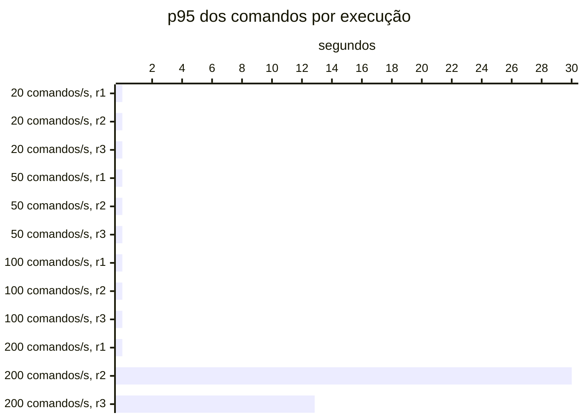

# Resumo

Gerado por `java bench/Report.java summarize`. Mediana das repetições; entre colchetes, a faixa do p95
(mín–máx). Latências em ms, vazão em requisições/s. Parâmetros de cada cenário em
`runs/<cenário>/scenario.properties`; série temporal de cada execução (5 s) em
`runs/<cenário>/r<n>/timeseries.csv`.

## c2-w0020 (3 execuções)

`writeRate=20` · `readRate=75` · `duration=180`

| Requisição | Vazão | % KO | p50 | p95 | p99 |
|---|---:|---:|---:|---:|---:|
| Global | 95.0 | 0.0 | 3 | 23 [23–24] | 54 |
| comandos | 20.0 | 0.0 | 3 | 6 [6–6] | 13 |
| consultas | 75.0 | 0.0 | 4 | 27 [26–28] | 57 |
| comandos / deposit empresa | 2.9 | 0.0 | 3 | 5 [5–5] | 10 |
| comandos / deposit pessoa | 2.8 | 0.0 | 3 | 6 [6–6] | 13 |
| comandos / transfer empresa | 1.6 | 0.0 | 4 | 7 [6–7] | 23 |
| comandos / transfer pessoa | 1.5 | 0.0 | 4 | 7 [6–9] | 15 |
| comandos / withdraw empresa | 5.6 | 0.0 | 3 | 5 [5–5] | 10 |
| comandos / withdraw pessoa | 5.6 | 0.0 | 3 | 6 [5–6] | 11 |
| consultas / Q1 empresa | 9.3 | 0.0 | 1 | 2 [2–2] | 4 |
| consultas / Q1 pessoa | 9.5 | 0.0 | 1 | 2 [2–2] | 3 |
| consultas / Q2 empresa | 9.4 | 0.0 | 7 | 15 [15–16] | 25 |
| consultas / Q2 pessoa | 9.5 | 0.0 | 4 | 9 [9–10] | 16 |
| consultas / Q3 empresa | 9.6 | 0.0 | 9 | 14 [13–15] | 21 |
| consultas / Q3 pessoa | 9.4 | 0.0 | 2 | 3 [3–3] | 6 |
| consultas / Q4 empresa | 9.4 | 0.0 | 22 | 63 [60–65] | 94 |
| consultas / Q4 pessoa | 9.0 | 0.0 | 4 | 11 [11–11] | 17 |

## c2-w0050 (3 execuções)

`writeRate=50` · `readRate=75` · `duration=180`

| Requisição | Vazão | % KO | p50 | p95 | p99 |
|---|---:|---:|---:|---:|---:|
| Global | 125.0 | 0.0 | 3 | 19 [18–23] | 52 |
| comandos | 50.0 | 0.0 | 3 | 5 [5–7] | 10 |
| consultas | 75.0 | 0.0 | 4 | 26 [25–31] | 60 |
| comandos / deposit empresa | 7.4 | 0.0 | 3 | 5 [4–6] | 9 |
| comandos / deposit pessoa | 7.3 | 0.0 | 3 | 6 [5–7] | 13 |
| comandos / transfer empresa | 3.7 | 0.0 | 4 | 6 [6–8] | 14 |
| comandos / transfer pessoa | 3.6 | 0.0 | 4 | 7 [6–10] | 13 |
| comandos / withdraw empresa | 14.0 | 0.0 | 2 | 5 [5–6] | 8 |
| comandos / withdraw pessoa | 13.8 | 0.0 | 3 | 5 [5–7] | 11 |
| consultas / Q1 empresa | 9.5 | 0.0 | 1 | 2 [2–2] | 3 |
| consultas / Q1 pessoa | 9.5 | 0.0 | 1 | 2 [2–2] | 3 |
| consultas / Q2 empresa | 9.2 | 0.0 | 7 | 17 [14–19] | 23 |
| consultas / Q2 pessoa | 9.5 | 0.0 | 4 | 9 [8–11] | 16 |
| consultas / Q3 empresa | 9.2 | 0.0 | 9 | 14 [14–16] | 19 |
| consultas / Q3 pessoa | 9.6 | 0.0 | 2 | 3 [3–4] | 6 |
| consultas / Q4 empresa | 9.1 | 0.0 | 22 | 66 [62–76] | 123 |
| consultas / Q4 pessoa | 9.4 | 0.0 | 4 | 14 [12–15] | 26 |

## c2-w0100 (3 execuções)

`writeRate=100` · `readRate=75` · `duration=180`

| Requisição | Vazão | % KO | p50 | p95 | p99 |
|---|---:|---:|---:|---:|---:|
| Global | 175.0 | 0.0 | 3 | 17 [17–18] | 52 |
| comandos | 100.0 | 0.0 | 2 | 6 [5–6] | 15 |
| consultas | 75.0 | 0.0 | 4 | 30 [29–31] | 64 |
| comandos / deposit empresa | 14.9 | 0.0 | 2 | 5 [4–5] | 13 |
| comandos / deposit pessoa | 15.0 | 0.0 | 3 | 6 [5–6] | 14 |
| comandos / transfer empresa | 7.8 | 0.0 | 3 | 6 [6–7] | 13 |
| comandos / transfer pessoa | 7.5 | 0.0 | 3 | 7 [7–7] | 20 |
| comandos / withdraw empresa | 26.9 | 0.0 | 2 | 5 [5–5] | 13 |
| comandos / withdraw pessoa | 27.4 | 0.0 | 3 | 5 [5–6] | 15 |
| consultas / Q1 empresa | 9.4 | 0.0 | 1 | 1 [1–2] | 3 |
| consultas / Q1 pessoa | 9.5 | 0.0 | 1 | 2 [2–2] | 4 |
| consultas / Q2 empresa | 9.3 | 0.0 | 7 | 17 [17–17] | 40 |
| consultas / Q2 pessoa | 9.4 | 0.0 | 4 | 10 [9–10] | 18 |
| consultas / Q3 empresa | 9.4 | 0.0 | 8 | 13 [13–14] | 25 |
| consultas / Q3 pessoa | 9.3 | 0.0 | 1 | 3 [3–3] | 10 |
| consultas / Q4 empresa | 9.4 | 0.0 | 24 | 68 [67–71] | 104 |
| consultas / Q4 pessoa | 9.3 | 0.0 | 5 | 14 [14–14] | 36 |

## c2-w0200 (3 execuções)

`writeRate=200` · `readRate=75` · `duration=180`

| Requisição | Vazão | % KO | p50 | p95 | p99 |
|---|---:|---:|---:|---:|---:|
| Global | 273.5 | 0.0 | 4 | 12,899 [17–30,007] | 14,361 |
| comandos | 198.9 | 0.0 | 3 | 12,853 [8–30,007] | 14,318 |
| consultas | 74.6 | 0.0 | 8 | 13,006 [39–30,007] | 14,679 |
| comandos / deposit empresa | 29.4 | 0.0 | 3 | 12,785 [7–30,007] | 14,283 |
| comandos / deposit pessoa | 29.4 | 0.0 | 3 | 12,899 [8–30,008] | 14,331 |
| comandos / transfer empresa | 14.7 | 0.0 | 4 | 12,914 [9–30,008] | 14,322 |
| comandos / transfer pessoa | 14.7 | 0.0 | 4 | 12,921 [9–30,008] | 14,310 |
| comandos / withdraw empresa | 55.1 | 0.0 | 3 | 12,904 [7–30,007] | 14,313 |
| comandos / withdraw pessoa | 54.6 | 0.0 | 3 | 12,749 [7–30,007] | 14,326 |
| consultas / Q1 empresa | 9.2 | 0.0 | 1 | 12,889 [2–30,005] | 14,449 |
| consultas / Q1 pessoa | 9.2 | 0.0 | 1 | 12,853 [2–30,006] | 14,295 |
| consultas / Q2 empresa | 9.3 | 0.0 | 10 | 12,859 [24–30,009] | 14,299 |
| consultas / Q2 pessoa | 9.4 | 0.0 | 5 | 12,791 [13–30,007] | 14,504 |
| consultas / Q3 empresa | 8.9 | 0.0 | 10 | 13,033 [17–30,007] | 14,329 |
| consultas / Q3 pessoa | 9.3 | 0.0 | 2 | 12,788 [4–30,006] | 14,321 |
| consultas / Q4 empresa | 9.2 | 0.0 | 41 | 13,560 [92–30,023] | 18,416 |
| consultas / Q4 pessoa | 9.5 | 0.0 | 8 | 12,961 [22–30,008] | 16,893 |

## Capacidade

Critério do ADR-0013 por repetição: p95 dos comandos ≤ 50 ms, p95 das consultas ≤ 250 ms, KO ≤ 1%,
vazão ≥ 98% da oferecida e, com consistência eventual, atraso p99 ≤ 2 s e fila no fim ≤ 1 s de escrita.
Vazão baixa com nenhum container da fase acima de 50% do seu limite de CPU (p90 das amostras) é limite do
gerador. Degrau
sustentado: em pelo menos 2 de 3 repetições. **Maior degrau sustentado: 100 comandos/s.**

- c2-w0020: sustentado (3 de 3)
- c2-w0050: sustentado (3 de 3)
- c2-w0100: sustentado (3 de 3)
- c2-w0200: não sustentado (1 de 3); r2: comandos p95 30,007 ms, consultas p95 30,007 ms, KO 7.7%; r3: comandos p95 12,853 ms, consultas p95 13,006 ms, vazão 91% da oferecida (CPU da fase no p90 até 28% do limite)

Vazão em % da oferecida; p95 em ms, no cliente; KO em %; atraso p99 em s; fila no fim em segundos de
escrita (— sem consistência eventual).

| Degrau | Rep. | Estado | Vazão | p95 comandos | p95 consultas | % KO | Atraso p99 | Fila no fim |
|---|---|---|---:|---:|---:|---:|---:|---:|
| c2-w0020 | r1 | sustentado | 100.0% | 6 | 28 | 0.0 | — | — |
| c2-w0020 | r2 | sustentado | 100.0% | 6 | 26 | 0.0 | — | — |
| c2-w0020 | r3 | sustentado | 100.0% | 6 | 27 | 0.0 | — | — |
| c2-w0050 | r1 | sustentado | 100.0% | 7 | 31 | 0.0 | — | — |
| c2-w0050 | r2 | sustentado | 100.0% | 5 | 26 | 0.0 | — | — |
| c2-w0050 | r3 | sustentado | 100.0% | 5 | 25 | 0.0 | — | — |
| c2-w0100 | r1 | sustentado | 100.0% | 5 | 30 | 0.0 | — | — |
| c2-w0100 | r2 | sustentado | 100.0% | 6 | 29 | 0.0 | — | — |
| c2-w0100 | r3 | sustentado | 99.4% | 6 | 31 | 0.0 | — | — |
| c2-w0200 | r1 | sustentado | 100.0% | 8 | 39 | 0.0 | — | — |
| c2-w0200 | r2 | **não sustentado** | 99.4% | 30,007 | 30,007 | 7.7 | — | — |
| c2-w0200 | r3 | **não sustentado** | 91.4% | 12,853 | 13,006 | 0.0 | — | — |

## Estado por execução

Colapso: p95 global acima de 5,000 ms (ADR-0009). Leia a contagem, não a mediana: perto da saturação as
repetições caem em estados diferentes.

| Cenário | Colapsou |
|---|---|
| c2-w0020 | 0 de 3 |
| c2-w0050 | 0 de 3 |
| c2-w0100 | 0 de 3 |
| c2-w0200 | 2 de 3 (r2, r3) |

p95 global e comandos em ms, no cliente (Gatling). Espera e uso da conexão do Hikari em ms, média da
execução. Comando no banco: soma do tempo médio das instruções de escrita e do `SELECT … FOR UPDATE` no
`pg_stat_statements`, em ms (o custo de um comando dentro do Postgres, sem a fila). GC: segundos com a JVM
parada em GC na execução (medido a partir da #11).

| Cenário | Rep. | Estado | p95 global | % KO | Comandos p50 | p95 | p99 | Espera no pool | Uso da conexão | Comando no banco | GC |
|---|---|---|---:|---:|---:|---:|---:|---:|---:|---:|---:|
| c2-w0020 | r1 | estável | 24 | 0.0 | 3 | 6 | 14 | 0.0 | 4.9 | 0.7 | 0.1 |
| c2-w0020 | r2 | estável | 23 | 0.0 | 3 | 6 | 10 | 0.0 | 4.6 | 0.6 | 0.1 |
| c2-w0020 | r3 | estável | 23 | 0.0 | 3 | 6 | 13 | 0.0 | 4.6 | 0.6 | 0.1 |
| c2-w0050 | r1 | estável | 23 | 0.0 | 3 | 7 | 21 | 0.1 | 4.7 | 0.6 | 0.1 |
| c2-w0050 | r2 | estável | 19 | 0.0 | 3 | 5 | 10 | 0.0 | 4.3 | 0.6 | 0.1 |
| c2-w0050 | r3 | estável | 18 | 0.0 | 3 | 5 | 9 | 0.0 | 3.8 | 0.5 | 0.1 |
| c2-w0100 | r1 | estável | 18 | 0.0 | 2 | 5 | 15 | 0.0 | 3.7 | 0.5 | 0.1 |
| c2-w0100 | r2 | estável | 17 | 0.0 | 2 | 6 | 15 | 0.1 | 3.7 | 0.6 | 0.1 |
| c2-w0100 | r3 | estável | 17 | 0.0 | 2 | 6 | 13 | 0.2 | 4.0 | 0.5 | 0.1 |
| c2-w0200 | r1 | estável | 17 | 0.0 | 2 | 8 | 30 | 0.6 | 3.9 | 0.6 | 0.2 |
| c2-w0200 | r2 | **colapso** | 30,007 | 7.7 | 4,094 | 30,007 | 30,045 | 9,456.2 | 26.9 | 1.5 | 5.0 |
| c2-w0200 | r3 | **colapso** | 12,899 | 0.0 | 3 | 12,853 | 14,318 | 1,859.2 | 16.1 | 1.0 | 1.6 |

## Leitura de disco por execução

Páginas lidas fora do cache e tempo médio por página, em ms. Postgres: soma das instruções do
pg_stat_statements (as 50 mais caras; na v1-replica, do primário e da réplica somados). Mongo: leituras das
threads da aplicação para o cache do WiredTiger. — quando o store não existe na fase.

| Cenário | Rep. | Postgres: páginas | ms/página | Mongo: páginas | ms/página |
|---|---|---:|---:|---:|---:|
| c2-w0020 | r1 | 382,136 | 0.14 | — | — |
| c2-w0020 | r2 | 381,151 | 0.13 | — | — |
| c2-w0020 | r3 | 377,052 | 0.13 | — | — |
| c2-w0050 | r1 | 397,503 | 0.16 | — | — |
| c2-w0050 | r2 | 406,708 | 0.15 | — | — |
| c2-w0050 | r3 | 372,978 | 0.13 | — | — |
| c2-w0100 | r1 | 394,226 | 0.15 | — | — |
| c2-w0100 | r2 | 393,533 | 0.16 | — | — |
| c2-w0100 | r3 | 467,223 | 0.15 | — | — |
| c2-w0200 | r1 | 539,845 | 0.21 | — | — |
| c2-w0200 | r2 | 1,190,036 | 0.82 | — | — |
| c2-w0200 | r3 | 1,003,111 | 0.61 | — | — |

## Escrita em disco por execução

WAL gerado no Postgres primário (MB e KB por comando), fsyncs do WAL e o tempo médio de cada um, em ms
(pg_stat_io com track_wal_io_timing), e bytes gravados em disco pelo WiredTiger por comando, em KB (block
manager; — sem Mongo). Os contadores do pg_stat_io chegam com até ~1 s de atraso; a série por segundo está
no `pg-seconds.csv` de cada execução.

| Cenário | Rep. | WAL (MB) | WAL por comando | fsyncs | ms por fsync | Mongo por comando |
|---|---|---:|---:|---:|---:|---:|
| c2-w0020 | r1 | 52 | 14.8 | 3,835 | 0.45 | — |
| c2-w0020 | r2 | 66 | 18.7 | 3,853 | 0.42 | — |
| c2-w0020 | r3 | 68 | 19.3 | 3,844 | 0.40 | — |
| c2-w0050 | r1 | 138 | 15.7 | 9,119 | 0.47 | — |
| c2-w0050 | r2 | 139 | 15.9 | 9,182 | 0.42 | — |
| c2-w0050 | r3 | 128 | 14.5 | 9,164 | 0.37 | — |
| c2-w0100 | r1 | 201 | 11.4 | 18,054 | 0.41 | — |
| c2-w0100 | r2 | 210 | 12.0 | 18,077 | 0.44 | — |
| c2-w0100 | r3 | 214 | 12.2 | 18,081 | 0.44 | — |
| c2-w0200 | r1 | 362 | 10.3 | 35,705 | 0.55 | — |
| c2-w0200 | r2 | 334 | 9.5 | 29,219 | 2.09 | — |
| c2-w0200 | r3 | 370 | 10.5 | 35,150 | 1.38 | — |

## Pool e banco por cenário

Mediana das repetições. Espera = tempo médio para obter conexão do Hikari; uso = tempo médio com a
conexão (o trabalho no banco); hit ratio = blocos achados no shared_buffers.

| Cenário | Espera no pool (ms) | Uso da conexão (ms) | Fila máx. no pool | Hit ratio | CPU da app |
|---|---:|---:|---:|---:|---:|
| c2-w0020 | 0.0 | 4.6 | 0 | 97.3% | 2% |
| c2-w0050 | 0.0 | 4.3 | 0 | 96.5% | 3% |
| c2-w0100 | 0.1 | 3.7 | 0 | 97.3% | 4% |
| c2-w0200 | 1,859.2 | 16.1 | 3,439 | 94.2% | 10% |
