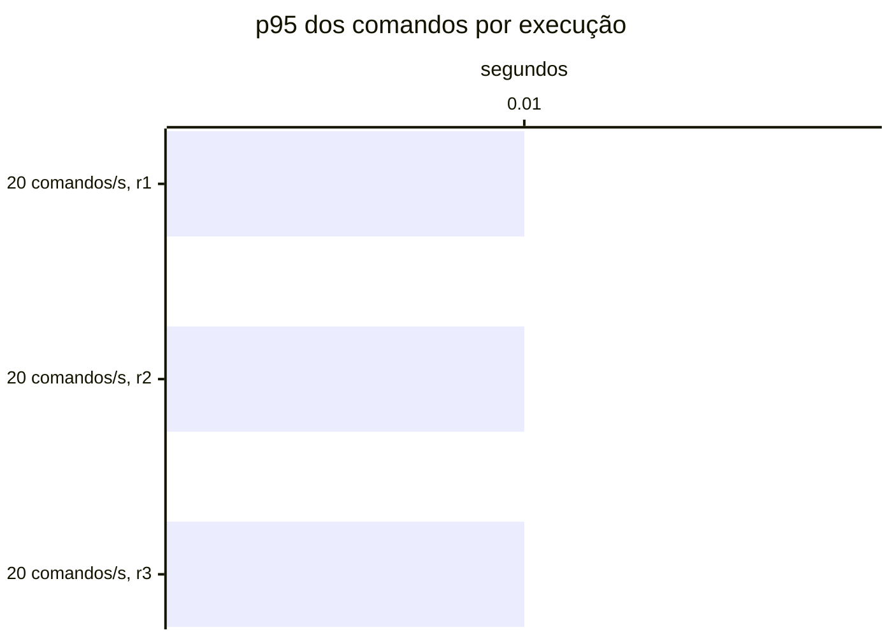

# Resumo

Gerado por `java bench/Report.java summarize`. Mediana das repetições; entre colchetes, a faixa do p95
(mín–máx). Latências em ms, vazão em requisições/s. Parâmetros de cada cenário em
`runs/<cenário>/scenario.properties`; série temporal de cada execução (5 s) em
`runs/<cenário>/r<n>/timeseries.csv`.

## c2-w0020 (3 execuções)

`writeRate=20` · `readRate=75` · `duration=180`

| Requisição | Vazão | % KO | p50 | p95 | p99 |
|---|---:|---:|---:|---:|---:|
| Global | 80.7 | 47.9 | 30,003 | 30,390 [30,240–30,524] | 34,353 |
| comandos | 17.0 | 0.0 | 6 | 13 [12–13] | 24 |
| consultas | 63.7 | 60.7 | 30,003 | 31,141 [30,983–31,148] | 38,638 |
| comandos / deposit empresa | 2.6 | 0.0 | 5 | 11 [11–12] | 24 |
| comandos / deposit pessoa | 2.6 | 0.0 | 7 | 13 [12–13] | 27 |
| comandos / transfer empresa | 1.2 | 0.0 | 7 | 14 [14–14] | 26 |
| comandos / transfer pessoa | 1.2 | 0.0 | 9 | 15 [15–17] | 25 |
| comandos / withdraw empresa | 4.7 | 0.0 | 5 | 11 [10–11] | 20 |
| comandos / withdraw pessoa | 4.7 | 0.0 | 7 | 12 [12–13] | 22 |
| consultas / Q1 empresa | 7.9 | 61.1 | 30,003 | 30,012 [30,008–30,059] | 30,668 |
| consultas / Q1 pessoa | 7.9 | 60.9 | 30,003 | 30,018 [30,009–30,020] | 30,522 |
| consultas / Q2 empresa | 8.1 | 60.5 | 30,003 | 30,055 [30,051–30,145] | 30,702 |
| consultas / Q2 pessoa | 8.0 | 61.2 | 30,003 | 30,025 [30,018–30,067] | 30,625 |
| consultas / Q3 empresa | 7.9 | 61.4 | 30,004 | 34,040 [33,849–34,101] | 34,641 |
| consultas / Q3 pessoa | 8.1 | 59.4 | 30,003 | 30,067 [30,053–30,077] | 30,550 |
| consultas / Q4 empresa | 8.0 | 62.0 | 30,004 | 30,273 [30,226–30,288] | 60,001 |
| consultas / Q4 pessoa | 7.7 | 62.9 | 30,003 | 45,398 [32,920–46,662] | 60,000 |

## Capacidade

Critério do ADR-0013 por repetição: p95 dos comandos ≤ 50 ms, p95 das consultas ≤ 250 ms, KO ≤ 1%,
vazão ≥ 98% da oferecida e, com consistência eventual, atraso p99 ≤ 2 s e fila no fim ≤ 1 s de escrita.
Vazão baixa com nenhum container da fase acima de 50% do seu limite de CPU (p90 das amostras) é limite do
gerador. Degrau
sustentado: em pelo menos 2 de 3 repetições. **Maior degrau sustentado: nenhum.**

- c2-w0020: não sustentado (0 de 3); r1: consultas p95 30,983 ms, KO 49.4%, vazão 85% da oferecida (CPU da fase no p90 até 31% do limite); r2: consultas p95 31,148 ms, KO 47.9%, vazão 85% da oferecida (CPU da fase no p90 até 31% do limite); r3: consultas p95 31,141 ms, KO 47.9%, vazão 85% da oferecida (CPU da fase no p90 até 33% do limite)

Vazão em % da oferecida; p95 em ms, no cliente; KO em %; atraso p99 em s; fila no fim em segundos de
escrita (— sem consistência eventual).

| Degrau | Rep. | Estado | Vazão | p95 comandos | p95 consultas | % KO | Atraso p99 | Fila no fim |
|---|---|---|---:|---:|---:|---:|---:|---:|
| c2-w0020 | r1 | **não sustentado** | 84.9% | 13 | 30,983 | 49.4 | 0.01 | 0.00 |
| c2-w0020 | r2 | **não sustentado** | 84.9% | 12 | 31,148 | 47.9 | 0.01 | 0.00 |
| c2-w0020 | r3 | **não sustentado** | 84.9% | 13 | 31,141 | 47.9 | 0.01 | 0.00 |

## Estado por execução

Colapso: p95 global acima de 5,000 ms (ADR-0009). Leia a contagem, não a mediana: perto da saturação as
repetições caem em estados diferentes.

| Cenário | Colapsou |
|---|---|
| c2-w0020 | 3 de 3 (r1, r2, r3) |

p95 global e comandos em ms, no cliente (Gatling). Espera e uso da conexão do Hikari em ms, média da
execução. Comando no banco: soma do tempo médio das instruções de escrita e do `SELECT … FOR UPDATE` no
`pg_stat_statements`, em ms (o custo de um comando dentro do Postgres, sem a fila). GC: segundos com a JVM
parada em GC na execução (medido a partir da #11).

| Cenário | Rep. | Estado | p95 global | % KO | Comandos p50 | p95 | p99 | Espera no pool | Uso da conexão | Comando no banco | GC |
|---|---|---|---:|---:|---:|---:|---:|---:|---:|---:|---:|
| c2-w0020 | r1 | **colapso** | 30,390 | 49.4 | 6 | 13 | 24 | 23,994.5 | 239.3 | 1.2 | 5.8 |
| c2-w0020 | r2 | **colapso** | 30,524 | 47.9 | 6 | 12 | 19 | 23,826.1 | 235.6 | 1.2 | 5.5 |
| c2-w0020 | r3 | **colapso** | 30,240 | 47.9 | 6 | 13 | 28 | 23,949.3 | 236.0 | 2.2 | 4.5 |

## Pools por execução

Espera e uso da conexão do Hikari em ms, média da execução; fila máxima de requisições esperando conexão.
Pool sem requisições na execução aparece com —.

| Cenário | Rep. | Pool | Espera | Uso da conexão | Fila máx. |
|---|---|---|---:|---:|---:|
| c2-w0020 | r1 | HikariPool-1@app-baseline | 0.0 | 5.3 | 0 |
| c2-w0020 | r1 | HikariPool-1@app-baseline-query | 29,280.8 | 387.8 | 2,260 |
| c2-w0020 | r2 | HikariPool-1@app-baseline | 0.0 | 5.1 | 0 |
| c2-w0020 | r2 | HikariPool-1@app-baseline-query | 29,163.8 | 379.2 | 2,270 |
| c2-w0020 | r3 | HikariPool-1@app-baseline | 0.0 | 5.6 | 0 |
| c2-w0020 | r3 | HikariPool-1@app-baseline-query | 29,162.9 | 374.0 | 2,265 |

## JVMs por execução

GC: segundos com a JVM parada em GC na execução. CPU: média do processo. Heap: maior uso na execução, em MiB.

| Cenário | Rep. | JVM | GC (s) | CPU | Heap máx. |
|---|---|---|---:|---:|---:|
| c2-w0020 | r1 | app-baseline | 0.3 | 3% | 38 |
| c2-w0020 | r1 | app-baseline-query | 5.5 | 7% | 649 |
| c2-w0020 | r2 | app-baseline | 0.3 | 3% | 39 |
| c2-w0020 | r2 | app-baseline-query | 5.2 | 7% | 699 |
| c2-w0020 | r3 | app-baseline | 0.3 | 3% | 42 |
| c2-w0020 | r3 | app-baseline-query | 4.2 | 7% | 672 |

## Leitura de disco por execução

Páginas lidas fora do cache e tempo médio por página, em ms. Postgres: soma das instruções do
pg_stat_statements (as 50 mais caras; na v1-replica, do primário e da réplica somados). Mongo: leituras das
threads da aplicação para o cache do WiredTiger. — quando o store não existe na fase.

| Cenário | Rep. | Postgres: páginas | ms/página | Mongo: páginas | ms/página |
|---|---|---:|---:|---:|---:|
| c2-w0020 | r1 | 2,615,981 | 0.79 | — | — |
| c2-w0020 | r2 | 2,788,910 | 0.74 | — | — |
| c2-w0020 | r3 | 2,720,018 | 0.76 | — | — |

## Escrita em disco por execução

WAL gerado no Postgres primário (MB e KB por comando), fsyncs do WAL e o tempo médio de cada um, em ms
(pg_stat_io com track_wal_io_timing), e bytes gravados em disco pelo WiredTiger por comando, em KB (block
manager; — sem Mongo). Os contadores do pg_stat_io chegam com até ~1 s de atraso; a série por segundo está
no `pg-seconds.csv` de cada execução.

| Cenário | Rep. | WAL (MB) | WAL por comando | fsyncs | ms por fsync | Mongo por comando |
|---|---|---:|---:|---:|---:|---:|
| c2-w0020 | r1 | 43 | 12.4 | 3,626 | 2.57 | — |
| c2-w0020 | r2 | 42 | 12.0 | 3,622 | 2.44 | — |
| c2-w0020 | r3 | 78 | 22.3 | 3,645 | 2.62 | — |

## Pool e banco por cenário

Mediana das repetições. Espera = tempo médio para obter conexão do Hikari; uso = tempo médio com a
conexão (o trabalho no banco); hit ratio = blocos achados no shared_buffers.

| Cenário | Espera no pool (ms) | Uso da conexão (ms) | Fila máx. no pool | Hit ratio | CPU da app |
|---|---:|---:|---:|---:|---:|
| c2-w0020 | 23,949.3 | 236.0 | 2,265 | 99.5% | 5% |
