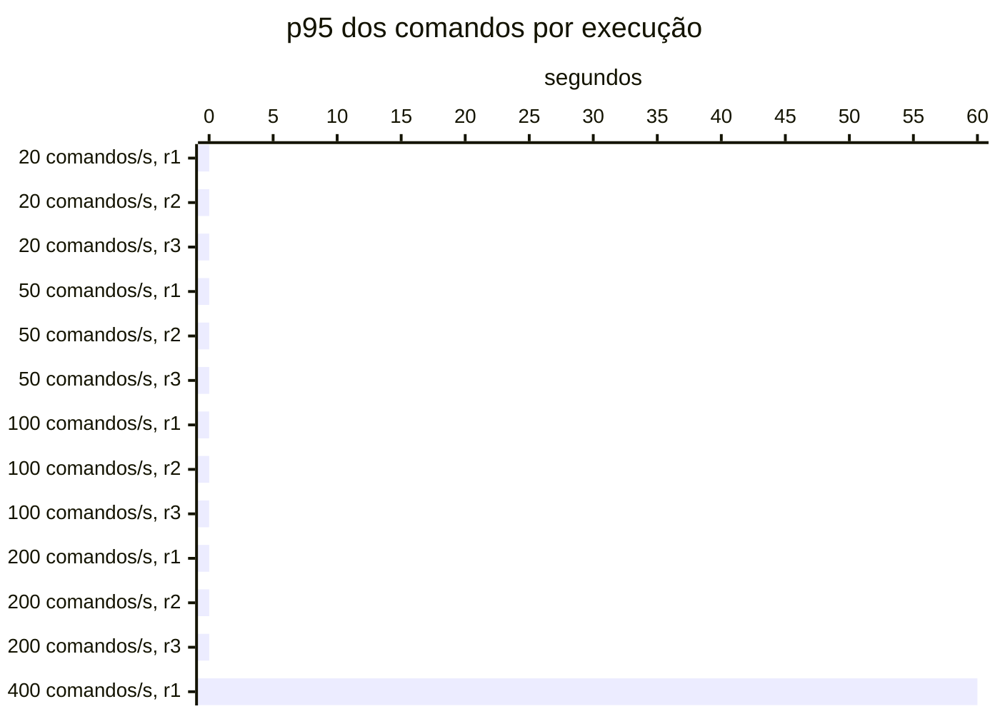

# Resumo

Gerado por `java bench/Report.java summarize`. Mediana das repetições; entre colchetes, a faixa do p95
(mín–máx). Latências em ms, vazão em requisições/s. Parâmetros de cada cenário em
`runs/<cenário>/scenario.properties`; série temporal de cada execução (5 s) em
`runs/<cenário>/r<n>/timeseries.csv`.

## c2-w0020 (3 execuções)

`writeRate=20` · `readRate=75` · `duration=180`

| Requisição | Vazão | % KO | p50 | p95 | p99 |
|---|---:|---:|---:|---:|---:|
| Global | 95.0 | 0.0 | 3 | 22 [21–23] | 53 |
| comandos | 20.0 | 0.0 | 3 | 5 [5–5] | 9 |
| consultas | 75.0 | 0.0 | 4 | 25 [24–27] | 56 |
| comandos / deposit empresa | 2.9 | 0.0 | 3 | 5 [5–5] | 7 |
| comandos / deposit pessoa | 3.1 | 0.0 | 3 | 5 [5–6] | 10 |
| comandos / transfer empresa | 1.5 | 0.0 | 4 | 6 [6–6] | 13 |
| comandos / transfer pessoa | 1.4 | 0.0 | 4 | 6 [6–7] | 13 |
| comandos / withdraw empresa | 5.6 | 0.0 | 3 | 5 [5–5] | 9 |
| comandos / withdraw pessoa | 5.4 | 0.0 | 3 | 5 [5–5] | 8 |
| consultas / Q1 empresa | 9.4 | 0.0 | 1 | 2 [2–2] | 3 |
| consultas / Q1 pessoa | 9.5 | 0.0 | 1 | 2 [2–2] | 3 |
| consultas / Q2 empresa | 9.4 | 0.0 | 7 | 15 [14–16] | 22 |
| consultas / Q2 pessoa | 9.5 | 0.0 | 4 | 8 [8–8] | 12 |
| consultas / Q3 empresa | 9.4 | 0.0 | 9 | 13 [13–13] | 18 |
| consultas / Q3 pessoa | 9.4 | 0.0 | 2 | 3 [3–3] | 5 |
| consultas / Q4 empresa | 9.2 | 0.0 | 22 | 62 [60–62] | 90 |
| consultas / Q4 pessoa | 9.2 | 0.0 | 4 | 11 [11–11] | 16 |

## c2-w0050 (3 execuções)

`writeRate=50` · `readRate=75` · `duration=180`

| Requisição | Vazão | % KO | p50 | p95 | p99 |
|---|---:|---:|---:|---:|---:|
| Global | 125.0 | 0.0 | 3 | 20 [20–24] | 54 |
| comandos | 50.0 | 0.0 | 3 | 5 [5–7] | 10 |
| consultas | 75.0 | 0.0 | 4 | 27 [27–33] | 60 |
| comandos / deposit empresa | 7.3 | 0.0 | 2 | 5 [4–5] | 8 |
| comandos / deposit pessoa | 7.5 | 0.0 | 3 | 5 [4–6] | 12 |
| comandos / transfer empresa | 3.6 | 0.0 | 3 | 6 [5–9] | 10 |
| comandos / transfer pessoa | 3.7 | 0.0 | 4 | 7 [6–10] | 20 |
| comandos / withdraw empresa | 13.9 | 0.0 | 2 | 4 [4–6] | 9 |
| comandos / withdraw pessoa | 13.8 | 0.0 | 3 | 5 [5–6] | 10 |
| consultas / Q1 empresa | 9.5 | 0.0 | 1 | 2 [2–2] | 3 |
| consultas / Q1 pessoa | 9.5 | 0.0 | 1 | 2 [2–2] | 3 |
| consultas / Q2 empresa | 9.6 | 0.0 | 8 | 18 [16–21] | 26 |
| consultas / Q2 pessoa | 9.3 | 0.0 | 4 | 8 [8–11] | 14 |
| consultas / Q3 empresa | 9.2 | 0.0 | 9 | 13 [13–15] | 18 |
| consultas / Q3 pessoa | 9.4 | 0.0 | 2 | 3 [3–4] | 6 |
| consultas / Q4 empresa | 9.4 | 0.0 | 23 | 64 [61–76] | 90 |
| consultas / Q4 pessoa | 9.2 | 0.0 | 4 | 12 [11–13] | 20 |

## c2-w0100 (3 execuções)

`writeRate=100` · `readRate=75` · `duration=180`

| Requisição | Vazão | % KO | p50 | p95 | p99 |
|---|---:|---:|---:|---:|---:|
| Global | 175.0 | 0.0 | 2 | 16 [16–19] | 50 |
| comandos | 100.0 | 0.0 | 2 | 4 [4–5] | 9 |
| consultas | 75.0 | 0.0 | 4 | 29 [28–32] | 62 |
| comandos / deposit empresa | 14.6 | 0.0 | 2 | 4 [4–4] | 9 |
| comandos / deposit pessoa | 14.9 | 0.0 | 2 | 4 [4–5] | 11 |
| comandos / transfer empresa | 7.8 | 0.0 | 3 | 5 [5–5] | 10 |
| comandos / transfer pessoa | 7.5 | 0.0 | 3 | 6 [5–6] | 11 |
| comandos / withdraw empresa | 27.9 | 0.0 | 2 | 4 [3–4] | 8 |
| comandos / withdraw pessoa | 27.5 | 0.0 | 2 | 4 [4–5] | 9 |
| consultas / Q1 empresa | 9.4 | 0.0 | 1 | 1 [1–1] | 2 |
| consultas / Q1 pessoa | 9.5 | 0.0 | 1 | 1 [1–1] | 3 |
| consultas / Q2 empresa | 9.6 | 0.0 | 8 | 17 [17–21] | 26 |
| consultas / Q2 pessoa | 9.3 | 0.0 | 4 | 9 [8–10] | 15 |
| consultas / Q3 empresa | 9.3 | 0.0 | 8 | 12 [12–14] | 17 |
| consultas / Q3 pessoa | 9.2 | 0.0 | 1 | 2 [2–3] | 6 |
| consultas / Q4 empresa | 9.1 | 0.0 | 25 | 67 [63–77] | 96 |
| consultas / Q4 pessoa | 9.3 | 0.0 | 5 | 13 [12–13] | 19 |

## c2-w0200 (3 execuções)

`writeRate=200` · `readRate=75` · `duration=180`

| Requisição | Vazão | % KO | p50 | p95 | p99 |
|---|---:|---:|---:|---:|---:|
| Global | 273.5 | 0.0 | 2 | 19 [19–30] | 88 |
| comandos | 198.9 | 0.0 | 2 | 7 [6–8] | 45 |
| consultas | 74.6 | 0.0 | 5 | 51 [49–71] | 186 |
| comandos / deposit empresa | 29.5 | 0.0 | 2 | 5 [5–7] | 39 |
| comandos / deposit pessoa | 29.7 | 0.0 | 2 | 7 [6–9] | 37 |
| comandos / transfer empresa | 15.2 | 0.0 | 3 | 8 [7–10] | 53 |
| comandos / transfer pessoa | 15.0 | 0.0 | 3 | 8 [8–10] | 46 |
| comandos / withdraw empresa | 55.1 | 0.0 | 2 | 5 [5–8] | 44 |
| comandos / withdraw pessoa | 54.7 | 0.0 | 2 | 7 [6–9] | 61 |
| consultas / Q1 empresa | 9.3 | 0.0 | 1 | 1 [1–2] | 16 |
| consultas / Q1 pessoa | 9.3 | 0.0 | 1 | 2 [2–2] | 48 |
| consultas / Q2 empresa | 9.3 | 0.0 | 9 | 37 [35–45] | 107 |
| consultas / Q2 pessoa | 9.4 | 0.0 | 4 | 17 [12–19] | 80 |
| consultas / Q3 empresa | 9.1 | 0.0 | 8 | 14 [13–16] | 45 |
| consultas / Q3 pessoa | 9.2 | 0.0 | 1 | 4 [3–5] | 41 |
| consultas / Q4 empresa | 9.5 | 0.0 | 32 | 295 [175–748] | 1,852 |
| consultas / Q4 pessoa | 9.6 | 0.0 | 6 | 34 [30–59] | 116 |

## c2-w0400 (1 execuções)

`writeRate=400` · `readRate=75` · `duration=180`

| Requisição | Vazão | % KO | p50 | p95 | p99 |
|---|---:|---:|---:|---:|---:|
| Global | 438.5 | 39.1 | 172 | 60,001 [60,001–60,001] | 60,002 |
| comandos | 369.2 | 39.1 | 168 | 60,001 [60,001–60,001] | 60,002 |
| consultas | 69.2 | 39.1 | 221 | 60,001 [60,001–60,001] | 60,002 |
| comandos / deposit empresa | 54.6 | 39.6 | 224 | 60,001 [60,001–60,001] | 60,002 |
| comandos / deposit pessoa | 55.8 | 38.9 | 157 | 60,001 [60,001–60,001] | 60,002 |
| comandos / transfer empresa | 27.1 | 40.1 | 204 | 60,001 [60,001–60,001] | 60,002 |
| comandos / transfer pessoa | 27.2 | 38.5 | 105 | 60,001 [60,001–60,001] | 60,002 |
| comandos / withdraw empresa | 102.0 | 38.7 | 140 | 60,001 [60,001–60,001] | 60,002 |
| comandos / withdraw pessoa | 102.5 | 39.4 | 182 | 60,001 [60,001–60,001] | 60,002 |
| consultas / Q1 empresa | 8.4 | 40.0 | 228 | 60,001 [60,001–60,001] | 60,002 |
| consultas / Q1 pessoa | 8.7 | 39.1 | 221 | 60,001 [60,001–60,001] | 60,002 |
| consultas / Q2 empresa | 8.8 | 39.4 | 162 | 60,001 [60,001–60,001] | 60,002 |
| consultas / Q2 pessoa | 8.7 | 39.4 | 90 | 60,001 [60,001–60,001] | 60,003 |
| consultas / Q3 empresa | 8.4 | 38.7 | 147 | 60,000 [60,000–60,000] | 60,002 |
| consultas / Q3 pessoa | 8.5 | 38.7 | 175 | 60,000 [60,000–60,000] | 60,002 |
| consultas / Q4 empresa | 9.0 | 38.4 | 452 | 60,000 [60,000–60,000] | 60,002 |
| consultas / Q4 pessoa | 8.9 | 39.4 | 169 | 60,001 [60,001–60,001] | 60,002 |

## Capacidade

Critério do ADR-0013 por repetição: p95 dos comandos ≤ 50 ms, p95 das consultas ≤ 250 ms, KO ≤ 1%,
vazão ≥ 98% da oferecida e, com consistência eventual, atraso p99 ≤ 2 s e fila no fim ≤ 1 s de escrita.
Vazão baixa com nenhum container da fase acima de 50% do seu limite de CPU (p90 das amostras) é limite do
gerador. Degrau
sustentado: em pelo menos 2 de 3 repetições. **Maior degrau sustentado: 200 comandos/s.**

- c2-w0020: sustentado (3 de 3)
- c2-w0050: sustentado (3 de 3)
- c2-w0100: sustentado (3 de 3)
- c2-w0200: sustentado (3 de 3)
- c2-w0400: não sustentado (0 de 1); r1: fase fora do ar no fim (http://localhost:8080), comandos p95 60,001 ms, consultas p95 60,001 ms, KO 39.1%, vazão 92% da oferecida (CPU da fase no p90 até 51% do limite)

Vazão em % da oferecida; p95 em ms, no cliente; KO em %; atraso p99 em s; fila no fim em segundos de
escrita (— sem consistência eventual).

| Degrau | Rep. | Estado | Vazão | p95 comandos | p95 consultas | % KO | Atraso p99 | Fila no fim |
|---|---|---|---:|---:|---:|---:|---:|---:|
| c2-w0020 | r1 | sustentado | 100.0% | 5 | 27 | 0.0 | — | — |
| c2-w0020 | r2 | sustentado | 100.0% | 5 | 24 | 0.0 | — | — |
| c2-w0020 | r3 | sustentado | 100.0% | 5 | 25 | 0.0 | — | — |
| c2-w0050 | r1 | sustentado | 100.0% | 5 | 27 | 0.0 | — | — |
| c2-w0050 | r2 | sustentado | 100.0% | 7 | 33 | 0.0 | — | — |
| c2-w0050 | r3 | sustentado | 99.4% | 5 | 27 | 0.0 | — | — |
| c2-w0100 | r1 | sustentado | 100.0% | 4 | 28 | 0.0 | — | — |
| c2-w0100 | r2 | sustentado | 100.0% | 5 | 32 | 0.0 | — | — |
| c2-w0100 | r3 | sustentado | 100.0% | 4 | 29 | 0.0 | — | — |
| c2-w0200 | r1 | sustentado | 99.4% | 6 | 49 | 0.0 | — | — |
| c2-w0200 | r2 | sustentado | 99.4% | 7 | 51 | 0.0 | — | — |
| c2-w0200 | r3 | sustentado | 100.0% | 8 | 71 | 0.0 | — | — |
| c2-w0400 | r1 | **não sustentado** | 92.3% | 60,001 | 60,001 | 39.1 | — | — |

## Estado por execução

Colapso: p95 global acima de 5,000 ms (ADR-0009). Leia a contagem, não a mediana: perto da saturação as
repetições caem em estados diferentes.

| Cenário | Colapsou |
|---|---|
| c2-w0020 | 0 de 3 |
| c2-w0050 | 0 de 3 |
| c2-w0100 | 0 de 3 |
| c2-w0200 | 0 de 3 |
| c2-w0400 | 1 de 1 (r1) |

p95 global e comandos em ms, no cliente (Gatling). Espera e uso da conexão do Hikari em ms, média da
execução. Comando no banco: soma do tempo médio das instruções de escrita e do `SELECT … FOR UPDATE` no
`pg_stat_statements`, em ms (o custo de um comando dentro do Postgres, sem a fila). GC: segundos com a JVM
parada em GC na execução (medido a partir da #11).

| Cenário | Rep. | Estado | p95 global | % KO | Comandos p50 | p95 | p99 | Espera no pool | Uso da conexão | Comando no banco | GC |
|---|---|---|---:|---:|---:|---:|---:|---:|---:|---:|---:|
| c2-w0020 | r1 | estável | 23 | 0.0 | 3 | 5 | 11 | 0.0 | 4.7 | 0.7 | 0.7 |
| c2-w0020 | r2 | estável | 21 | 0.0 | 3 | 5 | 9 | 0.1 | 4.6 | 0.6 | 0.7 |
| c2-w0020 | r3 | estável | 22 | 0.0 | 3 | 5 | 9 | 0.0 | 4.4 | 0.6 | 0.6 |
| c2-w0050 | r1 | estável | 20 | 0.0 | 3 | 5 | 10 | 0.0 | 4.2 | 0.6 | 0.8 |
| c2-w0050 | r2 | estável | 24 | 0.0 | 3 | 7 | 29 | 0.2 | 4.7 | 0.6 | 0.5 |
| c2-w0050 | r3 | estável | 20 | 0.0 | 3 | 5 | 8 | 0.0 | 4.0 | 0.5 | 0.1 |
| c2-w0100 | r1 | estável | 16 | 0.0 | 2 | 4 | 9 | 0.0 | 3.4 | 0.4 | 0.2 |
| c2-w0100 | r2 | estável | 19 | 0.0 | 2 | 5 | 16 | 0.5 | 3.8 | 0.5 | 0.2 |
| c2-w0100 | r3 | estável | 16 | 0.0 | 2 | 4 | 8 | 0.0 | 3.5 | 0.5 | 0.1 |
| c2-w0200 | r1 | estável | 19 | 0.0 | 2 | 6 | 45 | 1.2 | 5.0 | 0.5 | 0.2 |
| c2-w0200 | r2 | estável | 19 | 0.0 | 2 | 7 | 41 | 0.9 | 5.6 | 0.6 | 0.2 |
| c2-w0200 | r3 | estável | 30 | 0.0 | 2 | 8 | 106 | 2.3 | 8.1 | 0.7 | 0.2 |
| c2-w0400 | r1 | **colapso** | 60,001 | 39.1 | 168 | 60,001 | 60,002 | — | — | 0.8 | — |

## Leitura de disco por execução

Páginas lidas fora do cache e tempo médio por página, em ms. Postgres: soma das instruções do
pg_stat_statements (as 50 mais caras; na v1-replica, do primário e da réplica somados). Mongo: leituras das
threads da aplicação para o cache do WiredTiger. — quando o store não existe na fase.

| Cenário | Rep. | Postgres: páginas | ms/página | Mongo: páginas | ms/página |
|---|---|---:|---:|---:|---:|
| c2-w0020 | r1 | 451,691 | 0.12 | — | — |
| c2-w0020 | r2 | 440,135 | 0.12 | — | — |
| c2-w0020 | r3 | 440,100 | 0.12 | — | — |
| c2-w0050 | r1 | 456,355 | 0.13 | — | — |
| c2-w0050 | r2 | 451,959 | 0.15 | — | — |
| c2-w0050 | r3 | 451,106 | 0.12 | — | — |
| c2-w0100 | r1 | 459,073 | 0.13 | — | — |
| c2-w0100 | r2 | 452,554 | 0.16 | — | — |
| c2-w0100 | r3 | 470,761 | 0.13 | — | — |
| c2-w0200 | r1 | 745,734 | 0.23 | — | — |
| c2-w0200 | r2 | 747,253 | 0.26 | — | — |
| c2-w0200 | r3 | 1,050,686 | 0.29 | — | — |
| c2-w0400 | r1 | 834,938 | 0.56 | — | — |

## Escrita em disco por execução

WAL gerado no Postgres primário (MB e KB por comando), fsyncs do WAL e o tempo médio de cada um, em ms
(pg_stat_io com track_wal_io_timing), e bytes gravados em disco pelo WiredTiger por comando, em KB (block
manager; — sem Mongo). Os contadores do pg_stat_io chegam com até ~1 s de atraso; a série por segundo está
no `pg-seconds.csv` de cada execução.

| Cenário | Rep. | WAL (MB) | WAL por comando | fsyncs | ms por fsync | Mongo por comando |
|---|---|---:|---:|---:|---:|---:|
| c2-w0020 | r1 | 66 | 18.8 | 3,832 | 0.35 | — |
| c2-w0020 | r2 | 61 | 17.4 | 3,826 | 0.32 | — |
| c2-w0020 | r3 | 69 | 19.6 | 3,849 | 0.33 | — |
| c2-w0050 | r1 | 107 | 12.2 | 9,135 | 0.38 | — |
| c2-w0050 | r2 | 143 | 16.2 | 9,144 | 0.41 | — |
| c2-w0050 | r3 | 128 | 14.6 | 9,154 | 0.34 | — |
| c2-w0100 | r1 | 199 | 11.3 | 18,075 | 0.34 | — |
| c2-w0100 | r2 | 225 | 12.8 | 18,022 | 0.41 | — |
| c2-w0100 | r3 | 213 | 12.1 | 18,051 | 0.35 | — |
| c2-w0200 | r1 | 366 | 10.4 | 35,887 | 0.51 | — |
| c2-w0200 | r2 | 359 | 10.2 | 35,792 | 0.56 | — |
| c2-w0200 | r3 | 366 | 10.4 | 35,663 | 0.74 | — |
| c2-w0400 | r1 | 430 | 6.1 | 40,625 | 1.16 | — |

## Pool e banco por cenário

Mediana das repetições. Espera = tempo médio para obter conexão do Hikari; uso = tempo médio com a
conexão (o trabalho no banco); hit ratio = blocos achados no shared_buffers.

| Cenário | Espera no pool (ms) | Uso da conexão (ms) | Fila máx. no pool | Hit ratio | CPU da app |
|---|---:|---:|---:|---:|---:|
| c2-w0020 | 0.0 | 4.6 | 0 | 96.9% | 4% |
| c2-w0050 | 0.0 | 4.2 | 0 | 96.8% | 5% |
| c2-w0100 | 0.0 | 3.5 | 0 | 96.9% | 6% |
| c2-w0200 | 1.2 | 5.6 | 23 | 95.0% | 11% |
| c2-w0400 | — | — | — | 100.0% | — |
