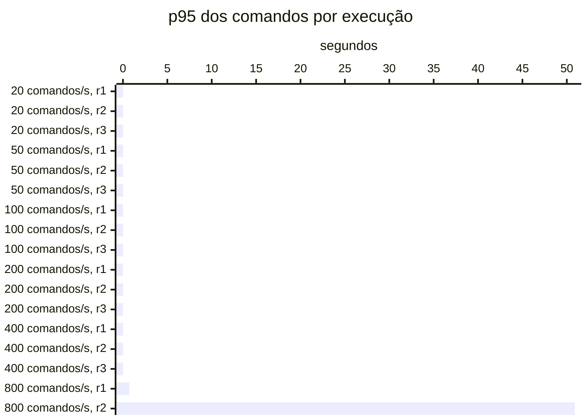

# Resumo

Gerado por `java bench/Report.java summarize`. Mediana das repetições; entre colchetes, a faixa do p95
(mín–máx). Latências em ms, vazão em requisições/s. Parâmetros de cada cenário em
`runs/<cenário>/scenario.properties`; série temporal de cada execução (5 s) em
`runs/<cenário>/r<n>/timeseries.csv`.

## c2-w0020 (3 execuções)

`writeRate=20` · `readRate=75` · `duration=180`

| Requisição | Vazão | % KO | p50 | p95 | p99 |
|---|---:|---:|---:|---:|---:|
| Global | 95.0 | 0.0 | 2 | 18 [18–18] | 34 |
| comandos | 20.0 | 0.0 | 3 | 7 [6–7] | 10 |
| consultas | 75.0 | 0.0 | 2 | 20 [20–21] | 35 |
| comandos / deposit empresa | 2.9 | 0.0 | 3 | 6 [5–6] | 9 |
| comandos / deposit pessoa | 3.0 | 0.0 | 3 | 6 [5–6] | 9 |
| comandos / transfer empresa | 1.5 | 0.0 | 4 | 8 [8–8] | 13 |
| comandos / transfer pessoa | 1.4 | 0.0 | 5 | 8 [8–8] | 12 |
| comandos / withdraw empresa | 5.7 | 0.0 | 3 | 6 [5–6] | 10 |
| comandos / withdraw pessoa | 5.5 | 0.0 | 3 | 6 [6–6] | 11 |
| consultas / Q1 empresa | 9.5 | 0.0 | 1 | 2 [2–2] | 3 |
| consultas / Q1 pessoa | 9.3 | 0.0 | 1 | 2 [2–2] | 3 |
| consultas / Q2 empresa | 9.4 | 0.0 | 5 | 8 [8–9] | 12 |
| consultas / Q2 pessoa | 9.5 | 0.0 | 2 | 4 [3–4] | 7 |
| consultas / Q3 empresa | 9.5 | 0.0 | 2 | 3 [3–3] | 6 |
| consultas / Q3 pessoa | 9.4 | 0.0 | 2 | 3 [3–3] | 6 |
| consultas / Q4 empresa | 9.5 | 0.0 | 18 | 38 [38–38] | 46 |
| consultas / Q4 pessoa | 9.1 | 0.0 | 3 | 5 [5–5] | 7 |

## c2-w0050 (3 execuções)

`writeRate=50` · `readRate=75` · `duration=180`

| Requisição | Vazão | % KO | p50 | p95 | p99 |
|---|---:|---:|---:|---:|---:|
| Global | 125.0 | 0.0 | 3 | 14 [14–15] | 31 |
| comandos | 50.0 | 0.0 | 3 | 5 [5–6] | 9 |
| consultas | 75.0 | 0.0 | 2 | 20 [20–21] | 35 |
| comandos / deposit empresa | 7.4 | 0.0 | 3 | 5 [5–5] | 8 |
| comandos / deposit pessoa | 7.4 | 0.0 | 3 | 5 [5–5] | 9 |
| comandos / transfer empresa | 3.8 | 0.0 | 4 | 6 [6–7] | 10 |
| comandos / transfer pessoa | 3.6 | 0.0 | 4 | 7 [7–8] | 14 |
| comandos / withdraw empresa | 13.9 | 0.0 | 3 | 5 [4–5] | 8 |
| comandos / withdraw pessoa | 13.7 | 0.0 | 3 | 5 [5–5] | 8 |
| consultas / Q1 empresa | 9.4 | 0.0 | 1 | 2 [2–2] | 3 |
| consultas / Q1 pessoa | 9.3 | 0.0 | 1 | 2 [2–2] | 3 |
| consultas / Q2 empresa | 9.5 | 0.0 | 5 | 8 [8–9] | 12 |
| consultas / Q2 pessoa | 9.3 | 0.0 | 2 | 3 [3–3] | 6 |
| consultas / Q3 empresa | 9.4 | 0.0 | 2 | 3 [3–3] | 6 |
| consultas / Q3 pessoa | 9.5 | 0.0 | 2 | 3 [3–3] | 5 |
| consultas / Q4 empresa | 9.1 | 0.0 | 18 | 38 [38–38] | 48 |
| consultas / Q4 pessoa | 9.3 | 0.0 | 3 | 5 [4–5] | 9 |

## c2-w0100 (3 execuções)

`writeRate=100` · `readRate=75` · `duration=180`

| Requisição | Vazão | % KO | p50 | p95 | p99 |
|---|---:|---:|---:|---:|---:|
| Global | 174.0 | 0.0 | 2 | 10 [10–16] | 29 |
| comandos | 99.5 | 0.0 | 3 | 5 [5–7] | 10 |
| consultas | 74.6 | 0.0 | 2 | 20 [19–23] | 34 |
| comandos / deposit empresa | 14.9 | 0.0 | 2 | 4 [4–6] | 10 |
| comandos / deposit pessoa | 14.9 | 0.0 | 3 | 5 [4–7] | 10 |
| comandos / transfer empresa | 7.6 | 0.0 | 4 | 6 [6–8] | 14 |
| comandos / transfer pessoa | 7.3 | 0.0 | 4 | 7 [6–8] | 11 |
| comandos / withdraw empresa | 27.4 | 0.0 | 2 | 4 [4–6] | 9 |
| comandos / withdraw pessoa | 27.4 | 0.0 | 3 | 5 [4–7] | 10 |
| consultas / Q1 empresa | 9.3 | 0.0 | 1 | 2 [1–2] | 4 |
| consultas / Q1 pessoa | 9.5 | 0.0 | 1 | 2 [1–2] | 4 |
| consultas / Q2 empresa | 9.4 | 0.0 | 5 | 8 [7–10] | 12 |
| consultas / Q2 pessoa | 9.4 | 0.0 | 2 | 3 [3–4] | 7 |
| consultas / Q3 empresa | 9.3 | 0.0 | 2 | 3 [3–5] | 7 |
| consultas / Q3 pessoa | 9.3 | 0.0 | 1 | 3 [2–4] | 7 |
| consultas / Q4 empresa | 9.0 | 0.0 | 17 | 38 [37–40] | 48 |
| consultas / Q4 pessoa | 9.5 | 0.0 | 3 | 4 [4–6] | 9 |

## c2-w0200 (3 execuções)

`writeRate=200` · `readRate=75` · `duration=180`

| Requisição | Vazão | % KO | p50 | p95 | p99 |
|---|---:|---:|---:|---:|---:|
| Global | 275.0 | 0.0 | 2 | 7 [7–8] | 26 |
| comandos | 200.0 | 0.0 | 2 | 4 [4–5] | 9 |
| consultas | 75.0 | 0.0 | 2 | 20 [20–20] | 35 |
| comandos / deposit empresa | 29.9 | 0.0 | 2 | 4 [4–4] | 10 |
| comandos / deposit pessoa | 29.5 | 0.0 | 2 | 4 [4–4] | 9 |
| comandos / transfer empresa | 15.0 | 0.0 | 3 | 5 [5–6] | 11 |
| comandos / transfer pessoa | 15.0 | 0.0 | 3 | 6 [6–6] | 13 |
| comandos / withdraw empresa | 55.6 | 0.0 | 2 | 4 [4–4] | 9 |
| comandos / withdraw pessoa | 55.1 | 0.0 | 2 | 4 [4–4] | 9 |
| consultas / Q1 empresa | 9.3 | 0.0 | 1 | 1 [1–1] | 3 |
| consultas / Q1 pessoa | 9.5 | 0.0 | 1 | 1 [1–1] | 3 |
| consultas / Q2 empresa | 9.2 | 0.0 | 4 | 8 [7–8] | 15 |
| consultas / Q2 pessoa | 9.5 | 0.0 | 2 | 3 [3–3] | 7 |
| consultas / Q3 empresa | 9.4 | 0.0 | 1 | 3 [3–3] | 6 |
| consultas / Q3 pessoa | 9.3 | 0.0 | 1 | 3 [3–3] | 7 |
| consultas / Q4 empresa | 9.4 | 0.0 | 18 | 38 [37–38] | 48 |
| consultas / Q4 pessoa | 9.4 | 0.0 | 2 | 5 [4–5] | 11 |

## c2-w0400 (3 execuções)

`writeRate=400` · `readRate=75` · `duration=180`

| Requisição | Vazão | % KO | p50 | p95 | p99 |
|---|---:|---:|---:|---:|---:|
| Global | 475.0 | 0.0 | 2 | 11 [8–17] | 77 |
| comandos | 400.0 | 0.0 | 2 | 8 [6–13] | 77 |
| consultas | 75.0 | 0.0 | 2 | 26 [23–28] | 73 |
| comandos / deposit empresa | 59.3 | 0.0 | 2 | 7 [5–12] | 79 |
| comandos / deposit pessoa | 59.7 | 0.0 | 2 | 7 [6–13] | 73 |
| comandos / transfer empresa | 29.7 | 0.0 | 3 | 9 [8–15] | 85 |
| comandos / transfer pessoa | 29.9 | 0.0 | 3 | 10 [7–14] | 91 |
| comandos / withdraw empresa | 110.7 | 0.0 | 2 | 7 [6–12] | 80 |
| comandos / withdraw pessoa | 110.5 | 0.0 | 2 | 8 [6–13] | 71 |
| consultas / Q1 empresa | 9.5 | 0.0 | 1 | 1 [1–3] | 58 |
| consultas / Q1 pessoa | 9.2 | 0.0 | 1 | 2 [1–4] | 85 |
| consultas / Q2 empresa | 9.3 | 0.0 | 5 | 12 [9–13] | 67 |
| consultas / Q2 pessoa | 9.5 | 0.0 | 2 | 5 [4–8] | 48 |
| consultas / Q3 empresa | 9.6 | 0.0 | 2 | 4 [4–9] | 61 |
| consultas / Q3 pessoa | 9.4 | 0.0 | 1 | 6 [4–8] | 60 |
| consultas / Q4 empresa | 9.2 | 0.0 | 19 | 45 [41–47] | 106 |
| consultas / Q4 pessoa | 9.2 | 0.0 | 2 | 9 [6–12] | 78 |

## c2-w0800 (2 execuções)

`writeRate=800` · `readRate=75` · `duration=180`

| Requisição | Vazão | % KO | p50 | p95 | p99 |
|---|---:|---:|---:|---:|---:|
| Global | 836.9 | 48.3 | 7,503 | 26,158 [705–51,610] | 30,570 |
| comandos | 765.1 | 48.3 | 7,503 | 25,802 [710–50,894] | 30,570 |
| consultas | 71.7 | 48.2 | 7,503 | 22,371 [712–44,029] | 30,568 |
| comandos / deposit empresa | 114.1 | 48.3 | 7,503 | 24,737 [708–48,765] | 30,571 |
| comandos / deposit pessoa | 114.8 | 48.3 | 7,503 | 24,823 [752–48,894] | 30,570 |
| comandos / transfer empresa | 57.4 | 48.4 | 7,504 | 27,060 [688–53,432] | 30,573 |
| comandos / transfer pessoa | 55.8 | 48.4 | 7,504 | 21,586 [709–42,463] | 30,573 |
| comandos / withdraw empresa | 211.2 | 48.3 | 7,503 | 27,467 [700–54,233] | 30,569 |
| comandos / withdraw pessoa | 212.0 | 48.3 | 7,503 | 24,742 [706–48,778] | 30,569 |
| consultas / Q1 empresa | 8.7 | 48.2 | 7,502 | 30,401 [802–60,000] | 30,572 |
| consultas / Q1 pessoa | 9.0 | 48.1 | 7,502 | 18,878 [750–37,005] | 30,564 |
| consultas / Q2 empresa | 8.9 | 47.8 | 7,505 | 29,835 [700–58,969] | 30,568 |
| consultas / Q2 pessoa | 9.1 | 48.5 | 7,503 | 19,360 [669–38,051] | 30,557 |
| consultas / Q3 empresa | 9.0 | 48.2 | 7,503 | 12,557 [632–24,482] | 30,559 |
| consultas / Q3 pessoa | 8.8 | 48.4 | 7,503 | 19,059 [729–37,388] | 30,570 |
| consultas / Q4 empresa | 9.1 | 48.3 | 7,516 | 29,949 [674–59,224] | 30,598 |
| consultas / Q4 pessoa | 9.1 | 48.3 | 7,503 | 21,100 [565–41,634] | 30,559 |

## Capacidade

Critério do ADR-0013 por repetição: p95 dos comandos ≤ 50 ms, p95 das consultas ≤ 250 ms, KO ≤ 1%,
vazão ≥ 98% da oferecida e, com consistência eventual, atraso p99 ≤ 2 s e fila no fim ≤ 1 s de escrita.
Vazão baixa com nenhum container da fase acima de 50% do seu limite de CPU (p90 das amostras) é limite do
gerador. Degrau
sustentado: em pelo menos 2 de 3 repetições. **Maior degrau sustentado: 400 comandos/s.**

- c2-w0020: sustentado (3 de 3)
- c2-w0050: sustentado (3 de 3)
- c2-w0100: sustentado (3 de 3)
- c2-w0200: sustentado (3 de 3)
- c2-w0400: sustentado (3 de 3)
- c2-w0800: não sustentado (0 de 2); r1: comandos p95 710 ms, consultas p95 712 ms; r2: fase fora do ar no fim (http://localhost:8080), comandos p95 50,894 ms, consultas p95 44,029 ms, KO 96.6%, vazão 92% da oferecida (CPU da fase no p90 até 52% do limite)

Vazão em % da oferecida; p95 em ms, no cliente; KO em %; atraso p99 em s; fila no fim em segundos de
escrita (— sem consistência eventual).

| Degrau | Rep. | Estado | Vazão | p95 comandos | p95 consultas | % KO | Atraso p99 | Fila no fim |
|---|---|---|---:|---:|---:|---:|---:|---:|
| c2-w0020 | r1 | sustentado | 100.0% | 7 | 21 | 0.0 | — | — |
| c2-w0020 | r2 | sustentado | 100.0% | 6 | 20 | 0.0 | — | — |
| c2-w0020 | r3 | sustentado | 100.0% | 7 | 20 | 0.0 | — | — |
| c2-w0050 | r1 | sustentado | 100.0% | 5 | 21 | 0.0 | — | — |
| c2-w0050 | r2 | sustentado | 100.0% | 6 | 20 | 0.0 | — | — |
| c2-w0050 | r3 | sustentado | 100.0% | 5 | 20 | 0.0 | — | — |
| c2-w0100 | r1 | sustentado | 100.0% | 5 | 19 | 0.0 | — | — |
| c2-w0100 | r2 | sustentado | 99.4% | 7 | 23 | 0.0 | — | — |
| c2-w0100 | r3 | sustentado | 99.4% | 5 | 20 | 0.0 | — | — |
| c2-w0200 | r1 | sustentado | 100.0% | 4 | 20 | 0.0 | — | — |
| c2-w0200 | r2 | sustentado | 100.0% | 5 | 20 | 0.0 | — | — |
| c2-w0200 | r3 | sustentado | 100.0% | 4 | 20 | 0.0 | — | — |
| c2-w0400 | r1 | sustentado | 100.0% | 13 | 28 | 0.0 | — | — |
| c2-w0400 | r2 | sustentado | 100.0% | 6 | 23 | 0.0 | — | — |
| c2-w0400 | r3 | sustentado | 100.0% | 8 | 26 | 0.0 | — | — |
| c2-w0800 | r1 | **não sustentado** | 99.4% | 710 | 712 | 0.0 | — | — |
| c2-w0800 | r2 | **não sustentado** | 91.8% | 50,894 | 44,029 | 96.6 | — | — |

## Estado por execução

Colapso: p95 global acima de 5,000 ms (ADR-0009). Leia a contagem, não a mediana: perto da saturação as
repetições caem em estados diferentes.

| Cenário | Colapsou |
|---|---|
| c2-w0020 | 0 de 3 |
| c2-w0050 | 0 de 3 |
| c2-w0100 | 0 de 3 |
| c2-w0200 | 0 de 3 |
| c2-w0400 | 0 de 3 |
| c2-w0800 | 1 de 2 (r2) |

p95 global e comandos em ms, no cliente (Gatling). Espera e uso da conexão do Hikari em ms, média da
execução. Comando no banco: soma do tempo médio das instruções de escrita e do `SELECT … FOR UPDATE` no
`pg_stat_statements`, em ms (o custo de um comando dentro do Postgres, sem a fila). GC: segundos com a JVM
parada em GC na execução (medido a partir da #11).

| Cenário | Rep. | Estado | p95 global | % KO | Comandos p50 | p95 | p99 | Espera no pool | Uso da conexão | Comando no banco | GC |
|---|---|---|---:|---:|---:|---:|---:|---:|---:|---:|---:|
| c2-w0020 | r1 | estável | 18 | 0.0 | 3 | 7 | 10 | 0.0 | 2.7 | 0.6 | 0.2 |
| c2-w0020 | r2 | estável | 18 | 0.0 | 3 | 6 | 10 | 0.0 | 2.6 | 0.6 | 0.2 |
| c2-w0020 | r3 | estável | 18 | 0.0 | 3 | 7 | 10 | 0.0 | 2.7 | 0.7 | 0.2 |
| c2-w0050 | r1 | estável | 15 | 0.0 | 3 | 5 | 9 | 0.0 | 2.5 | 0.5 | 0.2 |
| c2-w0050 | r2 | estável | 14 | 0.0 | 3 | 6 | 10 | 0.0 | 2.5 | 0.6 | 0.2 |
| c2-w0050 | r3 | estável | 14 | 0.0 | 3 | 5 | 8 | 0.0 | 2.4 | 0.6 | 0.2 |
| c2-w0100 | r1 | estável | 10 | 0.0 | 3 | 5 | 9 | 0.0 | 2.0 | 0.5 | 0.2 |
| c2-w0100 | r2 | estável | 16 | 0.0 | 3 | 7 | 159 | 3.8 | 2.9 | 0.7 | 0.3 |
| c2-w0100 | r3 | estável | 10 | 0.0 | 3 | 5 | 10 | 0.0 | 2.1 | 0.5 | 0.2 |
| c2-w0200 | r1 | estável | 7 | 0.0 | 2 | 4 | 9 | 0.0 | 1.8 | 0.4 | 0.3 |
| c2-w0200 | r2 | estável | 8 | 0.0 | 2 | 5 | 11 | 0.0 | 1.8 | 0.5 | 0.3 |
| c2-w0200 | r3 | estável | 7 | 0.0 | 2 | 4 | 9 | 0.0 | 1.8 | 0.5 | 0.3 |
| c2-w0400 | r1 | estável | 17 | 0.0 | 2 | 13 | 77 | 1.5 | 2.5 | 0.6 | 0.5 |
| c2-w0400 | r2 | estável | 8 | 0.0 | 2 | 6 | 35 | 0.7 | 2.0 | 0.6 | 0.4 |
| c2-w0400 | r3 | estável | 11 | 0.0 | 2 | 8 | 101 | 2.2 | 2.3 | 0.7 | 0.5 |
| c2-w0800 | r1 | estável | 705 | 0.0 | 3 | 710 | 1,138 | 87.4 | 4.6 | 1.1 | 2.6 |
| c2-w0800 | r2 | **colapso** | 51,610 | 96.6 | 15,003 | 50,894 | 60,002 | — | — | 3.7 | — |

## Leitura de disco por execução

Páginas lidas fora do cache e tempo médio por página, em ms. Postgres: soma das instruções do
pg_stat_statements (as 50 mais caras; na v1-replica, do primário e da réplica somados). Mongo: leituras das
threads da aplicação para o cache do WiredTiger. — quando o store não existe na fase.

| Cenário | Rep. | Postgres: páginas | ms/página | Mongo: páginas | ms/página |
|---|---|---:|---:|---:|---:|
| c2-w0020 | r1 | 119,570 | 0.09 | — | — |
| c2-w0020 | r2 | 119,067 | 0.09 | — | — |
| c2-w0020 | r3 | 120,940 | 0.09 | — | — |
| c2-w0050 | r1 | 132,578 | 0.09 | — | — |
| c2-w0050 | r2 | 130,913 | 0.09 | — | — |
| c2-w0050 | r3 | 132,119 | 0.09 | — | — |
| c2-w0100 | r1 | 146,021 | 0.10 | — | — |
| c2-w0100 | r2 | 150,577 | 0.14 | — | — |
| c2-w0100 | r3 | 152,086 | 0.10 | — | — |
| c2-w0200 | r1 | 178,833 | 0.11 | — | — |
| c2-w0200 | r2 | 181,388 | 0.11 | — | — |
| c2-w0200 | r3 | 196,169 | 0.10 | — | — |
| c2-w0400 | r1 | 243,827 | 0.17 | — | — |
| c2-w0400 | r2 | 290,363 | 0.13 | — | — |
| c2-w0400 | r3 | 290,097 | 0.16 | — | — |
| c2-w0800 | r1 | 475,970 | 0.30 | — | — |
| c2-w0800 | r2 | 22,512 | 0.65 | — | — |

## Escrita em disco por execução

WAL gerado no Postgres primário (MB e KB por comando), fsyncs do WAL e o tempo médio de cada um, em ms
(pg_stat_io com track_wal_io_timing), e bytes gravados em disco pelo WiredTiger por comando, em KB (block
manager; — sem Mongo). Os contadores do pg_stat_io chegam com até ~1 s de atraso; a série por segundo está
no `pg-seconds.csv` de cada execução.

| Cenário | Rep. | WAL (MB) | WAL por comando | fsyncs | ms por fsync | Mongo por comando |
|---|---|---:|---:|---:|---:|---:|
| c2-w0020 | r1 | 66 | 18.6 | 3,915 | 0.29 | — |
| c2-w0020 | r2 | 65 | 18.6 | 3,872 | 0.29 | — |
| c2-w0020 | r3 | 65 | 18.6 | 3,859 | 0.29 | — |
| c2-w0050 | r1 | 124 | 14.1 | 9,163 | 0.26 | — |
| c2-w0050 | r2 | 125 | 14.3 | 9,179 | 0.26 | — |
| c2-w0050 | r3 | 136 | 15.5 | 9,150 | 0.26 | — |
| c2-w0100 | r1 | 231 | 13.2 | 18,162 | 0.24 | — |
| c2-w0100 | r2 | 238 | 13.5 | 18,056 | 0.34 | — |
| c2-w0100 | r3 | 237 | 13.5 | 18,048 | 0.26 | — |
| c2-w0200 | r1 | 436 | 12.4 | 36,104 | 0.22 | — |
| c2-w0200 | r2 | 433 | 12.3 | 35,931 | 0.24 | — |
| c2-w0200 | r3 | 534 | 15.2 | 36,057 | 0.23 | — |
| c2-w0400 | r1 | 1,354 | 19.3 | 69,853 | 0.29 | — |
| c2-w0400 | r2 | 1,426 | 20.3 | 71,044 | 0.26 | — |
| c2-w0400 | r3 | 1,684 | 23.9 | 70,630 | 0.32 | — |
| c2-w0800 | r1 | 4,221 | 30.0 | 120,049 | 0.58 | — |
| c2-w0800 | r2 | 543 | 3.9 | 3,445 | 1.90 | — |

## Pool e banco por cenário

Mediana das repetições. Espera = tempo médio para obter conexão do Hikari; uso = tempo médio com a
conexão (o trabalho no banco); hit ratio = blocos achados no shared_buffers.

| Cenário | Espera no pool (ms) | Uso da conexão (ms) | Fila máx. no pool | Hit ratio | CPU da app |
|---|---:|---:|---:|---:|---:|
| c2-w0020 | 0.0 | 2.7 | 0 | 93.5% | 4% |
| c2-w0050 | 0.0 | 2.5 | 0 | 94.1% | 6% |
| c2-w0100 | 0.0 | 2.1 | 0 | 94.8% | 8% |
| c2-w0200 | 0.0 | 1.8 | 0 | 95.7% | 12% |
| c2-w0400 | 1.5 | 2.3 | 0 | 96.0% | 21% |
| c2-w0800 | 87.4 | 4.6 | 1,016 | 96.0% | 41% |
