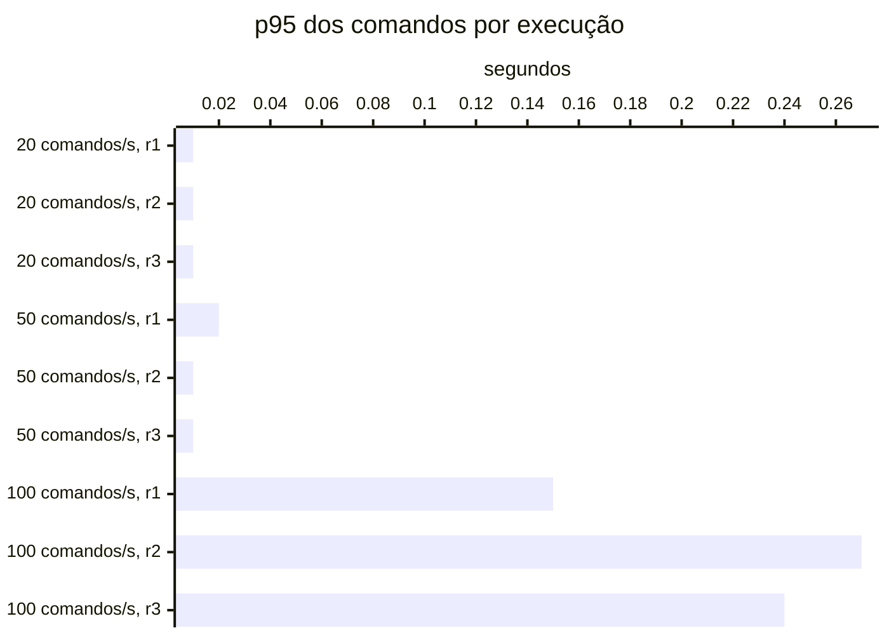

# Resumo

Gerado por `java bench/Report.java summarize`. Mediana das repetições; entre colchetes, a faixa do p95
(mín–máx). Latências em ms, vazão em requisições/s. Parâmetros de cada cenário em
`runs/<cenário>/scenario.properties`; série temporal de cada execução (5 s) em
`runs/<cenário>/r<n>/timeseries.csv`.

## c2-w0020 (3 execuções)

`writeRate=20` · `readRate=75` · `duration=180`

| Requisição | Vazão | % KO | p50 | p95 | p99 |
|---|---:|---:|---:|---:|---:|
| Global | 95.0 | 0.0 | 3 | 17 [16–17] | 37 |
| comandos | 20.0 | 0.0 | 3 | 8 [7–8] | 124 |
| consultas | 75.0 | 0.0 | 3 | 18 [17–18] | 34 |
| comandos / deposit empresa | 3.0 | 0.0 | 3 | 7 [7–8] | 122 |
| comandos / deposit pessoa | 2.9 | 0.0 | 3 | 8 [8–8] | 89 |
| comandos / transfer empresa | 1.5 | 0.0 | 4 | 10 [9–11] | 156 |
| comandos / transfer pessoa | 1.5 | 0.0 | 4 | 9 [7–9] | 64 |
| comandos / withdraw empresa | 5.4 | 0.0 | 3 | 7 [7–8] | 80 |
| comandos / withdraw pessoa | 5.6 | 0.0 | 3 | 8 [7–9] | 158 |
| consultas / Q1 empresa | 9.5 | 0.0 | 1 | 2 [2–2] | 5 |
| consultas / Q1 pessoa | 9.2 | 0.0 | 1 | 2 [2–2] | 5 |
| consultas / Q2 empresa | 9.2 | 0.0 | 3 | 7 [6–8] | 16 |
| consultas / Q2 pessoa | 9.4 | 0.0 | 3 | 6 [6–6] | 24 |
| consultas / Q3 empresa | 9.6 | 0.0 | 3 | 7 [6–7] | 21 |
| consultas / Q3 pessoa | 9.4 | 0.0 | 2 | 5 [5–6] | 29 |
| consultas / Q4 empresa | 9.4 | 0.0 | 15 | 32 [31–33] | 77 |
| consultas / Q4 pessoa | 9.4 | 0.0 | 3 | 7 [7–7] | 24 |

## c2-w0050 (3 execuções)

`writeRate=50` · `readRate=75` · `duration=180`

| Requisição | Vazão | % KO | p50 | p95 | p99 |
|---|---:|---:|---:|---:|---:|
| Global | 125.0 | 0.0 | 3 | 19 [18–20] | 251 |
| comandos | 50.0 | 0.0 | 3 | 14 [12–18] | 614 |
| consultas | 75.0 | 0.0 | 3 | 19 [18–20] | 40 |
| comandos / deposit empresa | 7.5 | 0.0 | 3 | 22 [16–23] | 684 |
| comandos / deposit pessoa | 7.5 | 0.0 | 3 | 15 [11–29] | 646 |
| comandos / transfer empresa | 3.8 | 0.0 | 4 | 31 [14–51] | 609 |
| comandos / transfer pessoa | 3.6 | 0.0 | 4 | 12 [9–33] | 554 |
| comandos / withdraw empresa | 13.8 | 0.0 | 3 | 11 [8–18] | 566 |
| comandos / withdraw pessoa | 13.8 | 0.0 | 3 | 13 [12–15] | 623 |
| consultas / Q1 empresa | 9.4 | 0.0 | 1 | 2 [2–3] | 7 |
| consultas / Q1 pessoa | 9.4 | 0.0 | 1 | 2 [2–3] | 6 |
| consultas / Q2 empresa | 9.5 | 0.0 | 3 | 8 [7–8] | 37 |
| consultas / Q2 pessoa | 9.1 | 0.0 | 3 | 9 [8–9] | 37 |
| consultas / Q3 empresa | 9.4 | 0.0 | 3 | 7 [6–9] | 29 |
| consultas / Q3 pessoa | 9.3 | 0.0 | 2 | 8 [7–8] | 43 |
| consultas / Q4 empresa | 9.2 | 0.0 | 15 | 35 [32–43] | 173 |
| consultas / Q4 pessoa | 9.8 | 0.0 | 3 | 9 [9–11] | 49 |

## c2-w0100 (3 execuções)

`writeRate=100` · `readRate=75` · `duration=180`

| Requisição | Vazão | % KO | p50 | p95 | p99 |
|---|---:|---:|---:|---:|---:|
| Global | 175.0 | 0.0 | 3 | 34 [31–35] | 1,004 |
| comandos | 100.0 | 0.0 | 3 | 243 [151–274] | 1,265 |
| consultas | 75.0 | 0.0 | 3 | 22 [21–23] | 62 |
| comandos / deposit empresa | 15.0 | 0.0 | 3 | 208 [100–302] | 1,203 |
| comandos / deposit pessoa | 14.8 | 0.0 | 3 | 249 [159–266] | 1,227 |
| comandos / transfer empresa | 7.5 | 0.0 | 4 | 226 [182–261] | 1,278 |
| comandos / transfer pessoa | 7.6 | 0.0 | 4 | 243 [213–412] | 1,209 |
| comandos / withdraw empresa | 27.3 | 0.0 | 3 | 231 [153–244] | 1,248 |
| comandos / withdraw pessoa | 27.5 | 0.0 | 3 | 245 [129–279] | 1,299 |
| consultas / Q1 empresa | 9.4 | 0.0 | 1 | 3 [3–3] | 7 |
| consultas / Q1 pessoa | 9.2 | 0.0 | 1 | 3 [3–4] | 12 |
| consultas / Q2 empresa | 9.3 | 0.0 | 3 | 12 [11–16] | 48 |
| consultas / Q2 pessoa | 9.5 | 0.0 | 3 | 18 [18–18] | 47 |
| consultas / Q3 empresa | 9.3 | 0.0 | 3 | 9 [9–11] | 39 |
| consultas / Q3 pessoa | 9.7 | 0.0 | 2 | 16 [16–18] | 46 |
| consultas / Q4 empresa | 9.1 | 0.0 | 15 | 46 [46–58] | 275 |
| consultas / Q4 pessoa | 9.5 | 0.0 | 3 | 22 [18–23] | 58 |

## Capacidade

Critério do ADR-0013 por repetição: p95 dos comandos ≤ 50 ms, p95 das consultas ≤ 250 ms, KO ≤ 1%,
vazão ≥ 98% da oferecida e, com consistência eventual, atraso p99 ≤ 2 s e fila no fim ≤ 1 s de escrita.
Vazão baixa com nenhum container da fase acima de 50% do seu limite de CPU (p90 das amostras) é limite do
gerador. Degrau
sustentado: em pelo menos 2 de 3 repetições. **Maior degrau sustentado: 50 comandos/s.**

- c2-w0020: sustentado (3 de 3)
- c2-w0050: sustentado (3 de 3)
- c2-w0100: não sustentado (0 de 3); r1: comandos p95 151 ms; r2: comandos p95 274 ms; r3: comandos p95 243 ms

Vazão em % da oferecida; p95 em ms, no cliente; KO em %; atraso p99 em s; fila no fim em segundos de
escrita (— sem consistência eventual).

| Degrau | Rep. | Estado | Vazão | p95 comandos | p95 consultas | % KO | Atraso p99 | Fila no fim |
|---|---|---|---:|---:|---:|---:|---:|---:|
| c2-w0020 | r1 | sustentado | 100.0% | 8 | 18 | 0.0 | 0.12 | 0.00 |
| c2-w0020 | r2 | sustentado | 100.0% | 8 | 18 | 0.0 | 0.21 | 0.00 |
| c2-w0020 | r3 | sustentado | 100.0% | 7 | 17 | 0.0 | 0.20 | 0.00 |
| c2-w0050 | r1 | sustentado | 100.0% | 18 | 20 | 0.0 | 0.41 | 0.00 |
| c2-w0050 | r2 | sustentado | 100.0% | 14 | 19 | 0.0 | 0.27 | 0.00 |
| c2-w0050 | r3 | sustentado | 100.0% | 12 | 18 | 0.0 | 0.35 | 0.00 |
| c2-w0100 | r1 | **não sustentado** | 100.0% | 151 | 23 | 0.0 | 0.36 | 0.00 |
| c2-w0100 | r2 | **não sustentado** | 100.0% | 274 | 21 | 0.0 | 0.35 | 0.00 |
| c2-w0100 | r3 | **não sustentado** | 100.0% | 243 | 22 | 0.0 | 0.32 | 0.00 |

## Estado por execução

Colapso: p95 global acima de 5,000 ms (ADR-0009). Leia a contagem, não a mediana: perto da saturação as
repetições caem em estados diferentes.

| Cenário | Colapsou |
|---|---|
| c2-w0020 | 0 de 3 |
| c2-w0050 | 0 de 3 |
| c2-w0100 | 0 de 3 |

p95 global e comandos em ms, no cliente (Gatling). Espera e uso da conexão do Hikari em ms, média da
execução. Comando no banco: soma do tempo médio das instruções de escrita e do `SELECT … FOR UPDATE` no
`pg_stat_statements`, em ms (o custo de um comando dentro do Postgres, sem a fila). GC: segundos com a JVM
parada em GC na execução (medido a partir da #11).

| Cenário | Rep. | Estado | p95 global | % KO | Comandos p50 | p95 | p99 | Espera no pool | Uso da conexão | Comando no banco | GC |
|---|---|---|---:|---:|---:|---:|---:|---:|---:|---:|---:|
| c2-w0020 | r1 | estável | 17 | 0.0 | 3 | 8 | 104 | 0.1 | 1.3 | 0.4 | 1.8 |
| c2-w0020 | r2 | estável | 17 | 0.0 | 3 | 8 | 132 | 0.0 | 1.6 | 0.4 | 1.9 |
| c2-w0020 | r3 | estável | 16 | 0.0 | 3 | 7 | 124 | 0.0 | 1.5 | 0.4 | 1.8 |
| c2-w0050 | r1 | estável | 20 | 0.0 | 3 | 18 | 643 | 4.1 | 2.6 | 0.4 | 2.1 |
| c2-w0050 | r2 | estável | 19 | 0.0 | 3 | 14 | 597 | 4.2 | 2.6 | 0.4 | 1.9 |
| c2-w0050 | r3 | estável | 18 | 0.0 | 3 | 12 | 614 | 3.5 | 2.3 | 0.3 | 1.8 |
| c2-w0100 | r1 | estável | 35 | 0.0 | 3 | 151 | 1,265 | 12.3 | 2.5 | 0.4 | 2.4 |
| c2-w0100 | r2 | estável | 31 | 0.0 | 3 | 274 | 1,289 | 15.3 | 2.5 | 0.5 | 2.0 |
| c2-w0100 | r3 | estável | 34 | 0.0 | 3 | 243 | 1,250 | 13.2 | 2.5 | 0.3 | 2.1 |

## Pools por execução

Espera e uso da conexão do Hikari em ms, média da execução; fila máxima de requisições esperando conexão.
Pool sem requisições na execução aparece com —.

| Cenário | Rep. | Pool | Espera | Uso da conexão | Fila máx. |
|---|---|---|---:|---:|---:|
| c2-w0020 | r1 | HikariPool-1@command-api | 0.1 | 1.8 | 0 |
| c2-w0020 | r1 | HikariPool-1@query-api | 0.0 | 0.0 | 0 |
| c2-w0020 | r2 | HikariPool-1@command-api | 0.0 | 2.1 | 0 |
| c2-w0020 | r2 | HikariPool-1@query-api | 0.0 | 0.0 | 0 |
| c2-w0020 | r3 | HikariPool-1@command-api | 0.0 | 2.0 | 0 |
| c2-w0020 | r3 | HikariPool-1@query-api | 0.0 | 0.0 | 0 |
| c2-w0050 | r1 | HikariPool-1@command-api | 4.8 | 3.0 | 11 |
| c2-w0050 | r1 | HikariPool-1@query-api | 0.0 | 0.1 | 0 |
| c2-w0050 | r2 | HikariPool-1@command-api | 4.8 | 2.9 | 0 |
| c2-w0050 | r2 | HikariPool-1@query-api | 0.0 | 0.0 | 0 |
| c2-w0050 | r3 | HikariPool-1@command-api | 4.1 | 2.7 | 16 |
| c2-w0050 | r3 | HikariPool-1@query-api | 0.0 | 0.0 | 0 |
| c2-w0100 | r1 | HikariPool-1@command-api | 13.2 | 2.7 | 149 |
| c2-w0100 | r1 | HikariPool-1@query-api | 0.1 | 0.2 | 0 |
| c2-w0100 | r2 | HikariPool-1@command-api | 16.5 | 2.7 | 124 |
| c2-w0100 | r2 | HikariPool-1@query-api | 0.0 | 0.0 | 0 |
| c2-w0100 | r3 | HikariPool-1@command-api | 14.3 | 2.7 | 207 |
| c2-w0100 | r3 | HikariPool-1@query-api | 0.0 | 0.1 | 0 |

## JVMs por execução

GC: segundos com a JVM parada em GC na execução. CPU: média do processo. Heap: maior uso na execução, em MiB.

| Cenário | Rep. | JVM | GC (s) | CPU | Heap máx. |
|---|---|---|---:|---:|---:|
| c2-w0020 | r1 | command-api | 0.2 | 4% | 56 |
| c2-w0020 | r1 | projector | 0.1 | 4% | 60 |
| c2-w0020 | r1 | query-api | 1.6 | 8% | 69 |
| c2-w0020 | r2 | command-api | 0.1 | 4% | 57 |
| c2-w0020 | r2 | projector | 0.1 | 4% | 60 |
| c2-w0020 | r2 | query-api | 1.6 | 8% | 76 |
| c2-w0020 | r3 | command-api | 0.1 | 3% | 59 |
| c2-w0020 | r3 | projector | 0.1 | 3% | 60 |
| c2-w0020 | r3 | query-api | 1.6 | 8% | 81 |
| c2-w0050 | r1 | command-api | 0.3 | 7% | 62 |
| c2-w0050 | r1 | projector | 0.2 | 6% | 60 |
| c2-w0050 | r1 | query-api | 1.7 | 8% | 88 |
| c2-w0050 | r2 | command-api | 0.2 | 7% | 68 |
| c2-w0050 | r2 | projector | 0.2 | 6% | 61 |
| c2-w0050 | r2 | query-api | 1.5 | 8% | 94 |
| c2-w0050 | r3 | command-api | 0.2 | 6% | 71 |
| c2-w0050 | r3 | projector | 0.1 | 6% | 60 |
| c2-w0050 | r3 | query-api | 1.5 | 8% | 97 |
| c2-w0100 | r1 | command-api | 0.5 | 13% | 90 |
| c2-w0100 | r1 | projector | 0.3 | 11% | 60 |
| c2-w0100 | r1 | query-api | 1.6 | 8% | 104 |
| c2-w0100 | r2 | command-api | 0.4 | 12% | 105 |
| c2-w0100 | r2 | projector | 0.2 | 10% | 60 |
| c2-w0100 | r2 | query-api | 1.5 | 8% | 110 |
| c2-w0100 | r3 | command-api | 0.4 | 12% | 114 |
| c2-w0100 | r3 | projector | 0.2 | 10% | 59 |
| c2-w0100 | r3 | query-api | 1.5 | 8% | 112 |

## Atraso da projeção por execução

Do `occurred_at` do lançamento (início da transação do comando) até ele estar nas duas projeções do Mongo,
em ms; superestima o atraso em até a duração do comando. p50 e p99 vêm do histograma (precisão dos
buckets); o máximo pode vir de uma janela anterior à execução. Reentregas: lançamentos que o projetor
recebeu de novo e descartou. Fila do outbox: publicações ainda não enviadas ao Kafka, no maior instante.

| Cenário | Rep. | Lançamentos | p50 | p99 | Máx. | Reentregas | Fila do outbox |
|---|---|---:|---:|---:|---:|---:|---:|
| c2-w0020 | r1 | 4,085 | 12 | 119 | 700 | 0 | 0 |
| c2-w0020 | r2 | 4,028 | 13 | 210 | 683 | 0 | 1 |
| c2-w0020 | r3 | 4,088 | 12 | 198 | 627 | 0 | 0 |
| c2-w0050 | r1 | 10,212 | 12 | 409 | 1,561 | 0 | 31 |
| c2-w0050 | r2 | 9,967 | 12 | 267 | 1,608 | 0 | 2 |
| c2-w0050 | r3 | 9,979 | 12 | 355 | 1,608 | 0 | 48 |
| c2-w0100 | r1 | 20,222 | 12 | 362 | 2,274 | 0 | 236 |
| c2-w0100 | r2 | 20,230 | 12 | 353 | 2,253 | 0 | 213 |
| c2-w0100 | r3 | 20,383 | 12 | 319 | 2,279 | 0 | 143 |

## Leitura de disco por execução

Páginas lidas fora do cache e tempo médio por página, em ms. Postgres: soma das instruções do
pg_stat_statements (as 50 mais caras; na v1-replica, do primário e da réplica somados). Mongo: leituras das
threads da aplicação para o cache do WiredTiger. — quando o store não existe na fase.

| Cenário | Rep. | Postgres: páginas | ms/página | Mongo: páginas | ms/página |
|---|---|---:|---:|---:|---:|
| c2-w0020 | r1 | 0 | — | 60,984 | 0.30 |
| c2-w0020 | r2 | 0 | — | 61,260 | 0.32 |
| c2-w0020 | r3 | 0 | — | 60,141 | 0.31 |
| c2-w0050 | r1 | 0 | — | 73,017 | 0.47 |
| c2-w0050 | r2 | 0 | — | 72,944 | 0.42 |
| c2-w0050 | r3 | 0 | — | 74,499 | 0.35 |
| c2-w0100 | r1 | 0 | — | 90,460 | 0.51 |
| c2-w0100 | r2 | 0 | — | 91,787 | 0.46 |
| c2-w0100 | r3 | 0 | — | 92,428 | 0.52 |

## Escrita em disco por execução

WAL gerado no Postgres primário (MB e KB por comando), fsyncs do WAL e o tempo médio de cada um, em ms
(pg_stat_io com track_wal_io_timing), e bytes gravados em disco pelo WiredTiger por comando, em KB (block
manager; — sem Mongo). Os contadores do pg_stat_io chegam com até ~1 s de atraso; a série por segundo está
no `pg-seconds.csv` de cada execução.

| Cenário | Rep. | WAL (MB) | WAL por comando | fsyncs | ms por fsync | Mongo por comando |
|---|---|---:|---:|---:|---:|---:|
| c2-w0020 | r1 | 22 | 6.2 | 11,911 | 0.49 | 68.4 |
| c2-w0020 | r2 | 22 | 6.3 | 11,862 | 0.54 | 66.2 |
| c2-w0020 | r3 | 20 | 5.7 | 11,965 | 0.51 | 72.5 |
| c2-w0050 | r1 | 36 | 4.1 | 28,975 | 0.47 | 68.3 |
| c2-w0050 | r2 | 34 | 3.9 | 29,148 | 0.44 | 70.0 |
| c2-w0050 | r3 | 40 | 4.5 | 29,252 | 0.41 | 71.5 |
| c2-w0100 | r1 | 63 | 3.6 | 57,585 | 0.44 | 69.2 |
| c2-w0100 | r2 | 65 | 3.7 | 57,601 | 0.42 | 72.1 |
| c2-w0100 | r3 | 67 | 3.8 | 57,624 | 0.42 | 72.1 |

## Pool e banco por cenário

Mediana das repetições. Espera = tempo médio para obter conexão do Hikari; uso = tempo médio com a
conexão (o trabalho no banco); hit ratio = blocos achados no shared_buffers.

| Cenário | Espera no pool (ms) | Uso da conexão (ms) | Fila máx. no pool | Hit ratio | CPU da app |
|---|---:|---:|---:|---:|---:|
| c2-w0020 | 0.0 | 1.5 | 0 | 100.0% | 5% |
| c2-w0050 | 4.1 | 2.6 | 11 | 100.0% | 7% |
| c2-w0100 | 13.2 | 2.5 | 149 | 100.0% | 10% |
