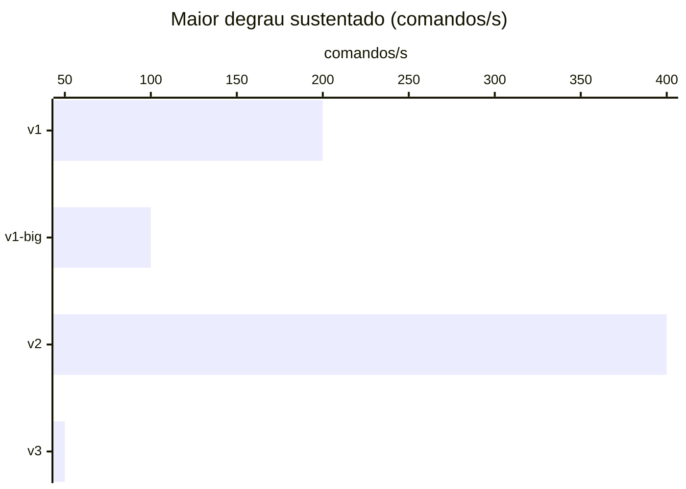

Maior degrau sustentado em pelo menos 2 de 3 repetições (ADR-0013), em comandos/s. Gerado por
`java bench/Report.java capacity`.

| Fase | Maior degrau sustentado | Parou em | Por quê |
|---|---:|---:|---|
| v1 | 200 | 400 | fase fora do ar no fim (http://localhost:8080) (1 de 1), comandos p95 (1 de 1), consultas p95 (1 de 1), KO (1 de 1), vazão (1 de 1) |
| v1-big | 100 | 200 | comandos p95 (2 de 3), consultas p95 (2 de 3), KO (1 de 3), vazão (1 de 3) |
| v1-replica | nenhum a partir de 20 | 20 | consultas p95 (3 de 3), KO (3 de 3), vazão (3 de 3) |
| v2 | 400 | 800 | comandos p95 (2 de 2), consultas p95 (2 de 2), fase fora do ar no fim (http://localhost:8080) (1 de 2), KO (1 de 2), vazão (1 de 2) |
| v3 | 50 | 100 | comandos p95 (3 de 3) |

